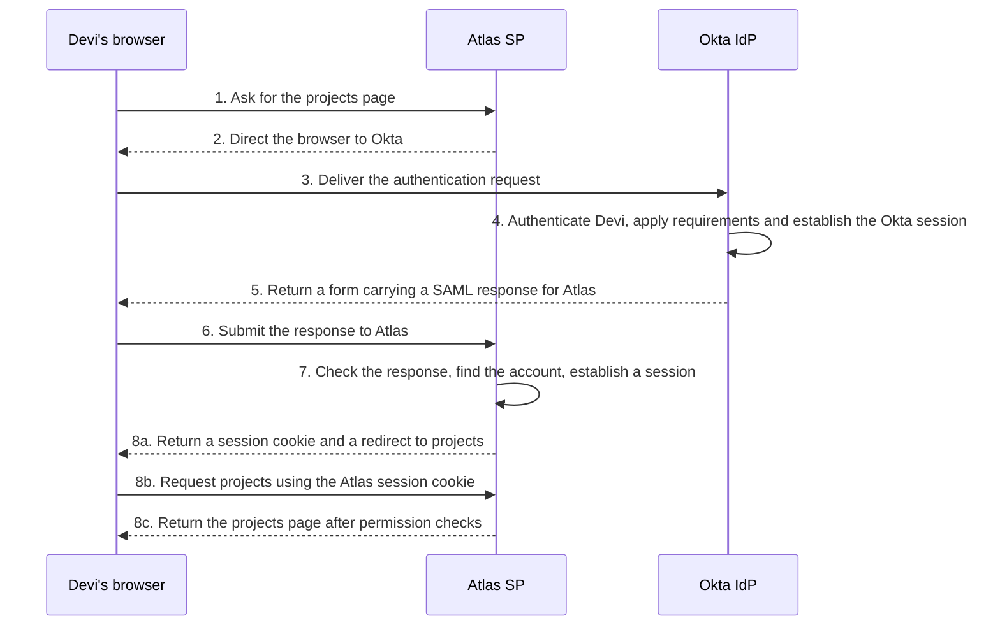
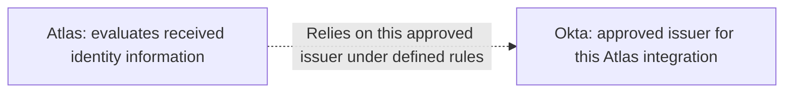
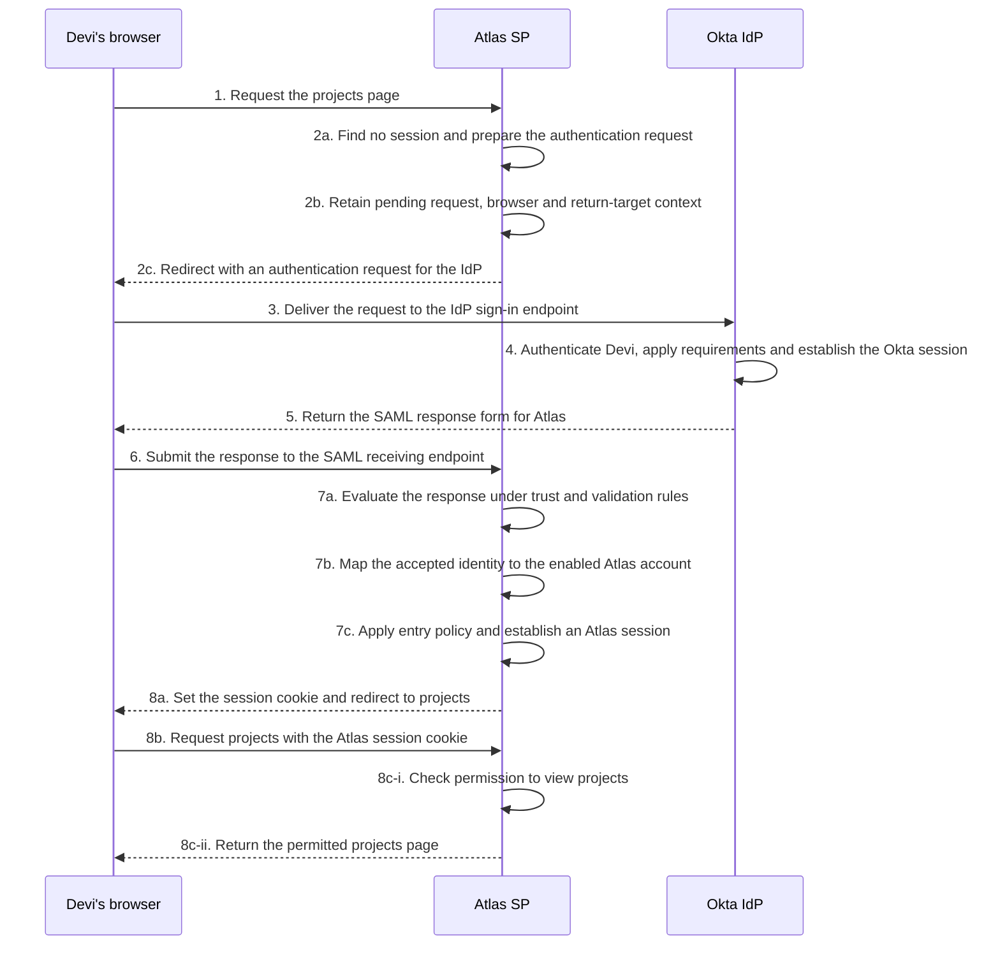
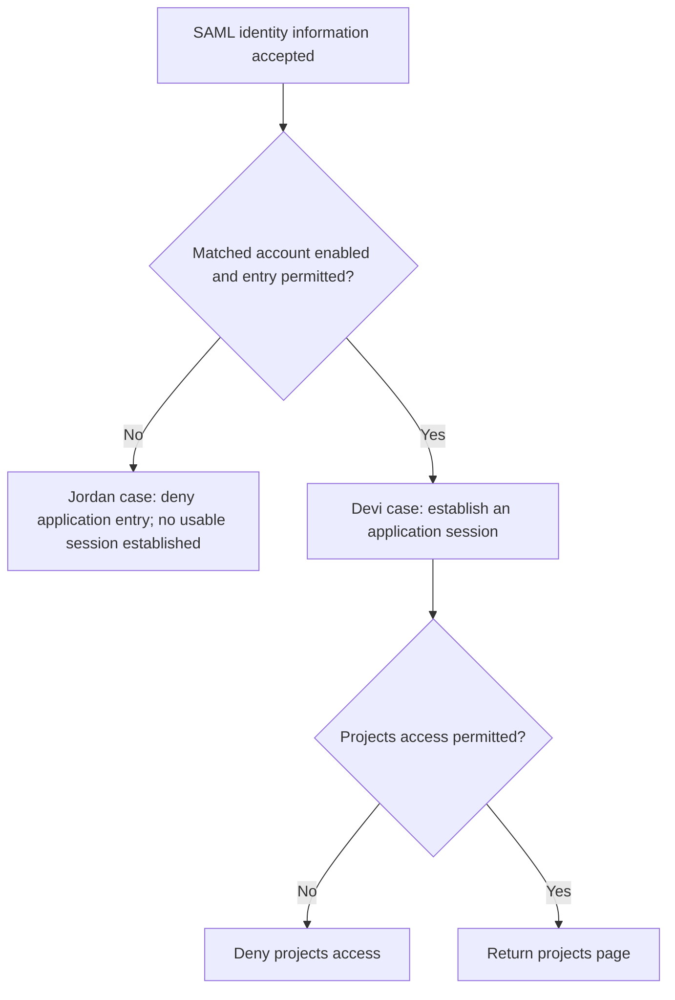

# Lesson 1: How SAML connects Okta to an application

Devi has just joined Northstar Research. During her first week, she needs Atlas for project work and Ledger for expenses. Both are web applications, and both need to know who she is before showing her anything private.

One way to build this would be to give Devi a separate password in each application. Atlas would check its own password record, and Ledger would check another. Every additional application would bring another place to manage authentication and another set of changes when a person joins, changes roles, or leaves.

Northstar uses **Okta Identity Engine** to handle authentication for its applications. Its **Okta org** is its own Okta environment, containing the relevant users, integrations and policies. Each application continues to manage its own responsibilities. Atlas still needs to recognize Devi's application account and decide what that account may do. What changes is where Atlas obtains trustworthy information about her authentication.

That arrangement raises an important question: **how can an application rely on authentication performed by another system without handing that system every application decision?**

## 1.1 Why separate sign-ins create a larger problem

An application cannot responsibly treat every visitor as an authenticated employee. It needs some basis for associating a request with an account. When Atlas handles authentication itself, it must decide how to check the person's credentials and how to maintain the resulting signed-in state. That continuing signed-in interaction is a **session**. It lets the application recognize later activity under its session rules rather than asking the person to authenticate for every page.

Now consider Northstar's wider situation. Its authentication requirements may include an additional factor, a device check, or a rule about when someone must authenticate again. Repeating those capabilities independently in every application creates coordination work. Using Okta for authentication lets Northstar apply its configured authentication requirements before issuing information to an application. The application and its integration must still support the required behavior.

Delegation does not remove the need for careful configuration. It moves some responsibility and creates a new dependency: Atlas must have a sound way to recognize the authentication information it is prepared to accept. A response that happens to say “Devi authenticated” is not enough.

This is where federation enters the picture. **Federation** means an arrangement in which one system relies on identity or authentication information supplied by another under an established trust relationship. Those systems can belong to the same organization or to different organizations. Crossing a company boundary is not required; the important boundary is between systems making and relying on identity statements. [NIST federation guidance, introduction and federation model](https://pages.nist.gov/800-63-4/sp800-63c.html)

**SAML** stands for Security Assertion Markup Language. It provides standardized structures and rules for exchanging security information. In SAML 2.0 browser sign-in, one participant supplies authentication and identity information that another participant can evaluate. [OASIS SAML Core, introduction](https://docs.oasis-open.org/security/saml/v2.0/saml-core-2.0-os.pdf)

SAML is a standard, rather than the name of Northstar's identity product or an application. When a project says an application “supports SAML,” the next useful question is which sign-in behaviors, messages, and configuration that application supports. The label begins the compatibility discussion; it does not finish it.

## 1.2 Authentication, authorization, and the account between them

Suppose Devi successfully completes Northstar's authentication checks. The system has established an authentication result according to the method and policy used. It has not thereby established that she may approve every expense or open every project.

**Authentication** concerns establishing the identity associated with the person or account taking part in the interaction. **Authorization** concerns whether an action on a resource is allowed. The distinction becomes useful when we give the actions concrete names: signing in as Devi and being allowed to approve a payment are different questions.

Atlas needs a way to connect accepted identity information with the account it will use for Devi. In our example, Devi has an employee identifier, `E1042`, and an Atlas account whose internal ID is `atlas-4821`. Those values can refer to the same person without being the same identifier.

An **identifier** is a value used to distinguish or refer to something within a particular context. An employee number, an application account ID, and an email address can all be identifiers. Whether any one of them is appropriate for account matching depends on its meaning, scope, stability, and the application's configuration.

An **account** is the record through which a system represents a user and associates relevant settings, status, or access with that user. Devi's identity as a person is broader than her Atlas account. She can have one account in Atlas and another in Ledger, each with different permissions and lifecycle rules.

An **attribute** is a piece of information about the subject, such as a department value. A permission is an application's allowance to do something. Atlas might use a supplied department or group value as an input to its access rules, but a value does not carry one universal permission meaning across all applications.

| In Devi's example | What it refers to | What it does not establish by itself |
| --- | --- | --- |
| Devi | The person taking part | That a current request has authenticated her |
| Employee identifier `E1042` | An organizational identifier in this example | That Atlas uses this value as its account key |
| Atlas account `atlas-4821` | Atlas's local account record | That the account is enabled or may access every resource |
| Department value `Research` | An attribute about Devi | A universal role or permission |
| Permission to view projects | An application access decision | Permission to administer Atlas |

The table matters because integration problems often begin with an unstated equality. Someone assumes that the username is always the email address, or that the identifier supplied during sign-in must be the application's internal account ID. A successful integration makes the relationship explicit.

A SAML field called **NameID** can identify the subject in an assertion. Receiving that identifier and selecting the correct application account are related steps with a configured relationship. A value identifies an account only when its context and the application's matching rules make that connection. Devi's Okta username, the application username configured for Atlas, and Atlas's internal account ID can be different values. The integration must define how the supplied value reaches the correct account.

## 1.3 Meet the systems and keep the browser visible

In this browser sign-in, **Okta** acts as the **identity provider**, abbreviated **IdP**. It performs or relies on authentication according to its policy and supplies the resulting SAML information.

Atlas acts as the **service provider**, abbreviated **SP**. It receives the SAML information, evaluates it under the applicable rules and configuration, and decides how the application can proceed. In other identity material, you may encounter the term *relying party*: it emphasizes that a system relies on information supplied by another party. IdP and SP name those roles in the browser exchange below.

Devi is the person trying to use Atlas. The standards use **principal** for an entity whose identity can be authenticated; in our example, that is Devi. The principal is the subject of this authentication, not another server between the IdP and SP.

Her **browser** runs on her device and makes web requests. Atlas and Okta run server-side services that answer requests. These web requests and responses use the Hypertext Transfer Protocol, or **HTTP**. The browser is an active participant in delivering messages between the systems.

When Devi opens a URL such as `https://atlas.northstar.example/projects`, she is addressing a resource at Atlas. A URL specifies where the browser should direct its request. A particular URL used to receive a kind of message is often called an **endpoint**. Atlas's ordinary projects page and its SAML receiving endpoint serve different purposes even though both belong to Atlas.

All `.example` addresses here are fictional.

The first visual shows the complete browser delivery path. Read it from top to bottom. It is a successful example: Devi has an active Okta account and is assigned to the Atlas app integration in Okta. The applicable Okta policies permit the sign-in. Atlas has an enabled account for her, trusts this Okta integration and permits her account to view projects. Neither Okta nor Atlas initially has a signed-in session for this browser.

**Figure L01-S1: The complete journey at overview depth.** Arrows between different participants show browser/server delivery. The arrow returning to Okta groups authentication, applicable app-access requirements, Okta session establishment and their browser interactions. Atlas's local processing is also grouped. Step 8 includes the final application navigation, so the flow reaches an observed resource outcome.

At step 1, the browser asks Atlas for projects. Atlas cannot yet associate that request with a signed-in application session, so at step 2 it directs the browser toward Okta. The browser carries the authentication request there at step 3.

Okta handles authentication and the applicable app-access requirements at step 4. After those succeed in this example, it prepares a response for Atlas and returns it to the browser inside a form at step 5. The browser submits that form to Atlas at step 6.

Atlas does its own acceptance and account work at step 7. It then establishes the browser's application session and directs it back toward projects at step 8a. The browser requests that page using the Atlas session cookie at step 8b, and Atlas returns it after permission checks at step 8c.

Notice what the diagram does not show: there is no direct IdP-to-Atlas network arrow for delivering this response. In this selected flow, the browser carries it. “The IdP sends a response to the SP” describes the logical sender and recipient, but the delivery path includes the browser. The Web Browser SSO profile describes these roles and exchanges. [SAML Profiles, §4.1.3](https://docs.oasis-open.org/security/saml/v2.0/saml-profiles-2.0-os.pdf)

The browser's involvement does not make it the authority that decides which identity information Atlas should accept. It is the carrier in this exchange. Atlas still needs to evaluate the received information rather than trust whatever content arrives through a browser.

## 1.4 The trust relationship comes before the response

Why would Atlas accept information from Okta in the first place?

Because Northstar has deliberately established a SAML **app integration** for Atlas in Okta. An app integration is the configuration through which Okta connects to that application; it is not the Atlas application server itself. Atlas has corresponding approved configuration identifying Okta as the expected provider and the relevant verification information. The participants also need compatible message locations, formats, and behavior. These details are often exchanged in a document called **metadata**, which describes participants and their services, supported behavior, and key information.

We can represent the reliance separately from the traffic. The following figure contains no browser-delivery arrows. Its line describes an approved relationship for evaluating identity information.

**Figure L01-T1: Approved reliance, not a network request.** The dashed arrow points from Atlas toward the issuer it is configured to trust. The browser is absent because this visual concerns trust, not delivery. The line describes approved reliance; it does not establish that every received message is acceptable.

The relationship answers which provider Atlas is prepared to rely on. It does not promise that Atlas will accept every message bearing that provider's name. A particular message can still be unsuitable for this application, this attempt, or this point in time.

A digital signature helps Atlas check whether the relevant content verifies under a particular key. Atlas also needs a reason to trust that key for the expected issuer. An incoming statement does not get to create its own trust relationship merely by claiming a familiar name or supplying a key.

There are two kinds of agreement here. The systems need technical compatibility, but the people running them also need to agree on identity meaning and responsibilities. Which identifier will Okta send to Atlas? What does Atlas map it to? Who assigns the app in Okta, who creates the Atlas account, and who maintains the signing certificate and partner configuration? An integration is not complete because two URLs have been pasted into forms.

In Okta, Atlas's SAML settings describe such values as the application's receiving URL, audience and identity output. Atlas must be configured to expect the corresponding values and trust the appropriate Okta signing key. These are two sides of one integration. [Okta SAML setting reference](https://help.okta.com/oie/en-us/content/topics/apps/aiw-saml-reference.htm)

## 1.5 Expand the journey: messages, decisions, and state

We can now return to Devi's successful attempt and expand the grouped stages. The participants and starting conditions are unchanged from Figure L01-S1; the expanded view exposes Atlas's local decisions.

First, a small amount of web behavior will make the expansion easier to follow.

A **redirect** is an HTTP response that tells the browser to make a request at another location. It is the browser that follows the direction and makes the next request. In this example, Atlas uses a redirect to help deliver its authentication request to the IdP.

An HTML **form submission** is another way for the browser to send information to a server. Here, Okta returns a page containing a form that carries the SAML response. The browser submits it to Atlas's receiving endpoint. This example uses a redirect for the request and a form submission for the response. Other SAML delivery arrangements exist.

A **session** is the continuing signed-in interaction a system maintains under its own rules. A **cookie** is information a server can ask a browser to store and return with applicable later requests. In our application example, Atlas sends an opaque session cookie: its value lets Atlas associate later requests with the application session. It is not Devi's password or the SAML assertion. Cookie applicability depends on scope and browser rules. [HTTP State Management Mechanism, §§3–5](https://www.rfc-editor.org/rfc/rfc6265.html)

The SAML response and the Atlas session cookie therefore have different jobs. The response participates in the federation exchange. The cookie supports later application requests in this implementation. The browser does not repeatedly post the same assertion whenever Devi opens another Atlas page in this arrangement.

**Figure L01-S2: The same exchange with local decisions exposed.** The numbered stages match Figure L01-S1. Lettered substeps expand a stage. Self-arrows represent local work. Step 4 groups authentication, policy decisions and Okta session establishment, including the associated browser interactions. The local decision order shown belongs to this example; other applications may organize their checks differently.

### The first request does not yet have a session

At step 1, Devi's browser requests `https://atlas.northstar.example/projects`. At step 2a, Atlas finds no usable application session for that request. It prepares an authentication request. At step 2b, Atlas retains context for the pending sign-in. That retained context will matter when Atlas connects a returning response with an attempt it actually started.

At step 2c, Atlas directs the browser toward the IdP. At step 3, the browser delivers the request to Okta's sign-in endpoint. An endpoint is doing a particular job here: it receives an authentication request. It is not necessarily the provider's general homepage.

The protocol name for the request is **AuthnRequest**. Its role is to ask the IdP to perform the authentication exchange under the relevant requirements. Creating a request does not establish that authentication has already happened.

### The IdP authenticates and prepares information for Atlas

At step 4, Okta authenticates Devi and applies the relevant requirements for accessing Atlas. In this case, it has no existing Okta session, so it needs to perform its configured authentication interactions. This could involve more than one browser exchange. Step 4 groups those interactions and Okta's access-to-app decisions; this successful case has a valid assignment and policies that permit it to proceed. During these interactions, Okta establishes its own session and the browser receives the associated Okta session cookie. This cookie supports subsequent requests to Okta; it is separate from the SAML response that the browser will deliver to Atlas. [Okta Identity Engine global session rules and cookies](https://help.okta.com/oie/en-us/content/topics/identity-engine/policies/add-okta-sign-on-policy-rule.htm)

The IdP then prepares a SAML **Response**. A response is a protocol message. In a successful browser sign-in such as this one, it carries an **assertion** containing statements about the subject and authentication, together with applicable information and constraints. The Response is the enclosing protocol message; the assertion carries statements Atlas may rely on after the applicable checks. [SAML Core, §§2.3 and 3.3.3](https://docs.oasis-open.org/security/saml/v2.0/saml-core-2.0-os.pdf)

For the present example, think of the assertion as structured information Atlas can evaluate, not a copy of Devi's login form. Her password is not forwarded to Atlas as the federation result. What Atlas needs is suitable evidence from a provider it is configured to trust, with the identity information needed for its own processing.

At step 5, the IdP returns the form carrying the SAML response to the browser. At step 6, the browser submits the form to `https://atlas.northstar.example/saml/acs`, Atlas's SAML receiving endpoint in this example. This service is called the **Assertion Consumer Service**, or **ACS**: it is where the application receives the relevant SAML sign-in response in this flow.

### Atlas must decide what it can rely on

Step 7a is an acceptance decision, not a ceremonial pause. Atlas needs to establish that the relevant information is suitable to rely on. Atlas checks whether the expected issuer supplied trustworthy content, whether it is intended for Atlas, whether it is timely, and whether it fits the current sign-in context.

The applicable checks succeed in Devi's transaction. In another attempt, a response could arrive successfully and then be rejected. Delivery and acceptance are different observations.

The trust relationship and the received message work together. Configuration tells Atlas what it expects and trusts. The message supplies information to inspect. The browser's successful delivery establishes only that the response arrived at the receiving boundary.

### An accepted identity still needs an application account

At step 7b, Atlas connects the accepted identity with Devi's account. For this example, the mapping selects the already-created account `atlas-4821`, and that account is enabled. The mapping rule belongs to this integration. Other applications may use different identifiers or account-creation rules.

At step 7c, Atlas applies its entry policy and establishes its application session. This is Atlas's state, not a session handed over from the IdP. A session at the IdP and one at an application are separate states; their lifetimes and termination behavior require separate reasoning. [NIST federation guidance, session management](https://pages.nist.gov/800-63-4/sp800-63c.html)

At step 8a, Atlas returns the session cookie and directs the browser back toward projects. The browser makes the resource request with the Atlas cookie at step 8b. Atlas checks permission at step 8c-i and returns the permitted page at step 8c-ii.

We can now describe the outcome precisely. Okta authenticated Devi. Atlas accepted the response, selected an enabled local account, established a session, and allowed that account to view the requested page. Each part tells us something different. The final page access is stronger evidence than a message that only says authentication succeeded.

## 1.6 How the same arrangement produces single sign-on

So far, Devi has signed in to one application. Where does **single sign-on**, or **SSO**, enter?

Suppose she later opens Ledger, the expense application. This is a new application and a new sign-in situation. Ledger has no application session for her browser, but Okta still has an appropriate signed-in session. Devi is also assigned to Ledger in Okta. Under the policies for this Ledger attempt, Okta may be able to satisfy the authentication requirements using that existing state.

In this browser example, Okta uses its own session cookie to recognize the returning browser. When the browser contacts the IdP, it presents the applicable IdP cookie; it does not give Ledger the Atlas cookie or copy the IdP cookie into Ledger.

Ledger still needs its own exchange and its own acceptance, account, and access decisions. Devi may experience fewer authentication prompts because the IdP can reuse its session. She has not received one universal application session shared by Atlas and Ledger.

SSO describes the experience of accessing multiple services without unnecessarily repeating authentication interactions. Federation provides a way for systems to rely on supplied identity information. They are closely related in this example, but they are not interchangeable descriptions of the same thing.

An existing Okta session can still be followed by another authentication prompt. In Identity Engine, the **global session policy** governs the Okta session context, while the **app sign-in policy** sets authentication requirements for the requested app. An app can require further authentication even when an Okta session exists. [Okta Identity Engine policies](https://help.okta.com/oie/en-us/content/topics/identity-engine/policies/about-policies.htm)

Conversely, when Devi already has a usable Atlas session and opens another Atlas page, Atlas may be able to handle the request without starting another SAML exchange at all.

This is why “the user was prompted again” is an observation to investigate, not proof that SAML has failed. The first questions are which system asked, which state existed, and what requirements applied.

## 1.7 SSO does not replace account provisioning

Return to Devi's first week. Somebody must arrange for Atlas to have the account she is allowed to use. That may happen through an administrator, a provisioning integration, an import, or another supported lifecycle mechanism.

**Assigning an app in Okta** grants a user or group access to that integration under its configuration. It is separate from the question of whether a usable account exists inside Atlas. If lifecycle provisioning is configured, assignment may trigger downstream actions, but the assignment alone is not proof that those actions completed or that Atlas will allow a resource. [Okta provisioning and assignment workflow](https://help.okta.com/oie/en-us/content/topics/provisioning/lcm/lcm-deploy-cloud.htm)

**Provisioning** concerns creating and maintaining accounts and related access information. **Deprovisioning** concerns removing or disabling the relevant accounts or access as the lifecycle requires. A sign-in exchange and an account lifecycle process solve connected but different problems.

Some receiving applications support **just-in-time provisioning**, often abbreviated **JIT**: under configured rules, the application may create an account during a successful federated sign-in. That is an application capability to examine, not a universal result of receiving SAML. It does not by itself explain how the application handles future updates, removals, or existing sessions.

Suppose Northstar deactivates Devi's Okta account. That can affect her ability to authenticate again, but it does not alone tell us whether every application account is disabled or every existing application session has ended. Account status and existing-session behavior must each be checked.

SCIM, the System for Cross-domain Identity Management, is one standard used for account and group lifecycle integrations. It defines operations for managing identity resources; it is not the SAML browser authentication exchange we just traced. [SCIM protocol, RFC 7644, §§1 and 3](https://www.rfc-editor.org/rfc/rfc7644.html)

For an integration project, this distinction becomes a useful pair of questions: “How does the application learn who is signing in?” and “How does the account get created, updated, and disabled?” Answering only the first leaves part of the integration undefined.

## 1.8 A successful authentication can lead to denied access

Consider an independent case involving another employee, Jordan Lee. Jordan has an active Okta account and is assigned to Atlas. The applicable Okta policies allow the attempt, but Jordan's existing Atlas account is disabled. Okta authenticates Jordan successfully, and Atlas accepts the returned SAML identity information under its configured rules. The application then refuses entry because the matched account is disabled.

The decision view below compares the successful and denied outcomes after response acceptance. It groups preceding protocol checks and follows an illustrative application policy. It does not prescribe the order in which every product must implement account or access checks.

**Figure L01-D1: Acceptance and application access are separate boundaries.** The connecting arrows mean “continue to the next decision,” not message delivery. The two cases differ in account state. The permitted branch additionally assumes the account may view projects.

The first box is an explicitly supplied fact: the SAML information has been accepted. The next question concerns the local account and entry policy. Jordan's case stops there. Devi's continues through session creation to the projects permission decision.

The additional projects-denied branch reminds us that entering an application does not imply permission for every resource. An enabled account can still lack a particular permission. We would need the actual application policy and observations to decide that case.

If a support ticket says, “SSO is broken; Jordan cannot get into Atlas,” the engineer should not immediately change a certificate or an endpoint. The initial report describes an unsuccessful user experience, not its cause. Here, the evidence places the stopping boundary at application account readiness.

Changing the IdP's authentication method would not address the supplied reason for denial. Neither would treating a browser redirect as proof that the application account must be usable. The useful investigation follows the evidence across boundaries.

## 1.9 Where SAML fits beside other identity technologies

You will meet several technologies in project discussions. You do not need to master all of them before learning SAML. You do need enough orientation to recognize when a question belongs to a different mechanism.

| Technology | Useful initial orientation | What to avoid assuming |
| --- | --- | --- |
| SAML 2.0 | Standardized security assertions and protocols; the exchange above is federated browser sign-in | Every capability or binding is supported by every product |
| OpenID Connect, or OIDC | An identity layer using OAuth 2.0 that supports authentication and identity information | It is another name for SAML, with identical messages and checks |
| OAuth 2.0 | An authorization framework through which a client can obtain limited access to an HTTP service | An access token alone is a universally valid sign-in assertion for an application |
| SCIM | A protocol for managing identity resources such as users and groups | Enabling it replaces the browser sign-in protocol |
| LDAP | A protocol for accessing and modifying directory information, with authentication-related operations | A directory connection is the same exchange as SAML browser SSO |
| Kerberos | Ticket-based network authentication | A Kerberos ticket is a SAML assertion |
| WS-Federation | Another federation framework with its own mechanisms and profiles | Similar federation goals make its messages interchangeable with SAML |

The OIDC and OAuth distinction is particularly useful. OIDC supplies an authentication/identity layer on OAuth 2.0; OAuth defines delegated access mechanisms. Learn the actual role of the message or token involved rather than grouping every identity-related protocol under “login.” [OpenID Connect Core, §1](https://openid.net/specs/openid-connect-core-1_0.html), [OAuth 2.0, RFC 6749, §1](https://www.rfc-editor.org/rfc/rfc6749.html)

Directory access, network authentication and application federation can occupy different parts of one architecture. Identify the job each technology performs before treating its presence as a description of the whole sign-in path. [LDAP, RFC 4511, §1](https://www.rfc-editor.org/rfc/rfc4511.html), [Kerberos, RFC 4120, §1](https://www.rfc-editor.org/rfc/rfc4120.html), [WS-Federation 1.2, introduction](https://docs.oasis-open.org/wsfed/federation/v1.2/os/ws-federation-1.2-spec-os.html)

SAML has earlier versions, including 1.0 and 1.1. Verify the actual version and supported capabilities rather than treating any mention of “SAML” as an assurance of compatibility. A SAML 2.0 integration needs compatible version-2.0 behavior at both participants.

## 1.10 Begin investigating like an engineer

You already have enough of the model to improve an investigation, even before reading XML.

Consider this fictional ticket:

> Avery opens Atlas from a bookmarked projects URL. The browser reaches Okta, Avery completes authentication, and the browser returns to Atlas. Atlas then displays “Unable to sign in.” We have not yet inspected the application logs or the returned SAML message.

The facts establish movement through several parts of the journey and an observed authentication interaction. They do not establish why Atlas rejected or failed to complete the attempt. We have no evidence yet that Atlas accepted the SAML information, matched an account, or created a session.

An unhelpful response would leap straight to “the certificate is wrong” or “the user needs provisioning.” Each could be relevant in some case, but neither follows from the supplied observations.

A useful next step is to gather Atlas's processing result for this attempt, together with the relevant Okta System Log evidence and returned message evidence under the organization's approved procedures. The **System Log** records activity in the Okta org. Its evidence helps explain what happened on the Okta side; it does not establish Atlas's internal acceptance or authorization outcome. The aim is to locate the stopping boundary. Did the response fail acceptance? Was there no account match? Did a matched account fail entry policy? Was a session created but the requested resource denied?

The answer controls what to investigate next. If the application rejected the response, we examine the relevant acceptance evidence. If it accepted the identity but found no matching account, we inspect the identifier and mapping configuration. If a session exists but the page is denied, we examine the account's resource permissions. We do not need to claim a cause before the evidence supports it.

Browser network tools and SAML trace viewers can help reveal message movement and contents; the Okta System Log and Atlas logs can reveal different parts of the processing history. Okta's SAML assertion preview can help inspect the XML produced from integration settings, but a preview is not evidence that a particular live attempt reached or was accepted by Atlas. [Okta SAML app integration guidance](https://help.okta.com/oie/en-us/content/topics/apps/apps_app_integration_wizard_saml.htm) Reading a captured message is not the same as independently verifying its cryptographic validity.

SAML messages and logs can contain personal information and security-sensitive values. Use approved tools and redaction procedures rather than pasting assertions into an arbitrary public decoder.

As you explain a case to another engineer, use observations tied to boundaries: “The browser submitted the response to Atlas, but we do not yet know its acceptance result” is more useful than “SAML looks fine.” It tells the next person both what you know and what remains to be checked.

## 1.11 What you can now explain

Return to Devi's successful journey. Her browser requested a resource, Atlas initiated an authentication exchange, Okta authenticated her, and the browser carried the response back. Atlas evaluated the information, selected its own account, established its own session, and allowed the requested resource under its application policy.

You should now be able to explain why each participant exists, why the browser belongs in the flow, and why receipt, acceptance, account readiness, session creation, and permission are distinct observations. You can also explain why SSO does not automatically solve account creation or termination of every existing session.

Before looking back at a diagram, reconstruct Devi’s journey aloud. Start with her browser requesting Atlas projects. Identify who creates the authentication request, who authenticates Devi, how the response reaches Atlas, and which system creates the Atlas session. Finally, explain why a signed-in session still does not grant every permission.

Check your explanation against the flow: Atlas creates the request, the browser carries it to Okta, and Okta supplies the response through the browser. Atlas evaluates it, matches its account, and creates its own session when its entry requirements are met. Atlas then decides whether the account may open projects. The browser carries messages; it does not make Atlas’s acceptance or permission decisions.

To check your understanding, explain Jordan's disabled-account case without using the phrase “the login failed” as the entire diagnosis. Then explain what remains unknown in Avery's ticket. If your explanation separates what happened from what still needs evidence, you are using the model rather than memorizing a sequence of names.

A useful integration review now has specific questions to answer: which value names the participant, which URL receives the message, which key information is approved, how the received identity maps to an account, and what evidence establishes permitted access.

### Terms to keep straight

| Term | Meaning in this sign-in |
| --- | --- |
| Authentication / authorization | Establishing the identity involved / deciding whether an action is allowed |
| IdP / SP | Okta supplies authentication information / Atlas evaluates and uses it |
| Principal | Devi, the person whose identity is being authenticated |
| Account / identifier / attribute | A system's record / a value used to refer to an entity / information about the subject |
| AuthnRequest / Response / assertion | The request for authentication / the enclosing reply / statements carried within the reply |
| Endpoint / ACS | A message-receiving location / Atlas's SAML sign-in receiving service |
| Session / cookie | Continuing signed-in state / browser-held information returned with applicable requests |
| Okta cookie / Atlas cookie | Browser information for the respective service’s session; an Okta cookie does not itself establish an Atlas session |
| Federation / SSO / provisioning | Reliance across systems / reduced repeated authentication / account lifecycle management |

An **Okta app assignment** identifies who is granted access to an integration; the **app integration** holds its connection settings. Neither is the application's own account or session.

The distinctions matter together. An IdP can authenticate a principal and supply an assertion, while the SP still needs to accept the information, find an appropriate account, establish a session, and authorize the requested action.

## References

- [SAML Core: assertions and protocol messages, §§2.3 and 3.3.3](https://docs.oasis-open.org/security/saml/v2.0/saml-core-2.0-os.pdf)
- [SAML Profiles: Web Browser SSO, §4.1](https://docs.oasis-open.org/security/saml/v2.0/saml-profiles-2.0-os.pdf)
- [OASIS Technical Overview: explanatory context and browser exchanges](https://docs.oasis-open.org/security/saml/Post2.0/sstc-saml-tech-overview-2.0.html)
- [NIST federation guidance: trust relationships and independent sessions](https://pages.nist.gov/800-63-4/sp800-63c.html)
- [HTTP State Management Mechanism: cookies, RFC 6265](https://www.rfc-editor.org/rfc/rfc6265.html)
- [Okta Identity Engine SAML settings](https://help.okta.com/oie/en-us/content/topics/apps/aiw-saml-reference.htm)
- [Okta Identity Engine policies and rules](https://help.okta.com/oie/en-us/content/topics/identity-engine/policies/about-policies.htm)
- [Okta provisioning and assignment workflow](https://help.okta.com/oie/en-us/content/topics/provisioning/lcm/lcm-deploy-cloud.htm)
