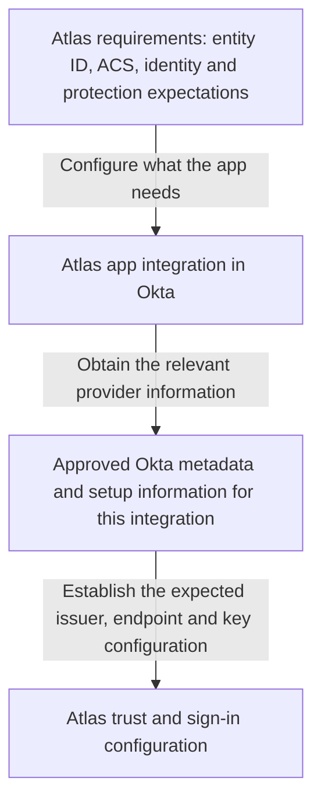
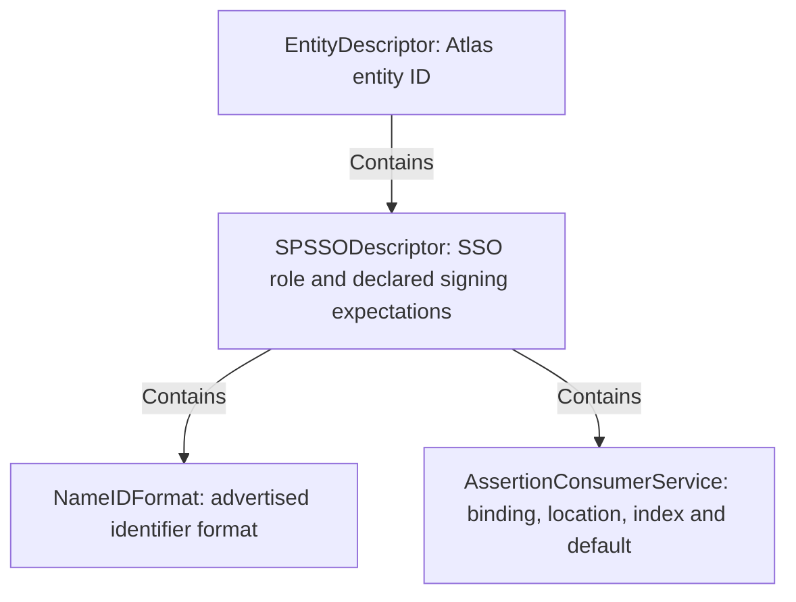
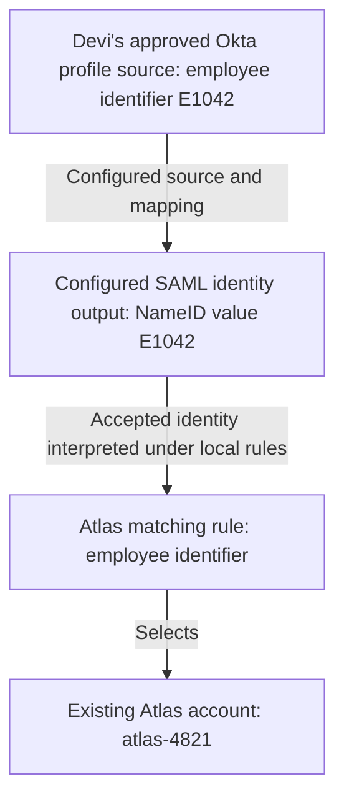
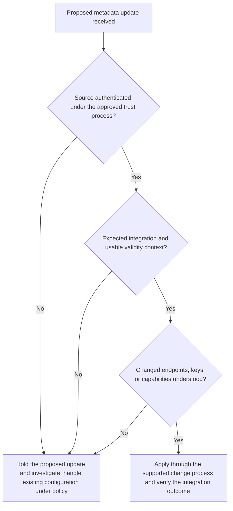

# Lesson 2: Planning an Okta SAML integration and reading metadata

Devi can sign in to Atlas through Okta. Daniel, the engineer responsible for federation at Northstar Research, now needs to document how that integration works and prepare a separate test environment. He has a practical question to answer before anyone copies settings: which information belongs to Atlas, which belongs to Okta, and what must each side agree to trust?

A successful sign-in is useful evidence, but it does not explain the configuration that produced it. If Daniel cannot identify the source and purpose of each value, he may reproduce the wrong relationship in test, overlook an account-matching assumption, or leave a certificate change without an owner.

The starting point is an integration agreement that can be explained. Metadata supplies part of that agreement in a structured form. The rest comes from the application’s requirements, Okta configuration, and the people responsible for operating both systems.

## 2.1 Collect the requirements before changing settings

### Begin with the application’s expectations

Atlas owns the service Devi wants to use. Its application team must explain how Atlas receives SAML, which identity it expects, and how that identity becomes a local account. Daniel should not have to guess those answers from the names of Okta fields.

For the existing Northstar example, Atlas’s entity ID is `https://atlas.northstar.example/saml`, and its SAML receiving endpoint is `https://atlas.northstar.example/saml/acs`. These values are fictional, but their different purposes are important: one identifies Atlas as a SAML participant; the other identifies a location that receives a message.

Priya, Atlas’s application owner, also needs to specify the application’s account rules. Does Atlas expect an email address, an employee number, or another identifier? Must the account already exist? Which attributes does it require? If a department or group value is supplied, how does Atlas interpret it?

Without these answers, Daniel could deliver a technically acceptable identity statement that Atlas cannot use. There is no universal field called “the username” that automatically means the same thing to both products.

### Turn the requirements into a shared information sheet

An information sheet makes configuration review more useful than comparing screenshots. Each entry should identify a value, its purpose, where it came from, and who can confirm it.

| Question | Evidence or decision needed | Responsibility in this example |
| --- | --- | --- |
| Which application instance and environment? | Atlas production or Atlas test, with separately identified configuration | Daniel and Priya |
| What identifies the SP? | Application’s exact entity ID | Atlas team |
| Where should the SAML response arrive? | Approved ACS URL and supported response binding | Atlas team |
| How can sign-in start? | Supported application-initiated and unsolicited-response behavior | Atlas team, checked against the chosen Okta integration |
| Which issuer and keys will Atlas trust? | Relevant Okta metadata/setup information and approved trust process | Daniel supplies; Atlas team configures and confirms |
| What identifies the person to Atlas? | Expected identifier, NameID format, source value and matching rule | Both teams |
| What additional information is needed? | Attribute names, value types and interpretation | Atlas team specifies; Daniel maps supported sources |
| How are accounts maintained? | Creation, updates, disablement and any supported JIT behavior | Application and lifecycle owners |
| Who may attempt access? | Okta user/group assignment and applicable authentication policy | Okta administrators |
| What establishes success? | Accepted response, correct account, usable session and permitted resource | Both teams |
| Who owns later changes? | Certificate, metadata, application, policy and support contacts | Named owners, not an assumption |

Keep four kinds of evidence separate as you fill in the sheet. **Declared** means published in metadata or requirements. **Configured** means entered or selected in a system. **Observed** means seen in a particular message or event. **Enforced** means applied by the receiver, with a recorded outcome. If metadata declares one ACS and Okta is configured with another, the declaration alone cannot tell you where a response will go.

Some entries are URLs or identifiers. Others are decisions. A metadata file can advertise an ACS, but it cannot settle whether Priya wants Atlas to create an account for an unfamiliar subject. A working app assignment cannot establish that a downstream provisioning operation completed.

For Devi’s existing successful case, the supplied facts remain unchanged: she has an active Okta account, an Atlas assignment, suitable authentication policy, and an enabled Atlas account with projects access. The separate test environment needs its own evidence. Production success does not silently establish test readiness.

### Choose the right integration starting point

The **Okta Integration Network**, or **OIN**, provides prepared integrations that can be added and configured for an organization. A custom SAML integration provides another starting point when the appropriate integration is unavailable or the application requires a custom arrangement. Either path still requires agreement with the application’s documented requirements. [Okta: add existing app integrations](https://help.okta.com/oie/en-us/content/topics/apps/apps-add-applications.htm), [create SAML app integrations](https://help.okta.com/oie/en-us/content/topics/apps/apps_app_integration_wizard_saml.htm)

An OIN entry is not proof that every edition or deployment of a product supports the behavior you want. Check the actual integration’s capabilities and setup instructions. Similarly, having access to a custom configuration field does not prove that the application will process the resulting message as intended.

Daniel’s choice should answer, “Which supported integration matches this Atlas deployment?” The purpose is compatibility and clear ownership, not collecting the largest set of configurable options.

**Figure L02-C1: Information supplied in each direction.** These arrows represent configuration information, not browser traffic or a live SAML exchange. The application requirements configure Okta’s output; the approved Okta identity-provider information configures Atlas’s expectations.



The upper-level relationship is two-sided. Daniel configures Okta with what Atlas needs, then the Atlas team configures its side with the appropriate Okta information. Giving an application its own ACS URL as the IdP sign-in URL would mix these responsibilities: a destination for the returning response cannot also be assumed to be the provider endpoint that receives the outgoing authentication request.

## 2.2 Read the SAML building blocks without memorizing a specification

### Different documents answer different questions

During a project, “the SAML XML” can refer to several different things. Ask which document you are looking at before interpreting its contents.

A **metadata document** describes a participant and its services. An **AuthnRequest** asks for an authentication exchange. A **Response** reports a protocol result and can carry assertions. An **assertion** contains statements about a subject, together with information governing their use. Metadata is not evidence that Devi authenticated during a particular attempt.

For the browser journey, start with two questions: what message is being exchanged, and how does it travel? The **protocol** defines the interaction and its messages, including the authentication request and response. A **binding** defines their carriage, such as an HTTP redirect or POST. The same message name does not imply the same delivery method.

Two other terms describe the rules around those pieces. A **profile** combines and constrains them for a use case, such as browser SSO. A **schema** describes allowed XML structure and data types. When reviewing an integration, translate these terms into questions:

| Question | Relevant term |
| --- | --- |
| What is Atlas asking Okta to do? | Protocol |
| How does the browser carry each message? | Binding |
| Which rules apply to this browser SSO arrangement? | Profile |
| Is the XML shaped correctly? | Schema |

These are different layers of the agreement, not alternative names for one file. [OASIS Technical Overview, §4.3](https://docs.oasis-open.org/security/saml/Post2.0/sstc-saml-tech-overview-2.0.html)

The engineering consequence is practical. Two systems may both understand SAML messages but still disagree about the supported delivery arrangement or the rules of the selected profile. “Both support SAML” is a starting point for checking compatibility.

### An XML element contains information; an attribute describes it

The following is a small XML fragment from fictional Atlas metadata. It contains one service declaration, not a complete metadata document.

```xml
<md:AssertionConsumerService
    xmlns:md="urn:oasis:names:tc:SAML:2.0:metadata"
    Binding="urn:oasis:names:tc:SAML:2.0:bindings:HTTP-POST"
    Location="https://atlas.northstar.example/saml/acs"
    index="0"
    isDefault="true" />
```

`AssertionConsumerService` is the **element** name. `Binding`, `Location`, `index`, and `isDefault` are **XML attributes** on that element. An XML attribute is a property written in the opening tag; it is not automatically a SAML attribute about a user. A department value carried in an assertion belongs to a different concept despite the shared word *attribute*.

The `/>` ends an element with no child content. An element with children instead uses an opening tag and a matching closing tag. Nesting tells you which structure owns a value.

The prefix `md` is associated with the metadata **namespace** by `xmlns:md`. A namespace distinguishes XML vocabularies. The prefix is a local label for that namespace: another document could use a different prefix for the same namespace. Matching the visible letters `md` is therefore not a substitute for interpreting the namespace and element together. [W3C XML Schema Primer, §§2.1 and 3.1](https://www.w3.org/TR/xmlschema-0/)

For a first reading, identify the element, then its location and delivery method. In this fragment, read “an ACS at the Atlas `/saml/acs` address that receives HTTP-POST.” You can then inspect the index and default flag. There is no need to memorize every long URI before understanding what the declaration says.

This distinction helps when reading mixed documents. A metadata element and an assertion element can have different namespaces even if they appear in related examples. Their prefixes help you read; the namespace supplies the vocabulary identity.

### Read the structure from outside inward

The next compact document describes the fictional Atlas SP. Its values and signing expectations are example choices, not Okta defaults. It advertises one ACS and requests signed assertions. It includes no real key material or metadata signature.

```xml
<md:EntityDescriptor
    xmlns:md="urn:oasis:names:tc:SAML:2.0:metadata"
    entityID="https://atlas.northstar.example/saml"
    cacheDuration="PT24H">
  <md:SPSSODescriptor
      protocolSupportEnumeration="urn:oasis:names:tc:SAML:2.0:protocol"
      AuthnRequestsSigned="false"
      WantAssertionsSigned="true">
    <md:NameIDFormat>urn:oasis:names:tc:SAML:1.1:nameid-format:unspecified</md:NameIDFormat>
    <md:AssertionConsumerService
        Binding="urn:oasis:names:tc:SAML:2.0:bindings:HTTP-POST"
        Location="https://atlas.northstar.example/saml/acs"
        index="0"
        isDefault="true" />
  </md:SPSSODescriptor>
</md:EntityDescriptor>
```

Start with `EntityDescriptor`: it identifies the SAML entity whose information is being described. Inside it, `SPSSODescriptor` describes the SP’s SSO role. The child declarations describe that role’s capabilities and expectations. An IdP role uses `IDPSSODescriptor`; a collection of entity descriptions can be grouped inside `EntitiesDescriptor`. [SAML Metadata, §§2.3–2.4](https://docs.oasis-open.org/security/saml/v2.0/saml-metadata-2.0-os.pdf)

The role matters. Finding a key or URL somewhere in a large metadata document does not establish that it belongs to the entity and role you intended to configure. A document can describe more than one participant or capability.

**Figure L02-M1: Containment in the Atlas metadata.** The arrows mean “contains,” not “sends.” The entity ID belongs to the entity description; the ACS URL belongs to an endpoint declaration inside its SP role.



Read the tree in the same order as the XML. The entity is Atlas. Its role is SP. The ACS is a service belonging to that role. This prevents a common shortcut: collecting familiar-looking URLs before asking what they identify.

The `SAML:1.1` text within the unspecified NameID format URI does not make this a SAML 1.1 metadata document. A standardized identifier can retain an older version label while being used within SAML 2.0. The selected protocol and the meaning of the particular identifier must be interpreted separately. [SAML Core, §8.3.1](https://docs.oasis-open.org/security/saml/v2.0/saml-core-2.0-os.pdf)

A schema can help check structure and data types. It does not prove that a URL reaches the intended application, that a publisher is authorized, or that the advertised behavior is implemented. Extensions also exist: an unfamiliar element may belong to a documented extension rather than being a typo. Determine its namespace and applicable rules instead of either trusting or rejecting it solely because it is unfamiliar.

## 2.3 Read the values that must agree

### A name is different from a delivery address

Atlas’s entity ID and ACS both resemble web addresses. That appearance does not give them the same job.

`https://atlas.northstar.example/saml` names Atlas as a SAML entity. `https://atlas.northstar.example/saml/acs` is the address selected to receive the response in this example. They may share a hostname, but copying one into the other’s configuration field changes the agreement.

A **URI**, or Uniform Resource Identifier, can identify something without being a page the browser can open. A URL is a location-oriented form of identifier. For SAML configuration, use the documented value as intended; do not “repair” an entity ID because opening it does not display a page.

In particular, avoid silently adding a trailing slash, changing case in a path, or replacing an identifier’s scheme. Treat entity IDs as exact agreed values under the applicable comparison rules, rather than as invitations to apply a browser’s URL-cleanup behavior. [SAML Core, §1.3.2](https://docs.oasis-open.org/security/saml/v2.0/saml-core-2.0-os.pdf)

The **Issuer** in a message identifies the entity making that message or assertion. In the main outbound case, Atlas expects the appropriate Okta issuer. That is different from Atlas’s own SP entity ID, which the assertion’s audience must target under the selected configuration. The sender’s identity and the intended recipient are separate facts.

### Translate Okta’s field labels into protocol meaning

The following table connects the existing Atlas values to Okta’s terminology. Obtain real Okta issuer, endpoint and certificate values from the specific integration’s approved setup information or metadata; they are not constructed by copying Atlas’s domain.

| Configuration item | What it means in this outbound integration | Atlas example or source |
| --- | --- | --- |
| Okta **Single sign-on URL** | Default SP ACS used for the response | `https://atlas.northstar.example/saml/acs` |
| Okta **Audience URI (SP Entity ID)** | Intended assertion audience | `https://atlas.northstar.example/saml` |
| Okta **Recipient URL** and **Destination URL** | Related receiving-location values, where separately configured | Agreed with Atlas; not assumed interchangeable in every deployment |
| **IdP SSO URL** supplied to Atlas | Provider endpoint to receive the authentication request | Relevant Okta integration metadata/setup information |
| **IdP issuer** supplied to Atlas | Provider identity Atlas expects | Relevant Okta integration metadata/setup information |
| **Default RelayState** | Navigation-related state used by the integration where applicable | Application requirements; not an entity ID or signature key |

The most misleading label is **Single sign-on URL**: on the Okta SAML app form it describes the application-side destination. It is not the Okta IdP SSO URL that Atlas uses to start authentication. Okta’s field reference documents this ACS mapping and the audience setting. [Okta SAML field reference: General settings](https://help.okta.com/oie/en-us/content/topics/apps/aiw-saml-reference.htm)

For the simple Atlas arrangement, the receiving location values can agree. That does not erase their different protocol purposes. If a partner requires separate values, establish why and verify the relevant configuration. Changing every location to the same string because it “usually works” hides the distinction an engineer needs to diagnose a rejection.

### The binding belongs with the endpoint

An endpoint declaration pairs a location with a supported binding. In the Atlas XML, the ACS location is associated with HTTP-POST. A receiver expecting a SAML response in a form submission is not automatically offering a general-purpose endpoint for every other SAML transport.

The corresponding provider service is named `SingleSignOnService`; locate the matching binding and location within the expected IdP role in the approved Okta metadata. Other metadata service names include `SingleLogoutService` for logout and `ArtifactResolutionService` for artifact resolution. They describe different jobs; their presence does not establish that Northstar has configured all those features in Okta and Atlas.

An integration with multiple ACS endpoints may use indexes and default-selection information. The `index="0"` in Atlas’s example identifies this ACS entry; `isDefault="true"` marks it as the declared default. An index is not a port number, an array position to guess, or a user priority. Selection also depends on the request, binding/profile rules and receiving configuration. [SAML Metadata, endpoint types and SP role](https://docs.oasis-open.org/security/saml/v2.0/saml-metadata-2.0-os.pdf)

Do not assume that loading SP metadata into a product automatically enables every advertised endpoint. Some setup paths use manual values. Okta’s SAML settings include additional requestable ACS choices and signed-request behavior; the selected configuration matters. [Okta SAML field reference: Other Requestable SSO URLs and Signed Requests](https://help.okta.com/oie/en-us/content/topics/apps/aiw-saml-reference.htm)

### Keep environments distinguishable

Daniel cannot conclude that test is a copy of production with a different display name. The integration inventory must identify which values each environment actually uses.

| Item | Existing Atlas production example | Separate Atlas test example |
| --- | --- | --- |
| SP entity ID | `https://atlas.northstar.example/saml` | `https://atlas-test.northstar.example/saml` |
| ACS | `https://atlas.northstar.example/saml/acs` | `https://atlas-test.northstar.example/saml/acs` |
| Okta configuration | Approved production app integration | Explicitly identified test app integration |
| Expected Okta issuer and key | Verified against that integration’s approved information | Established for the test relationship; not assumed equal or different |
| Accounts and access | Devi’s known production account and permission | Test identity/account/assignment/policy chosen for the test |

These separate SP identifiers are Northstar’s example design. The broader requirement is to document the application’s actual environment boundaries and avoid accidentally sending identity information to the wrong instance. Do not assume an Okta issuer or key changes merely because an integration’s label changes, or remains the same merely because both integrations are in one org.

### Check the destination before moving on

Daniel is preparing the test integration. The approved application requirements identify the test SP as `https://atlas-test.northstar.example/saml` and its ACS as `https://atlas-test.northstar.example/saml/acs`. He finds these entries in the proposed Okta configuration:

| Okta field | Proposed value |
| --- | --- |
| Single sign-on URL | `https://atlas.northstar.example/saml/acs` |
| Audience URI (SP Entity ID) | `https://atlas-test.northstar.example/saml` |

Which entry needs attention, and what could go wrong if Daniel leaves it as shown? Try answering before reading the explanation.

The Single sign-on URL points to the production ACS. The audience identifies the intended test SP correctly, but that does not redirect the response to test. Daniel should correct the receiving address against the approved test requirements before an attempt. This review identifies a configuration mismatch; it does not establish that production would accept the response or that the corrected test integration will pass every check.

## 2.4 Read the keys and declared expectations

### A public certificate supplies verification material, not permission to trust

A **key pair** has a private key, kept under its owner’s control, and a corresponding public key that can be shared. For signing, the owner creates a signature with the private key; the receiver uses the public key to verify it. For encryption to a recipient, public-key encryption helps protect content for that recipient, which needs the corresponding private key to decrypt it. Signing does not hide the content. Encryption alone does not establish who supplied it.

A public **certificate** contains a public key and associated information. In SAML setup, exchanging a certificate is a common way to supply that public key. Metadata can describe its intended use through `KeyDescriptor`. Read the direction before choosing a certificate:

| Purpose in this example | Public information supplied to the other side | Private key stays with |
| --- | --- | --- |
| Okta signs an assertion for Atlas | Okta signing certificate supplied to Atlas for verification | Okta |
| Okta encrypts an assertion for Atlas | Atlas encryption certificate supplied to Okta for encryption | Atlas |

The table describes two different operations. It does not assume assertion encryption is enabled or that the same key pair serves both purposes.

The following is an abbreviated IdP-role fragment. It shows placement only. The certificate text is a placeholder, not Base64 certificate data; the fragment is not a complete or usable metadata document. It contains no real Okta issuer, endpoint or key.

```xml
<md:IDPSSODescriptor
    xmlns:md="urn:oasis:names:tc:SAML:2.0:metadata"
    xmlns:ds="http://www.w3.org/2000/09/xmldsig#"
    protocolSupportEnumeration="urn:oasis:names:tc:SAML:2.0:protocol">
  <md:KeyDescriptor use="signing">
    <ds:KeyInfo>
      <ds:X509Data>
        <ds:X509Certificate>ILLUSTRATIVE_CERTIFICATE_DATA</ds:X509Certificate>
      </ds:X509Data>
    </ds:KeyInfo>
  </md:KeyDescriptor>
</md:IDPSSODescriptor>
```

In this fragment, the key belongs to the IdP role and is declared for signing. Atlas can use the approved public key to verify signed content from Okta. It cannot use that public key to create an Okta signature. Nor would supplying Okta’s signing certificate to Okta tell it how to encrypt for Atlas.

The public certificate is shareable configuration material. A private key is not something to paste into the partner’s metadata form. A certificate attached to an unexpected message also does not become approved simply because software can read it.

Trust comes from how the metadata or key was obtained, authenticated and authorized for this relationship. Establish the expected source and issuer before adopting changed keys. An approved metadata trust model may rely on directly configured keys rather than treating certificate contents as a Web PKI chain; do not infer certificate acceptance rules from the certificate’s appearance. [SAML Metadata Interoperability Profile, §§2.3–2.6](https://docs.oasis-open.org/security/saml/Post2.0/sstc-metadata-iop.pdf)

Okta exposes signing certificates for an app integration. The partner configuration must agree with the intended active signing key; obtaining a new certificate is not proof that Atlas has adopted it. [Okta: manage signing certificates](https://help.okta.com/oie/en-us/content/topics/apps/manage-signing-certificates.htm)

### Signing declarations describe different responsibilities

The Atlas example advertises `AuthnRequestsSigned="false"` and `WantAssertionsSigned="true"`. The first concerns the SP’s authentication requests; the second concerns the assertions it expects to receive. They do not contradict each other. Request protection and returned assertion protection are distinct choices under the applicable requirements.

You may also encounter `WantAuthnRequestsSigned` on an IdP role. Read the role and full attribute name before translating it into a configuration decision. A metadata declaration does not show whether a particular request was signed or whether a particular receiver enforced its configured policy. [SAML Metadata, IdP and SP SSO role definitions](https://docs.oasis-open.org/security/saml/v2.0/saml-metadata-2.0-os.pdf)

Okta separately exposes response-signing, assertion-signing and assertion-encryption choices. Agree on the protection Atlas actually requires and inspect the resulting message. “Signed” is incomplete unless you know which content is signed and what the receiver checks. [Okta SAML field reference: Advanced settings](https://help.okta.com/oie/en-us/content/topics/apps/aiw-saml-reference.htm)

### An identifier format does not choose the account value

Atlas’s metadata advertises the unspecified NameID format. That declaration does not say that the value must be an email address, an employee number or the application’s internal ID. A format declaration and a selected value answer different questions.

In Okta, review the configured Name ID format and application username along with the application’s expectations. For this example, Priya requires a stable employee identifier. Daniel’s proposed output is `E1042`, and Atlas’s agreed matching rule resolves that value to Devi’s existing account `atlas-4821`. These are declared example decisions, not universal behavior of the unspecified format.

**Figure L02-M2: From source data to the application account.** The arrows show a configured data relationship. They are not network requests. An attribute existing in an Okta profile does not by itself establish that it was included in the assertion or consumed correctly.



The first connection needs a source and mapping. The second needs an accepted identity and an agreed interpretation. The third needs an appropriate application record. If any connection differs from the documented design, a familiar-looking identifier can still select no account, or the wrong account.

Okta’s Profile Editor supports mappings between Okta and application profiles. Direction matters: “App to Okta User” and “Okta User to App” are different data flows. Do not assume that editing a profile mapping automatically proves a particular SAML field was emitted. Review the field’s configured source and its actual output. [Okta: map profile attributes](https://help.okta.com/oie/en-us/content/topics/users-groups-profiles/usgp-map-attributes.htm)

### Requested attributes and released attributes are different evidence

An SP metadata document may include `AttributeConsumingService` information, an index, a service name, and `RequestedAttribute` entries. These advertise the requested information for a service. They are not the user attributes of a particular authentication attempt.

For example, Atlas might request a `department` attribute. Its actual requirement must still be agreed: spelling, name format, value type, whether multiple values are possible, and what happens if the value is missing. A declaration that marks an attribute required does not prove that Okta released it or Atlas enforced it.

In the response, an attribute statement is evidence of what was supplied. In Okta, custom claims supply user information to integrations, and SAML custom claims are attribute statements. Current documentation distinguishes newer claims management from legacy configuration. Use the applicable configuration model rather than assuming an expression copied from another org or interface has the same syntax or source. [Okta: configure custom claims](https://help.okta.com/oie/en-us/content/topics/apps/federated-claims-overview.htm)

Group statements also need an agreed interpretation. Sending a group name does not itself assign a universal application role. Atlas must define what that value means for its own permissions. Release only the information the application needs; copying every available profile attribute creates exposure without establishing correctness.

## 2.5 Make metadata usable and keep it current

### A source is not trusted merely because it returns XML

Daniel receives a file labeled “Okta metadata.” Before Atlas relies on it, he needs to know which integration it describes, who supplied it, and how that source was authenticated. A valid XML structure establishes none of those facts on its own.

Metadata may be transferred as a file, retrieved from a documented location, or managed through a supported publication/refresh arrangement. Downloading from an authenticated expected source and verifying signed metadata under an approved trust anchor are ways a deployment can establish confidence. The exact method must match the chosen trust model. [SAML Metadata Interoperability Profile, §2.3](https://docs.oasis-open.org/security/saml/Post2.0/sstc-metadata-iop.pdf)

A **trust anchor** is previously approved information used to establish trust, rather than something accepted solely because it arrived in the document under examination. If signed metadata includes a certificate, that inclusion alone does not explain why the metadata signer is authorized.

Keep the two signature questions distinct. A metadata signature protects relevant configuration information. A message or assertion signature protects the relevant runtime content. Verifying one does not establish the other; nor must the same key serve both roles. [SAML Metadata, signing and processing metadata](https://docs.oasis-open.org/security/saml/v2.0/saml-metadata-2.0-os.pdf)

### Freshness and refresh are operational decisions

Metadata can carry `validUntil` and `cacheDuration`, but they answer different questions. `validUntil` sets an expiry time after which the affected metadata is invalid. `cacheDuration` sets how long a consumer should cache it before attempting refresh. Atlas’s compact document uses `cacheDuration="PT24H"`, a duration of 24 hours. This is a refresh-related value, not a 24-hour assertion or Atlas session. Reaching that cache duration does not, by itself, make metadata invalid. Expiry under `validUntil` does. [SAML Errata 05, E94](https://docs.oasis-open.org/security/saml/v2.0/errata05/os/saml-v2.0-errata05-os.pdf)

The metadata specification requires a root `EntityDescriptor` or `EntitiesDescriptor` to carry at least one of these attributes. Each attribute is individually optional in the XML schema, which cannot by itself establish that this root-level rule has been met. Applicable profiles can add requirements. Respect inherited limits and the deployment’s refresh and failure policy. [SAML Metadata, §§2.3.1–2.3.2](https://docs.oasis-open.org/security/saml/v2.0/saml-metadata-2.0-os.pdf), [SAML Errata 05, E76](https://docs.oasis-open.org/security/saml/v2.0/errata05/os/saml-v2.0-errata05-os.pdf)

Publication and consumption are separate operations. If Daniel publishes updated information, Atlas may still use a manually imported copy. If Atlas supports refresh, its schedule, source authentication, error handling and adoption of changes must be understood. A metadata URL does not prove that the receiver polls it.

An update plan should explain what happens when retrieval fails or the available information expires. Continuing to use old data indefinitely is not a harmless substitute for a defined policy. Equally, discarding working configuration because an unverified replacement arrived is not a sound trust decision.

**Figure L02-D1: Reviewing a proposed metadata update.** This is an example change-review flow, not a required SAML processing order. The arrows represent decisions about configuration. “Proceed” still means carrying out the receiver’s supported update process and testing the result.



The first decision concerns the source. The second concerns the relationship and whether the information is usable under the applicable validity rules. The third concerns the effect of the change. A document that passes one question does not answer the others.

This is especially important for keys. If Okta uses a new signing key while Atlas still trusts only the previous one, authentication can succeed at Okta while the application rejects the returned information. Conversely, adding an unapproved key because it appeared in a message changes who Atlas is prepared to trust. The remedy depends on which side changed and which configuration is authoritative.

### Diagnose a mismatch from the values actually supplied

Consider an independent fictional Atlas test attempt involving Devi. Her test account is assigned in Okta, the applicable policy allows sign-in, and the downstream test account is enabled. The test SP expects these values:

| Item | Atlas test expectation |
| --- | --- |
| SP entity ID / intended audience | `https://atlas-test.northstar.example/saml` |
| ACS | `https://atlas-test.northstar.example/saml/acs` |

The evidence packet contains three observations:

1. The browser delivered the response to the expected test ACS.
2. The application’s diagnostic record reports that verification under its configured trusted key succeeded.
3. The application reports an audience mismatch. The assertion audience shown in the captured excerpt is `https://atlas-test.northstar.example/saml/acs`.

Daniel also finds that Okta’s **Audience URI (SP Entity ID)** field contains the test ACS URL. What does that establish?

The supplied evidence identifies a specific configuration mismatch: the emitted audience is the receiving address, while the test SP expects its entity ID. Successful delivery answers where the response arrived. The reported signature result answers a different question about verification. Neither makes the wrong audience acceptable.

Changing the ACS merely to make its string match the audience would confuse the two roles further. The justified proposal is to correct the audience configuration against the approved test SP requirements, then repeat the test and inspect both the resulting message and the application outcome.

That proposal is not a claim that access has already succeeded. The next attempt must establish that the audience now matches, the other applicable checks succeed, the expected account is selected, and the requested resource is allowed. There may be additional failures after the known mismatch is removed.

### Leave an agreement that another engineer can maintain

Daniel’s useful deliverable is more than “metadata uploaded.” It is a record of the specific Atlas/Okta relationship: authoritative identifiers and endpoints, approved issuer/key information, binding/protection requirements, identity and attribute mappings, environment boundaries, account assumptions, refresh behavior, ownership and tested outcomes.

Before accepting that record, ask whether another engineer could explain which system owns a value, why it is present, and what evidence shows it is being used. If the answer depends on guessing from a field label, the agreement is incomplete.

The practical distinction to retain is **declared, configured, observed, enforced**. Metadata declares information. Administrators configure systems to use selected information. A captured message shows what was observed in an attempt. Receiver evidence shows which decisions were enforced and with what result. These layers should agree, but their agreement must be established rather than assumed.

### Terms to keep straight

| Term | Useful meaning |
| --- | --- |
| Entity ID / endpoint | Participant identifier / service location |
| Metadata / authentication response | Participant configuration information / result of a particular protocol exchange |
| XML attribute / SAML user attribute | Property in an XML tag / information about the subject |
| Namespace / prefix | XML vocabulary identity / local label for that vocabulary |
| Binding / profile | Message carriage rules / rules combining SAML pieces for a use case |
| Key declaration / trusted key | Published verification or encryption information / key approved for the relevant relationship |
| Requested attribute / released attribute | Information advertised as needed / information actually supplied |
| Metadata validity / session lifetime | Usability of configuration information / duration of signed-in application state |

## References

- [OASIS SAML Metadata](https://docs.oasis-open.org/security/saml/v2.0/saml-metadata-2.0-os.pdf)
- [OASIS SAML Core](https://docs.oasis-open.org/security/saml/v2.0/saml-core-2.0-os.pdf)
- [OASIS SAML Errata 05: nested metadata limits and caching versus validity, E76 and E94](https://docs.oasis-open.org/security/saml/v2.0/errata05/os/saml-v2.0-errata05-os.pdf)
- [OASIS Technical Overview](https://docs.oasis-open.org/security/saml/Post2.0/sstc-saml-tech-overview-2.0.html)
- [SAML Metadata Interoperability Profile](https://docs.oasis-open.org/security/saml/Post2.0/sstc-metadata-iop.pdf)
- [W3C XML Schema Primer](https://www.w3.org/TR/xmlschema-0/)
- [Okta SAML field reference](https://help.okta.com/oie/en-us/content/topics/apps/aiw-saml-reference.htm)
- [Okta signing certificate management](https://help.okta.com/oie/en-us/content/topics/apps/manage-signing-certificates.htm)
- [Okta custom claims](https://help.okta.com/oie/en-us/content/topics/apps/federated-claims-overview.htm)
