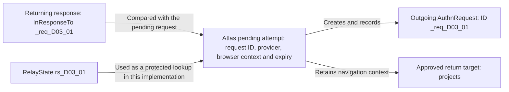
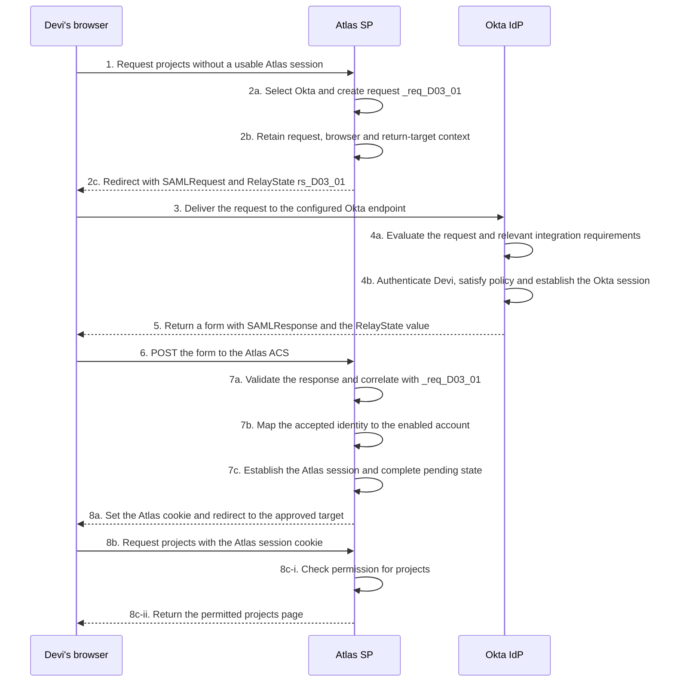
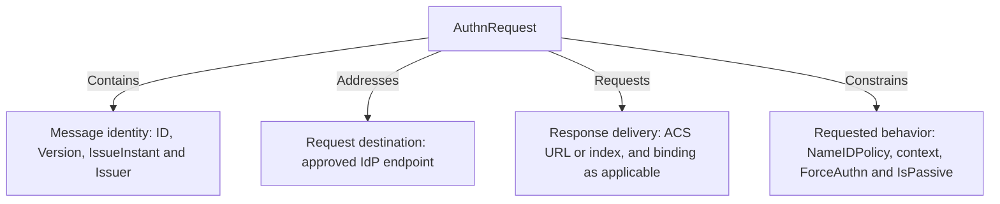
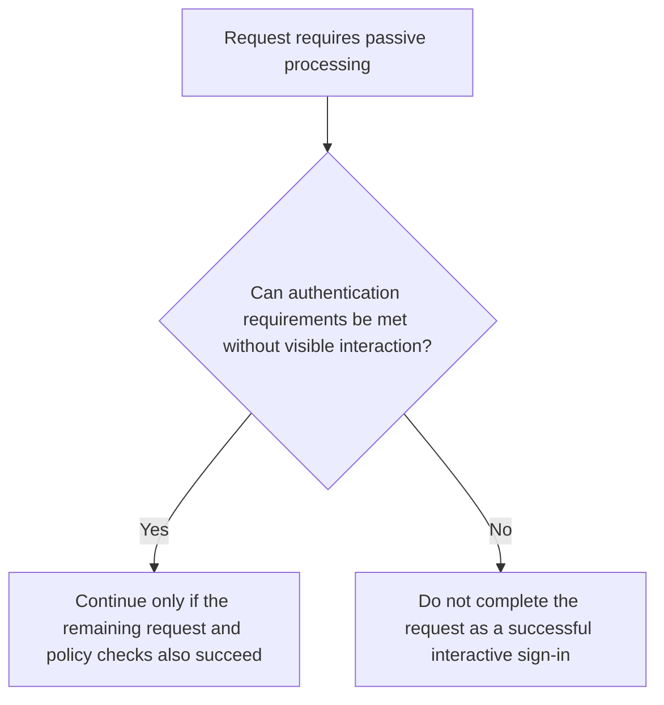
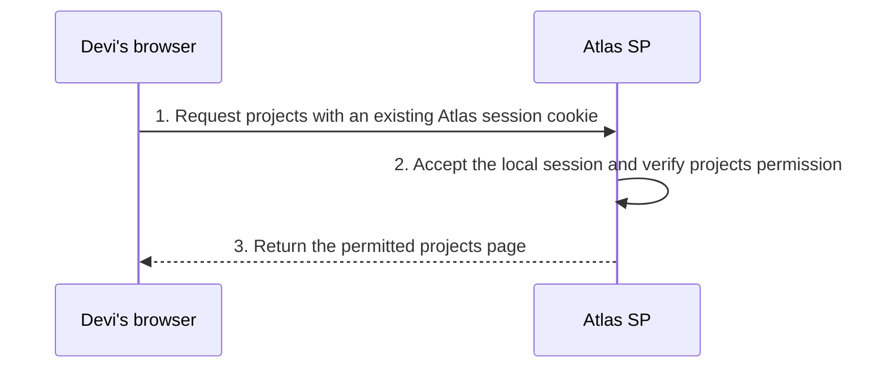

# Lesson 3: Follow an SP-initiated sign-in through Okta

Devi opens the projects page in Atlas. She starts with the application because that is where the work is. Atlas finds no usable signed-in session for her browser and needs authentication information from Okta before it can continue.

The resulting journey is called **SP-initiated SSO**. Atlas, the service provider, creates the authentication request. The browser carries it to Okta, the identity provider, and carries the resulting response back. The useful engineering question is how Atlas recognizes that the returning information belongs to the attempt it started.

The example below follows one successful transaction. Devi has an active Okta account, an Atlas assignment and an enabled Atlas account. The relevant Okta policies allow the attempt, Atlas trusts the appropriate Okta issuer and signing information, and its account rules permit Devi to view projects. Neither Okta nor Atlas initially has a usable session for this browser. These facts define this case; they do not establish the result of any other attempt.

## 3.1 The initial request and the state Atlas remembers

### Start with the page request

The browser requests `https://atlas.northstar.example/projects`. This is an ordinary request for an application resource. It is not yet a SAML request.

Atlas examines the request for a usable application session. In this case it finds none. That means Atlas needs a sign-in exchange before it can serve this protected resource. It does not mean Devi has no account, no browser cookies, or no session anywhere else.

Atlas selects the configured Okta identity provider. Selection is straightforward in this example because Atlas uses one provider for this user population. An application serving several organizations might need a discovery or organization-selection step. The application should select an approved configuration, not accept an arbitrary authentication destination supplied by the browser.

Atlas then creates an **AuthnRequest**, the SAML authentication request message. This message asks Okta to handle authentication under the applicable requirements. Creating it is not evidence that Devi has authenticated.

### Give the attempt an identity

For this transaction, Atlas chooses the request ID `_req_D03_01`. The request also has an issue time. These help distinguish this attempt from other activity, including another tab, another user, or a retry.

The following values are fictional transaction data. All times are UTC, indicated by the `Z` suffix. The five-minute pending-request window is an Atlas policy chosen for the example, not a universal SAML timeout.

| Item | Value for this attempt |
| --- | --- |
| Request ID | `_req_D03_01` |
| Request issue time | `2026-10-16T15:00:00Z` |
| SP entity ID | `https://atlas.northstar.example/saml` |
| Approved response endpoint | `https://atlas.northstar.example/saml/acs` |
| Intended resource | `/projects` |
| Optional RelayState value used here | `rs_D03_01` |
| Local pending-request expiry | `2026-10-16T15:05:00Z` |

An **ID** labels a particular message. Atlas's **entity ID** labels the participant. Devi's **NameID** will identify the subject in the returned identity information. These three identifiers do not have interchangeable roles.

### Remember enough to evaluate the return

Atlas needs context for the attempt it started. In this example, its implementation retains the pending request ID, expected provider, intended response endpoint, required authentication behavior, approved return target and expiry. It associates that context with the initiating browser through its own protected pre-authentication mechanism.

That pre-authentication context is not already a signed-in Atlas session. It supports an unfinished exchange. Once authentication and the application's checks succeed, Atlas can establish the authenticated application session.

The implementation can choose how to represent and protect its state. Server-side storage is used in this example; other designs may use protected state mechanisms. The engineering requirement is to understand what evidence ties the response to the relevant attempt, not to assume every product stores the same object in memory. The browser SSO profile permits the SP to associate the exchange with its original resource request. [SAML Profiles, §4.1.3.1](https://docs.oasis-open.org/security/saml/v2.0/saml-profiles-2.0-os.pdf)

**Figure L03-M1: One attempt, several related values.** These arrows show the relationship between Atlas's retained context and the values used during the exchange. They are not network messages. RelayState is a lookup value in this example, not a replacement for checking request correlation.



Read the response connection in the reverse direction from creation. Atlas does not create a new trusted attempt merely because a returning message includes a familiar-looking ID. It compares the received information with valid pending context and applies the other relevant checks.

## 3.2 Follow the complete Redirect and POST exchange

### Know which delivery mechanism belongs to which message

Atlas sends the request using the HTTP-Redirect binding. The browser receives a redirect to the approved Okta SSO endpoint, with the packaged request carried in a `SAMLRequest` query parameter. The endpoint value comes from the relevant Okta integration information; it is not derived from Atlas's ACS.

Okta returns the response using HTTP-POST in this example. The browser receives a page containing a form, then submits the response in a `SAMLResponse` form field to Atlas's ACS. The request binding and response binding are different choices. Using Redirect for the request does not mean the response also returns by Redirect.

The Redirect packaging includes binding-defined compression and encoding; POST uses Base64-encoded XML in the form field. Those packaging steps are not encryption. A trace viewer may decode them so that the underlying message becomes readable. [SAML Bindings, §§3.4 and 3.5](https://docs.oasis-open.org/security/saml/v2.0/saml-bindings-2.0-os.pdf)

### Keep the actors and local decisions visible

The next figure follows the transaction `_req_D03_01`. Its stage numbers retain the overall journey: initial request, SP preparation, delivery to Okta, Okta processing, response delivery, SP processing and resource access. Lettered substeps expose the work inside a stage.

**Figure L03-S1: Complete SP-initiated SSO with retained request context.** Cross-participant arrows show browser delivery. Self-arrows show local work. Step 4b groups authentication, policy and session-related browser interactions, rather than depicting a particular authentication screen sequence. The successful result assumes the applicable trust and validation checks pass.



At step 1, Atlas receives the resource request. Steps 2a and 2b create the authentication request and retain its context. At step 2c, the browser receives the redirect; at step 3, it delivers the request to Okta. Atlas has initiated the exchange even though the browser performs the delivery.

At step 4a, Okta evaluates the request in the context of the relevant app integration. Requested values are not automatically approved values. The request's claimed issuer, response endpoint and any required request protection need to fit the configured relationship.

At step 4b, the successful case proceeds through the relevant assignment and authentication requirements. Devi is assigned to Atlas, her account is usable, and policy permits access after the required authentication. Because she has no suitable Okta session at the start, Okta performs the necessary interactions and establishes its own session during this grouped stage.

Okta's session supports subsequent requests to Okta. It is not the Atlas session, and its cookie is not the identity payload posted to Atlas. The exact browser interactions involved depend on the authentication method and applicable Identity Engine policies. [Okta policies and rules](https://help.okta.com/oie/en-us/content/topics/identity-engine/policies/about-policies.htm), [Okta Identity Engine global session rules and cookies](https://help.okta.com/oie/en-us/content/topics/identity-engine/policies/add-okta-sign-on-policy-rule.htm)

At step 5, Okta prepares the successful response form. For the fictional transaction, the response ID is `_resp_D03_01`, its issue time is `2026-10-16T15:00:20Z`, and its `InResponseTo` identifies `_req_D03_01`. The assertion has its own ID, `_assert_D03_01`. The response and assertion are not renamed copies of the request.

The browser submits the form at step 6. Atlas receives information to evaluate, not an instruction it must obey. At step 7a, it applies the relevant trust, message and correlation checks. A matching request ID is one part of that evaluation. It does not establish the issuer's trustworthiness, valid timing, intended audience or correct consumed content by itself.

At step 7b, the accepted identity maps to Devi's enabled Atlas account. At step 7c, Atlas establishes its application session and completes its pending-request processing under its rules. Reusing a completed request must not be treated as a fresh successful attempt merely because its ID is recognizable.

Step 8a returns the application cookie and an approved navigation destination. At step 8b, the browser requests projects using the Atlas session. Steps 8c-i and 8c-ii establish the final resource outcome. The evidence for success includes the permitted page, not only a successful Okta-side authentication.

### Distinguish response correlation from assertion correlation

`InResponseTo` means “this replies to the request with this ID.” It can occur at two different levels of the returned XML. The response is the outer envelope; the assertion is inside it. Within the assertion, subject-confirmation data supplies conditions for presenting that assertion. In the browser SSO **bearer** method, possession and presentation of the assertion are used without a separate proof that the presenter holds a subject-specific private key; recipient, time and request-correlation checks are therefore important.

| Location, read from outside inward | Value in this requested exchange |
| --- | --- |
| `Response` → `InResponseTo` attribute | `_req_D03_01` |
| `Response` → `Assertion` → `Subject` → `SubjectConfirmation` → `SubjectConfirmationData` → `InResponseTo` attribute | `_req_D03_01` |

Each row ends at an XML attribute on the named element. Neither value identifies the response or assertion itself: those have their own IDs, `_resp_D03_01` and `_assert_D03_01`. Both correlation values point back to Atlas’s initiating request.

The locations have different processing contexts, and the applicable browser SSO rules govern their presence and checking. For this requested exchange, inspecting only the convenient outer occurrence is insufficient: Atlas must also apply the assertion’s bearer-confirmation requirements. A matching value in one location cannot excuse a mismatch in the other. [SAML Profiles, §4.1.4.2](https://docs.oasis-open.org/security/saml/v2.0/saml-profiles-2.0-os.pdf)

If Atlas cannot find usable pending context, it has not established that this returned information completes the attempt it expected. Whether a product also supports a separately configured unsolicited-response path is a different question. Falling back silently from failed requested correlation to unrestricted acceptance would erase a meaningful distinction.

## 3.3 Read the request fields that support those decisions

### Examine the request before interpreting its outcome

The following XML shows selected fields of `_req_D03_01`. Its issue time, SP identifier and ACS match the transaction above. The actual Okta `Destination` value and request-protection material are not printed here. In a real message, those details must satisfy the selected binding, profile and integration configuration. This excerpt is not a deployable request or proof that request verification succeeded.

```xml
<samlp:AuthnRequest
    xmlns:samlp="urn:oasis:names:tc:SAML:2.0:protocol"
    xmlns:saml="urn:oasis:names:tc:SAML:2.0:assertion"
    ID="_req_D03_01"
    Version="2.0"
    IssueInstant="2026-10-16T15:00:00Z"
    AssertionConsumerServiceURL="https://atlas.northstar.example/saml/acs"
    ProtocolBinding="urn:oasis:names:tc:SAML:2.0:bindings:HTTP-POST"
    ForceAuthn="false"
    IsPassive="false">
  <saml:Issuer>https://atlas.northstar.example/saml</saml:Issuer>
  <samlp:NameIDPolicy
      Format="urn:oasis:names:tc:SAML:1.1:nameid-format:unspecified"
      AllowCreate="true" />
</samlp:AuthnRequest>
```

The root element names the message type. `ID` identifies this request, and `IssueInstant` records when it was issued. `Issuer` identifies Atlas as the requester. It does not identify Devi, and it does not name the Okta issuer expected on the returning assertion.

`Version` declares the SAML protocol version. It is separate from the version-like text inside an identifier such as the unspecified NameID format URI. `Destination`, when present and required in context, identifies the intended request-receiving endpoint. It is not the ACS at which Atlas wants the response.

**Figure L03-M2: Group the request by purpose.** The arrows mean containment of related information, not processing order. The diagram separates message identity, return delivery and requested authentication behavior.



The last two groups are especially useful during troubleshooting. A response may reach the wrong application instance because return delivery was misconfigured, or an authentication attempt may fail because its requirements cannot be satisfied. Those are different problems even though both started with the same message type.

### ACS selection is a request within a trust relationship

The request above names its response endpoint using `AssertionConsumerServiceURL`. A requester can instead identify a configured ACS by `AssertionConsumerServiceIndex` where the applicable arrangement supports it. The IdP needs an approved way to interpret that selection for the requester.

These are alternative selection mechanisms. The ACS index is mutually exclusive with the ACS URL and `ProtocolBinding` attributes. A schema that accepts several individually defined attributes does not mean the protocol permits every combination. [SAML Core, §3.4.1](https://docs.oasis-open.org/security/saml/v2.0/saml-core-2.0-os.pdf)

An index is meaningful only through the corresponding configuration. `0` is not a universal name for an application's login endpoint. If two integrations map the same number to different locations, copying an index between them does not copy the relationship.

Okta's **Other Requestable SSO URLs** and **Signed Requests** settings affect the supported selection arrangement. The documented signed-request configuration can use ACS information from the signed request instead of the static requestable URLs. Apply the specific configuration rules; do not assume any URL supplied by a browser-carried request is accepted. [Okta SAML field reference: Signed Requests and Other Requestable SSO URLs](https://help.okta.com/oie/en-us/content/topics/apps/aiw-saml-reference.htm)

`ProtocolBinding` in the displayed request asks for the response through HTTP-POST. It does not describe how this request itself arrived at Okta. In the selected journey, Redirect delivers the request and POST delivers the response.

`AttributeConsumingServiceIndex`, if used, selects information about requested attributes for a service. It does not select the ACS and does not identify a user. An application asking for particular attributes still needs evidence of what was actually released and how the receiving application interpreted it. [SAML Profiles, §4.1.4.2](https://docs.oasis-open.org/security/saml/v2.0/saml-profiles-2.0-os.pdf)

### Request signing is separate from response signing

An authentication request and its resulting assertion are different content created by different participants. Protecting one does not automatically protect the other. A declaration that the SP wants signed assertions does not tell you whether it signs its requests.

With the Redirect binding, request-signature information can be carried in binding-defined query parameters rather than appearing as an XML signature inside the decoded request. Inspecting only the decoded XML can therefore omit relevant request-protection evidence. [SAML Bindings, §3.4.4](https://docs.oasis-open.org/security/saml/v2.0/saml-bindings-2.0-os.pdf)

Okta's relevant request-verification settings and the application must agree. A valid signature establishes a result under the verification key and covered data; acceptance also depends on the key's approved association and the applicable policy. Conversely, turning off a request-verification requirement solely to make an error disappear changes the agreement rather than explaining the original failure.

## 3.4 Ask for identity and authentication behavior

### NameIDPolicy concerns the identifier returned for the subject

`NameIDPolicy` expresses requirements concerning the name identifier used in returned assertions. Its `Format` concerns the identifier format. `SPNameQualifier`, where applicable, supplies the SP-related naming scope. These are not fields that choose the user's application permissions.

The request excerpt asks for the unspecified format. In Northstar's configured Atlas example, the emitted identifier is the employee value `E1042`, which Atlas maps to `atlas-4821`. That output comes from the agreed configuration, not from an intrinsic rule that unspecified means employee number.

`AllowCreate` is easy to misread. It concerns permission for the IdP to create or associate identifier-related information for the relying party while fulfilling the request. It is not an instruction for Atlas to create an application account. The SAML errata clarify its meaning and its deployment-dependent behavior. [SAML Errata 05, E14](https://docs.oasis-open.org/security/saml/v2.0/errata05/os/saml-v2.0-errata05-os.pdf)

In particular, `AllowCreate="true"` in the excerpt does not enable Atlas JIT provisioning, assign Devi to the app in Okta, or create a new Okta user. Those capabilities have their own configuration and context. The value does not demonstrate that any creation actually occurred.

An IdP may be unable to satisfy a requested identifier policy. Diagnosis then needs the requested format and scope, the actual integration settings and the returned result. Replacing a format at random can turn a visible error into a less visible account-matching problem.

### RequestedAuthnContext expresses requirements, not proof

An SP can include `RequestedAuthnContext` to state requirements for the authentication context it wants reported. The following is a standalone fragment illustrating syntax, not an additional condition silently added to `_req_D03_01`.

```xml
<samlp:RequestedAuthnContext
    xmlns:samlp="urn:oasis:names:tc:SAML:2.0:protocol"
    xmlns:saml="urn:oasis:names:tc:SAML:2.0:assertion"
    Comparison="exact">
  <saml:AuthnContextClassRef>urn:oasis:names:tc:SAML:2.0:ac:classes:PasswordProtectedTransport</saml:AuthnContextClassRef>
</samlp:RequestedAuthnContext>
```

Read the fragment as a specific requirement: “Return a context matching this requested class.” Its `Comparison="exact"` does not mean “choose anything you consider stronger instead.” `exact` is also the default when `Comparison` is omitted. The other comparison values change the selection rule:

| Comparison | Meaning under the protocol’s comparison rules |
| --- | --- |
| `exact` | Match at least one requested context exactly. |
| `minimum` | Meet or exceed the strength of at least one requested context. |
| `better` | Exceed the strength of every requested context. |
| `maximum` | Choose the strongest available context that does not exceed at least one requested context. |

For comparisons involving strength, the responder’s assessment matters. These names do not define a universal numerical ranking of authentication methods or a portable “MFA level” scale. In a project, establish the SP’s actual requirement and the provider’s supported behavior before changing this setting. [SAML Core, §3.3.2.2.1](https://docs.oasis-open.org/security/saml/v2.0/saml-core-2.0-os.pdf)

The class URI in the fragment identifies an authentication-context class. Its name alone does not establish that a specific Okta sign-in used multiple factors. Likewise, requesting a context does not prove that the provider supplied it. Inspect the returned authentication information and the relevant policy/event evidence to support the particular conclusion.

Okta exposes an **Authentication context class** setting in SAML configuration. Its relationship with an incoming request and the requirements of a particular SP must be understood for that integration. Do not assume the setting, a successful prompt and the SP's freshness requirements are all the same decision. [Okta SAML field reference: Authentication context class](https://help.okta.com/oie/en-us/content/topics/apps/aiw-saml-reference.htm)

### ForceAuthn asks for fresh authentication

At the protocol level, `ForceAuthn="true"` asks the IdP to authenticate the presenter rather than rely on its previous authentication context. That is a freshness request. It does not universally mean “ask for a password,” “use MFA,” or “delete every existing session.” A different supported authentication method may establish the required result.

For Okta, the **Honor Force Authentication** setting matters. The field reference describes whether Okta honors the incoming flag or ignores it under that configuration. Therefore, a captured request containing `ForceAuthn="true"` is not by itself evidence that Okta performed the intended fresh authentication. [Okta SAML field reference: Honor Force Authentication](https://help.okta.com/oie/en-us/content/topics/apps/aiw-saml-reference.htm)

Suppose a requirements document says sensitive Atlas actions need recent authentication. Daniel finds a ForceAuthn flag in a request. He still needs to check the applicable Okta behavior, the authentication evidence and what Atlas actually requires before saying the design meets that requirement.

An AuthnRequest only exists when the SP starts an exchange. If Atlas continues using an existing local session without initiating SAML, changing a future request flag does not retroactively reauthenticate that current application activity.

### IsPassive limits visible interaction

`IsPassive="true"` asks for an outcome without visibly taking control of the user's interface for authentication interactions. It is useful for checking whether an appropriate authentication state can be used without interrupting the user. It is not permission to skip authentication or weaken policy.

An existing session can make passive completion possible, but only if the applicable requirements can be satisfied without prohibited interaction. If an additional visible challenge is necessary, a passive request cannot be considered successful merely because showing that challenge would have worked.

**Figure L03-D1: Passive processing under a stated requirement.** This decision view illustrates the SAML meaning of the request constraint. It is not an exhaustive Okta processing pipeline and does not prescribe a product-specific error screen or status sequence.



The yes branch does not mean automatic acceptance. It means this particular constraint can be satisfied. The no branch does not establish a bad password or disabled account; it establishes that the constrained attempt cannot succeed through the interaction it would need.

ForceAuthn and IsPassive answer different questions: freshness and interaction. Both default to false when absent. A false ForceAuthn does not forbid fresh authentication if policy requires it, and a false IsPassive does not require a visible prompt when none is needed. Setting both true does not make their constraints disappear. Fresh authentication would still need to satisfy the passive constraint; the combination is not a universal way to force an MFA prompt silently. [SAML Core, §3.4.1](https://docs.oasis-open.org/security/saml/v2.0/saml-core-2.0-os.pdf)

For an Okta investigation, examine the actual request, route, applicable Identity Engine policy and observed result. External-provider routing can add another authentication boundary. Do not infer the exact passive outcome for every Okta arrangement from the flag alone.

## 3.5 Change the starting conditions and investigate the result

### Existing sessions change the work required

The successful journey began without an Atlas or Okta session. Other starting states are independent cases, not hidden changes to that completed transaction.

| Starting state | Likely path under the stated conditions | Evidence still needed |
| --- | --- | --- |
| No Atlas session, no suitable Okta session | Atlas requests authentication; Okta needs to establish the required result | Request, applicable requirements, returned information and application outcome |
| No Atlas session, usable Okta session satisfying app requirements | A new SAML exchange may complete without another visible authentication challenge | A response still needs to be generated, delivered and accepted by Atlas |
| No Atlas session, existing Okta session insufficient for the app | Okta may require additional authentication or the attempt may not satisfy its constraints | Policy, requested behavior and actual authentication/response result |
| Usable Atlas session and sufficient application policy | Atlas may serve the resource without another SAML exchange | Application session and resource authorization evidence |

The word *existing* is not enough. A session might be expired, unsuitable for the requested app, or insufficient for an authentication requirement. In Identity Engine, global session and app sign-in policies have different roles; a global session does not promise that every app can be entered without further requirements. [Okta policies and rules](https://help.okta.com/oie/en-us/content/topics/identity-engine/policies/about-policies.htm)

**Figure L03-S2: A separate attempt using an existing Atlas session.** The browser and Atlas complete the permitted resource request without contacting Okta. This is a complete application request, not a new SAML exchange.



Step 2 is doing the decisive work in this case. The absence of a new SAML request is consistent with the stated usable application session. It does not establish that Okta is bypassed incorrectly, or that the application has no authentication policy.

### RelayState is not the request ID

For `_req_D03_01`, Atlas used `rs_D03_01` as RelayState. In the selected Redirect/POST exchange, this separate binding-level value accompanies the outgoing request and is returned with the response. It is outside the request's XML message fields.

Atlas's implementation uses it as a protected lookup for local navigation and attempt context. Another integration may use it differently under its agreement. Its presence does not define a universal storage format, and the string is not automatically the AuthnRequest ID.

| Value or state | Its role in this case | What its presence alone does not prove |
| --- | --- | --- |
| `_req_D03_01` | Identifies the authentication request | That the response is trustworthy or accepted |
| Atlas pending context | Records expected provider, browser association, requirements, expiry and target | That the browser returned a response satisfying those expectations |
| `rs_D03_01` | Binding-level value used for an application lookup | Correct `InResponseTo`, safe navigation or completed authentication |
| `/projects` | Approved target after sign-in | That the account is allowed to view it |

An assertion's XML signature does not automatically protect an external form parameter. RelayState handling therefore needs the relevant binding protection and the application's own integrity and navigation controls. The selected binding also constrains its size and return behavior; it is not a general place to attach an unlimited unprotected application record. [SAML Bindings, §§3.4.3 and 3.5.3](https://docs.oasis-open.org/security/saml/v2.0/saml-bindings-2.0-os.pdf)

If RelayState supplies or selects a return target, Atlas should enforce its approved navigation rules. Authentication success is not permission to redirect the browser to any address the requester supplies.

### A matching RelayState cannot repair a mismatched response

Consider a separate fictional attempt. Atlas creates request `_req_D03_02` and retains that ID as pending for Devi's browser. The expected provider and endpoint are configured correctly. The browser returns a form carrying the expected RelayState value for this attempt, but the supplied response evidence shows `InResponseTo="_req_D03_99"`.

Atlas's diagnostic record reports that the signature check under its configured trusted key passed, but the response does not match the retained pending request. No evidence establishes `_req_D03_99` as the valid request for this browser context.

The returned RelayState does not make the different correlation ID acceptable. Nor does the reported signature result establish that the content answers `_req_D03_02`. The evidence identifies a correlation failure at the receiving boundary. It does not yet explain its cause.

Multiple tabs, a delayed response, incorrect state association, a retry implementation or unwanted response injection are competing possibilities to investigate. The packet does not establish which occurred. The useful next observations are the original outgoing request, the relevant response and browser association, timestamps, and Atlas's state transitions for the attempt.

Changing a signing certificate would not address the supplied mismatch. Turning off correlation might remove the visible error while abandoning the question Atlas needed to answer. A justified correction must explain why the wrong response was associated with the attempt, then verify both the intended success path and rejection of a mismatched one.

### Follow the actual attempt, not a preferred explanation

A request can contain scoping, proxy-related controls or extensions beyond the common fields examined here. Recognize that they can affect a particular integration and consult the applicable profile and implementation documentation when they appear. Their existence does not make them necessary for every Atlas sign-in.

For the main transaction, a precise account is now possible: Atlas created `_req_D03_01` for a browser without an application session, retained the expected context, and sent the request to Okta through Redirect. Okta completed the permitted authentication processing and returned a response through the browser. Atlas correlated and accepted the information, selected Devi's account, established its own session and allowed projects access.

For an unfamiliar attempt, ask the same connected questions. What did the SP request? What did it retain? What authentication and policy decisions actually occurred? What returned, which attempt did it answer, and what did the application establish after acceptance?

### Terms to keep straight

| Term | Meaning in this exchange |
| --- | --- |
| SP-initiated | Atlas creates the authentication request |
| Request ID / entity ID | Particular message identifier / participant identifier |
| Destination / ACS | Where the request is addressed / where the response is received |
| ProtocolBinding | Requested response delivery binding, not the request's delivery mechanism |
| NameIDPolicy | Requested identifier-related requirements, not downstream account provisioning |
| RequestedAuthnContext / reported context | Authentication requirement / information returned about authentication |
| ForceAuthn / IsPassive | Freshness request / constraint on visible interaction |
| InResponseTo / RelayState | Message correlation information / separate binding-level state with agreed application use |

## References

- [SAML Core: AuthnRequest, §3.4.1; requested authentication context, §3.3.2.2.1](https://docs.oasis-open.org/security/saml/v2.0/saml-core-2.0-os.pdf)
- [SAML Profiles: Web Browser SSO, §§4.1.3 and 4.1.4](https://docs.oasis-open.org/security/saml/v2.0/saml-profiles-2.0-os.pdf)
- [SAML Bindings: Redirect and POST, §§3.4 and 3.5](https://docs.oasis-open.org/security/saml/v2.0/saml-bindings-2.0-os.pdf)
- [SAML Errata 05: identifier creation and association, E14](https://docs.oasis-open.org/security/saml/v2.0/errata05/os/saml-v2.0-errata05-os.pdf)
- [Okta SAML field reference](https://help.okta.com/oie/en-us/content/topics/apps/aiw-saml-reference.htm)
- [Okta Identity Engine policies](https://help.okta.com/oie/en-us/content/topics/identity-engine/policies/about-policies.htm)
- [Okta Identity Engine global session rules and cookies](https://help.okta.com/oie/en-us/content/topics/identity-engine/policies/add-okta-sign-on-policy-rule.htm)
