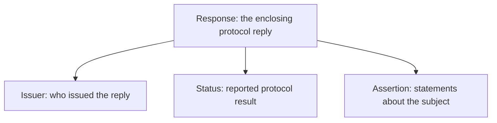
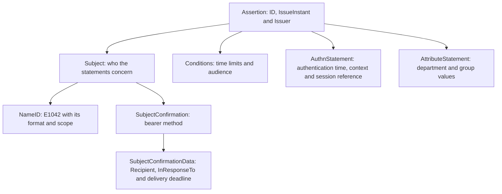
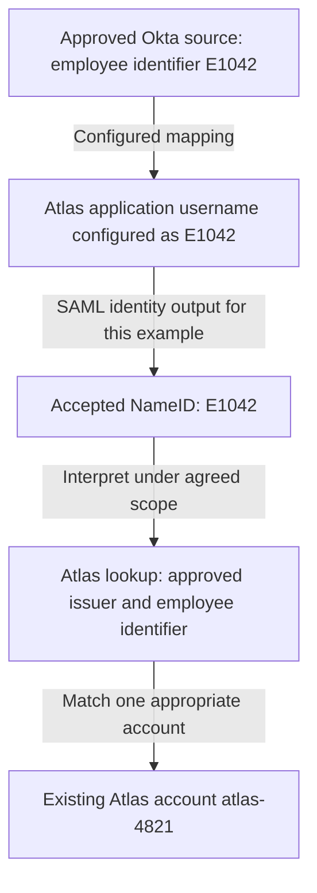
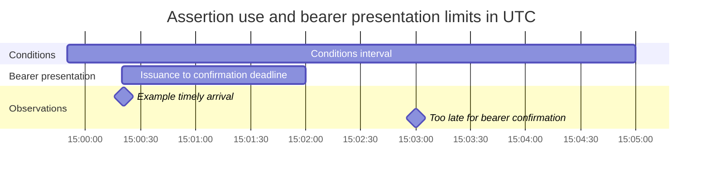
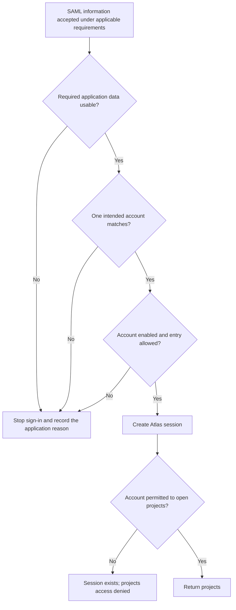
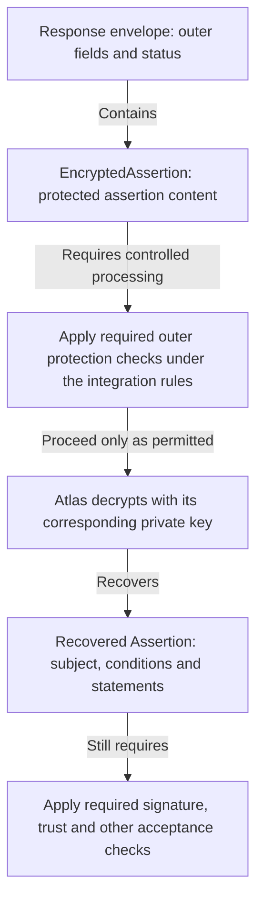

# Lesson 4: Responses, assertions, NameID, and attributes

Devi’s browser has returned from Okta and submitted a SAML response to Atlas. Daniel can see a successful status and an identifier that looks familiar. Before he calls the integration healthy, he needs to explain what each part means: whose statement it is, which request it answers, where it can be used, and how Atlas turns the accepted identity into Devi’s account.

Stay with the same successful attempt: Atlas requested `_req_D03_01`, Okta returned response `_resp_D03_01`, and the enclosed assertion is `_assert_D03_01`. Devi’s agreed application identifier is `E1042`; Atlas maps it to its existing account `atlas-4821`. The additional fields below describe this fictional example, not an actual tenant capture or Okta defaults.

## 4.1 Separate the envelope from the statement inside it

### Read the outer response first

A **Response** is a protocol reply. Its status reports the result supplied by the responder. An **assertion** contains statements about a subject and information governing their use. The outer reply and the inner statement have separate identifiers because they are different objects.

**Figure L04-M1: Start with three parts.** Arrows mean containment. This is the returned document’s structure, not a network flow.



Read the response’s issuer and status before interpreting the assertion. A reported success does not mean Atlas has verified a signature, accepted the audience, found an account, or granted projects access. Those are receiving-application decisions. A non-success status gives Daniel a different starting point: investigate the reported protocol failure rather than assuming a usable identity statement must be present.

A response can contain no assertions, one assertion, or multiple assertions as allowed by the protocol and applicable profile. Encrypted assertions are also possible. Do not build a reading habit around “take the first assertion anywhere in the XML.” Atlas must process the appropriate content under its supported rules. [SAML Core, §§3.2.2 and 3.3.3](https://docs.oasis-open.org/security/saml/v2.0/saml-core-2.0-os.pdf)

### Read a representative document from outside inward

This is an illustrative XML reading copy. **The signature is omitted**, so the document does not meet Atlas’s signed-assertion requirement and is not a message to submit to an application. `urn:example:northstar:okta-idp` is a conspicuous placeholder for the approved Okta issuer, not a real Okta issuer pattern. The identifiers, times, account data and group names are synthetic. A real integration obtains its issuer from the relevant Okta setup information and verifies the required message protection.

```xml
<samlp:Response
    xmlns:samlp="urn:oasis:names:tc:SAML:2.0:protocol"
    xmlns:saml="urn:oasis:names:tc:SAML:2.0:assertion"
    ID="_resp_D03_01"
    Version="2.0"
    IssueInstant="2026-10-16T15:00:20Z"
    Destination="https://atlas.northstar.example/saml/acs"
    InResponseTo="_req_D03_01">
  <saml:Issuer>urn:example:northstar:okta-idp</saml:Issuer>
  <samlp:Status>
    <samlp:StatusCode Value="urn:oasis:names:tc:SAML:2.0:status:Success" />
  </samlp:Status>
  <saml:Assertion
      ID="_assert_D03_01"
      Version="2.0"
      IssueInstant="2026-10-16T15:00:20Z">
    <saml:Issuer>urn:example:northstar:okta-idp</saml:Issuer>
    <saml:Subject>
      <saml:NameID Format="urn:oasis:names:tc:SAML:1.1:nameid-format:unspecified">E1042</saml:NameID>
      <saml:SubjectConfirmation Method="urn:oasis:names:tc:SAML:2.0:cm:bearer">
        <saml:SubjectConfirmationData
            Recipient="https://atlas.northstar.example/saml/acs"
            InResponseTo="_req_D03_01"
            NotOnOrAfter="2026-10-16T15:02:00Z" />
      </saml:SubjectConfirmation>
    </saml:Subject>
    <saml:Conditions
        NotBefore="2026-10-16T14:59:50Z"
        NotOnOrAfter="2026-10-16T15:05:00Z">
      <saml:AudienceRestriction>
        <saml:Audience>https://atlas.northstar.example/saml</saml:Audience>
      </saml:AudienceRestriction>
    </saml:Conditions>
    <saml:AuthnStatement
        AuthnInstant="2026-10-16T15:00:15Z"
        SessionIndex="_session_D04_01">
      <saml:AuthnContext>
        <saml:AuthnContextClassRef>urn:oasis:names:tc:SAML:2.0:ac:classes:PasswordProtectedTransport</saml:AuthnContextClassRef>
      </saml:AuthnContext>
    </saml:AuthnStatement>
    <saml:AttributeStatement>
      <saml:Attribute Name="department"
          NameFormat="urn:oasis:names:tc:SAML:2.0:attrname-format:basic">
        <saml:AttributeValue>Research</saml:AttributeValue>
      </saml:Attribute>
      <saml:Attribute Name="groups"
          NameFormat="urn:oasis:names:tc:SAML:2.0:attrname-format:basic">
        <saml:AttributeValue>Atlas-Readers</saml:AttributeValue>
        <saml:AttributeValue>Research-Staff</saml:AttributeValue>
      </saml:Attribute>
    </saml:AttributeStatement>
  </saml:Assertion>
</samlp:Response>
```

First locate the outer `Response`. Its `ID` names this reply; `InResponseTo` points back to Atlas’s request. `Destination` addresses the reply to the ACS. `IssueInstant` records issuance, not expiry. The `Z` suffix denotes UTC.

Next locate the assertion. Its own ID names the statement container, and its issuer identifies the authority making those statements. In this direct Okta-to-Atlas example, both issuers identify the expected Okta provider. Do not infer that every federation arrangement must have identical issuers at every layer, or trust a supplied issuer merely because it has the expected text.

The authentication context class in this reading copy is an illustrative reported value. It is not evidence of the factors used in a real Okta authentication. Atlas’s actual context requirements and Okta’s applicable behavior still need to agree.

**Figure L04-M2: Expand the assertion.** This adds the inner relationships to Figure L04-M1. Arrows still mean containment.



The subject tells Atlas whom the statements concern. Confirmation constrains how that subject may be confirmed when the assertion is presented. Conditions restrict use of the assertion. Authentication information describes authentication; attributes supply additional information. Finding a value is only the first step. Its parent element tells you which question it answers.

### Use status as evidence with limits

`Success` is the provider’s protocol result. Other top-level statuses include `Requester`, concerning the request, and `Responder`, concerning processing at the responder. A nested code can narrow the result, such as `NoAuthnContext` when the requested authentication context cannot be satisfied. Human-readable status text may add context, but it is not a substitute for the relevant logs and configuration evidence. [SAML Core, §3.2.2.2](https://docs.oasis-open.org/security/saml/v2.0/saml-core-2.0-os.pdf)

If Atlas reports “account not found” after accepting an assertion, changing a successful protocol status would not repair the account lookup. Daniel should follow the boundary at which processing stopped.

## 4.2 Follow the identifier to the application account

### NameID is a value with an interpretation

The **Subject** is the entity the assertion concerns. In this example, its `NameID` is `E1042`. That does not make `E1042` Atlas’s internal account ID, Devi’s email address, or her Okta login. Northstar chose an employee identifier for the application-facing identity, and Atlas agreed to interpret it that way.

In Okta, inspect the relevant user and application profiles, the configured application username, and the Name ID format. Profile mappings have a direction: an application-to-Okta mapping is different from an Okta-to-application mapping. A value present in a profile is not proof that it was emitted into a particular assertion. [Okta: map profile attributes](https://help.okta.com/oie/en-us/content/topics/users-groups-profiles/usgp-map-attributes.htm)

**Figure L04-M3: Trace the agreed identity relationship.** These arrows describe mapping and lookup, not network traffic. Each connection requires its own agreement and evidence.



The source-to-username connection is a configuration decision. The username-to-NameID connection must be confirmed in the output. The final connection belongs to Atlas: its account store must associate the accepted identity with `atlas-4821`. The equality of the visible `E1042` strings helps follow this example, but does not establish those connections by itself.

Okta documents application username and Name ID format as distinct settings. It also cautions against constructing application usernames from fields end users can edit. For an account-selecting identifier, Northstar needs an authoritative source and controlled changes. [Okta SAML field reference: Name ID and application username](https://help.okta.com/oie/en-us/content/topics/apps/aiw-saml-reference.htm)

### Choose the format for the intended relationship

The `Format` URI describes identifier semantics. A familiar-looking value does not override that meaning.

| NameID format | What it tells the receiver | Practical implication |
| --- | --- | --- |
| `unspecified` | Interpretation is agreed by the implementations. | Document the actual value, scope and lookup rule; do not assume email. |
| `emailAddress` | The content has email-address form. | Email can change or be reassigned; the format alone does not establish durable account ownership or mailbox verification. |
| `persistent` | A lasting opaque identifier scoped to an IdP and an SP or SP affiliation. | Preserve the relationship; do not substitute a readable username merely because it is stable. |
| `transient` | An opaque, temporary identifier. | Do not use it as a durable account key without a separate supported linking design. |

The first two full URIs are `urn:oasis:names:tc:SAML:1.1:nameid-format:unspecified` and `urn:oasis:names:tc:SAML:1.1:nameid-format:emailAddress`. Persistent and transient use `urn:oasis:names:tc:SAML:2.0:nameid-format:persistent` and `urn:oasis:names:tc:SAML:2.0:nameid-format:transient`. The older version label in the first two URIs does not change the message’s SAML 2.0 version. [SAML Core, §8.3](https://docs.oasis-open.org/security/saml/v2.0/saml-core-2.0-os.pdf)

Persistent identifiers have privacy and relationship semantics, not just a promise that a string rarely changes. Their values must have no guessable relationship to the subject’s underlying identity; the standard does not require one particular generation technique. [SAML Errata 05, E86](https://docs.oasis-open.org/security/saml/v2.0/errata05/os/saml-v2.0-errata05-os.pdf)

Their values must not later be reassigned to a different principal. This matters when an employee leaves: giving the replacement employee the old person’s identifier can reconnect them to the old application account. [SAML Errata 05, E78](https://docs.oasis-open.org/security/saml/v2.0/errata05/os/saml-v2.0-errata05-os.pdf)

The example deliberately retains `unspecified` for `E1042`. Calling the value “stable” in Northstar’s requirements does not turn an employee number into a standards-defined persistent pseudonym. Changing the format requires agreement about semantics, product support and existing account links.

### The same visible string can name different people

Imagine Atlas also trusts an independently approved partner IdP. Both providers send `E1042` under an agreed unspecified format. Northstar’s `E1042` refers to Devi; the partner’s `E1042` refers to someone else. A global lookup by the bare string could join the wrong accounts.

Atlas needs a documented identity scope, such as the trusted issuer plus the agreed identifier. Where present, `NameQualifier` qualifies the identifier’s administrative/security domain and `SPNameQualifier` further qualifies its SP or affiliation scope. Their permitted use depends on the format. Do not invent qualifiers or discard supplied scope without understanding the relationship. They are attributes of the identifier, not additional user profile fields to concatenate casually. [SAML Core, §2.2](https://docs.oasis-open.org/security/saml/v2.0/saml-core-2.0-os.pdf)

The practical question is “Which identity in which approved relationship selects this account?” It remains necessary even when no explicit qualifiers appear in the XML.

## 4.3 Locate the target and time restrictions

### Four related fields answer four different questions

| Field and location | Question it answers | Value in this example |
| --- | --- | --- |
| `Response@Destination` | Where is the reply addressed? | Atlas ACS |
| `SubjectConfirmationData@Recipient` | Where may this bearer assertion be presented? | Atlas ACS |
| `Conditions/AudienceRestriction/Audience` | Which relying party is an intended audience? | Atlas SP entity ID |
| `InResponseTo`, on the Response and confirmation data | Which request does this requested exchange answer? | `_req_D03_01` |

The `@` notation here means an XML attribute. The audience is element content. In the reading copy, Destination and Recipient have the same ACS URL, but the audience is `https://atlas.northstar.example/saml`, without `/acs`. Each check still has its own purpose. The right delivery address does not establish the right audience or correlation.

The bearer method does not ask the browser to prove possession of a subject-specific private key. Atlas therefore needs the applicable protection, recipient, time, correlation and replay checks before relying on the assertion. A second submission within the time window is not automatically acceptable merely because it arrived before expiry. [SAML Profiles, §§4.1.4.2–4.1.4.5, as amended](https://docs.oasis-open.org/security/saml/v2.0/saml-profiles-2.0-os.pdf)

### Read each clock in its own location

The reading copy contains two `NotOnOrAfter` attributes. One belongs to `Conditions`; the other belongs to `SubjectConfirmationData`. They do not merge into one interchangeable “token expiry.”

With clock tolerance temporarily set aside, the Conditions interval starts at 14:59:50 UTC and excludes 15:05:00 UTC. The bearer confirmation deadline excludes 15:02:00 UTC. An arrival at 15:03:00 is inside the Conditions interval but too late for that bearer confirmation.

Read the same attempt at four arrival times. These results concern only the illustrated time checks, with no clock tolerance; a “Yes” does not establish overall SAML acceptance.

| Arrival time, UTC | Inside the Conditions interval? | Before the bearer deadline? | Consequence for these time checks |
| --- | --- | --- | --- |
| 15:00:21 | Yes | Yes | Both permit processing to continue. |
| 15:02:00 exactly | Yes | No | The bearer deadline has been reached. |
| 15:03:00 | Yes | No | The later Conditions expiry does not rescue presentation. |
| 15:05:00 exactly | No | No | Both limits have been reached. |

**Figure L04-T1: The overlapping limits on October 16, 2026.** Bars represent time intervals, not messages. The bearer row begins at issuance for visual orientation; its XML does not contain a `NotBefore` attribute. Bar endpoints are excluded at the stated `NotOnOrAfter` time.



At the timely arrival, both illustrated time limits permit processing, but all the other requirements still apply. At 15:03:00, the outer Conditions deadline has not rescued the failed bearer deadline. At 15:05:00 exactly, the Conditions interval has ended too. `NotBefore` includes its starting instant; `NotOnOrAfter` excludes its ending instant. [SAML Core, §2.5.1.2](https://docs.oasis-open.org/security/saml/v2.0/saml-core-2.0-os.pdf)

Real receivers account for permitted clock differences under their supported policy. A tolerance is not permission to ignore expiry, and changing it to conceal a persistent clock or delivery problem needs investigation. The browser SSO bearer confirmation rules also prohibit a `NotBefore` attribute in `SubjectConfirmationData`; the Conditions placement in this example is deliberate. [SAML Profiles, §§4.1.4.2–4.1.4.3](https://docs.oasis-open.org/security/saml/v2.0/saml-profiles-2.0-os.pdf)

Conditions can contain other restrictions. Do not silently ignore an unfamiliar condition that the receiver cannot evaluate. Multiple audience restrictions also have combination rules; do not flatten a complex document into a single list and assume any matching string settles it. Use the applicable condition rules when those structures appear.

## 4.4 Distinguish authentication information from application attributes

### Authentication happened at a different time from issuance

The example’s `AuthnStatement` says authentication occurred at 15:00:15 UTC. The assertion was issued at 15:00:20 UTC. Those times have different meanings. In an exchange using an existing authentication context, the gap may be larger: a recently issued assertion is not proof that the user just completed fresh authentication.

`AuthnContext` describes the reported authentication context. Its class reference must be interpreted with the actual request, provider behavior and applicable policy. A successful sign-in, a recent `IssueInstant`, and an authentication class URI do not independently prove the same thing.

`SessionIndex` is an issuer-provided reference associated with the authentication session. It can help identify a session in supported SAML operations. It is not Atlas’s browser cookie, a password, or the ID of the assertion. The `_session_D04_01` value is illustrative; Atlas’s local session identifier is independently managed.

An optional `SessionNotOnOrAfter` in an authentication statement indicates an upper bound for sessions derived from that assertion, with processing governed by the applicable profile. It is separate from the assertion’s Conditions deadline. A receiver must understand both the supplied bound and its own session policy; the five-minute Conditions window does not automatically make every application session last five minutes. [SAML Errata 05, E79](https://docs.oasis-open.org/security/saml/v2.0/errata05/os/saml-v2.0-errata05-os.pdf), [SAML Profiles, §4.1.4.3](https://docs.oasis-open.org/security/saml/v2.0/saml-profiles-2.0-os.pdf)

### Read attribute names and values separately

The example’s `department` attribute has one value, `Research`. Its `groups` attribute has two values, `Atlas-Readers` and `Research-Staff`. Each `AttributeValue` is a separate value. A comma-joined string is not automatically equivalent to two XML values.

The `Name` identifies the attribute. `NameFormat` describes the convention for that name; it does not define the data type of the attribute’s value. An optional `FriendlyName` is a readable label, not a replacement for the agreed technical name. Applications may also require particular value types or serialization. Check the actual contract rather than inferring it from a display label.

Northstar defines these names and group meanings for Atlas. The SAML standard does not make `groups` a universal permission field or `Atlas-Readers` a built-in role. Atlas’s rule is that an accepted `Atlas-Readers` value can support the reader entitlement for the matched enabled account. A different application could interpret the same group name differently or ignore it.

Okta supports attribute and group statements for SAML integrations. Group statements need deliberate selection/filtering and an agreed output name. Sending every group can disclose unnecessary organizational information and still fail to provide the value Atlas actually expects. [Okta: define attribute statements](https://help.okta.com/oie/en-us/content/topics/apps/define-attribute-statements.htm), [define group attribute statements](https://help.okta.com/oie/en-us/content/topics/apps/define-group-attribute-statements.htm)

### An available source is different from a released claim

Suppose Devi’s Okta profile contains a department. That establishes source data, not successful release. Daniel still needs to inspect the statement’s configured source/expression and the resulting SAML output. Atlas must then read the agreed name and apply its own rules.

Okta’s current documentation calls SAML custom claims attribute statements and distinguishes current claims management from legacy configuration. Use the configuration model applicable to the org instead of moving expressions between interfaces by guesswork. It also documents that an expression evaluating to empty causes the claim to be omitted. Missing output can therefore reflect source or expression behavior, not only a transport problem. [Okta: configure custom claims](https://help.okta.com/oie/en-us/content/topics/apps/federated-claims-overview.htm)

An assertion preview helps inspect generated content. It does not establish that a specific browser attempt delivered that content, that Atlas accepted it, or that it selected the expected account. For those conclusions, correlate the live attempt’s permitted evidence across Okta, browser and application boundaries.

## 4.5 Turn accepted information into a usable account

### Keep account matching deliberate

Atlas’s agreed match uses the approved identity relationship and employee identifier. It does not fall back to a display name if `E1042` fails. Its contract treats the example identifier as an exact value; Daniel should not silently lowercase, trim, or rewrite it to make a test pass.

Other applications may document normalization rules. Those rules need to be explicit, consistently applied and assessed for collisions. If two incoming values collapse to the same local value, a seemingly helpful normalization can become an account-selection error. Email changes and identifier reassignment need the same care. A correct signature cannot repair an unsafe linking rule.

**Figure L04-D1: From accepted identity to the resource result.** This begins after SAML acceptance and shows Atlas’s example application decisions. It is not the complete SAML validation algorithm.



The first decision concerns application-required information, beyond the SAML acceptance assumed at the start. The account lookup must then identify an appropriate unique account. Atlas checks entry requirements before creating its session, and projects permission when the resource is requested. A failure at each boundary needs different evidence and a different correction.

An application supporting **just-in-time creation**, or **JIT**, may create an account during sign-in under configured rules. That is an application capability and policy, not a consequence of merely receiving a NameID or `AllowCreate="true"` in a request. Northstar’s current Atlas example uses an existing account. Ongoing provisioning separately handles lifecycle operations such as updates and disablement where configured. Okta assignment, downstream account readiness and resource permission remain separate observations.

### Investigate a missing attribute without inventing a cause

Consider an independent fictional test. Atlas requires `department` for entry and has an enabled account matched by employee identifier. The supplied evidence says:

1. Okta returned protocol `Success`.
2. Atlas recorded successful SAML acceptance and matched `E1042` to `atlas-4821`.
3. The captured assertion has `groups` but no `department` attribute.
4. Atlas’s application diagnostic reports “required department missing”; it created no application session.

Which boundary failed, and what should Daniel inspect next?

The known failure is application-required data after the recorded SAML acceptance and account match. Daniel should compare Atlas’s exact requirement with the claim configuration, source data, expression result and emitted attribute names. An omitted empty expression, a different attribute name or an unconfigured statement are possibilities. The packet does not establish which one occurred.

Changing the ACS or signing key does not address the supplied evidence. Changing Atlas to accept every missing department would change its entry policy. The justified correction depends on the agreed requirement and the confirmed cause. A retest should show the intended output, successful application processing, the correct account and the permitted resource.

### Recognize encrypted content without confusing its role

If assertion encryption is enabled, the response can carry `EncryptedAssertion` in place of readable assertion content. Authorized decryption recovers the inner assertion for processing; it does not establish trust or satisfy every acceptance requirement. Individual encrypted identifiers or attributes also exist in SAML, but their use depends on supported integration behavior.

**Figure L04-M4: A response with an encrypted assertion.** The outer envelope remains distinct from the protected inner content. This shows containment and processing, not a browser exchange or signature placement.



The figure does not prescribe a universal cryptographic processing order: outer protection may need verification before decryption, and the actual signed layers matter. Okta exposes separate response-signing, assertion-signing and assertion-encryption options. An encrypted capture may conceal the NameID from a trace viewer, but it has not made issuer, target, time, account or permission questions disappear. [Okta SAML field reference: protection settings](https://help.okta.com/oie/en-us/content/topics/apps/aiw-saml-reference.htm), [SAML Errata 05, E93](https://docs.oasis-open.org/security/saml/v2.0/errata05/os/saml-v2.0-errata05-os.pdf)

### Explain the evidence in order

Return to Devi’s successful transaction. The response answers `_req_D03_01`; its assertion concerns `E1042`, targets Atlas and constrains its use. Atlas still needs to establish that the required content is trustworthy and acceptable. It then interprets the agreed identity, finds `atlas-4821`, applies its entry policy, creates its own session and evaluates projects permission.

To check your reading, locate the response ID, assertion ID and both request-correlation values in the XML. Then explain why an arrival at 15:03:00 fails the illustrated bearer deadline despite the later Conditions expiry. Finally, explain why another trusted issuer’s `E1042` must not automatically select Devi’s account. Each answer depends on a relationship between fields, not simply recognizing a field name.

### Terms to keep straight

| Distinction | What to retain |
| --- | --- |
| Response / assertion | Protocol reply / statements and their use restrictions |
| NameID format / NameID value | Identifier semantics / the actual supplied identifier |
| Issuer / audience / recipient | Authority making the statement / intended relying party / presentation location |
| IssueInstant / AuthnInstant | Issuance time / reported authentication time |
| Conditions expiry / bearer deadline | Assertion-use limit / presentation-confirmation limit |
| SessionIndex / Atlas cookie | SAML session reference / browser information for the application’s local session |
| Attribute name / value / local role | Agreed claim identifier / supplied data / application interpretation |
| Protocol success / usable access | Provider-reported result / accepted identity, account, session and resource permission |

## References

- [OASIS SAML Core: identifiers, assertions, conditions, statements and responses](https://docs.oasis-open.org/security/saml/v2.0/saml-core-2.0-os.pdf)
- [OASIS SAML Profiles: Web Browser SSO processing](https://docs.oasis-open.org/security/saml/v2.0/saml-profiles-2.0-os.pdf)
- [OASIS SAML Errata 05: identifier semantics, session bounds and protection](https://docs.oasis-open.org/security/saml/v2.0/errata05/os/saml-v2.0-errata05-os.pdf)
- [Okta Identity Engine SAML field reference](https://help.okta.com/oie/en-us/content/topics/apps/aiw-saml-reference.htm)
- [Okta profile attribute mappings](https://help.okta.com/oie/en-us/content/topics/users-groups-profiles/usgp-map-attributes.htm)
- [Okta custom claims](https://help.okta.com/oie/en-us/content/topics/apps/federated-claims-overview.htm)
- [Okta attribute statements](https://help.okta.com/oie/en-us/content/topics/apps/define-attribute-statements.htm)
- [Okta group attribute statements](https://help.okta.com/oie/en-us/content/topics/apps/define-group-attribute-statements.htm)
