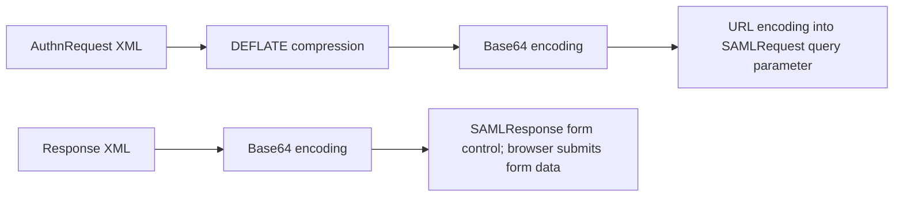
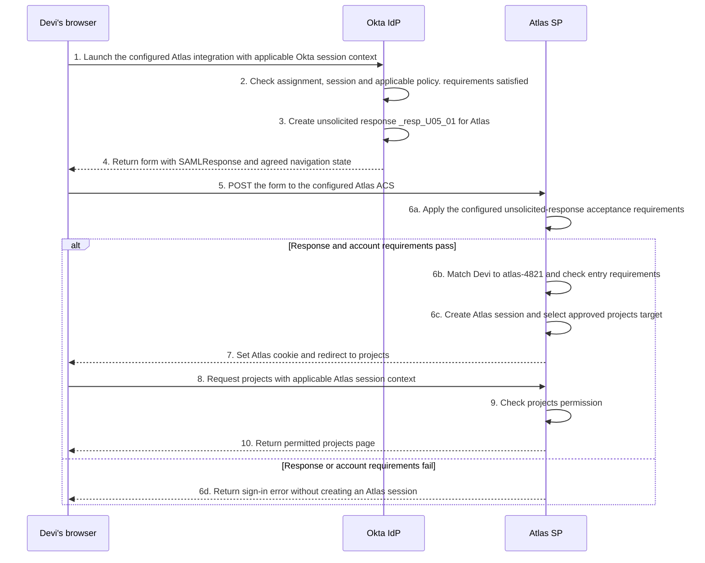
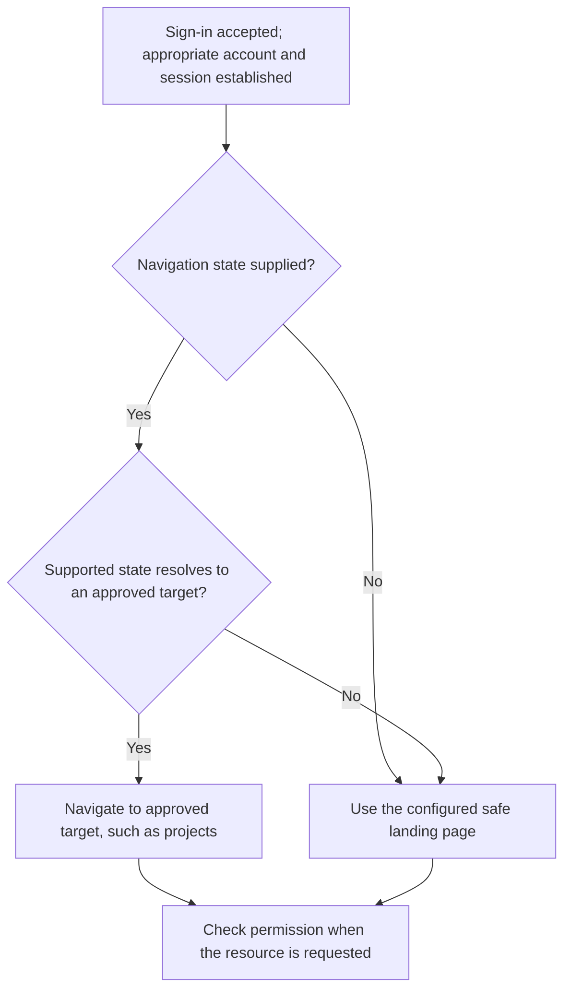
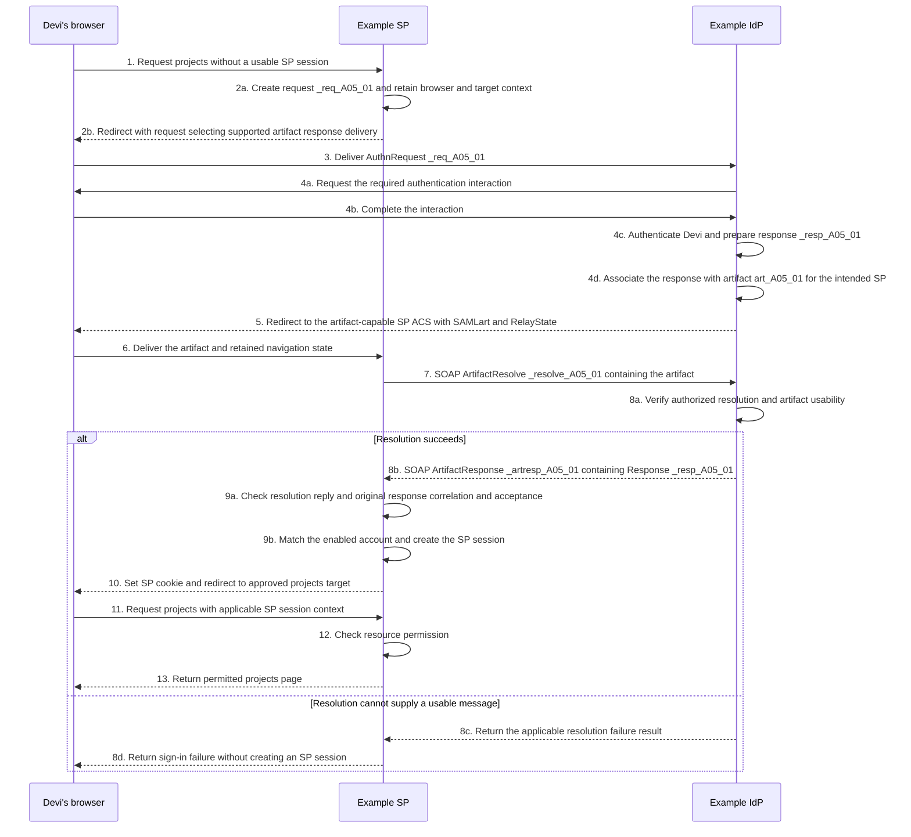
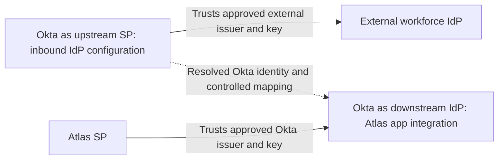
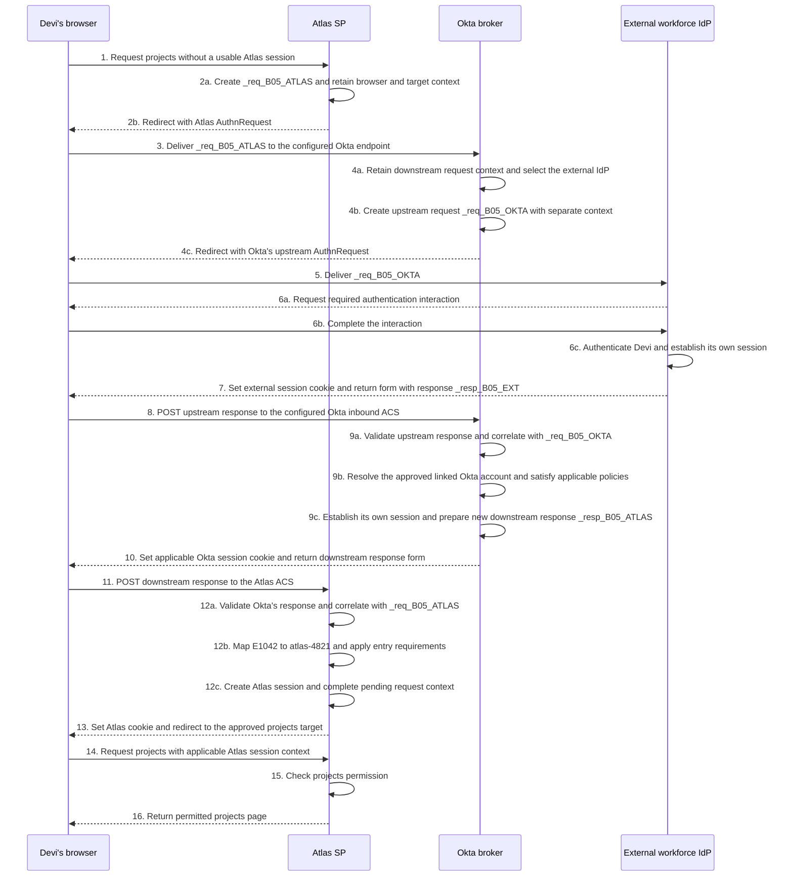

# Lesson 5: Bindings, RelayState, and alternative paths

Daniel is comparing three sign-in reports. One says Devi started from Atlas, another says she clicked an Okta tile, and a third says an external identity provider authenticated her. All three end with a browser returning to an application. That shared ending does not establish which messages were exchanged or which system trusted which identity.

To explain a journey accurately, separate three questions. Who created the authentication request, if there was one? How was each message delivered? Which system accepted the resulting identity and created the application session? The browser’s starting page alone cannot answer all three.

## 5.1 Recognize how a SAML message becomes browser traffic

### A binding carries the message

In the Atlas exchange, the browser carried an authentication request to Okta using HTTP Redirect and carried the response back using HTTP POST. The request and response were XML messages; the bindings determined how those messages appeared in HTTP traffic.

| Delivery arrangement | What to look for | What the receiver obtains |
| --- | --- | --- |
| HTTP Redirect | A redirect location and a URL query parameter such as `SAMLRequest` | An encoded SAML message in the URL |
| HTTP POST | A form sent to the recipient, with `SAMLRequest` or `SAMLResponse` as a form control | An encoded SAML message in the submitted form data |
| HTTP Artifact | `SAMLart` in a URL or form | A reference that must be resolved to obtain the message |

The parameter name distinguishes a request from a response; it does not identify the entire sign-in arrangement. A POST can carry a request, and Redirect has a protocol definition for responses too. The applicable browser SSO profile, participant support and message constraints determine the permitted combination. For Atlas’s established arrangement, inspect the outgoing Redirect request and the incoming POST response rather than assuming both legs use one binding.

### Decode according to the binding

For Redirect’s DEFLATE encoding, XML content is compressed using DEFLATE, Base64 encoded, then URL encoded into the query string. For the ordinary HTTP POST binding, the XML is Base64 encoded into the form control; Redirect’s DEFLATE step is not part of that POST encoding. The browser’s form submission also applies its normal form encoding. These transformations need to be distinguished when reading a capture. [SAML Bindings, §§3.4.4 and 3.5.4](https://docs.oasis-open.org/security/saml/v2.0/saml-bindings-2.0-os.pdf)

**Figure L05-M1: The two packaging paths in the Atlas arrangement.** Arrows mean transformation of a message representation. They do not show network traffic or trust decisions. Signature construction is a separate concern.

Follow the upper path when inspecting the Redirect request. Reverse those transformations to recover its XML. Follow the lower path for the POST response. A trace viewer may already have decoded one or more layers, so establish what representation it is showing before trying to decode it again.

Base64 makes bytes representable as text; it does not make them secret. Compression reduces size; it does not establish who created the message. URL encoding makes data suitable for a URL; it does not encrypt it. HTTPS protects an HTTP connection, while SAML signatures and encryption address particular message content. An encoded assertion visible to an authorized trace viewer can still contain personal information. Use approved inspection and redaction procedures.

### Signature placement follows the actual mechanism

Redirect can carry `SigAlg` and `Signature` query parameters. Its signature input includes the prescribed encoded message parameter, RelayState when present, and the algorithm parameter. This differs from finding an XML signature inside decoded content. The Redirect encoding rules remove a signature on the protocol message itself before compression; an embedded assertion signature is a separate case. A receiver needs the original binding representation for the relevant verification, not an arbitrarily reformatted reconstruction.

For the ordinary POST binding, a signature on an assertion or response covers its referenced XML content. A separate `RelayState` form control is outside that XML. A valid assertion signature therefore does not, by itself, prove the integrity of that form control. Do not transfer a protection conclusion from one binding or layer to another. [SAML Bindings, §§3.4.4.1 and 3.5](https://docs.oasis-open.org/security/saml/v2.0/saml-bindings-2.0-os.pdf)

### RelayState preserves agreed state

In Atlas’s requested example, `rs_D03_01` was a protected lookup associated with pending browser/request context and an approved return target. Other deployments may use a different supported arrangement. RelayState is a binding-level value, not an assertion field with a universal meaning.

When an applicable request/response exchange receives RelayState, the response returns the same value under the binding rules. That preserves the value; it does not prove that the value was trustworthy when supplied. The Redirect, POST and Artifact bindings specify an 80-byte limit. A short opaque reference can avoid carrying a large navigation payload, but its associated state still needs appropriate protection and lifetime handling.

Keep correlation and navigation separate. `InResponseTo` relates messages to a request. RelayState may help preserve application context. A matching RelayState cannot repair a wrong request ID, wrong audience or unacceptable assertion. Nor does a valid assertion make every navigation target safe. [SAML Bindings, §§3.4.3, 3.5.3 and 3.6.3.1](https://docs.oasis-open.org/security/saml/v2.0/saml-bindings-2.0-os.pdf)

## 5.2 Follow an explicitly unsolicited Okta launch

### Begin without an Atlas authentication request

Consider an independent Atlas sign-in. Devi has a usable Okta session and no usable Atlas session. She is assigned to Atlas, satisfies the applicable Okta policy, and has an enabled Atlas account with projects permission. For this scenario, Northstar has selected an integration launch that sends an unsolicited SAML response, and Atlas is explicitly configured to accept that supported path.

**Unsolicited** means the response does not answer a preceding Atlas `AuthnRequest`. It does not mean Devi did nothing or that no HTTP requests occurred. Clicking a launch control still generates browser traffic.

**Figure L05-S1: Complete unsolicited POST sign-in.** This is a new attempt, with its own numbering. Every cross-system SAML delivery shown here passes through the browser. Internal arrows show decisions and state changes.

At step 1, the browser asks Okta to launch the configured integration. Step 2 uses the starting conditions supplied for this case; an existing Okta session does not generally guarantee that every app launch can proceed without further authentication. Steps 3–5 create and deliver the response. Okta’s SAML field reference identifies the configured Single sign-on URL as the default ACS used for IdP-initiated requests. Atlas’s actual support still has to agree. [Okta SAML field reference: Single sign-on URL](https://help.okta.com/oie/en-us/content/topics/apps/aiw-saml-reference.htm)

At step 6a, Atlas cannot compare the response to a pending authentication request that it never created. For an unsolicited response, `Response@InResponseTo` is absent, and bearer confirmation data must not carry a request-correlation value either. Inventing an ID would not establish a missing relationship. Atlas still needs the applicable issuer, trust, signature, target, time, replay and other acceptance checks. [SAML Profiles, §§4.1.4.3 and 4.1.5](https://docs.oasis-open.org/security/saml/v2.0/saml-profiles-2.0-os.pdf)

Steps 6b and 6c establish account readiness and the application session on the successful branch. Steps 7–10 complete navigation and resource authorization. Step 6d represents rejection at an earlier boundary; it is not a partial application session. The projects-permission success at step 9 is a supplied fact of this scenario, not a consequence of SAML acceptance alone.

### The missing request relationship changes the risk

A requested response can be checked against the SP’s retained transaction and browser context. An unsolicited response lacks that initiating SP request relationship. Correct signatures do not recreate it. This matters for **login CSRF**, where an unwanted sign-in can place a browser into a session for an identity the browser’s user did not intend to use.

Support for unsolicited responses should therefore be a deliberate application choice with appropriate controls. If the application requires a requested flow, disabling request correlation to make an unsolicited launch work changes that design. It is not a routine fix for “SSO failure.” The SAML errata specifically discusses unsolicited-response CSRF exposure and the ability to disable this path. [SAML Errata 05, E90](https://docs.oasis-open.org/security/saml/v2.0/errata05/os/saml-v2.0-errata05-os.pdf)

Do not classify every Okta dashboard tile as an unsolicited SAML flow. A launch control may lead to an application URL that then creates an authentication request. Determine initiation from the actual protocol exchange: did Atlas create an `AuthnRequest`, and does the response answer it?

### A deep link is a navigation goal

Devi wants `/projects`, rather than Atlas’s home page. That desired destination is a **deep link**. An IdP launch can use agreed navigation state or an application default, but there is no original Atlas resource request to recover automatically in this unsolicited example.

Okta exposes Default RelayState for applications that need it. The application’s supported interpretation controls how it is used. Do not assume every integration accepts a full URL or preserves any supplied path. [Okta SAML field reference: Default RelayState](https://help.okta.com/oie/en-us/content/topics/apps/aiw-saml-reference.htm)

**Figure L05-D1: Atlas’s example navigation decision after successful sign-in.** These arrows are local decisions. The opaque-handle arrangement is an example application design, not an Okta default.

Atlas does not treat an arbitrary supplied URL as trusted merely because sign-in succeeded. Unsupported or unapproved navigation state uses the safe landing page under this example’s policy. A target that resolves successfully still requires resource authorization. The SAML errata requires care with RelayState-derived URLs and executable content; a project should use the application’s supported validation rules rather than a homemade “starts with our domain” check. [SAML Errata 05, E90](https://docs.oasis-open.org/security/saml/v2.0/errata05/os/saml-v2.0-errata05-os.pdf)

## 5.3 Understand artifact delivery as a separate protocol arrangement

An artifact changes how the receiver obtains a message. Keep three questions in view: what reference does the browser carry, which server retrieves the actual message, and what must that receiver still check? The extra server exchange is the feature that distinguishes this path from the Atlas POST arrangement.

### The browser carries a reference

With POST delivery, the browser carries the encoded response. With artifact delivery, it carries a reference called an **artifact**. The receiving server uses that reference to retrieve the actual message from the issuing server.

The following is a SAML protocol example using an **Example IdP** and **Example SP**. It does not describe an enabled Okta or Atlas capability. Before proposing artifact delivery in an Okta project, establish documented support for the exact integration, direction and endpoints on both sides. A standard-defined binding or an `ArtifactResolutionService` in unrelated metadata is not that evidence.

For this example, Devi has no usable SP session, both participants support the selected arrangement, and the SP requests artifact delivery for the authentication response. The request itself travels through Redirect. Both providers have approved metadata, trust and protected resolution connectivity. Devi has an enabled application account and the relevant resource permission.

**Figure L05-S2: Complete requested SSO with an artifact response.** Steps 7–8 are direct server communication using SOAP. The browser waits for the SP’s result; it does not perform artifact resolution. `art_A05_01` is a symbolic label, not a serialized artifact value.

Steps 1–4 establish a requested authentication exchange. At step 4d the IdP retains an association between the artifact and the message. Steps 5–6 move the reference through the browser. The binding also defines form-based artifact delivery, but this particular diagram uses a redirect. [SAML Bindings, §3.6](https://docs.oasis-open.org/security/saml/v2.0/saml-bindings-2.0-os.pdf)

At step 7, the SP sends `ArtifactResolve` directly to the issuer’s approved resolution service. At step 8b, `ArtifactResponse` wraps the original authentication `Response`. SOAP is the envelope/binding for this server exchange; it does not replace the inner SAML response or its assertions.

There are now two request relationships:

| Reply being checked | Request it answers |
| --- | --- |
| ArtifactResponse `_artresp_A05_01` | ArtifactResolve `_resolve_A05_01` |
| Authentication Response `_resp_A05_01` and relevant bearer confirmation | AuthnRequest `_req_A05_01` |

Confusing these IDs would associate an authentication result with a retrieval operation. At step 9a, the SP needs both the applicable resolution checks and normal processing of the recovered authentication result. An HTTP success from the SOAP endpoint is not, by itself, successful SAML resolution or sign-in. [SAML Core, §3.5](https://docs.oasis-open.org/security/saml/v2.0/saml-core-2.0-os.pdf), [SAML Profiles, §5](https://docs.oasis-open.org/security/saml/v2.0/saml-profiles-2.0-os.pdf)

### Retrieval creates another dependency

The browser can reach the SP successfully while the SP cannot reach the resolution service. Daniel would need server-side network and resolution evidence, not just another browser capture. Failure possibilities include unavailable connectivity, incorrect endpoint selection, failed requester authentication or an artifact that cannot be resolved. A timeout may prevent a protocol reply entirely, so steps 8c–8d show a returned failure result rather than every network-failure shape.

For browser SSO response resolution, the applicable profile requires mutually authenticated, integrity-protected and confidential resolution, and release only to the intended SP. Artifacts have single-use semantics after successful resolution. They are sensitive references, not reusable bookmarks. Resolving one does not make its recovered assertion acceptable for every recipient or time. [SAML Profiles, §4.1.4.4](https://docs.oasis-open.org/security/saml/v2.0/saml-profiles-2.0-os.pdf), [SAML Core, §3.5](https://docs.oasis-open.org/security/saml/v2.0/saml-core-2.0-os.pdf)

The useful engineering model is the extra dependency: browser delivery provides a reference; an authorized server exchange retrieves the message; the SP then evaluates that message and the application account. If the reference reaches the SP but no usable response is retrieved, investigate the resolution boundary before account lookup.

## 5.4 Follow Okta across two federation relationships

### A role belongs to a relationship

Consider another independent Northstar scenario. Devi authenticates through a configured external workforce IdP. Okta accepts that upstream identity and issues a separate SAML response to Atlas. This is often described as **brokering** federation. Okta is an SP toward the external IdP and an IdP toward Atlas.

**Figure L05-C1: Two approved trust relationships.** Arrows mean configured reliance, not message movement. Browser traffic is absent from this trust view because the arrows describe which provider each receiver relies on.

The first relationship determines whether Okta accepts the external identity. The second determines whether Atlas accepts Okta’s statement. The dotted connection represents identity handling inside Okta; it does not mean an external assertion is forwarded unchanged to Atlas. Atlas need not trust the external provider’s signing key merely because Okta uses that provider.

Okta documents inbound SAML through an external IdP configuration. The inbound provider’s information and Okta’s SP information configure that relationship. The Atlas app integration separately configures the outbound relationship. These are different configuration objects with different responsibilities. [Okta: add a SAML IdP](https://help.okta.com/oie/en-us/content/topics/security/idp-inbound-saml-workflow.htm)

### Establish the starting facts

For this requested example, Devi begins at Atlas without a usable Atlas or Okta session. An applicable Okta routing rule selects the approved external IdP. The external account is already linked to Devi’s enabled Okta user under the organization’s approved linking policy. Her Atlas assignment, downstream account and projects permission are in place. The required upstream authentication and Okta policies can be satisfied.

The external subject value is represented here by the fictional identifier `external-devi-73`. Okta’s approved application identity mapping supplies `E1042` to Atlas. These values are example decisions, not provider defaults or an automatic string transformation.

Follow the journey in four phases. Okta’s role changes with the relationship, while Atlas’s original request remains pending until its own response returns.

| Phase | Steps in the sequence | Relationship to follow |
| --- | --- | --- |
| Atlas asks Okta | 1–3 | Atlas is the SP; Okta is its IdP. |
| Okta asks the external IdP | 4–8 | Okta is now the upstream SP; the external provider authenticates Devi. |
| Okta accepts and issues | 9–11 | Okta resolves its account and creates a separate response for Atlas. |
| Atlas completes access | 12–16 | Atlas accepts Okta’s statement, finds its account and evaluates projects access. |

**Figure L05-S3: Complete requested sign-in through an external IdP and Okta.** This expands the trust view into actual movement and state changes. Each cross-provider SAML delivery uses the browser in this example. Local request IDs distinguish the two exchanges.

Steps 1–3 start the Atlas-to-Okta exchange. At steps 4a–4c, Okta retains that downstream context while starting its own upstream request. It does not replace Atlas’s request ID with a new value and then expect Atlas to accept the new one.

Steps 5–8 complete the external authentication exchange. The external response answers `_req_B05_OKTA`, targets Okta as the upstream SP, and arrives at Okta’s inbound ACS. The actual Okta SP entity ID and ACS must come from that inbound configuration; they are not Atlas’s entity ID and ACS.

Steps 9a–9c are the broker’s critical boundary. Okta validates the incoming statement, resolves the appropriate Okta identity, applies the relevant policy and constructs its own downstream statement. A returned external assertion does not alone establish that these decisions succeeded. This successful scenario assumes no additional visible interaction is needed after the upstream result; another applicable policy may require it.

Steps 10–12 return a different response, issued by Okta for Atlas and answering `_req_B05_ATLAS`. The downstream NameID can differ from the upstream identifier because the relationships have separate matching and release rules. Steps 13–16 establish the final Atlas resource result.

Retained state also belongs to a particular exchange. If RelayState is used on both legs, each value must be handled under that leg’s rules and associated with the correct context. Do not assume that Atlas’s opaque navigation reference is meaningful to the external IdP, or that copying one state value everywhere establishes both request relationships.

| Relationship | SP creating the request | IdP issuing the response | Request correlation | Intended audience |
| --- | --- | --- | --- | --- |
| Upstream | Okta | External IdP | `_req_B05_OKTA` | Configured Okta inbound SP entity ID |
| Downstream | Atlas | Okta | `_req_B05_ATLAS` | `https://atlas.northstar.example/saml` |

A signature verified under the external provider’s approved key at Okta is not Atlas’s verification of Okta’s signature. Likewise, an accepted upstream authentication context does not mean every downstream authentication requirement has been met. Inspect the requirements and actual evidence at each relationship.

### Linking and JIT happen at a particular account boundary

An inbound identity must resolve to an appropriate Okta user. Okta exposes account-matching and linking controls, including persistent NameID matching, username-based matching and filters under the applicable configuration. Treat automatic linking as an explicit trust decision. Matching email-like text is not a universal proof that two accounts belong to the same person. [Okta: SAML IdP account matching and linking](https://help.okta.com/oie/en-us/content/topics/security/idp-add-saml.htm)

Where enabled and permitted, inbound JIT can create an Okta user when no match exists. That does not create an Atlas account automatically. Downstream provisioning or supported Atlas JIT is a separate arrangement. The main broker example uses an existing linked Okta user and an existing Atlas account so those assumptions are visible.

Ask which record is missing before proposing “enable JIT.” If Okta cannot resolve an allowed user, Atlas account creation does not repair that upstream boundary. If Okta accepts the identity but Atlas lacks an account, changing inbound linking does not repair the downstream account store.

## 5.5 Choose and investigate the actual path

### Routing chooses a provider, not a permission outcome

An integration with several IdPs needs a way to select the intended provider. Okta’s IdP routing rules can use context such as application, network/location, device, email domain or user attributes. Some conditions require user information that is not yet available and may cause an identifier prompt before routing. Inspect the applicable rule and available context instead of assuming the user’s email domain always controls selection. Routing does not replace the applicable authentication policies or the application’s authorization. [Okta: Identity Provider routing rules](https://help.okta.com/oie/en-us/content/topics/security/identity_provider_discovery.htm)

SAML also defines discovery-related mechanisms and specialized bindings. An Okta routing rule is a product capability; it is not evidence that every SAML discovery protocol is in use. SOAP is relevant to the server exchange shown above. Reverse SOAP/PAOS and enhanced-client arrangements require particular client and implementation support. Recognize those names when encountered, then consult the actual integration documentation; they are not extra switches needed for the ordinary Atlas browser flow.

### Browser context remains part of the explanation

The browser carries messages and applicable cookies according to cookie scope, attributes and browser policy. It does not send every service’s cookies to every participant. A user can have a usable external-provider session, no usable Okta session and an independent Atlas session state. Moving into another browser profile can change which of those states is available.

When a sign-in behaves differently in another context, inspect the actual redirects, form submissions, cookie behavior and retained application state. Cross-site navigation and embedded use can have different browser-policy implications. There is no universal rule that every extra prompt is a SAML failure or that every browser-specific failure is a bad assertion. Avoid weakening browser protections based on the symptom alone. [MDN: HTTP cookies, scope and cross-site behavior](https://developer.mozilla.org/en-US/docs/Web/HTTP/Guides/Cookies)

### Compare the questions each path introduces

| Path | Evidence that distinguishes it | Additional question |
| --- | --- | --- |
| Requested Redirect/POST | SP AuthnRequest, retained context and correlated response | Does the returned content complete the expected browser attempt? |
| Unsolicited POST | No initiating SP AuthnRequest; supported unsolicited acceptance | How does the SP control unwanted sign-in and choose a safe landing target? |
| Artifact response | Browser-delivered reference plus direct resolution exchange | Can the authorized receiver retrieve and then accept the intended message? |
| External IdP through Okta | Two requests, two issuer/audience relationships and two account mappings | At which leg did identity, policy or account processing stop? |

These categories are not mutually exclusive design dimensions. A brokered journey can use POST on its response legs, and artifact delivery can be part of a requested exchange. Initiation, binding and participant topology answer different questions.

### Work through a broker failure from its evidence

Consider an independent fictional attempt. The evidence packet establishes that Okta accepted the external response, resolved Devi’s intended Okta account, and issued a downstream SAML response. The browser submitted that response to the expected Atlas ACS. Atlas recorded successful signature verification but rejected the audience: it received the Okta inbound SP entity ID where it expected `https://atlas.northstar.example/saml`. No Atlas session was created.

Which relationship is affected, and what should Daniel compare?

The observed mismatch is on the Okta-to-Atlas relationship. The downstream audience names the upstream SP rather than Atlas. Daniel should compare the Atlas app integration’s audience configuration, the approved Atlas requirement and the actual emitted assertion. Successful upstream authentication does not make the downstream audience acceptable, and replacing the external IdP certificate would not address the supplied mismatch.

The packet establishes the mismatch, not the full change history that caused it. A justified correction would align the downstream audience with the approved Atlas configuration, then retest both the message and the complete application outcome. It should preserve the upstream relationship’s own identifiers.

### Reconstruct the journey before changing settings

For a new ticket, identify the application resource and browser context, locate each SAML request and response, label its sender and intended receiver, and establish its binding. If an artifact appears, identify the resolution exchange. If Okta brokers an identity, separate the upstream and downstream account relationships. Then determine the last successful decision and the first failed one.

That reconstruction explains why “the user clicked Okta” or “the response is signed” is insufficient as a diagnosis. A useful explanation connects message movement, retained state, trust and account decisions to the observed resource result.

### Terms to keep straight

| Distinction | Useful meaning |
| --- | --- |
| Initiation / binding | Who starts the SAML exchange / how a message is delivered |
| Base64 / encryption | Text representation of bytes / protection of content confidentiality |
| RelayState / InResponseTo | Agreed binding-level state / correlation to a protocol request |
| Artifact / assertion | Message reference requiring resolution / statements about a subject |
| ArtifactResponse / authentication Response | Resolution reply / original authentication result carried inside it |
| Upstream / downstream | Provider-to-broker relationship / broker-to-application relationship in this scenario |
| Inbound JIT / downstream JIT | Creation of an Okta user where configured / creation of an application account where supported |
| Routing / authorization | Selection of an identity provider / permission to perform an application action |

## References

- [OASIS SAML Bindings: Redirect, POST, Artifact and SOAP](https://docs.oasis-open.org/security/saml/v2.0/saml-bindings-2.0-os.pdf)
- [OASIS SAML Profiles: browser SSO and artifact resolution](https://docs.oasis-open.org/security/saml/v2.0/saml-profiles-2.0-os.pdf)
- [OASIS SAML Core: artifact resolution protocol](https://docs.oasis-open.org/security/saml/v2.0/saml-core-2.0-os.pdf)
- [OASIS SAML Errata 05: RelayState and unsolicited-response risks](https://docs.oasis-open.org/security/saml/v2.0/errata05/os/saml-v2.0-errata05-os.pdf)
- [Okta SAML app field reference](https://help.okta.com/oie/en-us/content/topics/apps/aiw-saml-reference.htm)
- [Okta inbound SAML workflow](https://help.okta.com/oie/en-us/content/topics/security/idp-inbound-saml-workflow.htm)
- [Okta external SAML IdP settings](https://help.okta.com/oie/en-us/content/topics/security/idp-add-saml.htm)
- [Okta IdP routing rules](https://help.okta.com/oie/en-us/content/topics/security/identity_provider_discovery.htm)
- [MDN HTTP cookie guide](https://developer.mozilla.org/en-US/docs/Web/HTTP/Guides/Cookies)
