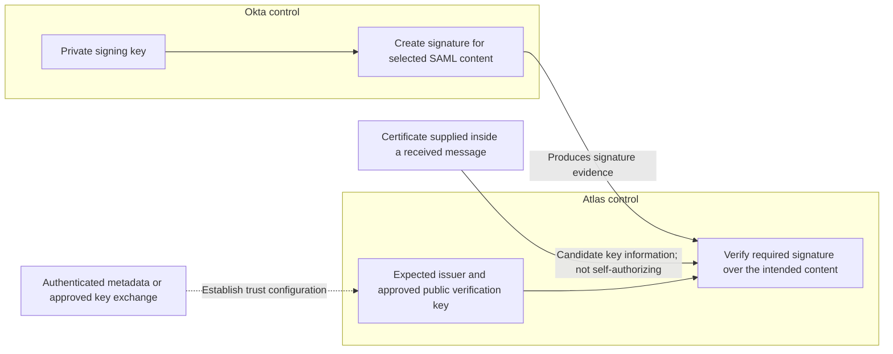
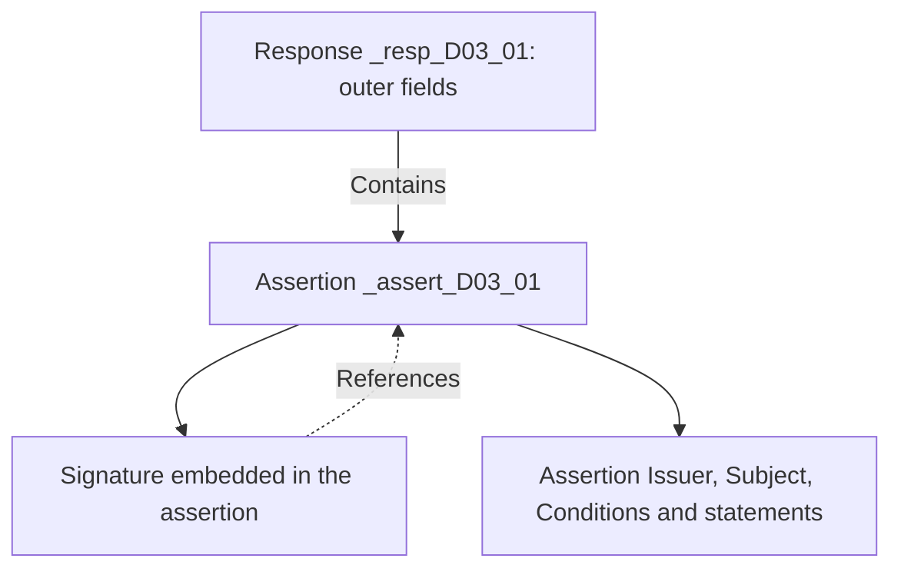
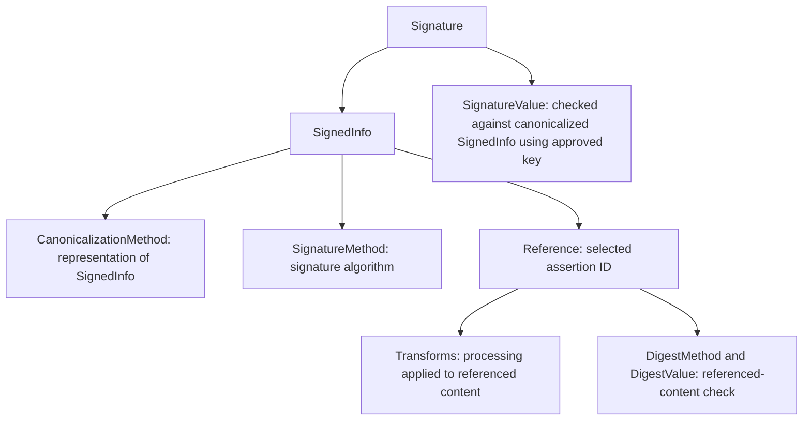
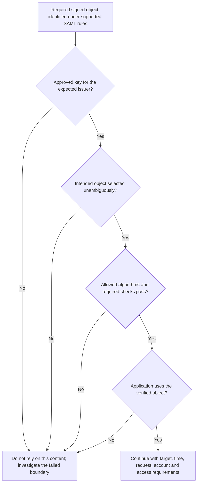
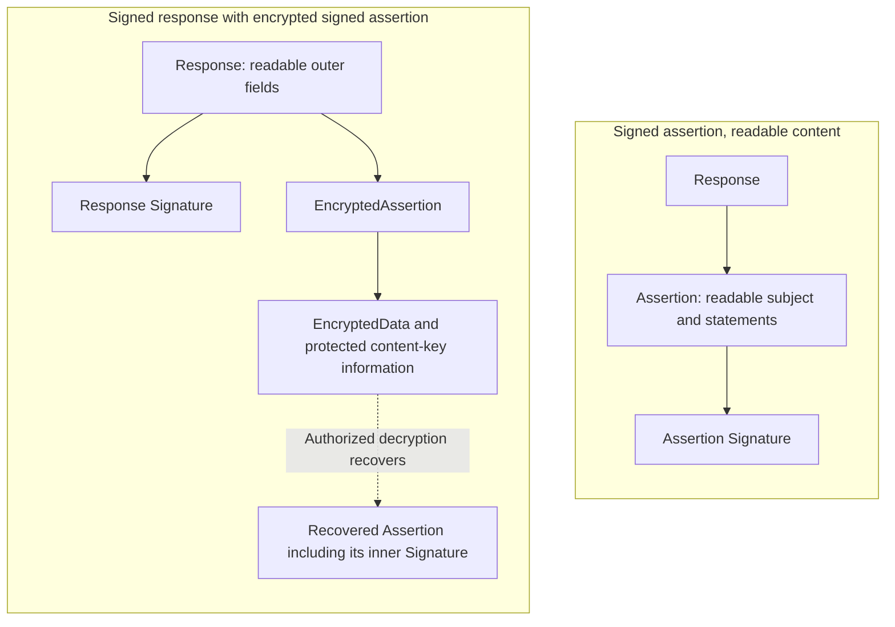
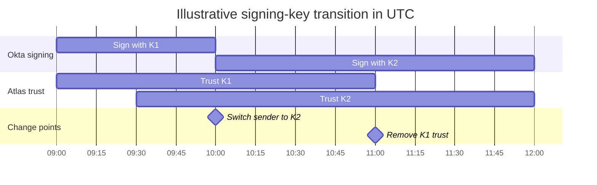

# Lesson 6: Trust, signatures, encryption, and certificate lifecycle

Devi completes authentication at Okta, but Atlas rejects the returned response. Daniel sees a certificate in the message and a recent certificate change in the integration record. Before replacing anything, he needs to answer three questions: which key Atlas is supposed to trust, which content the signature protects, and whether Atlas’s configuration agrees with the key Okta actually used.

These questions also matter when sign-in succeeds. An application can perform a mathematical signature check and still make an unsafe decision if it trusts the wrong key or uses different content from the content it verified.

## 6.1 Separate the protection goals

### Ask what each mechanism establishes

**Authenticity** concerns the origin of the protected information. **Integrity** concerns whether that information has changed. **Confidentiality** concerns who can read it. A SAML integration may need all three, but one mechanism does not automatically supply all three.

| Mechanism | What it does | What it does not establish by itself |
| --- | --- | --- |
| Base64 encoding | Represents bytes as text | Secrecy, trustworthy origin or integrity |
| Cryptographic hash | Produces a digest from input data | Who supplied the data; an attacker can hash their own replacement |
| Digital signature | Enables verification of protected content under a signing key | Whether that key is approved for this issuer, whether the content is acceptable, or secrecy |
| Encryption | Protects content for a recipient with the required decryption capability | An approved sender’s identity or every required integrity property |
| HTTPS/TLS | Protects the connection under its negotiated security and peer-authentication rules | A SAML signature on content that continues beyond that connection |

In the browser POST journey, Okta returns a form to Devi’s browser, and the browser submits it to Atlas. Those are distinct HTTP connections. A signed assertion can retain verifiable message protection as it passes through the browser. TLS still matters: message signatures do not make an unprotected connection suitable for session cookies or other sensitive traffic.

### Keep signing and decryption ownership clear

For signing, the owner uses a private key and receivers verify using its corresponding public key. A public certificate is a common way to distribute that public key. For encryption to Atlas, Okta uses Atlas’s approved public encryption information; Atlas retains the private decryption capability.

| Operation in this integration | Private key under whose control? | Public information needed by the other side |
| --- | --- | --- |
| Okta signs content for Atlas | Okta | Atlas needs the approved Okta verification key |
| Atlas signs a request to Okta, where configured | Atlas | Okta needs the approved Atlas verification key |
| Okta encrypts an assertion for Atlas | Atlas holds the recipient’s private key | Okta needs Atlas’s approved encryption certificate/key |

The same participant can have different key responsibilities. Atlas’s verification copy of Okta’s public key does not allow Atlas to create Okta signatures. Okta does not need Atlas’s private key to encrypt for it. Private keys are not partner setup values to paste into a metadata form.

## 6.2 Establish why the key is trusted

### A supplied certificate is evidence to interpret

Suppose a message includes `KeyInfo` containing a certificate. Software can extract its public key, but that does not explain why Atlas should accept statements made under that key. A sender can include its own certificate in its own message.

Atlas needs an approved relationship between the expected issuer, the integration context and the verification key. That relationship can come from appropriately authenticated metadata or a controlled manual trust configuration. A message’s issuer text helps identify the claimed relationship; it does not authenticate itself.

**Figure L06-C1: Key ownership and Atlas’s trust boundary.** Solid arrows describe key use. The dotted arrow describes approved configuration. These are not browser message paths.



Inside Okta’s boundary, the private key creates the signature. Inside Atlas’s boundary, approved configuration controls which key may establish trust for this relationship. The supplied certificate may help identify a candidate key, but it cannot silently replace the approved trust decision.

A certificate fingerprint is a compact way to compare certificate bytes when using an agreed fingerprint algorithm. It helps Daniel distinguish files and communicate changes. A fingerprint copied from the same unverified message is not an independent trust anchor. Also distinguish a changed certificate from a changed public key: a replacement certificate can carry the same key, while a true key rollover changes the key material.

### Federation trust can differ from website certificate validation

A browser typically validates a website certificate using its applicable certificate and hostname rules. A SAML receiver may instead trust particular federation keys directly. A self-signed federation certificate is therefore not automatically an error, and a certificate chaining to a public authority is not automatically authorized to sign for Northstar’s Okta issuer.

The SAML Metadata Interoperability Profile defines a model in which accepted metadata establishes key trust, and certificate fields are not treated as an independent runtime Web PKI acceptance policy. This is a named profile’s model, not proof that every SP implements it. Establish Atlas’s documented behavior before drawing conclusions about certificate expiry, chain validation or revocation checking. [SAML Metadata Interoperability Profile, §§2.5–2.6](https://docs.oasis-open.org/security/saml/Post2.0/sstc-metadata-iop.pdf)

The operational consequence is straightforward: document how Atlas accepts and removes keys. Do not assume that a certificate expiry date, a revocation service or a metadata change will have an effect the receiver does not implement.

## 6.3 Connect the signature to the exact content used

### Start with the signed layer

In Northstar’s established Atlas example, the application requires a signed assertion. Okta also exposes a separate response-signing setting. A signature can protect the assertion, the response, or both when the integration supports the selected configuration.

**Figure L06-M1: Assertion-only signing.** This containment view shows the scope selected by a reference to `_assert_D03_01`. The enclosing response is outside this assertion signature’s scope.



For this arrangement, the assertion’s issuer, subject, conditions and statements are included in the referenced content. The outer response’s Destination or status is not protected by that assertion signature simply because the response carries it. Required processing still applies to those outer fields.

Conversely, a correctly constructed response signature can cover the response and its enclosed content according to its reference and transforms. Inspect the actual scope rather than deciding from the signature’s visual proximity to a field.

The amended browser SSO profile permits the response or enclosed assertions to provide the required POST signature protection. A particular SP can require a more specific arrangement, such as Atlas’s signed-assertion requirement. “The profile allows response signing” does not override that application requirement. [SAML Errata 05, E93](https://docs.oasis-open.org/security/saml/v2.0/errata05/os/saml-v2.0-errata05-os.pdf), [Okta SAML field reference: Response and Assertion Signature](https://help.okta.com/oie/en-us/content/topics/apps/aiw-saml-reference.htm)

### Read the signature’s internal relationships

An XML signature contains `SignedInfo` and `SignatureValue`, with optional key information. Within `SignedInfo`, a `Reference` identifies content, and its transforms and digest describe how that content is checked. The signature algorithm protects the canonicalized `SignedInfo` representation.

**Figure L06-M2: Expand the signature.** Arrows mean containment or the labeled processing relationship. This adds detail to the Signature node in Figure L06-M1.



There are two connected checks. Reference validation recomputes the digest over the selected, transformed content and compares it with the supplied digest. Signature validation checks `SignatureValue` against the canonicalized `SignedInfo` using the verification key and permitted algorithm. A digest match alone does not authenticate an origin. Checking only the signature value without the required reference validation does not establish content integrity. [W3C XML Signature, §§3.2–4.4](https://www.w3.org/TR/xmldsig-core1/)

**Canonicalization** produces a defined XML representation for cryptographic processing. It is not “ignore every formatting change.” Namespace context and the selected algorithm matter. A **transform** changes the referenced input before digest calculation. For an enveloped signature inside an assertion, the enveloped-signature transform excludes that signature from the input, avoiding a signature that would need to include itself.

For a small example with no namespaces or surrounding context, compare `<item a="1" b="2"/>` with `<item b="2" a="1"></item>`. Exclusive canonicalization gives both the representation `<item a="1" b="2"></item>`: it orders the attributes and expands the empty-element notation. The sender and verifier can therefore calculate over the same defined representation despite those surface differences. Changing `a="1"` to `a="9"` changes the content and its canonical representation. Text whitespace can matter too; canonicalization is not permission to tidy a signed document arbitrarily. [W3C Exclusive XML Canonicalization](https://www.w3.org/TR/xml-exc-c14n/)

When reading the fragment below, follow the two checks: which content does `Reference` select for its digest, and which `SignedInfo` does `SignatureValue` protect? The algorithm URIs specify how those operations work. Their exact spelling matters to software, but recognizing their purpose is what helps you investigate a signature failure.

The following standalone signature fragment illustrates the relationships. It belongs conceptually inside the assertion after its Issuer. Both `AA==` values are deliberately unusable cryptographic placeholders: the digest is not a real SHA-256 digest, and the signature value is not a valid signature. The reference target is outside this fragment. This is a reading example, not verifiable signed SAML.

```xml
<ds:Signature xmlns:ds="http://www.w3.org/2000/09/xmldsig#">
  <ds:SignedInfo>
    <ds:CanonicalizationMethod Algorithm="http://www.w3.org/2001/10/xml-exc-c14n#" />
    <ds:SignatureMethod Algorithm="http://www.w3.org/2001/04/xmldsig-more#rsa-sha256" />
    <ds:Reference URI="#_assert_D03_01">
      <ds:Transforms>
        <ds:Transform Algorithm="http://www.w3.org/2000/09/xmldsig#enveloped-signature" />
        <ds:Transform Algorithm="http://www.w3.org/2001/10/xml-exc-c14n#" />
      </ds:Transforms>
      <ds:DigestMethod Algorithm="http://www.w3.org/2001/04/xmlenc#sha256" />
      <ds:DigestValue>AA==</ds:DigestValue>
    </ds:Reference>
  </ds:SignedInfo>
  <ds:SignatureValue>AA==</ds:SignatureValue>
</ds:Signature>
```

Read `URI="#_assert_D03_01"` as a reference to the assertion with that ID in the same document. The `#` is a fragment reference, not part of the assertion ID. The algorithm URIs identify methods; they are not pages that Atlas must download to perform verification. No `KeyInfo` appears because a receiver can obtain its verification key from approved configuration.

### The verified object must be the consumed object

Suppose a diagnostic says that assertion A’s signature passed, but the application selects a NameID from a different assertion B elsewhere in the document. The successful check does not protect the identity it actually used. This class of mismatch is central to **XML signature wrapping** problems: the danger concerns what was verified versus what was consumed, not merely whether a signature element exists.

**Figure L06-D1: Connect approved trust to the application’s input.** This is a focused review of signature reliance, not a complete response-validation order.



Approved trust does not excuse an ambiguous reference. A valid signature does not excuse reading another object. All of these questions must connect before Atlas relies on the protected content. Use a maintained SAML implementation with safe XML handling and constrained signature processing. An integration engineer needs to recognize and investigate these boundaries; searching for the first NameID cannot replace those controls. [OWASP SAML security guidance: signature validation](https://cheatsheetseries.owasp.org/cheatsheets/SAML_Security_Cheat_Sheet.html)

## 6.4 Separate signed content from encrypted content

### Encryption protects a different property

A signed plaintext assertion can be readable to anyone able to inspect that plaintext. Encryption restricts access to the protected content, but a party possessing Atlas’s public encryption key can also encrypt content for Atlas. Successful decryption alone does not prove that Okta supplied it.

In a typical public-key XML Encryption arrangement, a symmetric content key encrypts the assertion. The recipient’s public key protects that content key using the configured key-transport mechanism; Atlas uses its private key to recover it. The content-encryption algorithm and key-transport algorithm are separate settings. This explains why “which certificate?” and “which encryption algorithm?” are related but different questions. [W3C XML Encryption, §2.2](https://www.w3.org/TR/xmlenc-core1/)

### Recognize the layers

**Figure L06-L1: Two illustrative protection arrangements.** Arrows mean containment. The encrypted branch includes an outer response signature and a signed inner assertion as an example supported arrangement, not an Okta default. The recovered inner structure is shown logically; it is not readable plaintext on the wire.



On the clear branch, the assertion signature addresses integrity and origin under approved trust while its subject remains readable. On the encrypted branch, the response signature can protect the ciphertext-containing response according to its actual reference. Atlas decrypts the encrypted assertion and still verifies the required inner protection and all applicable SAML restrictions.

`EncryptedData` describes the protected data; `CipherValue` carries encrypted bytes in a textual representation. `EncryptedKey`, where used, carries protected key material. These structures are not the same thing as a Base64-encoded plaintext assertion. SAML also supports encrypted identifiers and attributes, but their presence and handling depend on the particular integration’s supported arrangement.

### Processing order depends on the construction

An assertion signature inside ciphertext cannot be checked until the relevant content is recovered. An outer response signature may need to be checked before decryption. Historical CBC encryption constructions are a specific reason not to teach “always decrypt first, then verify”: exposing unauthenticated ciphertext to processing can create security problems. The SAML errata addresses surrounding integrity protection and response signing for that case. [SAML Errata 05, E93](https://docs.oasis-open.org/security/saml/v2.0/errata05/os/saml-v2.0-errata05-os.pdf)

Use the receiver’s documented secure processing and current approved algorithms. Do not invent a universal processing order from one diagram. Whatever the construction, decryption does not remove issuer, audience, recipient, time, request-correlation or account requirements.

Okta’s app settings distinguish Response signing, Assertion Signature, Assertion Encryption, Encryption Algorithm, Key Transport Algorithm and Encryption Certificate. The separate Signature Certificate field is used for validation of application-supplied sign-in/logout requests; it is not simply another label for the Okta signing certificate Atlas needs. Read the direction and purpose before uploading anything. [Okta SAML field reference: advanced settings](https://help.okta.com/oie/en-us/content/topics/apps/aiw-saml-reference.htm)

## 6.5 Plan a certificate change across both systems

### Separate availability, activation and adoption

Okta’s certificate management distinguishes available certificates and activation. Its documentation identifies the active certificate as app-scoped and recommends keeping the app-only certificate active. The app’s setup information supplies the relevant IdP details for its partner. Do not assume one certificate applies identically to every integration in the org. [Okta: manage signing certificates](https://help.okta.com/oie/en-us/content/topics/apps/manage-signing-certificates.htm)

For a planned rollover, use symbolic key labels `K1` and `K2`. They are labels for discussion, not literal values to put into XML. Generating a new certificate does not prove Okta has begun signing with K2, and switching Okta’s active signing certificate does not prove Atlas has adopted K2.

Daniel and Priya need to agree on the authoritative new certificate/key information, the supported activation process, Atlas’s ability to trust more than one key, its import or refresh behavior, and how they will verify the resulting sign-ins. A metadata URL does not prove that Atlas refreshes it automatically. Cached or manually imported configuration can outlive the sender’s activation change.

### Use overlap only when the receiver supports it

Assume this fictional Atlas deployment supports both K1 and K2 during a controlled transition. K1 is uncompromised and still acceptable under the applicable policy. The following schedule is an example coordination plan, not a standard waiting period or an Okta guarantee.

**Figure L06-T1: Sender activation and receiver trust are separate timelines.** On October 20, 2026, Atlas adopts K2 before the 10:00 UTC sender switch. K1 trust is removed at 11:00 after the agreed checks. Bars show configured states; they do not show assertion lifetimes.



At 09:30 Atlas can verify either approved key, while Okta still signs with K1. At 10:00 Okta switches to K2; Atlas is already prepared for it. The overlap can accommodate agreed in-flight and rollback needs, but also preserves K1’s authority during that interval. Its duration must reflect the actual system behavior and policy. The chart ends at noon for display; it does not imply K2 expires then.

Before removing K1, verify the sender’s observed signing key, successful K2-based acceptance on the relevant Atlas instances, and the agreed handling of old in-flight messages and cached configuration. Test the correct account and resource result too. A certificate file successfully imported into one node does not establish that every receiving node uses it.

If Atlas supports only one trusted key, this overlap plan cannot be assumed. The owners need a supported coordinated replacement or maintenance arrangement with explicit recovery steps. Do not simulate multi-key trust by accepting whatever certificate appears in the next message.

### Expiry and algorithm policy are distinct checks

A certificate’s validity dates, the assertion’s expiry, the key’s approved usage period and metadata freshness describe different things. An unexpired certificate does not guarantee that a key remains approved. Conversely, whether a particular receiver rejects on certificate expiry depends on its documented trust model and enforcement. Plan replacement before the applicable deadline rather than relying on inconsistent receiver behavior.

Algorithms also have separate roles. An XML signature’s SignatureMethod, its DigestMethod, a certificate’s own signature algorithm, and the content/key-transport algorithms used for encryption are not interchangeable. Choose a currently approved combination supported by both parties. Historical SAML examples contain obsolete choices; successful parsing is not evidence that an algorithm is acceptable. Current defensive guidance rejects SHA-1-based SAML signatures and digests in favor of approved modern alternatives. [OWASP SAML security guidance: algorithms and certificate lifecycle](https://cheatsheetseries.owasp.org/cheatsheets/SAML_Security_Cheat_Sheet.html)

The illustrative RSA-SHA256/SHA-256 fragment demonstrates field relationships. It is not a complete algorithm policy, key-size policy or compatibility promise for an unfamiliar partner.

### Diagnose a failed cutover from supplied evidence

Consider an independent fictional test. Okta’s Atlas integration now signs with K2. An authenticated setup record identifies K2 as the intended new key. Atlas’s runtime trust inventory still contains only K1. A captured message identifies K2, and Atlas’s diagnostic says no configured verification key matches. No Atlas session was created.

What does this establish, and what would changing the ACS accomplish?

The evidence establishes a sender/receiver key-configuration mismatch. It does not establish that the signature bytes are otherwise correct or that every later acceptance check will pass. Changing the ACS does not supply the missing approved verification key. Daniel should confirm the authorized change and Atlas’s supported update process, reconcile the receiver’s runtime trust, and retest the actual signature, message restrictions, account and resource outcome.

If the problem appeared only on some receiving nodes, compare their effective trust inventories and refresh/import history. A generic “signature invalid” label can also conceal other failures, such as altered signed content or unsupported algorithms. Use the specific processing evidence before naming the cause.

### Recovery must preserve the intended trust

A rollback to K1 is a possible recovery only if K1 remains permitted, available for the supported sender process, and trusted by the relevant receiver. Confirm those conditions in advance; do not promise that a button will reverse every partner’s state. Preserve approved configuration records and define the owner and evidence required for the recovery decision.

Key compromise changes the objective. If K1 may be controlled by an attacker, retaining it for convenient overlap or rolling back to it preserves the attacker’s signing authority. The response needs coordinated trust removal and replacement under the organization’s incident process. Certificate revocation alone is insufficient if the federation receiver does not consult that revocation mechanism. Previously established application sessions also need their own incident assessment; removing a signing key does not automatically erase every session already created.

### Explain what was actually proved

For a successful Atlas attempt, Daniel should be able to connect the expected Okta issuer, the approved verification key, the required signature layer, the exact verified assertion and the identity Atlas consumed. Where encryption is used, he should explain the recipient key and protected layers separately. For a rollover, he should distinguish the key Okta can use, the key it actually uses and the keys Atlas currently accepts.

Try explaining why these three observations are insufficient on their own: “the certificate is in the response,” “decryption succeeded,” and “the signature passed.” The first does not establish approved trust. The second does not establish the sender. The third still needs trustworthy key selection, correct signed-content selection and all remaining SAML and application decisions.

### Terms to keep straight

| Distinction | Useful meaning |
| --- | --- |
| Signature / encryption | Verifiable origin and integrity under an approved key / confidentiality for the intended decryption capability |
| Public certificate / private key | Shareable public-key information / protected capability to sign or decrypt |
| Supplied key / approved key | Information received with content / trust established for the relationship |
| DigestValue / SignatureValue | Check of referenced content / signature over canonicalized SignedInfo |
| Verified object / consumed object | Content whose required protection passed / content the application actually uses |
| Content encryption / key transport | Protection of the assertion bytes / protection of the content key |
| Generate / activate / adopt | Make new material available / select sender use / update receiver trust |
| Certificate expiry / assertion expiry | Certificate validity information / SAML use-time restriction |

## References

- [W3C XML Signature Syntax and Processing](https://www.w3.org/TR/xmldsig-core1/)
- [W3C XML Encryption Syntax and Processing](https://www.w3.org/TR/xmlenc-core1/)
- [OASIS SAML Errata 05: signature and encryption clarifications](https://docs.oasis-open.org/security/saml/v2.0/errata05/os/saml-v2.0-errata05-os.pdf)
- [SAML Metadata Interoperability Profile: key trust](https://docs.oasis-open.org/security/saml/Post2.0/sstc-metadata-iop.pdf)
- [Okta SAML field reference](https://help.okta.com/oie/en-us/content/topics/apps/aiw-saml-reference.htm)
- [Okta signing certificate management](https://help.okta.com/oie/en-us/content/topics/apps/manage-signing-certificates.htm)
- [OWASP SAML security guidance](https://cheatsheetseries.owasp.org/cheatsheets/SAML_Security_Cheat_Sheet.html)
