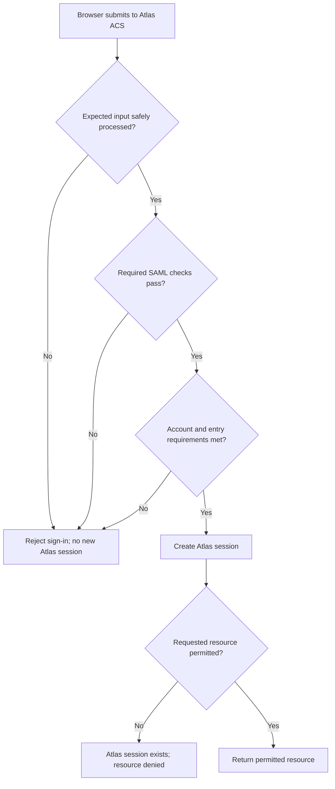
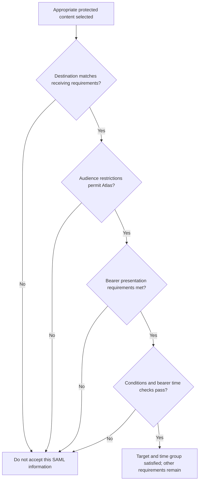
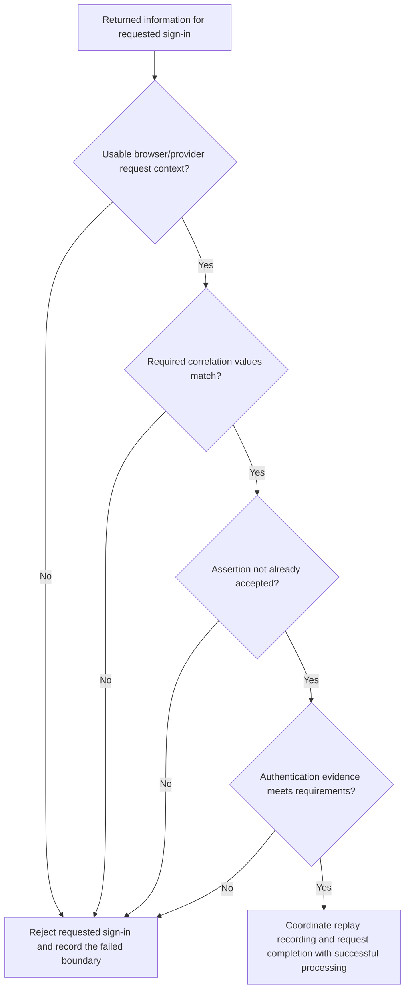
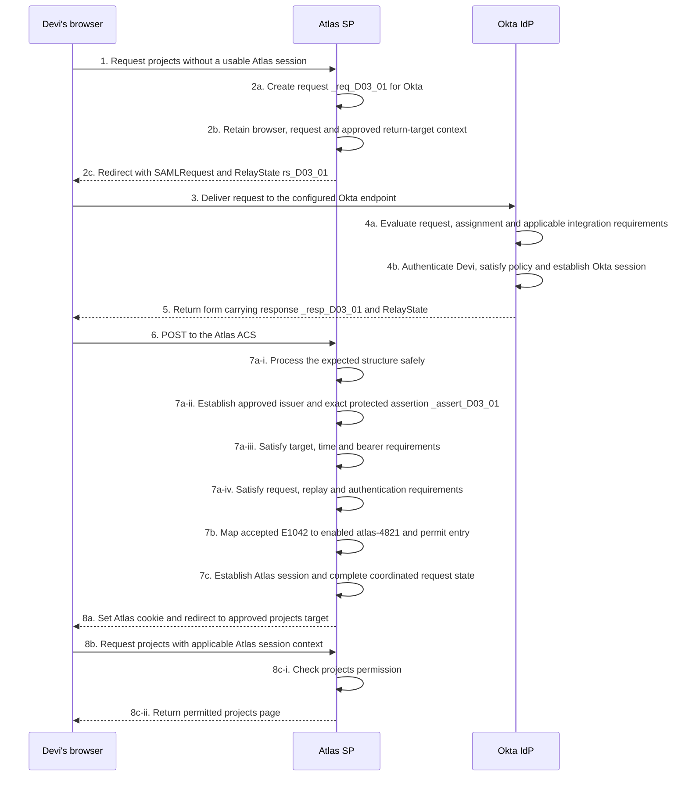
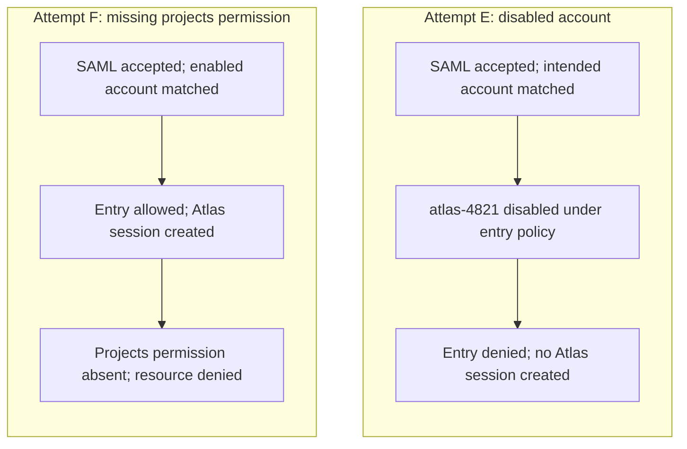

# Lesson 7: Response acceptance and application access

Devi has completed authentication at Okta. Her browser submits a SAML response to Atlas, and Atlas now has to decide whether it can rely on the returned information. That decision belongs to Atlas. An Okta success, a readable assertion and a familiar NameID are useful observations, but none establishes the application’s acceptance result.

Daniel needs to explain the boundary precisely. Did Atlas receive a usable message? Did it establish trustworthy content for the intended sign-in? Did the accepted identity select an appropriate account? Was a session created, and did that account have permission to open projects?

## 7.1 Receive the expected message without trusting it prematurely

### Start with the integration’s agreement

For the established Northstar arrangement, Atlas expects a requested browser SSO response from the approved Okta integration, delivered through HTTP POST to `https://atlas.northstar.example/saml/acs`. Its SP entity ID is `https://atlas.northstar.example/saml`. Atlas requires a signed assertion and uses the accepted employee identifier to find its local account.

The receiving endpoint is a location, not a guarantee about what arrives there. Atlas must process input under the expected binding, profile and supported application configuration. An unexpected form field, malformed encoding or unsupported message structure does not become acceptable because the request reached `/saml/acs`.

**Figure L07-D1: Three groups of decisions.** Arrows describe logical dependencies. This is an overview, not a universal parser or cryptographic execution order. Each group expands into several checks.

The first group concerns handling input safely. The second concerns reliance on SAML information. The third concerns Atlas’s own account and entry policy. Resource permission remains a separate question after the session exists. A failed check in an early group does not establish what a later group would have decided.

### Parsing and structure are security boundaries

An XML parser turns received bytes into elements and attributes. It should not let untrusted input trigger arbitrary file access, external entity expansion, remote schema downloads or unbounded resource use. A maintained SAML implementation needs safe parsing, appropriate input limits and controlled structural validation. Where schema validation is performed, schemas come from trusted local configuration rather than a location supplied by the message. OWASP recommends schema validation before security-related use of SAML XML. [OWASP SAML security guidance: validate signatures and XML](https://cheatsheetseries.owasp.org/cheatsheets/SAML_Security_Cheat_Sheet.html)

Schema validity establishes allowed structure and data types. It does not establish that Okta sent the message, that its key is approved, or that the assertion targets Atlas. Conversely, a signature check does not excuse unsafe parsing or ambiguous element selection. Structural handling and cryptographic reliance must work together.

A receiver must also apply its supported rules for message shape. Multiple assertions, extensions or subject-confirmation alternatives require deliberate processing; they are not an invitation to search the document for whichever NameID produces a match. Unexpected structures should follow documented rejection or supported handling, not improvised acceptance.

### Read status as a reported result

A non-success response is a protocol outcome to handle, not an instruction to keep searching for a usable account identifier. A success status is a claim from the responder, not proof that Atlas has accepted the assertion. Any information used for a security decision must have the protection required for its role and location.

When a response is rejected, Atlas should retain appropriate diagnostic evidence without exposing sensitive assertion contents or internal details indiscriminately. A user-facing error can be brief while authorized support records identify the failed processing boundary. Daniel should use those records to distinguish an encoding failure from an issuer mismatch or an application-account failure.

## 7.2 Establish the issuer and exact trustworthy content

### Select approved trust for this relationship

Atlas must establish that the required content is protected under an approved key for the expected Okta issuer and integration. It cannot trust a new certificate solely because the message supplies it. Nor can it establish the issuer by comparing the issuer string without validating the required protection.

The trust configuration supplies the approved relationship. The signature evidence establishes protection under the selected key. The receiver must then ensure that its identity and restriction checks use the verified content. A valid signature over one assertion does not authenticate a NameID selected from another.

| Question | Evidence needed | Failure that the evidence can expose |
| --- | --- | --- |
| Is this the expected issuer and trust relationship? | Approved integration information and effective runtime trust | Wrong provider, wrong environment or unauthorized key |
| Is the required layer protected? | Actual signature placement and reference scope | Response signed when this application requires an assertion signature |
| Does verification pass under permitted processing? | Reference/digest checks, signature-value result and algorithm policy | Changed content, wrong key, disallowed algorithm or invalid signature |
| Is the verified content what Atlas uses? | Unambiguous element selection tied to the verification result | Verified-versus-consumed mismatch |

These are related questions, not interchangeable descriptions of “signature valid.” The browser SSO processing rules require verification of signatures present on the response or assertions. Do not treat an invalid additional signature as harmless decoration because another required signature passed. The applicable profile, errata and supported receiver policy govern the complete arrangement. [SAML Profiles, §4.1.4.3](https://docs.oasis-open.org/security/saml/v2.0/saml-profiles-2.0-os.pdf), [SAML Errata 05, E93](https://docs.oasis-open.org/security/saml/v2.0/errata05/os/saml-v2.0-errata05-os.pdf)

### Handle encryption dependencies without inventing an order

If the assertion is encrypted, Atlas needs the appropriate private decryption capability. Required outer protection may need verification before decryption; a signature inside ciphertext cannot be checked until the relevant content is recovered. The supported construction determines those dependencies.

Do not use the order of headings in a checklist as a replacement for the SAML library’s secure processing. The important engineering questions are whether all required protections were applied, which exact content emerged from that processing, and whether Atlas relied only on acceptable content. [W3C XML Signature Best Practices](https://www.w3.org/TR/xmldsig-bestpractices/)

### Move the receiving role when the relationship changes

For Okta-to-Atlas SAML, Atlas is the receiver performing these checks. For an external IdP-to-Okta inbound relationship, Okta is the receiver. The inbound IdP configuration has its own issuer, certificate, signature-verification choices and account-matching policy. Editing the outbound Atlas app’s settings does not automatically repair an inbound validation failure.

Okta documents inbound Response Signature Verification options separately from the outbound app’s signing choices. A product offering a setting is not proof that a selected option meets the organization’s security requirements or Atlas’s downstream contract. [Okta: external SAML IdP settings](https://help.okta.com/oie/en-us/content/topics/security/idp-add-saml.htm)

## 7.3 Check where, for whom and when the content may be used

### Keep the target checks distinct

Atlas’s response destination and bearer recipient are its ACS in this arrangement. The assertion audience identifies Atlas as a relying party. The similar-looking URLs do different jobs.

**Figure L07-D2: Focus on target and presentation requirements.** Each diamond stands for the applicable checks on the intended response/assertion. A passing branch establishes only this group of requirements. The diagram assumes the content under examination is the appropriate trustworthy content.

The destination check concerns the reply’s receiving location under the applicable rules. The audience check concerns who may rely on the assertion. The bearer recipient check concerns where that confirmation permits presentation. None is replaced by a successful signature check.

Use exact approved values and applicable comparison rules. Do not silently rewrite an audience into an ACS URL, add a trailing slash to an entity ID, or use the test environment’s identity because its hostname looks familiar. When an application sits behind a proxy, its documented external endpoint and receiving configuration must agree; blindly trusting arbitrary incoming host information is not a sound way to discover its SAML identity.

### Evaluate restrictions as restrictions

For the established illustrative response, Conditions starts at 14:59:50 UTC and ends before 15:05:00 UTC. Bearer confirmation ends before 15:02:00 UTC. At 15:03:00, the assertion is still within the Conditions interval but fails that bearer presentation deadline. A signature continues to be mathematically verifiable after a use-time limit; that does not extend permission to use the assertion.

Allowed clock tolerance is a configured allowance for clock differences, not an automatic extra session lifetime. Daniel should know the receiver’s applicable tolerance and inspect system time when diagnosing boundary failures. Do not increase tolerance simply because an expired response would otherwise pass. Also distinguish clock error from real delivery delay.

Conditions must be evaluated according to their combination rules. For example, multiple AudienceRestriction elements cannot be flattened into one “any matching audience anywhere” test. Unrecognized conditions cannot simply be ignored to obtain a positive result. [SAML Core, §§2.5.1–2.5.1.4](https://docs.oasis-open.org/security/saml/v2.0/saml-core-2.0-os.pdf)

If multiple subject-confirmation alternatives appear, evaluate the supported confirmation under the applicable rules as a complete alternative. Do not borrow the recipient from one alternative and the time limit from another. The main Atlas example has one bearer confirmation, so its values must satisfy that confirmation together. [SAML Core, §2.4.1](https://docs.oasis-open.org/security/saml/v2.0/saml-core-2.0-os.pdf)

## 7.4 Establish the attempt, permitted reuse and authentication result

Recall Lesson 6’s verified-versus-consumed distinction: the identity, restrictions and authentication evidence used in these decisions must come from the exact content whose required protection was verified.

### Match the response to the pending browser attempt

For a requested exchange, Atlas must connect the returned information with the request it actually issued and the expected browser context. A matching ID is necessary in the relevant correlation fields, but an arbitrary old ID is not sufficient. The retained attempt needs to be usable, associated with the intended provider/browser, and handled under the application’s expiry and completion rules.

**Figure L07-D3: Requested exchange correlation and reuse.** This is Atlas’s example requested-flow policy. Unsolicited acceptance is a separate configured path, not a fallback from these failed decisions.

The first decision asks whether Atlas has the expected attempt, not just whether a query parameter is present. The second checks correlation at the required locations. In the established exchange, the relevant Response and bearer SubjectConfirmationData values both point to `_req_D03_01`.

RelayState can help preserve agreed context, but it cannot authorize a different InResponseTo value. A response signed by the right provider can still answer a different request. If pending state has expired or disappeared, investigate why rather than silently treating the response as unsolicited.

An explicitly supported unsolicited path has no initiating SP request and different correlation expectations. Its lack of request association is a known design property with its own controls. It is not a general exception that makes any unmatched response acceptable. [SAML Profiles, §§4.1.4.3 and 4.1.5](https://docs.oasis-open.org/security/saml/v2.0/saml-profiles-2.0-os.pdf), [SAML Errata 05, E90](https://docs.oasis-open.org/security/saml/v2.0/errata05/os/saml-v2.0-errata05-os.pdf)

### A valid time window does not authorize replay

Suppose Atlas accepts an assertion at 15:00:21 and receives the same assertion again at 15:00:25. Both arrivals can precede its time limits. The second does not become a new authentication just because its signature and timestamps still check out.

The POST browser SSO rules require protection against bearer assertion replay, retaining used IDs over their applicable validity period. Assertion IDs and response IDs identify different objects; the receiver’s controls must protect the actual bearer assertions it relies on. In a deployment with several receiving nodes, replay protection must remain effective across the nodes that could accept the same information. Two simultaneous requests must not both succeed merely because each node checked an incomplete local record. [SAML Profiles, §4.1.4.5](https://docs.oasis-open.org/security/saml/v2.0/saml-profiles-2.0-os.pdf)

This is an application/library coordination requirement, not a reason to implement a new replay algorithm by hand. Keep replay recording, pending-request transitions and sign-in processing consistent under the supported design. A retry after a browser or network problem may need a new sign-in attempt; resubmitting the same bearer assertion is not automatically a safe recovery.

### Check authentication evidence against the requirement

An assertion’s recent IssueInstant establishes recent issuance. AuthnInstant describes the reported authentication time. They are not interchangeable. A fresh response can report an older authentication context.

If Atlas requires recent authentication, or requests an authentication context, it needs evidence that meets the applicable requirement. A ForceAuthn flag in the outgoing request does not prove how Okta processed it. The relevant Okta configuration and authentication evidence matter, and Atlas’s own requirement must be clear. A context class URI is not a portable count of MFA factors.

Likewise, IsPassive constrains visible interaction; it does not instruct Atlas to accept an unsatisfied authentication requirement. Keep requested behavior, provider processing and receiver acceptance as separate facts. [SAML Core, §§3.3.2.2.1 and 3.4.1](https://docs.oasis-open.org/security/saml/v2.0/saml-core-2.0-os.pdf)

## 7.5 Complete the application decisions and identify the stopping boundary

### Follow the complete successful exchange

Return to Devi’s established requested sign-in. She has no usable Atlas session. Her Okta account, Atlas assignment and applicable policy allow this attempt. Atlas’s account `atlas-4821` is enabled and permitted to open projects.

The returned runtime assertion is properly protected under the configured requirements. This is a fictional successful processing record, not a claim that the unsigned reading copy or placeholder signature from the XML examples can be submitted successfully.

**Figure L07-S1: The complete requested exchange with expanded acceptance decisions.** This revisits the same transaction as L03-S1 and preserves its main step labels. The 7a substeps expand Atlas’s receiving work as logical groups; they do not prescribe one cryptographic execution order.

Steps 1–6 get the response to Atlas. Steps 7a-i through 7a-iv establish why Atlas may rely on the intended information for this attempt. Step 7b interprets the accepted identity under the agreed account rule. Step 7c establishes Atlas’s local session. Only steps 8c-i and 8c-ii establish permitted access to projects.

Account matching does not mean “find any account with similar-looking text.” Atlas uses the approved identity scope and identifier, requires an appropriate unique match, and checks its entry policy. Missing required application attributes, an ambiguous match or a disabled downstream account can stop sign-in even after SAML acceptance.

Where an application supports JIT, account creation follows its configured rules. An Okta assignment does not itself prove that a downstream provisioning operation succeeded. The account lifecycle mechanism and the sign-in evidence must agree with the application’s requirements.

### Compare independent rejection packets

Each row below is an independent fictional submission to Atlas’s production ACS. Atlas expects its production SP entity ID and approved Okta provider. The supplied diagnostics establish safe processing and successful required signature verification under the approved key. The submitting browser has no usable Atlas session.

In A through C, Atlas has pending request `_req_V07_01` for the correct browser and provider. D concerns an assertion from an earlier completed attempt being submitted again; its original pending request has already been completed.

The packet identifies one known failure in each row. It does not claim that every unreported check passed or that the proposed correction has already produced access. Time examples use no clock tolerance.

| Packet | Supplied observation | Boundary established by the evidence |
| --- | --- | --- |
| A: wrong audience | Response delivered to production ACS; assertion audience is `https://atlas-test.northstar.example/saml` | Correct delivery, wrong relying-party target |
| B: late bearer presentation | Conditions ends at 15:05:00; bearer deadline is 15:02:00; arrival is 15:03:00 UTC | Conditions time alone passes; bearer presentation is too late |
| C: wrong request | RelayState resolves to the expected pending context; required correlation values contain `_req_V07_99` | Returned content does not answer the retained request |
| D: repeated assertion | Diagnostics identify an assertion ID already accepted during its still-open presentation window | Time validity has not authorized reuse |

For A, compare approved audience configuration and actual output. Changing the ACS to resemble the wrong audience confuses two roles. For B, inspect timestamps, delivery delay and clock evidence. For C, inspect outgoing requests, browser/state association, retries and returned correlation. For D, inspect the earlier acceptance and whether the client repeated a submission; do not disable replay protection merely to remove the visible rejection.

None of these packets justifies replacing a certificate based on the stated evidence. Their signatures passed under the approved key, while the known failure lies elsewhere. A correction should address that boundary and then verify the entire intended outcome.

### Distinguish rejection from application denial

Now compare two further independent attempts. Both have recorded successful SAML acceptance, the correct scoped identifier `E1042`, and no pre-existing Atlas session.

**Figure L07-C1: Two different application outcomes after SAML acceptance.** These are paired local decision flows, not browser exchanges. The account and permission states are supplied fictional facts.

Attempt E stops before session creation because the account cannot enter Atlas under the stated policy. Attempt F establishes a session but denies projects. Neither is evidence of a bad SAML signature. For E, inspect the account lifecycle and entry-policy decision. For F, inspect the application’s permission model and any agreed attribute-to-role mapping.

These distinctions prevent risky fixes. Enabling an account or granting a role changes access and requires the appropriate authority; it is not a default troubleshooting step. Daniel’s first task is to establish the intended account state and permission, then involve the owner of the actual decision.

### Keep the evidence statement useful

Compare “Okta says success, so SAML is fine” with a more precise record:

> Okta returned a response, the browser submitted it to the expected Atlas ACS, and Atlas recorded successful SAML acceptance for the intended account. Atlas then denied entry because that downstream account was disabled. No new Atlas session was created.

That statement identifies the sender-side observation, receiving boundary, account decision and session outcome. It does not claim a cause that the packet never established. Okta’s assertion preview can help inspect generated output, but it is not evidence that Atlas accepted a particular live attempt. [Okta: create SAML app integrations and preview assertions](https://help.okta.com/oie/en-us/content/topics/apps/apps_app_integration_wizard_saml.htm)

To check your understanding, explain why each of these can coexist: a valid signature and wrong audience; an unexpired assertion and replay rejection; successful SAML acceptance and no application session; an application session and denied projects access. Then identify the next evidence you would request for rejection packets A–D and application-outcome attempts E–F. A useful answer names the decision, explains its purpose and limits, and connects the proposed investigation to the supplied facts.

### Terms to keep straight

| Distinction | What the evidence establishes |
| --- | --- |
| Received / accepted | Input arrived / applicable reliance requirements passed |
| Schema-valid / trustworthy | Allowed XML structure / approved protection and issuer relationship |
| Signature-valid / acceptable | Cryptographic result for selected content / all required SAML-use decisions |
| Conditions time / bearer deadline | Assertion-use interval / confirmation presentation limit |
| Correlated / not replayed | Answers the expected request / not an impermissible repeated assertion |
| Issued recently / authenticated recently | Recent message creation / recent authentication evidence |
| SAML accepted / entry permitted | Identity information accepted / application account may establish a session |
| Session established / resource allowed | Continuing application state / permission for the requested action |

## References

- [OASIS SAML Profiles: browser SSO response processing and replay](https://docs.oasis-open.org/security/saml/v2.0/saml-profiles-2.0-os.pdf)
- [OASIS SAML Core: conditions, subject confirmation and authentication requirements](https://docs.oasis-open.org/security/saml/v2.0/saml-core-2.0-os.pdf)
- [OASIS SAML Errata 05: processing clarifications](https://docs.oasis-open.org/security/saml/v2.0/errata05/os/saml-v2.0-errata05-os.pdf)
- [W3C XML Signature Best Practices](https://www.w3.org/TR/xmldsig-bestpractices/)
- [OWASP SAML Security Cheat Sheet](https://cheatsheetseries.owasp.org/cheatsheets/SAML_Security_Cheat_Sheet.html)
- [Okta external SAML IdP settings](https://help.okta.com/oie/en-us/content/topics/security/idp-add-saml.htm)
- [Okta SAML integration and assertion preview](https://help.okta.com/oie/en-us/content/topics/apps/apps_app_integration_wizard_saml.htm)
