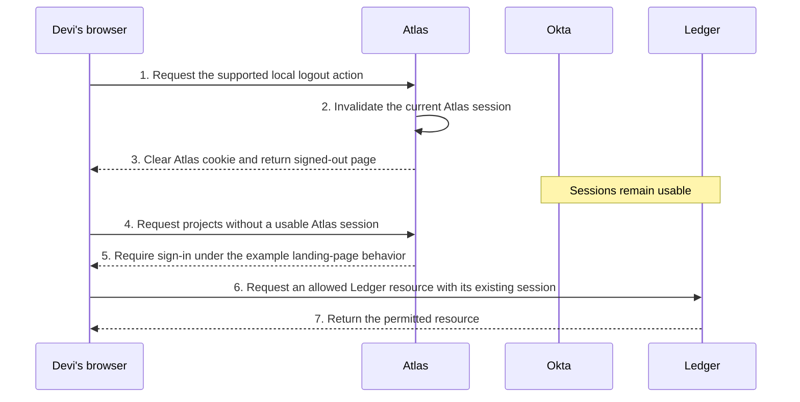
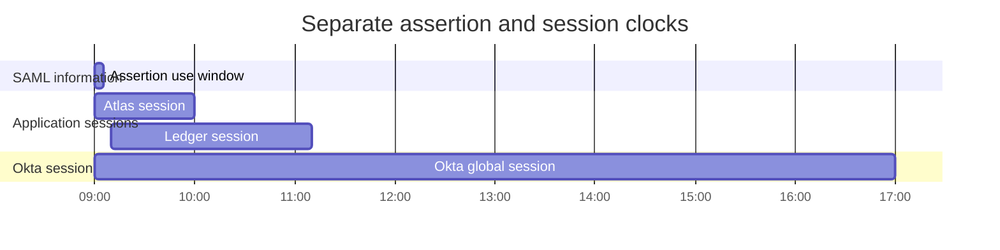
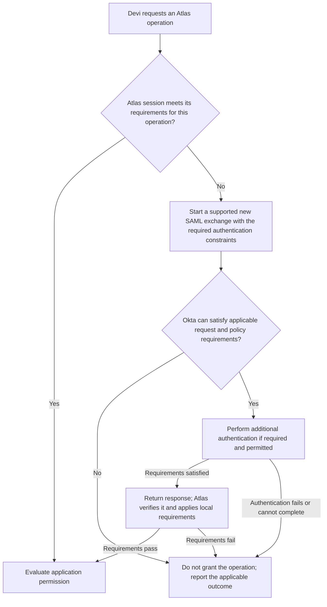
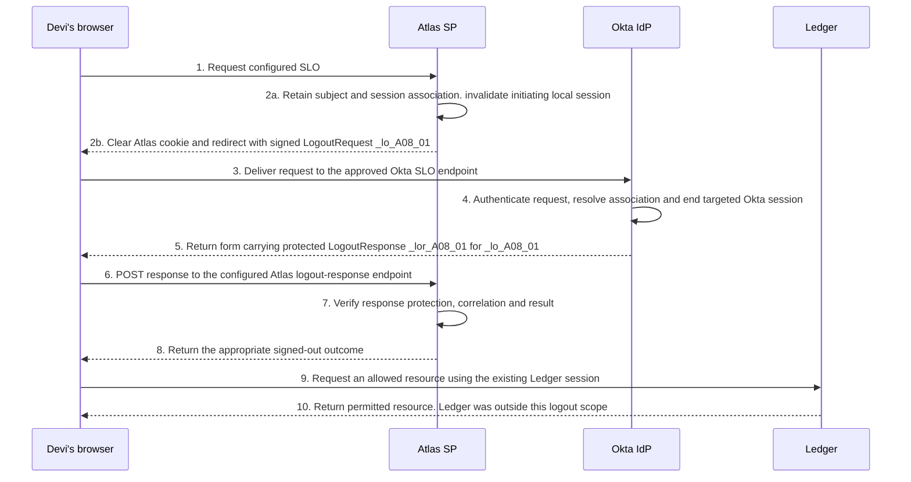
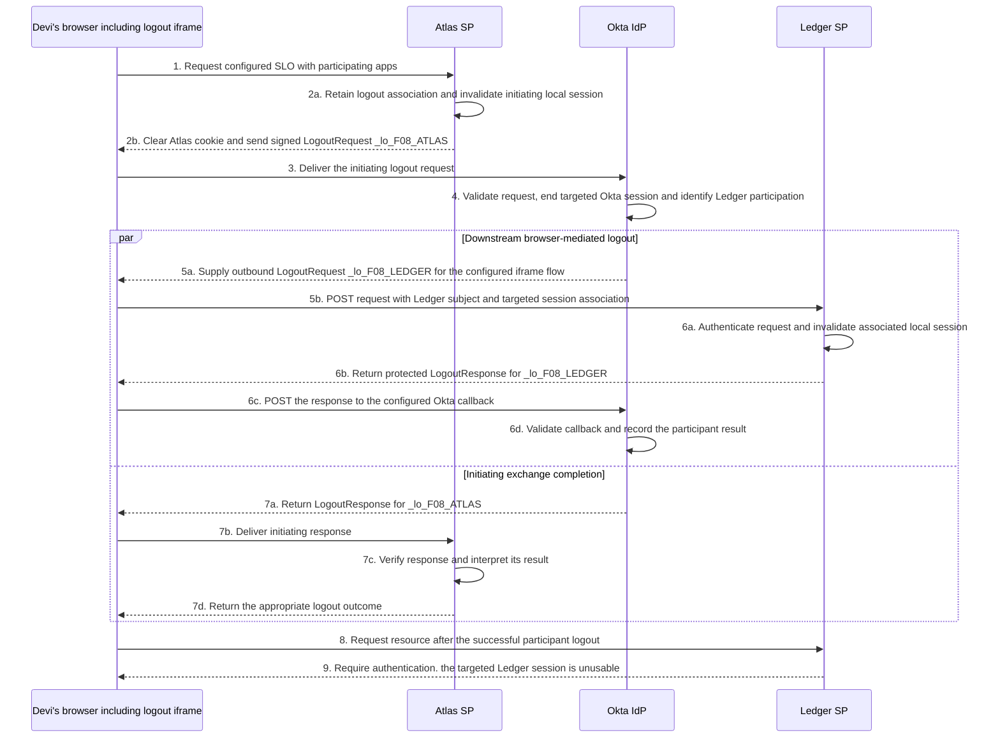
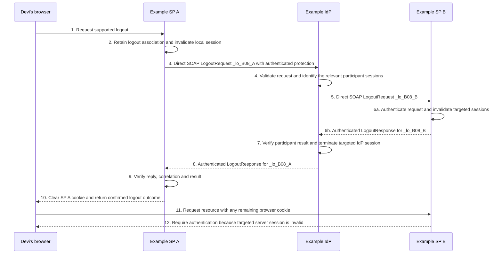

# Lesson 8: Sessions, reauthentication, and logout

Devi can open Atlas and Ledger after signing in through Okta. She signs out of Atlas, then discovers that Ledger still opens. Has logout failed, or did it do exactly what that particular action was designed to do?

Daniel cannot answer by looking at one sign-out page. He needs to identify the sessions involved, which action targeted them, which messages reached their destinations, and what the applications accepted afterward. Federation connects sign-in decisions across systems; it does not merge every system’s session into one object.

## 8.1 Identify the independent sessions

### Okta, Atlas and Ledger retain different state

After successful sign-in to both applications, Devi can have three separate sessions in one browser context:

| Session | Owner | What it can establish |
| --- | --- | --- |
| Okta global session | Okta | Context for subsequent Okta authentication and policy decisions |
| Atlas application session | Atlas | Continuing access under Atlas’s own session and account rules |
| Ledger application session | Ledger | Continuing access under Ledger’s own session and account rules |

The browser holds applicable cookies for these services and returns them according to their scope, attributes and browser policy. An Atlas cookie is not an Okta session, and Okta does not receive every application cookie. Cookie names and low-level behavior should not be inferred from a Classic Engine example. Okta’s global session rules govern its session lifetime and cookie persistence; each application owns its local session implementation. [Okta Identity Engine global session rules and cookies](https://help.okta.com/oie/en-us/content/topics/identity-engine/policies/add-okta-sign-on-policy-rule.htm), [MDN: HTTP cookies](https://developer.mozilla.org/en-US/docs/Web/HTTP/Guides/Cookies)

A cookie is browser-held information used in session handling. A server can invalidate the session associated with a cookie even if the browser still retains the cookie bytes. Conversely, removing a local browser cookie is not proof that the server invalidated every copy or related session elsewhere. Inspect the supported server and browser behavior together.

SAML’s `SessionIndex` associates authentication-session information with the federation relationship. It is not the Atlas cookie value and need not equal another application’s SessionIndex. An application supporting SLO needs an appropriate association among its local sessions, the SAML subject and the relevant session information.

### Local logout can leave SSO available

In this independent scenario, Atlas supports a local-only logout action. Devi has usable Okta, Atlas and Ledger sessions. No SAML logout messages are sent. The example Atlas implementation invalidates its current session and clears its corresponding cookie; Ledger and Okta are unaffected by that action.

**Figure L08-S1: Complete local Atlas logout and subsequent observations.** The browser remains explicit even though no SAML exchange occurs. The Atlas check stops at its sign-in page rather than automatically starting another SSO attempt.



Steps 1–3 establish local Atlas logout. Steps 4–5 verify that the old Atlas session no longer grants access. Steps 6–7 establish that Ledger’s own session remains usable. This is the expected outcome for the supplied local-only design.

If Atlas immediately starts SSO again, Okta’s still-usable session may help establish a new Atlas session, subject to applicable policy. A quick return to the application does not prove that the old Atlas session survived. Distinguish continued use of an old session from issuance of a new one by examining the actual request and session history.

## 8.2 Read the independent clocks

### Assertion validity is not the application session timer

An assertion’s time restrictions govern use of the SAML information. A bearer confirmation has its own presentation deadline. `AuthnInstant` describes the reported authentication time. These values do not, by themselves, define the exact lifetime of every derived application session.

An optional `SessionNotOnOrAfter` in an authentication statement expresses an upper bound for sessions derived from that assertion, with processing governed by the applicable profile. It must be understood separately from Conditions expiry. An application’s own maximum lifetime, idle timeout and reauthentication requirements can impose additional constraints. [SAML Errata 05, E79](https://docs.oasis-open.org/security/saml/v2.0/errata05/os/saml-v2.0-errata05-os.pdf), [SAML Profiles, §4.1.4.3](https://docs.oasis-open.org/security/saml/v2.0/saml-profiles-2.0-os.pdf)

**Maximum lifetime** limits how long a session can continue from its defined starting point. **Idle timeout** limits the permitted period without qualifying activity. The service defines which activity counts; using Ledger does not automatically count as activity at Atlas or Okta. Browser persistence is another consideration: a browser retaining a cookie does not override a server-side expiry.

### Compare an explicit example

The following is an independent fictional schedule on October 16, 2026. Authentication occurs at 09:00 UTC. The assertion is issued at 09:00:05 and its illustrated use window ends at 09:05:05. Atlas establishes a session at 09:00:06 with a fixed expiry of 10:00. Ledger establishes a separate session at 09:10 with expiry at 11:10. Okta’s example global session lasts until 17:00.

These are fictional values, not Okta defaults. The example supplies no earlier session bound, idle expiry, logout or other invalidation. No later sign-in extends or replaces the sessions shown.

**Figure L08-T1: Independent validity and session intervals in UTC.** Bars show the stated intervals, not network messages. The chart displays a selected assertion Conditions window; bearer presentation restrictions still apply independently.



At 09:30, the displayed assertion-use window has ended, while all three sessions remain usable under the supplied assumptions. Atlas is using its established session rather than accepting the old assertion again for every request. At 10:30, Atlas’s illustrated session has expired, while Ledger and Okta remain active. If Atlas starts a new SAML exchange, its result depends on current requirements, not the expired assertion.

This is why a short assertion lifetime can coexist with a longer application session. It is also why ending an Okta session does not automatically prove that an independently established application session ended. The particular logout or lifecycle mechanism must cause that downstream change.

## 8.3 Explain reauthentication at the right boundary

### Global policy and app sign-in policy have different roles

In Identity Engine, global session policy governs Okta session/authentication context and related challenges. App sign-in policy defines authentication requirements for the requested integration. Its rules can impose authentication frequency and context requirements. A usable Okta global session does not guarantee that every app’s current requirements are already satisfied. [Okta: global session policies](https://help.okta.com/oie/en-us/content/topics/identity-engine/policies/about-okta-sign-on-policies.htm), [app sign-in policies](https://help.okta.com/oie/en-us/content/topics/identity-engine/policies/about-app-sign-on-policies.htm)

Atlas also decides when its own local session is sufficient. A resource request served entirely under an existing Atlas session may never reach Okta. Changing an Okta app sign-in policy does not prove Atlas has started consulting Okta on every local page request.

| Question | Decision owner |
| --- | --- |
| Is there usable Okta session context? | Okta global session processing |
| Must the user satisfy additional authentication requirements for this integration? | Applicable Okta app sign-in policy and request processing |
| Is the current Atlas session sufficient for this operation? | Atlas’s session and action policy |
| Does the account have permission to perform the operation? | Atlas authorization |

### Follow changed requirements

**Figure L08-D1: Reauthentication decisions for an Atlas resource.** This is a conceptual supported integration path, not a claim that every application implements step-up in the same way. A new SAML exchange must still complete all acceptance, account and resource checks.



A recent assertion IssueInstant proves recent issuance, not recent authentication. Atlas must interpret the returned AuthnInstant and context under its actual requirement. A request containing ForceAuthn asks for fresh authentication; Okta’s documented Honor Force Authentication behavior and the observed result matter. It does not universally mean password entry, MFA, or termination of unrelated sessions. [Okta SAML field reference: Honor Force Authentication](https://help.okta.com/oie/en-us/content/topics/apps/aiw-saml-reference.htm)

IsPassive constrains visible interaction. If the required result cannot be obtained within that constraint, an existing session does not justify bypassing the requirement. A failed passive attempt and an interactive reauthentication path are different outcomes.

Okta documents authentication-frequency options within app sign-in rules. Interpret the applicable rule and supported authenticator behavior rather than assuming every policy evaluation must display a particular prompt. The evidence should establish which requirement applied and what authentication actually occurred. [Okta: app sign-in policy rule](https://help.okta.com/oie/en-us/content/topics/identity-engine/policies/add-app-sign-on-policy-rule.htm)

## 8.4 Follow logout messages and their scope

### A logout request identifies the relevant relationship

SAML **Single Logout**, or **SLO**, coordinates logout among a session authority and participating services. In the main relationship, Okta is the authority and Atlas is a participant. The authority needs to associate the relevant session with its participants; the apps need to associate incoming logout information with their local sessions.

| Message information | Purpose |
| --- | --- |
| LogoutRequest `ID`, `Issuer`, `IssueInstant` and applicable destination/expiry | Identify the request, sender and intended processing context |
| Subject identifier, such as NameID with its agreed format/scope | Identify the principal in this relationship |
| SessionIndex, where supplied and applicable | Identify the targeted session association |
| LogoutResponse `InResponseTo`, issuer and status | Associate the reply with the logout request and report its result |

The NameID used for logout must correspond to the relevant federation relationship, not an arbitrary display name. Atlas and Ledger may use different identifiers for Devi. An authentication SessionIndex is not a LogoutRequest ID, and neither is the application cookie.

Under the SAML participant rules, a valid request without SessionIndex can target all sessions associated with the identified principal at that participant. Supplying an index narrows the intended association under the applicable rules. A product’s supported request generation and application handling still need verification; do not assume one browser logout universally selects every session on every device. [SAML Core, §§3.7.1–3.7.3](https://docs.oasis-open.org/security/saml/v2.0/saml-core-2.0-os.pdf)

Logout messages need authentication, integrity protection, appropriate destination/time handling and response correlation under their binding and profile. A request that can end a session is security-sensitive even though it does not grant access. A bare HTTP success from a logout endpoint is not enough to establish a valid SAML LogoutResponse or successful session termination.

### The basic Okta app-initiated path

**Core path to master:** trace this browser exchange and explain which sessions end, which remain, and what evidence confirms each outcome.

Okta’s basic SAML SLO documentation describes an SP-initiated request that ends the Okta session and the configured application session. The SP’s SLO request must be signed, and the integration must support and be configured for this feature. The application’s Signature Certificate supplies verification material for its signed request; that is distinct from Okta’s signing certificate supplied to the app. [Okta: configure Single Logout](https://help.okta.com/oie/en-us/content/topics/apps/apps_single_logout.htm)

For this independent successful example, Atlas and Okta have agreed logout endpoints, approved keys and session associations. Ledger is not participating in this basic logout arrangement and retains its own usable session. Atlas retains the necessary SAML logout association while invalidating the initiating local session under its supported implementation.

**Figure L08-S2: Basic Atlas-initiated SLO through the browser.** Redirect is the selected example request binding, subject to support at both endpoints. Okta returns the response through POST, as described in its basic SLO configuration guidance. The IDs are symbolic transaction labels, and actual endpoints come from the approved setup information.



Steps 1–3 initiate and deliver the signed request. Step 4 establishes the targeted Okta-session outcome. Steps 5–7 complete the response exchange; Atlas must inspect the result rather than infer it from the browser returning. Steps 9–10 show the stated scope limit. Ending Atlas and Okta sessions did not send a logout request to Ledger.

The local invalidation timing at step 2a is this example’s implementation choice, not a universal SAML ordering rule. If the later exchange fails, that prior local invalidation can still have occurred. Report the actual per-service outcomes.

### Front-channel notification of another participating app

**Orientation and investigation:** recognize how notifications reach other apps. Study the configuration details when a project uses this supported feature; first be comfortable reconstructing the basic SLO exchange above.

Okta separately documents a Front-channel Single Logout feature, marked Early Access in the cited guide. It requires the feature and the relevant initiating/receiving app configuration, plus application support. Do not infer this fan-out behavior from the basic SLO checkbox alone.

For this example, Atlas can initiate SLO and Ledger is configured to receive Okta’s outbound logout request. Both sessions belong to the tracked Okta-session context. The documented front-channel notification uses the browser, including an embedded iframe for downstream app requests. The application remains responsible for invalidating its associated server-side sessions. [Okta: SAML front-channel SLO guide](https://developer.okta.com/docs/guides/single-logout/saml2/main/)

**Figure L08-S3: Atlas initiates; Okta notifies Ledger through the browser.** POST is selected for Ledger’s outbound request and callback. The two branches show separate work; the initiating response is not presented as proof that Ledger’s callback succeeded or as a guaranteed wait for every participant.



Steps 1–4 establish the initiating exchange and targeted Okta-session termination. Steps 5a–6d trace a separate outbound request, Ledger’s actual session invalidation, its response and the callback result. Steps 7a–7d complete the initiating app’s exchange. Step 8 is a later observation after the successful participant processing, not evidence inferred from the Atlas landing page.

The guide distinguishes ending the initiating Okta session from application session termination on other browsers/devices. Do not claim that every Okta session on every device ended. SessionIndex inclusion and application implementation affect which downstream sessions are targeted. Browser restrictions, unreachable endpoints or interrupted navigation can also affect front-channel completion.

### A direct server logout alternative in the SAML standard

**Orientation and investigation:** recognize direct server logout and its difference from browser delivery. Investigate its details only when the actual providers and applications document support for this arrangement.

SAML also defines synchronous logout using a binding such as SOAP. This is a **protocol example with generic participants**, not a claim that Okta’s documented front-channel feature performs SAML SOAP logout. A browser can start the user action while the federation messages travel directly between servers.

Assume Example SP A, Example SP B and Example IdP support the chosen back-channel arrangement, have approved trust and session associations, and all targeted processing succeeds. This example follows the authority’s participant-notification and session-termination ordering.

**Figure L08-S4: Complete SP-initiated back-channel SLO.** Browser traffic is distinct from direct SOAP requests and responses. SP B can invalidate server-side session state without receiving its browser cookie.



Steps 3 and 5 are server requests, not browser redirects. Steps 6b and 8 are the matching server responses. There are two request IDs and two reply relationships. A response to `_lo_B08_B` does not complete the initiating `_lo_B08_A` exchange by itself.

At step 11, the browser may still hold SP B’s old cookie. SP B’s invalidated server state prevents that cookie from continuing the targeted session. Direct communication avoids the browser as the message carrier for those logout requests, but introduces server connectivity and authenticated resolution of participants. It still does not make unreachable services disappear or prove that every unrelated session ended. [SAML Profiles, §§4.4.3–4.4.4](https://docs.oasis-open.org/security/saml/v2.0/saml-profiles-2.0-os.pdf)

## 8.5 Establish what ended and what remains

### Read partial logout honestly

The SAML authority’s top-level logout status concerns termination at that authority. If it ends its own targeted session but cannot obtain confirmation from every other participant, the standard uses a nested `PartialLogout` status to describe incomplete propagation. A top-level Success is therefore not a universal statement that every participant confirmed termination. [SAML Core, §3.7.3.2](https://docs.oasis-open.org/security/saml/v2.0/saml-core-2.0-os.pdf)

This standalone Status fragment illustrates that combination. It is not a complete LogoutResponse or an actual Okta capture. Whether a particular product exposes participant failures through this exact response, logs or another supported mechanism must be established for that path.

```xml
<samlp:Status xmlns:samlp="urn:oasis:names:tc:SAML:2.0:protocol">
  <samlp:StatusCode Value="urn:oasis:names:tc:SAML:2.0:status:Success">
    <samlp:StatusCode Value="urn:oasis:names:tc:SAML:2.0:status:PartialLogout" />
  </samlp:StatusCode>
</samlp:Status>
```

A participant timeout does not prove that its session is still active, and a delivered logout request does not prove that it ended. The defensible result may be “termination confirmed at Atlas and Okta; Ledger outcome unconfirmed.” Obtain Ledger’s processing and subsequent protected-resource evidence to resolve that uncertainty.

### Separate logout from account lifecycle actions

| Action | Intended boundary | Evidence still needed for downstream access |
| --- | --- | --- |
| Atlas local logout | Current Atlas session under its implementation | Other app and Okta session outcomes |
| End a targeted Okta session | Selected Okta session context | Any configured downstream logout/remediation and app-session results |
| Remove Atlas assignment in Okta | Access to that Okta integration and configured lifecycle effects | Provisioning result, downstream account state and existing Atlas sessions |
| Deactivate the Okta user | User and session state in Okta, plus configured deprovisioning | Completion and partner handling, including established application sessions |
| Disable the Atlas account directly | Atlas account/entry behavior | How Atlas applies disablement to already-issued local sessions |

Okta documents that deactivation stops active Okta sessions and removes app assignments; downstream deprovisioning depends on it being enabled and applicable to the app. Deactivation also runs as background work. These are important effects, but they do not justify inferring immediate termination of every independently established app session from the initial administrative action alone. Check the configured mechanism and actual application outcome. [Okta: deactivate and delete user accounts](https://help.okta.com/oie/en-us/content/topics/users-groups-profiles/usgp-deactivate-user-account.htm)

SAML assertions are not a live revocation feed that every application consults for each request. An application may have additional lifecycle, risk or session-termination integrations; those capabilities require their own support and evidence. Okta also has separately documented Universal Logout capabilities for supported apps. Do not confuse that product mechanism with the SAML SOAP example or assume it exists solely because an app uses SAML. [Okta: Universal Logout overview](https://developer.okta.com/docs/guides/oin-universal-logout-overview/)

### Investigate an incomplete sign-out

Consider an independent fictional ticket. Atlas and Ledger participate in the configured front-channel flow. The supplied evidence establishes that Atlas invalidated its initiating session, Okta ended the targeted global session, and a Ledger logout request was scheduled. The captured browser trace shows no completed Ledger callback. No Ledger application processing record has yet been obtained.

Can Daniel report that Ledger is logged out? Can he report that Ledger is definitely still signed in?

Neither conclusion follows. Scheduling is not processing, and the absent callback does not establish whether Ledger invalidated a session before its response was lost. The next evidence is the browser delivery result, Ledger’s matching request/session record, the callback result where available, and a fresh request to a protected Ledger resource under the relevant browser context.

If that fresh request succeeds, inspect whether it used the old session or completed a new authentication exchange. If it displays an old cached page without contacting the application, it has not established continued server access. Keep the observation tied to the actual protected operation.

### Define the scope of a logout claim

A useful report identifies the user, initiating browser/device, targeted Okta session, participating application sessions, per-service results and subsequent resource observations. “Signed out everywhere” needs an explicit meaning: all participants in one SLO context, all application sessions for that person, all Okta sessions, and every device are different scopes.

In a brokered sign-in, the external IdP has another independent session. Ending Okta’s downstream session does not establish that the external provider’s session ended. Include that relationship in the logout scope only when the supported configuration actually propagates logout there, and verify its result separately.

To check your understanding, explain why local Atlas logout can be followed by rapid SSO, why assertion expiry does not necessarily end Ledger’s session, and why Success with PartialLogout is not contradictory. Then describe the evidence needed to distinguish a surviving old session from a newly created one after logout. Each answer should identify whose state changed and what remains unknown.

### Terms to keep straight

| Distinction | Useful meaning |
| --- | --- |
| Okta session / app session | Provider-owned context / separately owned application state |
| Cookie removal / server invalidation | Browser-side change / receiver refuses the targeted session |
| Assertion expiry / session expiry | End of permitted SAML use / end of continuing signed-in state |
| Idle timeout / maximum lifetime | Inactivity limit / total-duration limit under the service’s policy |
| Reauthentication / authorization | Satisfying authentication again / permission for an action |
| Local logout / SLO | One service’s action / coordinated participant logout |
| Front-channel / back-channel | Browser carries federation messages / servers communicate directly |
| Requested / delivered / confirmed | Action initiated / message arrived / participant outcome established |
| Assignment removal / session termination | Integration access/lifecycle change / ending established session state |

## References

- [Okta Identity Engine global session rules and cookies](https://help.okta.com/oie/en-us/content/topics/identity-engine/policies/add-okta-sign-on-policy-rule.htm)
- [Okta global session policies](https://help.okta.com/oie/en-us/content/topics/identity-engine/policies/about-okta-sign-on-policies.htm)
- [Okta app sign-in policies](https://help.okta.com/oie/en-us/content/topics/identity-engine/policies/about-app-sign-on-policies.htm)
- [Okta app sign-in policy rules](https://help.okta.com/oie/en-us/content/topics/identity-engine/policies/add-app-sign-on-policy-rule.htm)
- [Okta SAML field reference](https://help.okta.com/oie/en-us/content/topics/apps/aiw-saml-reference.htm)
- [Okta Single Logout configuration](https://help.okta.com/oie/en-us/content/topics/apps/apps_single_logout.htm)
- [Okta front-channel SAML SLO guide](https://developer.okta.com/docs/guides/single-logout/saml2/main/)
- [OASIS SAML Core: Single Logout protocol](https://docs.oasis-open.org/security/saml/v2.0/saml-core-2.0-os.pdf)
- [OASIS SAML Profiles: Single Logout profile](https://docs.oasis-open.org/security/saml/v2.0/saml-profiles-2.0-os.pdf)
- [OASIS SAML Errata 05](https://docs.oasis-open.org/security/saml/v2.0/errata05/os/saml-v2.0-errata05-os.pdf)
- [Okta user deactivation](https://help.okta.com/oie/en-us/content/topics/users-groups-profiles/usgp-deactivate-user-account.htm)
- [Okta Universal Logout overview](https://developer.okta.com/docs/guides/oin-universal-logout-overview/)
- [MDN HTTP cookies](https://developer.mozilla.org/en-US/docs/Web/HTTP/Guides/Cookies)
