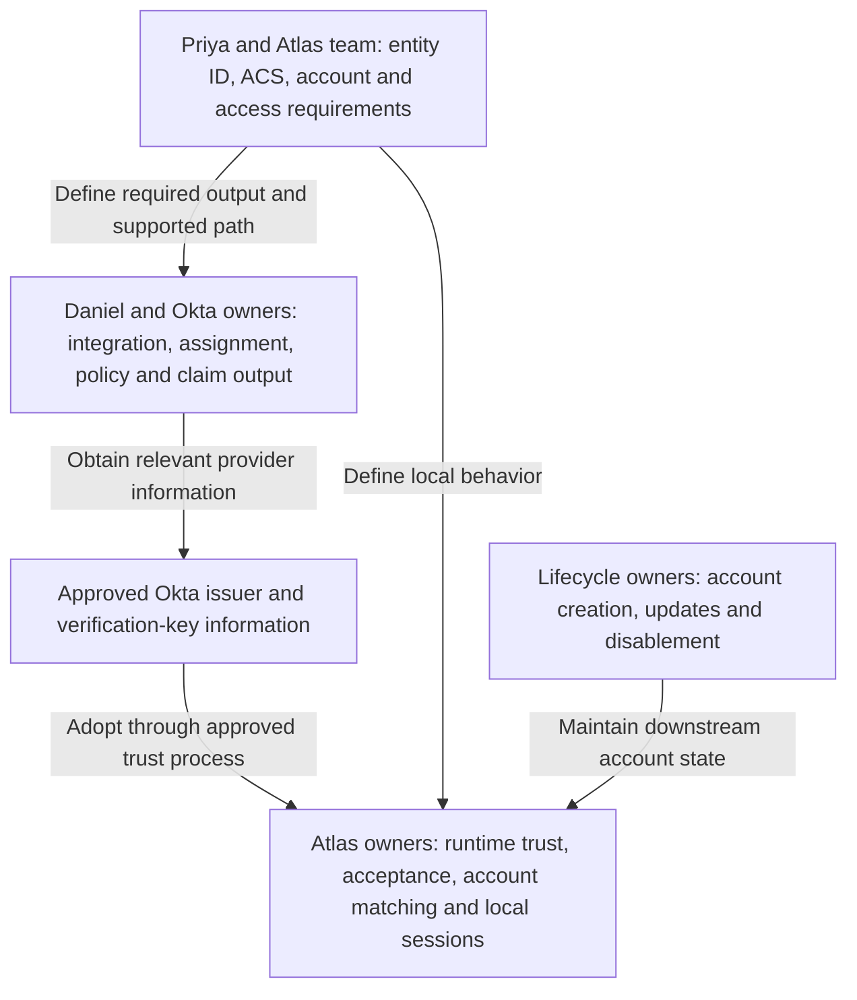
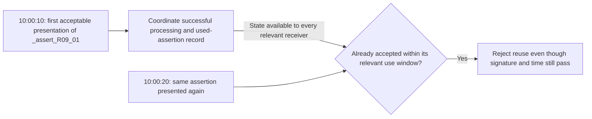
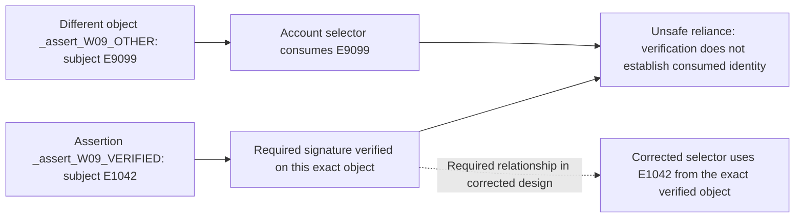
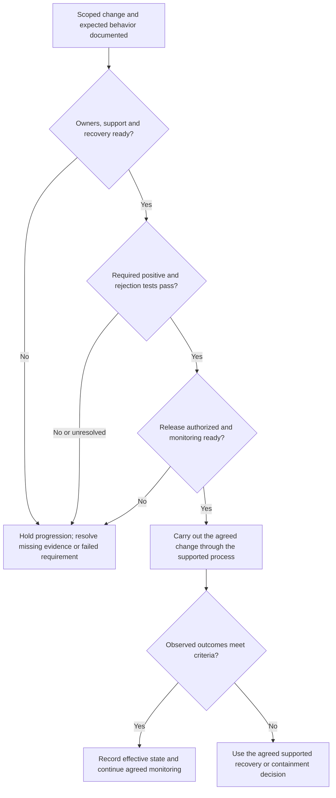

# Lesson 9: Secure integration design and change planning

Priya wants the separate Atlas test integration ready for a release review. Daniel receives a short proposal: copy the production settings, add the required department claim, activate a new signing certificate, and confirm that Devi can sign in. It sounds like a small task, but those instructions leave several decisions unresolved.

Which settings actually belong to test? Does the application still match the agreed employee identifier? Which key will Atlas trust when Okta changes its signing key? What would a successful test prove, and which rejection cases must remain rejected?

A useful review turns those questions into an agreement that another engineer can inspect and maintain. A working sign-in is one part of that agreement. Correct account selection, appropriate permissions, controlled failure behavior and recoverable changes matter too.

## 9.1 Turn the proposal into an explicit integration agreement

### Begin with purpose, participants and scope

The proposed test integration connects Northstar’s Okta Identity Engine org to Atlas test. Okta acts as IdP; Atlas test acts as SP. The agreed sign-in path is SP-initiated Redirect/POST. Unsolicited acceptance, artifact delivery and brokered authentication are outside this particular proposed path unless separately required and supported.

Devi is the representative permitted test user. The account-selecting identifier remains the approved employee value `E1042`, interpreted within the approved issuer relationship. Her test application record is a separate record from production, even if its visible identifier is the same.

The proposal must identify an actual supported integration, not merely a product name. An OIN integration and a custom integration can have different setup and capability requirements. Check the relevant application edition, environment and vendor instructions before deciding which configuration to use. [Okta: existing app integrations](https://help.okta.com/oie/en-us/content/topics/apps/apps-add-applications.htm), [custom SAML integrations](https://help.okta.com/oie/en-us/content/topics/apps/apps_app_integration_wizard_saml.htm)

### Compare the proposed values with their intended jobs

Daniel obtains this fictional review packet. It describes a proposal, not completed configuration or tested behavior.

| Item | Approved test requirement | Proposed entry or assumption | Review finding |
| --- | --- | --- | --- |
| SP entity ID | `https://atlas-test.northstar.example/saml` | Same test value | Agrees with the supplied requirement |
| ACS | `https://atlas-test.northstar.example/saml/acs` | `https://atlas.northstar.example/saml/acs` | Production receiving address copied into test proposal |
| Account identifier | Scoped employee identifier `E1042` | Devi’s email address | Changes the agreed account-selection rule |
| Required application data | `department`; selected group values with agreed meanings | Department plus every available group | Department output needs verification; broad group release lacks a stated need |
| Signing change | Receiver adopts approved K2 before sender uses it, if supported | Activate K2, then send the certificate to Priya | Receiver readiness has not been established |
| Account readiness | Appropriate enabled test account or supported creation arrangement | Assignment alone is considered sufficient | Downstream account evidence is missing |
| Logout scope | Explicit per-service expectations | “Okta logout ends all app sessions” | Scope and supporting mechanisms are unspecified |

The correct entity ID does not compensate for the wrong ACS. The right person’s email does not make it equivalent to the agreed employee identifier. An assignment, a certificate file and a logout button each need an interpretation tied to a particular system.

Okta’s Single sign-on URL, Audience URI, application username and Name ID format settings have distinct purposes. Review their meanings against Atlas’s requirements rather than copying a familiar-looking value into several fields. [Okta SAML field reference](https://help.okta.com/oie/en-us/content/topics/apps/aiw-saml-reference.htm)

### Locate the ownership boundaries

**Figure L09-C1: Configuration and responsibility in the test integration.** Arrows mean supplied requirements or approved configuration relationships, not live SAML traffic.

Atlas’s team specifies its receiving and account contract. Okta’s owners configure the provider side and establish what is actually emitted. Atlas’s owners adopt approved trust and implement acceptance and access decisions. Lifecycle owners establish how the account becomes ready and how access is removed. One person may perform several roles, but the decisions still belong to different boundaries.

For each important value, record its source, owner, environment and evidence. Keep declared, configured, observed and enforced information separate: metadata can declare a key while the receiver still uses an older manually imported key. A screenshot of a proposed setting does not establish runtime adoption.

## 9.2 Identify the assumption that could fail

### Replay: a still-valid assertion is not a reusable sign-in ticket

Consider an independent fictional processing record. Atlas accepted assertion `_assert_R09_01` at 10:00:10 UTC. Its bearer deadline is 10:02:00. At 10:00:20, Atlas receives that same assertion again. Signature verification still succeeds and the deadline has not passed.

The failed assumption would be: “If the signature and time checks pass, this can establish another session.” Those checks do not establish that the assertion has not already been used.

**Figure L09-D1: Two presentations of one bearer assertion.** Arrows describe receiving decisions, not an attack procedure. The time window is deliberately open for both presentations.

The protection is effective replay handling tied to the actual assertion and its usable lifetime. Its limit is equally important: replay protection does not establish the right audience, intended browser attempt or account mapping. For a service with several receiving nodes, the protection must remain effective across those nodes and simultaneous submissions. [SAML Profiles, §4.1.4.5](https://docs.oasis-open.org/security/saml/v2.0/saml-profiles-2.0-os.pdf)

### Response injection: a real provider response can belong elsewhere

In another independent fictional case, Atlas retains `_req_I09_EXPECTED` for Devi’s browser and the approved Okta provider. The returned response is genuinely signed under the approved key, targets Atlas, and falls within its time limits. However, its relevant correlation fields answer `_req_I09_OTHER`, an unrelated request. No evidence associates that request with Devi’s pending browser attempt.

The failed assumption would be: “Trusted sender and correct audience mean this response completes the current sign-in.” They do not establish which browser transaction the result belongs to. An unwanted or misplaced response must not establish the current session merely because its content originated from the right provider.

Atlas needs the applicable response and bearer InResponseTo checks, usable retained request/provider/browser association, and correct completion handling. RelayState alone cannot excuse the mismatched correlation. These controls also have a limit: an intentionally unsolicited path lacks an initiating SP request, so it needs a separately justified acceptance policy and controls against unwanted sign-in. A requested-flow failure must not silently fall through into that path. [SAML Profiles, §§4.1.4.3 and 4.1.5](https://docs.oasis-open.org/security/saml/v2.0/saml-profiles-2.0-os.pdf), [SAML Errata 05, E90](https://docs.oasis-open.org/security/saml/v2.0/errata05/os/saml-v2.0-errata05-os.pdf)

The next useful evidence in this case is the outgoing request, its retained browser/provider context, and the returned correlation values. Replacing a certificate is not justified by the supplied mismatch.

### Signature wrapping: the accepted identity must come from the verified object

Consider a fictional diagnostic design review, not an observed Atlas vulnerability. A verifier reports success for assertion `_assert_W09_VERIFIED`, whose subject is `E1042`. A separate account-selection component reads `E9099` from `_assert_W09_OTHER`. There is no evidence that this second object has the required trusted protection.

The failed assumption would be: “One valid signature somewhere in the document makes every identity value in the document trustworthy.” The application has disconnected its trust decision from its account decision.

**Figure L09-M1: Verified content and consumed content disagree.** Solid arrows show the diagnostic relationships in the flawed design. The dotted relationship is what the corrected design must establish, not another network message.

The correction is not “add another search for Signature.” It is safe, supported SAML/XML processing that identifies the intended object unambiguously and binds application use to the verification result. Duplicate or ambiguous identifiers and unexpected structures must follow the implementation’s rejection rules. Use a maintained library; a search for the first matching element is not a substitute for its security model. [W3C XML Signature Best Practices](https://www.w3.org/TR/xmldsig-bestpractices/), [OWASP SAML security guidance](https://cheatsheetseries.owasp.org/cheatsheets/SAML_Security_Cheat_Sheet.html)

Even a correctly verified and consumed object can fail audience, time, request or account requirements. Fixing the object-selection boundary does not remove those checks.

### Recognize the other assumptions worth reviewing

| Assumption in a proposal | What can go wrong | Review question |
| --- | --- | --- |
| Any XML at the ACS is safe to process | Unsafe entity resolution, resource use or ambiguous structures | Does the supported implementation constrain parsing and structure? |
| Any advertised algorithm is acceptable | Obsolete or unsupported cryptographic processing | What current algorithm policy is enforced on each side? |
| A certificate in the message establishes trust | An unauthorized key is accepted as an issuer’s authority | How was the approved issuer/key relationship established? |
| Matching email text proves account ownership | Incorrect linking, reassignment or collision | What authoritative identity scope and linking rules apply? |
| An accepted RelayState is any destination to visit | Unapproved redirects or unsafe derived content | How are state integrity and navigation targets controlled? |
| An assertion can be shared like a harmless screenshot | Personal information or usable bearer content is exposed | Which approved tools, storage and redaction rules apply? |
| Signing protects an existing application cookie | A stolen application session is outside assertion verification | How is the local session protected and terminated? |
| One logout confirmation covers every app/device | Unconfirmed participants or unrelated sessions remain | What scope was requested and what was actually confirmed? |

These questions connect to particular boundaries. They are not a claim that every integration has every failure. Gather evidence about the selected design rather than attaching a long list of security terms to the proposal.

## 9.3 Choose controls that answer the actual requirement

### State the purpose and limit together

For the Atlas test proposal, Daniel’s correction is a set of connected decisions: use test identifiers and endpoints, preserve the authoritative employee mapping, release the required claims, maintain approved signature trust, and establish downstream account and session behavior.

| Requirement | Control or design decision | Evidence to collect | What remains separate |
| --- | --- | --- | --- |
| Only the approved provider supplies relied-on identity | Issuer-specific approved trust and required signature processing | Effective trust inventory and verification result for the consumed assertion | Target, time, attempt and account requirements |
| A requested result completes the intended attempt | Retained provider/browser context and required correlation | Original request, relevant response fields and receiver decision | Replay and authentication requirements |
| The correct account is selected | Authoritative scoped identifier and documented unique lookup | Emitted NameID and actual matched account | Enabled state and resource permission |
| Only necessary information is released | Explicit department/group claim contract | Configured source and observed values | Atlas’s interpretation and enforcement |
| A signing change does not break trust | Receiver preparation, coordinated sender activation and verified adoption | Approved K2 information, runtime trust and post-change verification | All other SAML and application tests |
| Access ends within the agreed scope | Supported lifecycle and session-termination mechanisms | Per-service termination and protected-resource evidence | Sessions/devices outside the targeted scope |

For claims, a value in Devi’s Okta profile is source evidence. It is not proof that the value was emitted under the expected attribute name. Current Okta documentation distinguishes newer claims management from legacy configuration; the selected expression/source and its output need review under the applicable model. [Okta: custom claims](https://help.okta.com/oie/en-us/content/topics/apps/federated-claims-overview.htm)

### Do not turn an exception into invisible behavior

If Atlas cannot support a requested protection, record the specific limitation and its effect on the requirement. The decision owner can then evaluate a supported alternative, additional control or unresolved risk. Removing correlation, accepting an arbitrary key or ignoring expiry merely to obtain a green sign-in changes what the design can safely claim.

The same discipline applies to account linking in an inbound federation design. Okta provides configurable matching/linking options, but a convenient default or matching string does not establish that the external identity is authorized to select an existing account. Establish the approved trust and matching policy. [Okta: external SAML IdP matching and linking](https://help.okta.com/oie/en-us/content/topics/security/idp-add-saml.htm)

An engineer does not need to predict every possible deployment. They need to state which assumptions the current design depends on, how those assumptions are enforced, and what evidence is still missing.

## 9.4 Plan tests and a controlled change

### Define success before interpreting a test

For this fictional Atlas test release, success means that a permitted user reaches the correct test environment, Atlas accepts the intended protected information, the scoped identifier selects the expected test account, required claims are usable, an application session is established, and projects access matches the agreed permission. It also means the selected rejection cases remain rejected.

A denied case can be a successful test. For example, an unassigned user should not obtain a new Atlas session through this integration. To test that boundary, specify a browser without an existing Atlas session; otherwise a previously established application session could answer the resource request without a new Okta exchange.

### Use a small test matrix with explicit starting state

The [planning reference keeps T1–T11 together for reuse](../reference/integration-planning-changes-and-handover.md#define-tests-before-interpreting-results).

The following is a proposed test plan for approved isolated test conditions. It is not a record that these outcomes have already occurred. Cases involving controlled invalid messages require a supported test facility and the responsible owners; ordinary production users and live sign-ins are not the test mechanism.

| Case | Starting condition or controlled difference | Expected outcome and evidence |
| --- | --- | --- |
| T1: permitted baseline | Devi assigned, policy satisfied, expected enabled test account and projects role; no app session | Correct test delivery, accepted identity, intended account, new session and permitted projects |
| T2: assignment boundary | Separate unassigned test user; no app session | Relevant Okta denial and no successful downstream session from this attempt |
| T3: authentication-policy boundary | Assigned test user cannot meet the applicable policy; no app session | Correct policy outcome; no successful assertion-to-session completion |
| T4: identity mapping | Authoritative employee identifier available | Actual NameID and unique test-account match agree with the contract |
| T5: missing required application claim | Supported fixture omits department; SAML otherwise accepted | Application rejects entry for the stated missing data, without creating a session |
| T6: permission boundary | Correct enabled reader account; attempt an agreed restricted operation | Session works for permitted resources; restricted operation denied by Atlas |
| T7: target mismatch | Supported fixture targets another SP/environment | Receiver rejects the unacceptable target; no new session |
| T8: correlation and replay | Separate supported mismatched-request and repeated-assertion cases | Each rejected at the appropriate boundary; no successful reuse |
| T9: time boundary | Controlled expired bearer presentation with known clocks/tolerance | Rejection consistent with the actual deadline and configured tolerance |
| T10: key transition | Approved K2 adopted by receiver before selected sender cutover, where supported | New signed output verifies under intended trust on all relevant receiving instances |
| T11: session and logout scope | Documented active sessions and selected supported logout path | Targeted services’ outcomes confirmed; unconfirmed participants recorded honestly |

T4 should also include an agreed identifier-change scenario if the source or application username can change. Determine whether the existing account link should remain, be migrated, or block sign-in pending correction. Do not accept the accidental creation of a second account as proof that a new mapping works.

The expected outcome is only half of each test. Record actual evidence and a result of pass, fail or unresolved. “The browser returned” does not satisfy a test whose expected outcome includes correct account selection and permitted access.

### Collect evidence across the boundaries

Okta’s System Log provides org-side event details, including actor, target, time and event context. It does not establish Atlas’s internal acceptance or resource decision. A browser trace establishes movement and visible message content; it does not independently verify all cryptographic processing. Atlas records establish its receiving and application decisions within the limits of what they log. [Okta: System Log](https://help.okta.com/oie/en-us/content/topics/reports/reports_syslog.htm)

An evidence packet should associate the test case, user, application instance, time/time zone, relevant message IDs and available diagnostic references. Product request IDs and SAML request IDs are not automatically the same value. Missing events need investigation of scope and logging before they become evidence of a missing action. Redact and store sensitive material through approved procedures, while retaining enough correlation for an authorized reviewer.

Okta’s assertion preview helps inspect generated output. It does not replace a browser-to-application test or prove Atlas accepted a specific attempt. [Okta: SAML assertion preview](https://help.okta.com/oie/en-us/content/topics/apps/apps_app_integration_wizard_saml.htm)

### Stage the changes so failures remain explainable

For the proposal, first correct and verify the test environment values and account/claim contract. Then treat the signing-key transition as a separately identifiable change under its own prerequisites. Changing identifiers, claims, policy and keys together makes a later failure harder to attribute and recovery harder to reason about.

**Figure L09-D2: Readiness and change decisions.** Arrows represent a planning/change process. They do not execute a deployment or describe a new SAML exchange.

Before a key cutover, confirm the receiver’s actual capabilities, authoritative K2 information, effective trust on each relevant instance, sender activation behavior and monitoring. If the receiver supports overlap, adoption can precede sender activation. If it supports only one trusted key, the owners need a supported coordinated replacement plan. Generating a certificate in Okta does not update Atlas. [Okta: signing certificate management](https://help.okta.com/oie/en-us/content/topics/apps/manage-signing-certificates.htm)

Define stopping and recovery criteria concretely. For example: a post-change message uses an unexpected key; a required receiving instance has not adopted K2; the intended user maps to the wrong account; or a rejection case begins creating sessions. These are reasons to stop progression and use the agreed response, not continue because some other user can sign in.

A rollback must restore a supported, permitted state on both sides. It cannot be assumed to reverse account creation, exposed data, already-established sessions or a compromised key’s use. If K1 is suspected compromised, restoring trust in it is not an ordinary availability fix.

For changes that could affect administrative access, establish an approved recovery route that does not depend entirely on the federation path being changed. Identify its owner, permitted use and monitoring, and verify its readiness under the organization’s procedures. Recovery planning does not justify undocumented policy bypasses.

## 9.5 Leave a handover another engineer can use

### Write the decision, its evidence and its limits

For a new integration, use the [handover template in the planning reference](../reference/integration-planning-changes-and-handover.md#hand-over-the-maintained-state) alongside this filled example.

A useful integration brief can be short if the important relationships are explicit. The following is a fictional handover state after document review, before runtime tests. Its unresolved items deliberately prevent it from being mistaken for a completed release.

| Handover item | Current record for this proposal |
| --- | --- |
| Purpose and scope | Prepare Atlas test for the agreed SP-initiated Redirect/POST path |
| Identifiers and endpoint | Test entity ID and ACS recorded from approved Atlas requirements; copied production ACS rejected in review |
| Identity and claims | Preserve scoped employee identifier; department and selected group meanings agreed; emitted output still requires testing |
| Trust and protection | Signed assertion required; actual test issuer/key information must be obtained and approved for the identified integration |
| Account lifecycle | Test-account ownership named; readiness and ongoing lifecycle behavior still require evidence |
| Session and logout | Per-service scope must be recorded and tested; no all-device logout claim accepted |
| Change sequencing | Correct environment/mapping first; separately identify and prepare any K2 transition |
| Test state | T1–T11 proposed; no runtime pass claimed |
| Release decision | Not ready for release on this packet alone; missing runtime evidence and recovery readiness remain |
| Ongoing ownership | Daniel coordinates Okta settings; Priya coordinates Atlas requirements/receiving behavior; named lifecycle and support owners must be recorded |

This is a useful outcome even though it is not a release approval. It says what was established, which proposal errors were caught, and what evidence must exist before a different conclusion is justified.

The maintained record should also identify approved metadata/key sources, refresh or import behavior, algorithm and session requirements, change contacts and unresolved support conditions. An unfamiliar partner feature should appear as a question for authoritative documentation, not as an assumed capability copied from the SAML standard.

### Practice the review decision

Return to the original proposal. Explain why each of these is insufficient: copying production settings, observing a successful Okta authentication, previewing the department claim, generating K2, and reaching Atlas’s home page. Then choose the smallest useful next evidence for each unresolved item in the handover.

A strong answer connects requirements to evidence. Test delivery must reach test. The identifier must select the intended account. Claims must be emitted and interpreted as agreed. The receiver must trust the key actually used. A session and permitted resource result must be observed. Recovery must be feasible under the intended trust policy.

That is the engineering habit that makes an unfamiliar SAML project manageable: separate the relationships, expose the assumptions, establish the evidence and preserve the controls when correcting a failure.

### Terms to keep straight

| Distinction | Useful meaning |
| --- | --- |
| Requirement / setting | Intended behavior / one system’s configured means of producing it |
| Positive / rejection test | Intended permitted behavior succeeds / intended unacceptable behavior is refused |
| Preview / live acceptance evidence | Generated output inspection / receiver processing of a particular attempt |
| Proposed / effective configuration | Planned values / values actually used at runtime |
| Control / assurance | A protection mechanism / justified confidence from its scope and evidence |
| Rollback / complete reversal | Supported restoration of selected state / something a configuration rollback does not guarantee |
| Handover / success claim | Maintained agreement, evidence and limits / a conclusion requiring the stated acceptance criteria |

## References

- [Okta existing app integrations](https://help.okta.com/oie/en-us/content/topics/apps/apps-add-applications.htm)
- [Okta SAML integration and assertion preview](https://help.okta.com/oie/en-us/content/topics/apps/apps_app_integration_wizard_saml.htm)
- [Okta SAML field reference](https://help.okta.com/oie/en-us/content/topics/apps/aiw-saml-reference.htm)
- [Okta custom claims](https://help.okta.com/oie/en-us/content/topics/apps/federated-claims-overview.htm)
- [Okta signing certificate management](https://help.okta.com/oie/en-us/content/topics/apps/manage-signing-certificates.htm)
- [Okta external SAML IdP matching and linking](https://help.okta.com/oie/en-us/content/topics/security/idp-add-saml.htm)
- [Okta System Log](https://help.okta.com/oie/en-us/content/topics/reports/reports_syslog.htm)
- [OASIS SAML Profiles](https://docs.oasis-open.org/security/saml/v2.0/saml-profiles-2.0-os.pdf)
- [OASIS SAML Errata 05](https://docs.oasis-open.org/security/saml/v2.0/errata05/os/saml-v2.0-errata05-os.pdf)
- [W3C XML Signature Best Practices](https://www.w3.org/TR/xmldsig-bestpractices/)
- [OWASP SAML Security Cheat Sheet](https://cheatsheetseries.owasp.org/cheatsheets/SAML_Security_Cheat_Sheet.html)
