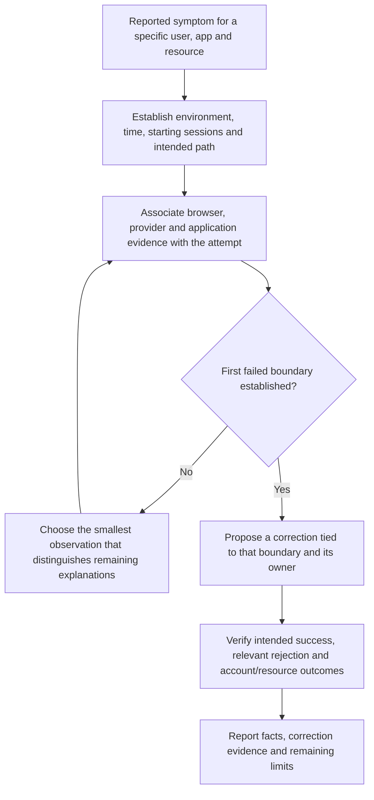
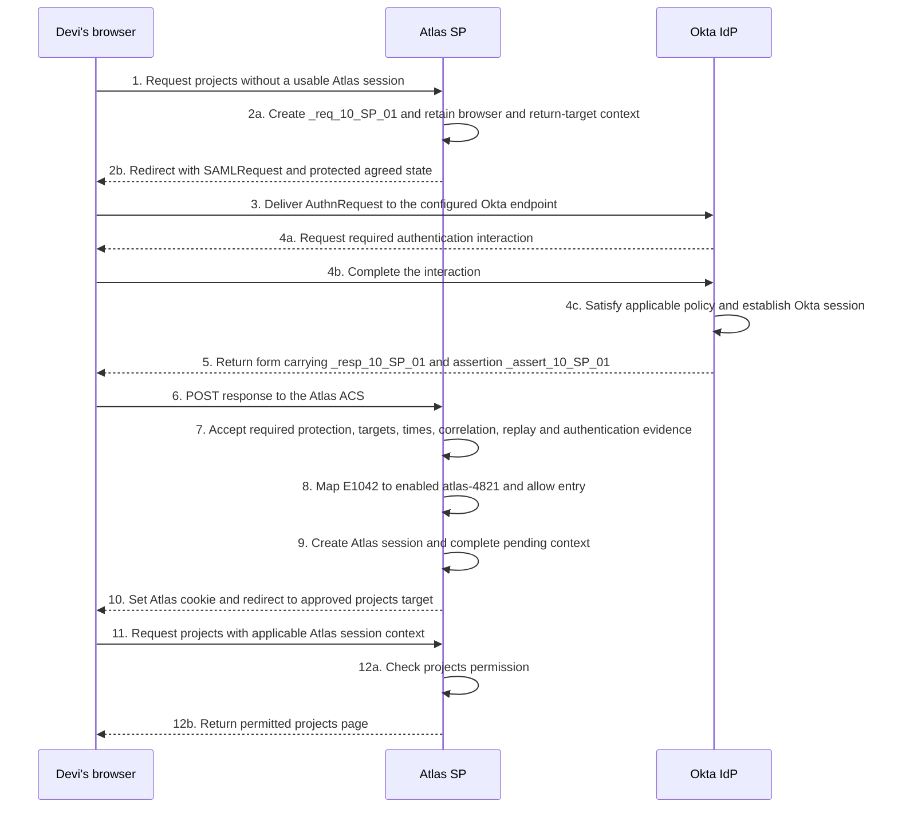
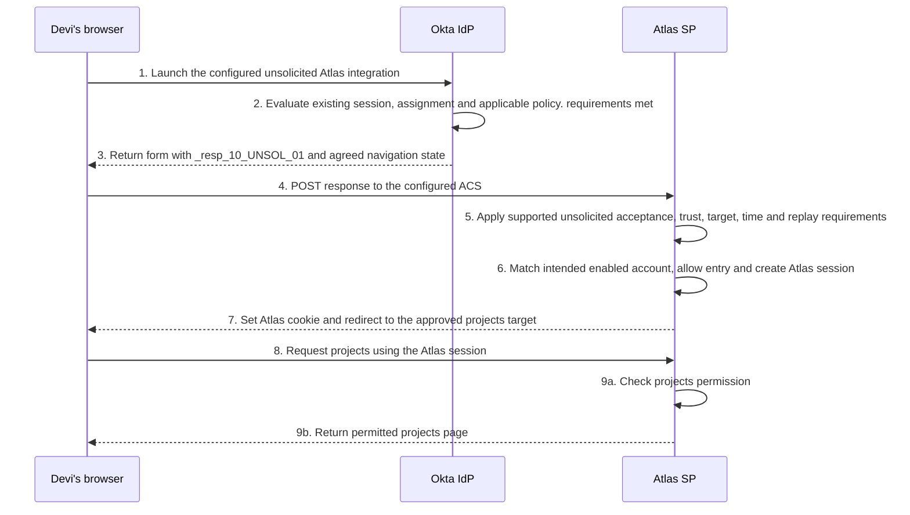
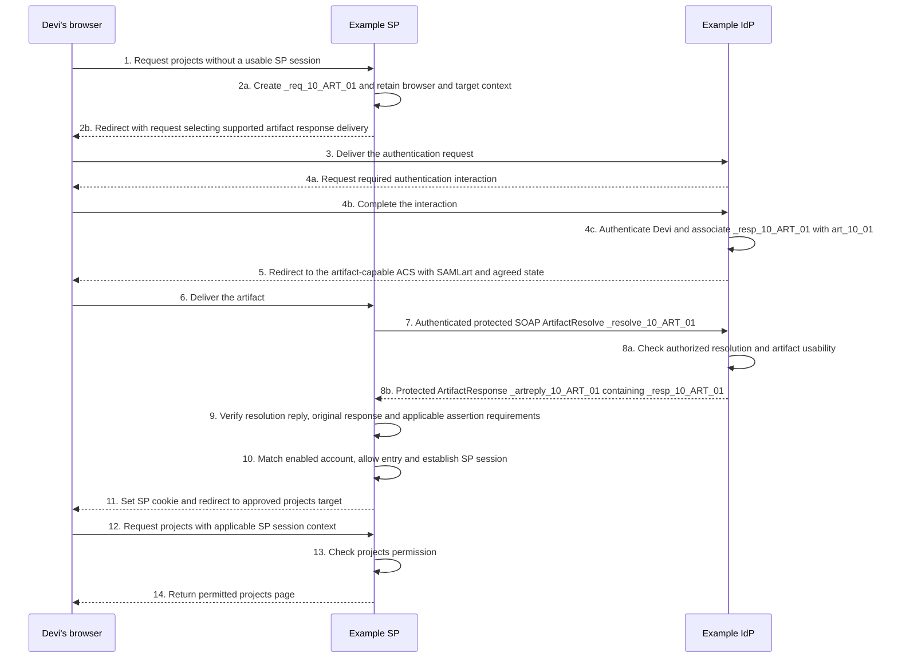
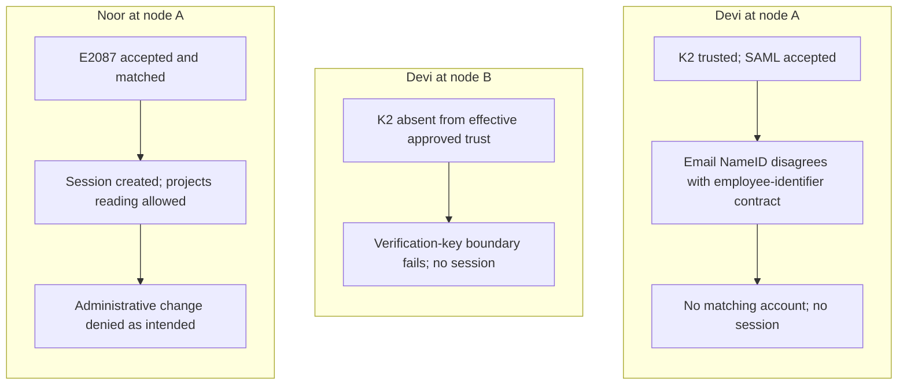

# Lesson 10: Troubleshooting and engineering casework

“SSO is failing” arrives in Daniel’s queue. One user cannot enter Atlas, another sees an authentication prompt, and a third reaches Atlas but cannot open an administrative page. Those symptoms may involve different decisions. Treating them as one certificate problem could conceal the actual faults and weaken working controls.

A useful investigation reconstructs the intended journey, identifies the last established success and the first established failure, and chooses the smallest observation that can resolve the next uncertainty. A corrective proposal follows the evidence. It is not the first step.

Use P1–P11 and I1–I10 as a diagnostic reference bank to consult when the symptom fits. Work the [combined packet in §10.5](#105-defend-an-engineering-conclusion-from-a-combined-packet) end to end, explaining the evidence and next decision at each boundary.

## 10.1 Establish the attempt before changing settings

### Ask questions that narrow the boundary

Begin with the affected application instance, environment, user, resource and browser context. Record when the behavior occurred, which time zone the evidence uses, whether it is repeatable, and which changes preceded it. Determine whether one user, one receiving node, one launch path or the whole integration is affected.

Then establish the starting state. Was there a usable Atlas session? A usable Okta session? Did the browser start at Atlas or launch an integration from Okta? Did an external IdP participate? A working application page under an existing session is not a successful test of a new federation exchange.

**Figure L10-D1: Choose evidence before a correction.** Arrows describe investigation decisions, not a SAML validation algorithm.

Do not fill a gap in the evidence with a preferred cause. “No Atlas session was created” is an outcome. It does not identify whether the problem was request delivery, policy, trust, targeting, account matching or entry policy.

### Give each source an appropriate role

| Source | What it can help establish | Limit |
| --- | --- | --- |
| Browser trace | Requests, redirects, form submissions, relevant cookie behavior and visible returned content | Reading XML is not independent cryptographic verification or proof of receiver acceptance |
| Okta System Log | Relevant org-side activity, actor, target, time and reported processing outcomes | Does not prove Atlas’s internal account or authorization decision |
| Atlas diagnostics | Receiving checks, account mapping, entry/session and resource results that the app records | A generic error or absent detail may not identify the exact cause |
| Effective configuration and approved requirements | What should happen and what each instance is actually configured to do | A screenshot or metadata declaration alone does not establish runtime behavior |

Okta documents filtering and inspecting System Log events by their context. Use relevant time, user and integration information, together with available request/transaction details. Do not assume an Okta event ID equals a SAML request ID. Missing events require checks of the org, filters, time range and logging scope before being treated as proof that an action never occurred. [Okta: System Log](https://help.okta.com/oie/en-us/content/topics/reports/reports_syslog.htm)

All packets below are fictional, normalized evidence summaries. Labels such as “Okta summary” describe the source of the synthetic observation; they are not literal event names or a promised Okta JSON schema. Message IDs are synthetic. Keep personal data and bearer material in approved tools and storage, using appropriate redaction without destroying necessary correlation.

## 10.2 Reconstruct independent successful baselines

### Case S: Atlas creates the request

Devi has an enabled Okta account and Atlas assignment, can satisfy the applicable policy, and has an enabled Atlas account with projects permission. She starts without usable Okta or Atlas sessions. Atlas supports the selected Redirect/POST arrangement.

The packet establishes:

| Evidence | Supplied observation |
| --- | --- |
| Atlas request record | `_req_10_SP_01` retained for Devi’s browser and the approved Okta provider, with projects as the approved return target |
| Browser summary | Redirect request reaches Okta; a response form later reaches the expected Atlas ACS |
| Okta summary | Required authentication and applicable policy processing succeeded for the intended integration |
| Atlas receiving record | `_resp_10_SP_01` and assertion `_assert_10_SP_01` accepted; required correlation answers `_req_10_SP_01` |
| Atlas application record | Accepted identifier `E1042` selected `atlas-4821`; entry allowed, new session established and projects request permitted |

Before reading the sequence, reconstruct which system creates each message and which observations establish account selection and resource access.

**Figure L10-S1: Answer sequence for the requested baseline.** Numbered steps trace a complete new attempt. Internal arrows represent processing and state changes.

Steps 1–6 establish creation and delivery. Step 7 groups the receiving requirements without prescribing one cryptographic execution order. Steps 8–9 establish the intended account and session. Steps 11–12 establish actual resource access. A report that stops at step 4c or step 6 has not established the final result.

### Case U: Okta sends an explicitly unsolicited response

This is a separate attempt. Devi has a usable Okta session but no Atlas session. Assignment, applicable policy, downstream account and projects permission are ready. The selected launch is explicitly configured to send an unsolicited POST response, and Atlas supports that acceptance path.

The packet shows `_resp_10_UNSOL_01`, no initiating Atlas AuthnRequest, and no InResponseTo in the response or relevant bearer confirmation. Atlas records successful unsolicited acceptance, intended account selection, a new session and permitted projects access. The agreed navigation state selects an approved projects target.

**Figure L10-S2: Answer sequence for the unsolicited baseline.** This numbering belongs to Case U. The absence of an SP authentication request is part of the supplied design, not missing evidence silently filled in.

Step 5 cannot check against an initiating Atlas request that did not exist. It must still apply the supported unsolicited policy and other requirements. A dashboard starting point alone would not establish this path; the actual absence of an initiating request and the configured behavior do. [SAML Profiles, §§4.1.4–4.1.5](https://docs.oasis-open.org/security/saml/v2.0/saml-profiles-2.0-os.pdf)

### Case A: The browser carries an artifact

This independent baseline uses generic Example SP and Example IdP participants with documented artifact support, approved trust and protected resolution connectivity. It is not a claim of artifact support in the Okta/Atlas integration. Devi starts without a usable SP session, can authenticate at the IdP, and has an enabled SP account with projects permission.

The SP creates `_req_10_ART_01`. The browser later delivers a reference labeled `art_10_01`; this is a symbolic label, not a serialized artifact. Server records establish a successful ArtifactResolve/ArtifactResponse exchange, recovery of `_resp_10_ART_01`, normal SAML acceptance, account matching and permitted projects access.

**Figure L10-S3: Answer sequence for the artifact baseline.** The browser carries the artifact at steps 5–6. Steps 7–8 are direct server communication over the supported SOAP arrangement.

The resolution reply answers `_resolve_10_ART_01`. The recovered authentication response and relevant bearer correlation answer `_req_10_ART_01`. A browser arrival at step 6 does not prove step 8b occurred, and a successful retrieval does not prove step 9 passed. The useful next evidence for a resolution failure is at the server exchange, not another guess about browser POST decoding. [SAML Core, §3.5](https://docs.oasis-open.org/security/saml/v2.0/saml-core-2.0-os.pdf), [SAML Profiles, §§4.1.4.4 and 5](https://docs.oasis-open.org/security/saml/v2.0/saml-profiles-2.0-os.pdf)

## 10.3 Locate protocol and trust failures

### Keep each packet independent

The following cases concern new requested sign-ins with no pre-existing application session. Each row supplies its own known observation; facts not supplied remain unestablished. Times are UTC. A stated signature pass means the receiver reports required verification under its configured approved key, not merely that someone decoded the XML.

For each case, name the known boundary, choose the next useful comparison, and reject an attractive but unsupported fix before reading the reasoning.

| Case | Supplied evidence | Boundary and next useful comparison |
| --- | --- | --- |
| P1: receiving address | Test integration emits toward the production ACS; approved test ACS is a separate address | Delivery configuration is wrong for test; compare the relevant Okta Single sign-on URL with the approved test requirement |
| P2: audience | Expected audience is `https://atlas.northstar.example/saml`; supplied audience ends in `/saml/acs`; signature passes | Audience differs from entity ID; compare Audience URI with Atlas’s actual expectation |
| P3: recipient | Browser delivered to the expected ACS, but bearer Recipient names another receiving location | Delivery alone did not satisfy presentation; compare the selected confirmation with the approved receiver endpoint |
| P4: destination | The protected processing record reports an unacceptable Response Destination for this endpoint | Check that outer field, its required protection and the deployment’s expected external receiving address |
| P5: bearer deadline | Conditions ends at 12:05, bearer deadline is 12:02, arrival is 12:03; clocks agree and configured tolerance is zero | Presentation is late despite remaining Conditions time; inspect delivery timing rather than extending a session |
| P6: correlation | Pending `_req_P10_EXPECTED`; response and bearer values answer `_req_P10_OTHER`; expected RelayState is returned | Wrong request association; compare the outgoing request and retained browser/provider state |
| P7: replay | Assertion ID was already accepted; repeat arrival is before its deadline | Previously accepted bearer content is being reused; inspect prior acceptance and retry behavior |
| P8: stale trust | Sender uses approved K2; receiver’s effective trust contains only K1 | Sender/receiver key adoption differs; compare authoritative change information and runtime trust |
| P9: algorithm policy | Receiving record identifies a SHA-1 method rejected by the approved algorithm policy | Selected method violates policy; compare the sender’s signing/digest choices and supported modern configuration |
| P10: generic signature error | Receiver reports verification failure, but no detailed stage, reference or key result is supplied | Exact cause remains unknown; obtain selected key, signed-object/reference, algorithm and failure-stage evidence |
| P11: encryption key | Sender’s effective encryption certificate identifies a different recipient key; Atlas lacks its corresponding private key | Recipient encryption configuration differs; reconcile approved Atlas encryption material and sender output |

P1 does not prove that production accepted the misdirected message. P2–P4 concern different target fields; do not fix them by making every field equal to whichever string happens to appear. P5 already establishes that clock disagreement is not the explanation under the supplied facts. P6 and P7 concern different protections even if both reject a repeated browser submission.

P8 is evidence of trust drift, not proof that every other message check will pass after K2 adoption. P9 does not justify permitting a rejected obsolete algorithm. P10 is deliberately unresolved: altered content, the wrong key, unsupported processing or reference handling are competing explanations. P11 concerns encryption recipient material, which is distinct from Okta’s signing certificate.

Okta exposes separate receiving-location, audience, signing, digest and encryption settings. Compare the actual setting relevant to the failed decision with the actual emitted message and Atlas’s requirement. A settings label or a successful certificate import is insufficient without that connection. [Okta SAML field reference](https://help.okta.com/oie/en-us/content/topics/apps/aiw-saml-reference.htm), [Okta signing certificate management](https://help.okta.com/oie/en-us/content/topics/apps/manage-signing-certificates.htm)

### Write a correction as a testable proposal

For P8, an appropriate proposal is: confirm K2’s approved source and intended use, update the affected receiver through its supported trust process, then verify fresh sign-ins and relevant rejection behavior on the receiving instances. It is not “accept whichever certificate the response contains.”

The result must remain conditional until the test occurs. A useful record says which mismatch is established, which correction addresses it, and which evidence would establish the intended outcome afterward. If the new result exposes another failure, investigate that boundary rather than declaring the original analysis wrong merely because one correction did not solve everything.

## 10.4 Investigate identity, policy and session state

### Assignment denial differs from authentication-policy denial

Consider two independent new attempts with no Atlas session:

| Case | Supplied evidence | Justified conclusion |
| --- | --- | --- |
| I1: unassigned integration | Relevant Okta processing record reports that the identified user lacks access to the selected integration; no successful downstream issuance is established | Investigate intended assignment for that user and integration before examining Atlas’s signing key |
| I2: policy requirement not met | Assignment is established, but the applicable Okta policy record reports an unsatisfied authentication requirement | Investigate the actual policy, context and authentication outcome; assignment alone is insufficient |

Do not infer I1 from the absence of a visible dashboard tile or I2 from the mere presence of an MFA prompt. Use the actual relevant processing result. Nor does an intended denial justify granting assignment or weakening policy without the appropriate access decision. [Okta: app sign-in policies](https://help.okta.com/oie/en-us/content/topics/identity-engine/policies/about-app-sign-on-policies.htm)

### Read the emitted identity, then the matched account

In I3, Atlas records successful SAML acceptance but no matching account. Its agreed rule uses employee identifier `E1042`. The captured NameID instead contains `devi@northstar.example`, and the relevant application username record contains that same email value. No new Atlas session exists.

The supplied evidence establishes a mismatch between the emitted identity and the agreed account key. Compare the authoritative source, application username and NameID configuration with Atlas’s lookup. Do not change Atlas to match any email-like string solely to suppress the error. Identifier changes, reassignment and account linking require an explicit agreed migration or matching policy.

In independent case I4, the NameID and account match are correct. Atlas accepts SAML but reports a missing required `department` claim and denies entry. The actual response lacks that attribute even though Devi’s source profile has a department. The source value does not prove release. Inspect the configured expression/source, exact output name and emitted values; an empty expression result or wrong name is a possibility to investigate, not a proven cause. Okta’s current claims documentation describes empty-result omission and distinguishes current and legacy claim management. [Okta: custom claims](https://help.okta.com/oie/en-us/content/topics/apps/federated-claims-overview.htm)

In I5, SAML acceptance, account matching and session creation all succeed, but projects access is denied. The relevant next evidence is Atlas’s permission and attribute-to-role interpretation for the actual account. An assertion’s group value does not create a universal application entitlement. A disabled account would be a different entry-policy failure and could prevent session creation entirely.

### Treat prompts and loops as observations

In independent case I6, Devi can open Atlas under an existing application session, but a fresh sign-in in another browser context displays an authentication challenge. That alone establishes neither a policy regression nor a bad assertion. Compare the available Okta/app sessions, browser context and applicable authentication requirement. Existing application access may not have contacted Okta at all.

In I7, a permitted new attempt repeatedly returns from Okta to Atlas, then redirects to Okta again. The packet contains no Atlas session-creation result and no reliable cookie evidence. Plausible causes include response rejection, failure to retain/use local session state, or application navigation behavior. The next useful observation is Atlas’s processing result at each return, together with whether the following resource request presents and uses a new session.

If Atlas rejected the response, investigate its acceptance evidence first. If it created a session that the next request cannot use, inspect supported cookie scope/attributes, browser policy and application session handling. Do not prescribe a cookie change merely because the user reported a loop. [MDN: HTTP cookies](https://developer.mozilla.org/en-US/docs/Web/HTTP/Guides/Cookies)

### Separate broker and logout boundaries

| Case | Supplied evidence | Where to investigate |
| --- | --- | --- |
| I8: inbound broker failure | External response reaches Okta, but Okta reports failure under the configured external IdP trust; no downstream issuance is established | External IdP-to-Okta issuer/key/protection relationship |
| I9: downstream broker failure | Okta accepts the external identity and issues a response; Atlas rejects the downstream audience | Okta-to-Atlas audience and receiving agreement |
| I10: incomplete logout evidence | Atlas and targeted Okta session ended; Ledger notification was scheduled, but no participant result is established | Actual Ledger delivery, processing, session association and subsequent protected request |

I8 does not justify editing Atlas’s audience. I9 does not justify replacing the external IdP’s signing certificate. In I10, absence of a callback does not prove that Ledger retained its old session; processing may have occurred before a response was lost. A fresh allowed Ledger request also needs interpretation: did it use the old session, or did a new federation exchange establish a replacement?

Okta’s inbound IdP settings and outbound app settings belong to separate relationships. Its documented front-channel SLO feature likewise has participation and feature conditions; a scheduled notification is not a participant’s confirmed termination. [Okta external SAML IdP settings](https://help.okta.com/oie/en-us/content/topics/security/idp-add-saml.htm), [Okta SAML front-channel logout](https://developer.okta.com/docs/guides/single-logout/saml2/main/)

## 10.5 Defend an engineering conclusion from a combined packet

### Independent assessment: several symptoms after a change

Priya reports intermittent Atlas test failures after a planned signing-key activation. Treat this as a new fictional investigation. Do not carry account or session outcomes over from the earlier cases.

The approved contract is:

- Atlas test SP entity ID is `https://atlas-test.northstar.example/saml`; ACS is `https://atlas-test.northstar.example/saml/acs`.
- Both receiving nodes, A and B, should accept the approved Okta integration’s signed assertions under the intended current trust.
- Account matching uses the approved issuer relationship and employee identifier. Devi’s intended value is `E1042`; Noor’s is `E2087`.
- Both users have enabled test accounts, assignment and satisfied authentication policy for their recorded attempts.
- Their agreed role permits projects reading but not administrative changes. The application enforces that distinction.

All timestamps below are UTC. Each sign-in has a fresh request and assertion, with no usable Atlas session at its start. The packet contains normalized source summaries, not literal vendor event exports.

| Time | Source | Supplied observation |
| --- | --- | --- |
| 14:00:00 | Authorized change record | The intended test app signing key was switched from approved K1 to approved K2 |
| 14:00:30 | Effective runtime inventory | Node A trusts K1 and K2; node B trusts only K1 |
| 14:01:00 | Okta/browser summaries for Devi | Authentication/policy processing succeeds; a fresh response signed with K2 reaches node A at the correct test ACS |
| 14:01:01 | Node A receiving record | Required SAML acceptance passes, including target, time, correlation and replay requirements |
| 14:01:02 | Node A account record | NameID is `devi@northstar.example`; no account matches the employee-identifier rule; no Atlas session is created |
| 14:01:10 | Relevant Okta app-user snapshot | Devi’s application username is `devi@northstar.example`; her authoritative employee source remains `E1042` |
| 14:02:00 | Separate Devi attempt at node B | Fresh K2-signed response arrives; node B reports no approved verification key for the intended sender key; no session is created |
| 14:03:00 | Separate Noor attempt at node A | Accepted NameID `E2087` selects the intended enabled account; an Atlas session is created and projects reading succeeds |
| 14:03:20 | Noor’s resource record | Administrative change request denied under the agreed reader role |

Before reading the analysis, prepare a short investigation note. Identify the distinct mismatches, distinguish the expected denial, name what remains unknown, and propose a correction and verification plan. Also explain whether rolling back the signing key alone would establish a successful Devi sign-in.

### Analysis: the change did not create one universal cause

**Figure L10-C1: Three observed outcomes in the combined packet.** Arrows show local processing and evidence relationships. These are separate attempts, not one response moving among nodes.

Node B has a known trust-adoption mismatch. The authorized sender now uses K2, but B has not adopted it. The packet does not explain why: manual import omission, failed refresh, different configuration scope or another operational cause remains to be investigated.

Node A accepts Devi’s SAML information but cannot use her emitted email as the agreed employee key. The actual application username corroborates the output mismatch. The packet does not establish which configuration or historical update decision caused that username to differ from the employee source. Inspect the configured source/mapping and applicable update behavior before choosing the correction.

Noor’s successful projects request establishes a working permitted path on node A for that account. The administrative denial is the intended authorization outcome, not another SSO defect. Granting an administrator role to make every observed request return success would violate the supplied access contract.

Rolling back K2 alone would not establish Devi’s account mapping. Even if it restored B’s verification path, the identifier mismatch could remain. K1 rollback is also only a possible recovery if it remains approved and the supported sender/receiver states permit it; an availability symptom is not permission to restore a compromised or prohibited key.

### Propose corrections with explicit verification

First, reconcile node B’s effective trust with the authorized K2 change through the supported update process, after confirming scope and source. Separately, correct Devi’s emitted identity under the approved employee-identifier design. Preserve the enabled intended account and assess existing links before changing values; do not create a duplicate account merely to accept the email.

Then verify fresh attempts on both nodes, recording the receiving node, actual sender key, correct NameID, receiver acceptance, intended account, new session and projects result. Verify that incorrect targets, mismatched requests and repeated assertions remain rejected through the approved test arrangements. Preserve the reader-role denial of administrative changes.

Noor’s success on A is insufficient evidence that B is ready or that every user’s mapping is correct. Likewise, a corrected preview for Devi is insufficient evidence of a completed runtime sign-in. The correction remains a proposal until the required receiver and resource outcomes are observed.

### Communicate what the packet supports

A useful stakeholder note would read:

> The evidence identifies two separate Atlas test issues: node B has not adopted the approved K2 verification key, and Devi’s emitted identifier differs from the agreed employee-key mapping. Node A accepts SAML for the recorded attempts, and Noor can read projects there. Noor’s administrative denial is expected for the reader role. We propose reconciling B’s runtime trust and separately correcting Devi’s identity output, then verifying fresh sign-ins and intended permissions on both nodes. The packet does not yet establish why B’s update was missed or why Devi’s application username differs from its authoritative source.

This note states facts, impact, proposed correction and limits. It does not claim a completed repair or collapse multiple symptoms into one cause.

### Use a compact investigation reference

| Question | First useful evidence | Boundary to preserve |
| --- | --- | --- |
| Did a new federation exchange occur? | Actual browser requests and starting sessions | Existing app access is not a new SSO test |
| What returned, and for whom? | Appropriate response/assertion fields plus required receiver verification | Supplied content is not automatically trustworthy |
| Which attempt does it answer? | Outgoing request and retained browser/provider context | RelayState does not replace correlation or replay handling |
| Which identity selected which account? | Emitted scoped identifier and actual lookup result | A similar string is not account ownership |
| Was a session created and used? | App session transition and fresh protected request | A landing page or retained cookie is insufficient |
| Why was the resource allowed or denied? | Actual account, role/mapping and resource decision | Authentication does not imply every permission |
| What changed, and where? | Approved change, effective sender/receiver state and instance-specific outcomes | Generated or published configuration is not runtime adoption |
| What would establish a correction? | Defined positive and rejection tests with account/resource results | A proposed fix is not a verified recovery |

For an unfamiliar project, begin with those relationships. The useful skill is to explain what each observation proves, what it leaves open, and which next observation can change the conclusion. That reasoning supports confident work without pretending that every implementation has identical settings or behavior.

## References

- [Okta System Log](https://help.okta.com/oie/en-us/content/topics/reports/reports_syslog.htm)
- [Okta SAML field reference](https://help.okta.com/oie/en-us/content/topics/apps/aiw-saml-reference.htm)
- [Okta custom claims](https://help.okta.com/oie/en-us/content/topics/apps/federated-claims-overview.htm)
- [Okta signing certificate management](https://help.okta.com/oie/en-us/content/topics/apps/manage-signing-certificates.htm)
- [Okta app sign-in policies](https://help.okta.com/oie/en-us/content/topics/identity-engine/policies/about-app-sign-on-policies.htm)
- [Okta external SAML IdP settings](https://help.okta.com/oie/en-us/content/topics/security/idp-add-saml.htm)
- [Okta SAML front-channel logout](https://developer.okta.com/docs/guides/single-logout/saml2/main/)
- [OASIS SAML Core](https://docs.oasis-open.org/security/saml/v2.0/saml-core-2.0-os.pdf)
- [OASIS SAML Profiles](https://docs.oasis-open.org/security/saml/v2.0/saml-profiles-2.0-os.pdf)
- [OASIS SAML Errata 05](https://docs.oasis-open.org/security/saml/v2.0/errata05/os/saml-v2.0-errata05-os.pdf)
- [MDN HTTP cookies](https://developer.mozilla.org/en-US/docs/Web/HTTP/Guides/Cookies)
