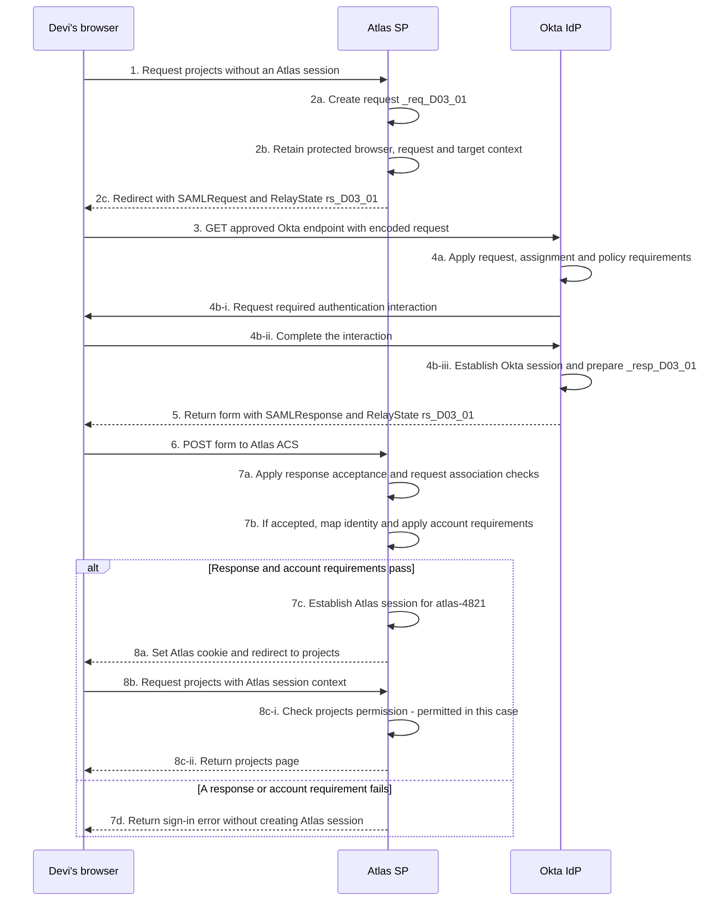
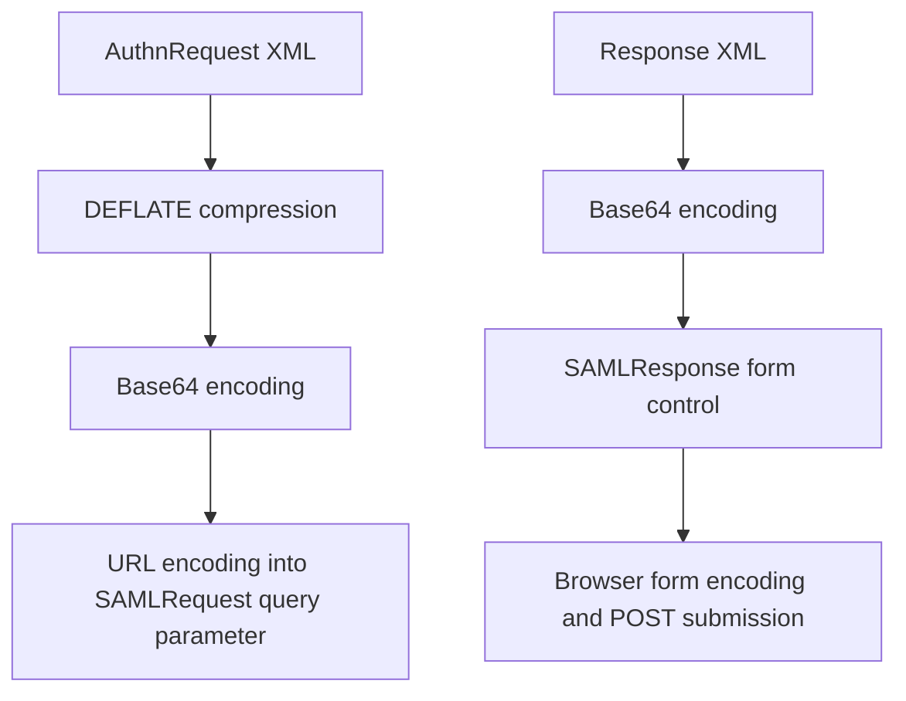

# SAML with Okta: binding comparison

A **binding** specifies how a SAML message is carried. To describe an integration clearly, name the message, its sender and receiver, and its binding. For the established Atlas exchange, that description is: Atlas sends an AuthnRequest to Okta through HTTP-Redirect; Okta returns a Response to Atlas through HTTP-POST. The browser carries both.

This reference uses Devi at Northstar Research and the fictional Atlas application. Addresses ending in `.example` are fictional. Real Okta endpoints come from the particular integration's approved setup information.

## Compare the delivery mechanisms

| Binding | What travels on the relevant leg | Useful trace clue | Receiving work |
| --- | --- | --- | --- |
| HTTP-Redirect | Encoded message in a URL query. | `SAMLRequest` or, where the profile permits it, `SAMLResponse`. | Recover the message and apply the required binding and protocol checks. |
| HTTP-POST | Encoded message in a submitted form. | A `SAMLRequest` or `SAMLResponse` form control. | Decode the XML and evaluate its required protection and meaning. |
| HTTP-Artifact | A reference to a message, delivered by URL or form. | `SAMLart`. | Resolve the reference, then process the recovered message. |
| SOAP | SAML protocol content inside a SOAP envelope, such as artifact resolution between servers. | Server-side request and reply evidence. | Evaluate the SOAP exchange and enclosed SAML result. |

These are protocol mechanisms, not a list of features supported by every Okta integration. SOAP over HTTP can itself use HTTP POST. An HTTP method alone therefore does not identify the SAML HTTP-POST binding. [SAML Technical Overview, §§4.3 and 4.4.4](https://docs.oasis-open.org/security/saml/Post2.0/sstc-saml-tech-overview-2.0.html)

### Apply the profile before choosing a combination

The Web Browser SSO profile permits Redirect, POST or Artifact for the authentication request, and POST or Artifact for the authentication response. Redirect's general ability to carry responses does not make it a browser SSO authentication-response option. Logout is a different profile.

A standard-permitted combination still needs support and agreement at both endpoints. In particular, the POST request option above is not a claim that a particular Okta endpoint accepts it. [SAML Profiles, §4.1.2](https://docs.oasis-open.org/security/saml/v2.0/saml-profiles-2.0-os.pdf)

## Follow the complete Atlas exchange

Devi starts without a usable Atlas or Okta session. Her Okta account and Atlas assignment are active, applicable policy can be satisfied, and her enabled Atlas account has projects permission. The successful branch assumes the required request handling, response acceptance and account checks pass.

**Figure RF-B1: Redirect request, POST response, then application access.** Cross-participant arrows show browser traffic. Self-arrows show local decisions or state changes. The stages retain Lesson 3's numbering, with step 4b expanded into interaction and Okta session establishment. The failure branch begins after a response reaches Atlas; it does not describe every possible earlier failure.

<!-- mermaid:id=RF-B1 -->

At steps 1–2, Atlas prepares request `_req_D03_01` and retains its browser, provider and return-target context. It gives the browser a redirect. At step 3, the browser delivers the packaged request to Okta. Atlas initiated the SAML exchange even though the browser performs delivery.

Step 4 handles Okta's request, assignment and authentication-policy requirements. At steps 5–6, Okta supplies a form and the browser submits its `SAMLResponse` to Atlas's ACS. This is not a direct Okta-server call to Atlas. The response answers the original request; POST has not changed which attempt it belongs to.

At steps 7a–7b, Atlas applies response and account requirements. On success, step 7c establishes the local session, and steps 8a–8c navigate to the approved target and check resource permission. Step 7d returns an error when a response or account requirement fails, without creating that session. Neither receiving a form nor successfully decoding its content establishes acceptance. The fuller state and identity explanation is in [Lesson 3](../lessons/lesson-03-sp-initiated-sso.md).

## Recognize the packaging

**Figure RF-B2: Message representation on the two legs.** Arrows mean transformations, not network calls or trust. This view leaves signature construction separate so that encoding is not mistaken for protection.

<!-- mermaid:id=RF-B2 -->

The request path uses Redirect's DEFLATE encoding. The ordinary POST path Base64 encodes the XML; it does not add Redirect's DEFLATE step. The browser then submits form data. A viewer may already have reversed some transformations, so establish whether it displays raw HTTP, an encoded parameter or decoded XML before decoding again. [SAML Technical Overview, §5.1.2](https://docs.oasis-open.org/security/saml/Post2.0/sstc-saml-tech-overview-2.0.html)

Base64 and URL encoding do not provide secrecy. A hidden form control is still accessible in the browser. Compression does not establish the sender. Use approved inspection and redaction procedures for traces containing assertions, identifiers, cookies or sensitive references.

### Separate packaging from signature scope

For Redirect's DEFLATE mechanism, query parameters `SigAlg` and `Signature` can protect the prescribed encoded parameter string, including RelayState when present. Reformatting decoded XML does not reconstruct that signed representation. A protocol-message XML signature is removed before this encoding; embedded assertion signatures are a separate case.

In ordinary POST, an XML signature protects its referenced XML. A separate RelayState form control is outside that scope. Choose protection according to the actual binding, profile and receiving contract. [SAML Bindings, §§3.4.4.1 and 3.5.5.2](https://docs.oasis-open.org/security/saml/v2.0/saml-bindings-2.0-os.pdf)

## Keep direction, endpoint and binding separate

| Item | Meaning | Atlas example |
| --- | --- | --- |
| IdP SSO service and its advertised binding | Where and how the IdP receives an authentication request. | Approved Okta endpoint for Atlas's Redirect request. |
| SP ACS and its advertised binding | Where and how the SP receives the authentication response. | `https://atlas.northstar.example/saml/acs`, using POST. |
| `AuthnRequest@ProtocolBinding` | Requested binding for the returning response. | HTTP-POST, although the request travels through Redirect. |
| `Response@Destination` | Intended location for that response. | Atlas ACS; not a binding identifier. |
| Audience | Intended relying party. | Atlas entity ID; not a delivery mechanism. |

Metadata associates a service's `Binding` with its `Location`. A matching URL alone does not establish a supported binding, and an approved metadata document still needs to be adopted by the implementation. The binding identifier is a URI, rather than the endpoint's web address. [SAML Metadata, §§2.2.2, 2.4.3 and 2.4.4](https://docs.oasis-open.org/security/saml/v2.0/saml-metadata-2.0-os.pdf)

| Binding | Full binding identifier |
| --- | --- |
| Redirect | `urn:oasis:names:tc:SAML:2.0:bindings:HTTP-Redirect` |
| POST | `urn:oasis:names:tc:SAML:2.0:bindings:HTTP-POST` |
| Artifact | `urn:oasis:names:tc:SAML:2.0:bindings:HTTP-Artifact` |
| SOAP | `urn:oasis:names:tc:SAML:2.0:bindings:SOAP` |

When comparing configuration, preserve the full identifier rather than substituting a UI label.

The request's ProtocolBinding describes a requested return mechanism. It is separate from the transport used to deliver that request and from the receiver's decision to honor it. See the [field comparison](field-comparison-and-message-anatomy.md#read-the-authentication-request) for ACS selection and related request fields. [SAML Core, §3.4.1](https://docs.oasis-open.org/security/saml/v2.0/saml-core-2.0-os.pdf)

### Read the Okta labels in their direction

In the outbound Okta-to-Atlas app integration, **Single sign-on URL** is the application's default ACS for POST delivery. It is not the Okta endpoint that receives Atlas's request. **Audience URI (SP Entity ID)** identifies Atlas as the intended audience, not a URL to which the browser must navigate.

**Default RelayState** depends on the application's documented requirements. **Other Requestable SSO URLs** concerns additional response locations for SP-initiated flows. Those locations do not turn the request into a different binding or prove that a receiving node is ready. [Okta SAML field reference](https://help.okta.com/oie/en-us/content/topics/apps/aiw-saml-reference.htm)

For a project, Daniel records the exact direction, message, selected service, binding and protection requirement for each leg. He compares approved integration information with the observed exchange, rather than inferring a binding from an app tile or a setting containing the word "SSO."

## Understand what Artifact adds

In an artifact response arrangement, the browser carries a reference instead of the authentication response. The SP retrieves the message through a separate server exchange. `ArtifactResponse` answers `ArtifactResolve`; the recovered authentication Response still answers the original AuthnRequest. These are different request relationships. [SAML Core, §3.5](https://docs.oasis-open.org/security/saml/v2.0/saml-core-2.0-os.pdf)

For browser SSO, resolution has its own authenticated, protected delivery requirements, and successful resolution consumes the artifact. Retrieval does not replace acceptance of the recovered message. [SAML Profiles, §4.1.4.4](https://docs.oasis-open.org/security/saml/v2.0/saml-profiles-2.0-os.pdf)

The [complete generic artifact flow in Lesson 5](../lessons/lesson-05-bindings-relaystate-and-alternative-paths.md#53-understand-artifact-delivery-as-a-separate-protocol-arrangement) shows the extra server dependency and its failure branch. It is not an Okta capability claim. Establish exact integration support before proposing this path. A browser trace showing artifact arrival cannot establish that the SP retrieved or accepted the response.

## Keep RelayState separate from correlation

For the Atlas requested exchange, `rs_D03_01` is a protected lookup for retained context and approved navigation. Applicable bindings return a supplied request RelayState unchanged and specify an 80-byte limit. The value is outside the assertion; its meaning is agreed by the participants. [SAML Bindings, §§3.4.3, 3.5.3 and 3.6.3.1](https://docs.oasis-open.org/security/saml/v2.0/saml-bindings-2.0-os.pdf)

Matching RelayState does not establish the right issuer, request or browser association. A usable identity result does not make an arbitrary supplied URL an approved landing page. Treat navigation state according to the application's supported validation and association rules. [SAML Errata 05, E90](https://docs.oasis-open.org/security/saml/v2.0/errata05/os/saml-v2.0-errata05-os.pdf)

SP initiation and binding are independent descriptions. A POST response can answer an SP request or arrive on an explicitly supported unsolicited path. Determine initiation from the protocol relationship, not from POST alone. The [unsolicited flow in Lesson 5](../lessons/lesson-05-bindings-relaystate-and-alternative-paths.md#52-follow-an-explicitly-unsolicited-okta-launch) explains the missing initiating-request relationship.

## Locate a failure before changing the binding

Each row is an independent fictional report. The evidence identifies the next boundary to investigate, not a complete root cause.

| Observation | What it establishes | Useful next evidence |
| --- | --- | --- |
| Atlas returns a Redirect, but no delivery to Okta is recorded in the available capture. | The observed trace stops before confirmed IdP receipt. | Browser continuation and Okta receipt evidence for this attempt. |
| The browser receives a response form, but Atlas has no confirmed submission. | Form generation is observed; ACS arrival remains unresolved. | Form target, browser submission and receiving-route evidence. |
| Atlas logs successful XML decoding followed by a signature failure. | Packaging was decoded; required protection failed at Atlas. | Exact signature mechanism, approved key and verifier result. |
| Atlas rejects the audience in a delivered POST response. | Delivery did not make the assertion suitable for Atlas. | Issued audience and the selected environment's expected entity ID. |
| A generic artifact reaches the SP, but resolution times out. | The browser leg completed; retrieval did not complete. | Server connectivity and resolution-service evidence. |
| Atlas accepts SAML and establishes a session, but denies an administrative page. | The recorded failure is at resource authorization. | Intended account, roles and that page's permission rule. |

Changing a binding can change delivery and protection requirements. It does not correct an audience, create a missing account or grant a role. Compare the observed failure with the agreed exchange before proposing a configuration change. For deeper diagnosis, use [Lesson 10](../lessons/lesson-10-troubleshooting-and-engineering-casework.md).
