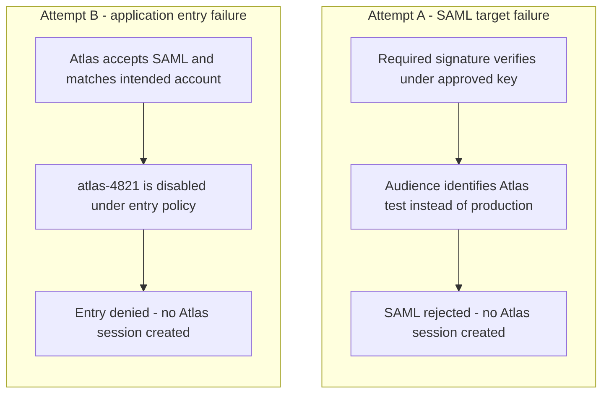

# SAML with Okta: common misconceptions

A familiar label can hide several different decisions. "Okta success," "valid signature" and "logout completed" each need a clear scope before they justify a conclusion about application access.

The examples use Devi at Northstar Research, with Okta Identity Engine as IdP and Atlas as SP. Example accounts, addresses and diagnostic reports are fictional. Each example is independent unless explicitly connected.

- [Identity and application access](#identity-and-application-access)
- [Message flow and targeting](#message-flow-and-targeting)
- [Trust and protection](#trust-and-protection)
- [Sessions and logout](#sessions-and-logout)
- [Evidence and configuration changes](#evidence-and-configuration-changes)

## Identity and application access

### "Okta says success, so Atlas must have accepted the sign-in"

Okta records its own processing. Atlas must still accept the returned SAML information, select the intended account, permit entry and decide resource access. A browser returning from Okta does not establish those outcomes either. Find Atlas's result for the same attempt before declaring SAML acceptance or naming an application-side cause. [Okta System Log](https://help.okta.com/oie/en-us/content/topics/reports/reports_syslog.htm)

### "Assigning Atlas in Okta creates the account and grants its roles"

Assignment, downstream account creation and application permission are different decisions. Provisioning or supported JIT can connect them when configured, but an assignment alone is not proof that either completed. Devi can be assigned to Atlas while her Atlas account is missing or disabled. A supplied group can inform Atlas's role rules without having a universal permission meaning. [Okta provisioning workflow](https://help.okta.com/oie/en-us/content/topics/provisioning/lcm/lcm-deploy-cloud.htm)

### "NameID is always an email address"

NameID follows the agreed identifier format, value and scope. Atlas's example uses employee identifier `E1042`, which maps to internal account `atlas-4821`. Those values have different jobs. Selecting an email-address format does not by itself identify the correct source attribute or preserve account linking after an address changes. Verify the emitted identifier and intended account match. [SAML Core, §§2.2 and 8.3](https://docs.oasis-open.org/security/saml/v2.0/saml-core-2.0-os.pdf)

The [field comparison](field-comparison-and-message-anatomy.md#identifier-formats-and-attribute-values) connects format, value, scope and attribute names. The [acceptance reference](response-validation-and-acceptance.md) separates accepted identity, entry and resource permission.

## Message flow and targeting

### "Clicking an Okta tile always means an unsolicited response"

A launch can send the browser to an application that then creates an AuthnRequest. Determine initiation from the actual request relationship. A genuinely unsolicited response has no preceding SP AuthnRequest to answer and needs deliberate receiver support. Do not turn failed requested correlation into unsolicited acceptance. [SAML Profiles, §§4.1.3 and 4.1.5](https://docs.oasis-open.org/security/saml/v2.0/saml-profiles-2.0-os.pdf)

### "The request and response use the same binding"

Atlas's established request travels through Redirect, while its response returns through POST. The request's ProtocolBinding asks for the return mechanism; it does not describe how that request arrived. Ordinary POST can also carry a SAML request when supported. Inspect each leg separately. The [binding comparison](binding-comparison.md) shows the complete browser path and the profile's permitted combinations.

### "ACS, audience and the Okta SSO endpoint are interchangeable URLs"

Atlas's ACS receives the response. Its audience identifies the relying party. The approved Okta SSO endpoint receives Atlas's authentication request. In an outbound Okta app integration, Single sign-on URL is the application's default POST ACS, despite the broad-sounding label. Use the integration's approved values instead of copying a convenient URL between fields. [Okta SAML field reference](https://help.okta.com/oie/en-us/content/topics/apps/aiw-saml-reference.htm)

### "Matching RelayState proves that the response belongs to this attempt"

RelayState carries agreed context outside the assertion. Atlas still needs the required request correlation, usable provider/browser association and all other acceptance checks. A matching navigation handle cannot repair a wrong InResponseTo. Sign-in success also does not approve an arbitrary supplied return URL. [SAML Errata 05, E90](https://docs.oasis-open.org/security/saml/v2.0/errata05/os/saml-v2.0-errata05-os.pdf)

### "SAML defines a feature, so our Okta integration supports it"

A standard-defined binding or profile is not a product support statement. Confirm the exact integration, direction, feature availability and endpoints on both sides. Artifact delivery and SOAP logout in the awareness examples use generic participants for that reason. Likewise, Okta being an SP toward an external IdP and an IdP toward Atlas creates two separately configured relationships. [Lesson 5](../lessons/lesson-05-bindings-relaystate-and-alternative-paths.md) shows these distinctions.

## Trust and protection

### "A valid signature means the whole sign-in is acceptable"

A signature result concerns selected protected content under a key. Atlas also needs approved issuer/key trust, the required signed layer and use of the actual verified object. Target, time, correlation, replay, account and access requirements remain. A signature over assertion A does not protect identity read from B. [W3C XML Signature Best Practices, §3.1.5](https://www.w3.org/TR/xmldsig-bestpractices/)

### "An unexpired assertion can be submitted again"

Time limits and replay protection answer different questions. A bearer assertion already accepted by Atlas can still be within its time window when a browser resubmits it. That does not authorize another acceptance. Repeated submissions across receiving nodes must remain subject to effective replay controls; a supported recovery may require a fresh sign-in attempt. [SAML Profiles, §4.1.4.5](https://docs.oasis-open.org/security/saml/v2.0/saml-profiles-2.0-os.pdf)

### "A certificate inside the message establishes trust"

A sender can supply its own certificate. Atlas needs an independently approved relationship between the expected provider, integration and verification key. A self-signed federation certificate is not automatically wrong, and a public-CA certificate is not automatically authorized for that provider. Establish the receiver's actual trust model. The named metadata interoperability model derives key trust from accepted metadata; do not assume every SP implements it. [SAML Metadata Interoperability Profile, §§2.3–2.6](https://docs.oasis-open.org/security/saml/Post2.0/sstc-metadata-iop.pdf)

### "Signed or Base64-encoded content is secret; decryption proves the sender"

Encoding makes bytes representable. A signature enables checks on protected content but does not conceal readable claims. Encryption restricts access to protected content, yet successful decryption alone does not establish an approved sender. Keep those goals separate and apply the supported protection arrangement. The [trust and protection reference](trust-and-protection.md#locate-the-protected-layer) shows the layers and processing limits.

### "Every certificate field expects the same certificate"

Direction and operation determine the material needed. Atlas verifies Okta-signed content using approved Okta public information. Okta's application Signature Certificate field supports validation of application-supplied requests. For encryption to Atlas, Okta needs Atlas's public recipient information, while Atlas retains its private decryption capability. Replacing one of these does not automatically repair another. [Okta SAML field reference](https://help.okta.com/oie/en-us/content/topics/apps/aiw-saml-reference.htm)

## Sessions and logout

### "Assertion expiry ends every application session"

Assertion-use limits and continuing session policy concern different state. A successfully established Atlas session can outlast the assertion used to create it. An optional SessionNotOnOrAfter supplies a separate derived-session bound under applicable processing; local maximum, idle and reauthentication rules still matter. [SAML Errata 05, E79](https://docs.oasis-open.org/security/saml/v2.0/errata05/os/saml-v2.0-errata05-os.pdf)

### "SSO means the user will never be challenged again"

Existing authentication state can reduce repeated interaction, but Identity Engine's applicable global and app sign-in requirements still need satisfaction. Atlas also decides when its own session is sufficient. A recent response IssueInstant does not prove recent authentication, and an outgoing ForceAuthn flag alone does not prove the provider supplied it. Inspect the applicable requirement and returned evidence. [Okta policies and rules](https://help.okta.com/oie/en-us/content/topics/identity-engine/policies/about-policies.htm)

### "Signing out of Atlas signs Devi out everywhere"

Local Atlas logout can leave Okta and Ledger sessions usable. A subsequent Atlas launch may create a new session through SSO, rather than continue the old one. Coordinated SLO has supported participants and a defined scope; another device or external provider is not automatically included. The [session and logout reference](sessions-reauthentication-and-logout.md) shows complete local and basic SLO paths and distinguishes confirmed from unknown results.

### "Deactivating the Okta user instantly ends all downstream access"

Okta deactivation affects Okta user/session state and assignments, with downstream deprovisioning where enabled and applicable. It runs as background work. Completion and the application's treatment of already-issued sessions still need evidence. An accepted administrative action is not an instantaneous, universal application-session result. [Okta user deactivation](https://help.okta.com/oie/en-us/content/topics/users-groups-profiles/usgp-deactivate-user-account.htm)

## Evidence and configuration changes

### "An assertion preview proves the live integration works"

Okta's preview shows XML generated from supplied settings. It helps inspect intended output, but does not establish that a live response reached Atlas, passed verification, selected the intended account or granted the required resource. Associate sender, browser and receiving evidence with the same attempt. [Okta SAML assertion preview](https://help.okta.com/oie/en-us/content/topics/apps/apps_app_integration_wizard_saml.htm)

### "Activating a certificate updates every receiver automatically"

Generation, sender activation and receiver adoption are separate events. Atlas may use manual imports, cached metadata or different effective state across nodes. A successful sign-in on node A does not establish that B adopted the same key. Verify observed sender use and relevant receiving outcomes. [Okta signing certificate management](https://help.okta.com/oie/en-us/content/topics/apps/manage-signing-certificates.htm)

### "An SSO error means the certificate is wrong"

The same user-facing error can follow different processing failures. The following independent fictional attempts both display "Unable to sign in." Each starts without a usable Atlas session, and the supplied diagnostics establish the stated boundaries.

**Figure RF-MC1: Similar symptoms, different stopping points.** Arrows show local Atlas processing, not message movement. The named branches are separate attempts, not stages in one exchange.

<!-- mermaid:id=RF-MC1 -->

In attempt A, required signature verification passes under the approved key, but the assertion audience targets Atlas test rather than production. Atlas rejects the SAML information. In attempt B, Atlas accepts SAML and matches Devi's intended account, but that account is disabled under entry policy. Both stop without creating an Atlas session. Neither supplied record establishes a certificate failure.

For A, compare the intended environment, issued audience and receiving expectation. For B, establish the intended account state with its owner. Enabling an account is an access change, not an automatic diagnostic step. A useful report names what passed, what failed and what remains untested. The [troubleshooting lesson](../lessons/lesson-10-troubleshooting-and-engineering-casework.md) develops that method.

### "A plausible correction or a configuration rollback proves recovery"

A proposed fix remains unverified until a fresh attempt establishes the intended outcome. A rollback can restore selected settings while leaving accounts, sessions, disclosed data or partner caches changed. Agree on the supported recovery scope and verify it. [Lesson 9](../lessons/lesson-09-integration-design-and-change-planning.md) connects change planning, tests and recovery decisions.

## Replace the assumption with a precise statement

| Broad claim | Evidence-based wording when these facts are known |
| --- | --- |
| "SAML works." | "Atlas accepted this attempt for Devi's intended account, created a session and permitted projects access." |
| "The certificate change is done." | "Okta uses K2, and all relevant Atlas nodes have demonstrated K2-based acceptance under the required checks." |
| "Logout failed." | "Atlas ended its session; Ledger's participant result remains unconfirmed." |
| "The issue is fixed." | "The audience correction passed a fresh attempt; account entry then failed, so end-to-end recovery remains incomplete." |

Use these statements only when the corresponding facts are established. When evidence is missing, say which result remains unresolved and identify the observation that would resolve it.
