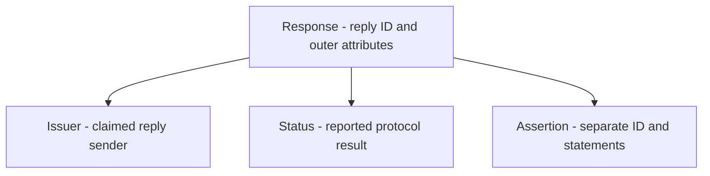
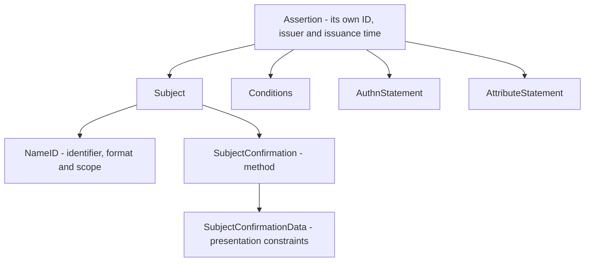

# SAML with Okta: field comparison and message anatomy

Atlas asks Okta for authentication information, but several values in the resulting documents can look alike while doing different jobs. The participant's entity ID, the receiving URL, the request ID and the user's identifier are four separate kinds of information.

This reference follows the fictional Atlas exchange: request `_req_D03_01`, response `_resp_D03_01`, assertion `_assert_D03_01`, and employee identifier `E1042`, which maps to Atlas account `atlas-4821`. All example addresses and records are fictional. Obtain real Okta issuer, endpoint and certificate values from the identified integration's approved setup information.

## Find the structure you need

- [Read the path notation](#read-the-path-notation)
- [Distinguish the documents](#distinguish-the-documents)
- [Read the authentication request](#read-the-authentication-request)
- [Read the response and assertion](#read-the-response-and-assertion)
- [Compare the fields that look alike](#compare-the-fields-that-look-alike)
- [Connect protocol meaning to Okta settings](#connect-protocol-meaning-to-okta-settings)
- [Keep protection and acceptance separate](#keep-protection-and-acceptance-separate)

## Read the path notation

`Response/Assertion/Subject/NameID` means follow those nested elements from outside inward. `Response@InResponseTo` means the InResponseTo XML attribute on Response. In `Conditions/AudienceRestriction/Audience`, the audience value is element content, rather than an XML attribute.

Paths below omit namespace prefixes for readability. In the XML, `samlp` is bound to the protocol namespace and `saml` to the assertion namespace. The namespace identifies the vocabulary; these prefix letters are local labels.

An XML attribute such as Recipient is different from a SAML user attribute such as department. Always identify the element owning a value before deciding what the value means.

## Distinguish the documents

| Structure | Main purpose | What its presence does not establish |
| --- | --- | --- |
| Metadata | Describe participants, roles, endpoints, keys and capabilities or expectations. | That a user authenticated, a receiver adopted the document or a runtime message was accepted. |
| AuthnRequest | Ask the IdP to perform the authentication exchange under applicable requirements. | That authentication happened or every requested value was approved. |
| Response | Report the protocol result and carry applicable assertions. | That the SP verified the message, found an account or granted a resource. |
| Assertion | Supply statements about the subject, with restrictions on their use. | That every readable field is trusted or suitable for the current attempt. |

Metadata advertises configuration information. A message shows what was supplied in an attempt. Receiver diagnostics establish the decisions actually recorded. Keep declared, configured, observed and enforced facts distinct.

## Read the authentication request

Atlas creates this request before Devi has an Atlas session. It retains protected pending context, including the expected provider, browser association and approved return target. The selected journey delivers the request through Redirect and asks for a POST response.

This is the same **reading copy** used in Lesson 3. The actual Okta Destination and request-protection material are omitted. It is not a complete deployment example or evidence of successful request verification. The response address and issuer belong to Atlas; neither is the Okta request-receiving endpoint.

```xml
<samlp:AuthnRequest
    xmlns:samlp="urn:oasis:names:tc:SAML:2.0:protocol"
    xmlns:saml="urn:oasis:names:tc:SAML:2.0:assertion"
    ID="_req_D03_01"
    Version="2.0"
    IssueInstant="2026-10-16T15:00:00Z"
    AssertionConsumerServiceURL="https://atlas.northstar.example/saml/acs"
    ProtocolBinding="urn:oasis:names:tc:SAML:2.0:bindings:HTTP-POST"
    ForceAuthn="false"
    IsPassive="false">
  <saml:Issuer>https://atlas.northstar.example/saml</saml:Issuer>
  <samlp:NameIDPolicy
      Format="urn:oasis:names:tc:SAML:1.1:nameid-format:unspecified"
      AllowCreate="true" />
</samlp:AuthnRequest>
```

| Request location | Meaning in this example | Important distinction |
| --- | --- | --- |
| `AuthnRequest@ID` | `_req_D03_01` identifies this request. | It is not Atlas's entity ID or Devi's user identifier. |
| `AuthnRequest/Issuer` | Atlas's SP entity ID. | The returning assertion identifies the provider as its issuer. |
| `AuthnRequest@IssueInstant` | Request creation at 15:00:00 UTC. | Not an authentication result or a universal timeout. |
| `AuthnRequest@AssertionConsumerServiceURL` | Requested response location: Atlas ACS. | The IdP must establish an approved association, rather than accept any supplied URL automatically. |
| `AuthnRequest@ProtocolBinding` | Requests the response through HTTP-POST. | Does not describe this request's Redirect delivery. |
| `AuthnRequest/NameIDPolicy@Format` | Requested identifier format. | Unspecified does not itself choose an employee number. |
| `AuthnRequest/NameIDPolicy@AllowCreate` | Identifier-related creation/association permission at the IdP. | Does not enable Atlas JIT or establish that an account was created. |
| `AuthnRequest@ForceAuthn` | False in this copy: no forced-freshness request from this flag. | Policy may still require fresh authentication. |
| `AuthnRequest@IsPassive` | False in this copy: passive-only processing is not requested. | This does not force a visible prompt. |

### Related request choices

`Destination`, where present and required by the selected arrangement, identifies the intended request-receiving endpoint at the IdP. It does not identify the ACS to which the response should return.

`AssertionConsumerServiceIndex` is an alternative way to select an ACS through approved configuration. It is mutually exclusive with `AssertionConsumerServiceURL` and `ProtocolBinding`. An index has no universal URL meaning. `AttributeConsumingServiceIndex` instead selects information about requested attributes; it does not select the ACS.

`RequestedAuthnContext`, when included, expresses authentication-context requirements. It is separate from the reported AuthnContext in the response. A requested class or ForceAuthn flag does not establish which authentication actually occurred. Okta's applicable configuration and the returned evidence still matter. [SAML Core, §3.4.1](https://docs.oasis-open.org/security/saml/v2.0/saml-core-2.0-os.pdf)

RelayState is not shown inside the XML because it is a separate binding-level value. In this example, `rs_D03_01` refers to protected local context and an approved navigation target. It does not replace the required request-correlation checks.

## Read the response and assertion

### Start with the envelope

**Figure RF-M1: Response envelope.** Arrows mean containment, not traffic, trust or execution order. The response has its own attributes, an issuer and a reported result. The assertion inside it is a separate object.

<!-- mermaid:id=RF-M1 -->


Read the reply's issuer and status, then identify the assertion the implementation is permitted to use. A successful status is the provider's reported protocol result. Non-success responses need their appropriate failure handling; they do not justify searching for any convenient identifier to sign in.

This compact view shows one assertion for the chosen example. SAML can carry different supported structures, including multiple or encrypted assertions. A generic search for the first NameID does not establish that the selected identity is protected and appropriate.

### Expand the assertion

**Figure RF-M2: Inside the assertion.** This expands the Assertion box in RF-M1. Arrows still mean containment. Subject leads to the identifier and confirmation data; Conditions, authentication information and user attributes remain separate branches.

<!-- mermaid:id=RF-M2 -->


NameID identifies the subject under its agreed format and scope. SubjectConfirmationData constrains presentation of the selected confirmation. Conditions restrict use of the assertion. AuthnStatement reports authentication information; AttributeStatement supplies additional subject data. These branches answer different questions even when some values happen to match.

### Locate those branches in XML

The following is the same fictional reading copy as Lesson 4. **The assertion signature is omitted**, so this copy fails Atlas's signed-assertion requirement and is not a message to submit to an application. `urn:example:northstar:okta-idp` is a conspicuous issuer placeholder, not a real Okta issuer pattern. Schema validity would not make this a cryptographically valid or accepted response.

```xml
<samlp:Response
    xmlns:samlp="urn:oasis:names:tc:SAML:2.0:protocol"
    xmlns:saml="urn:oasis:names:tc:SAML:2.0:assertion"
    ID="_resp_D03_01"
    Version="2.0"
    IssueInstant="2026-10-16T15:00:20Z"
    Destination="https://atlas.northstar.example/saml/acs"
    InResponseTo="_req_D03_01">
  <saml:Issuer>urn:example:northstar:okta-idp</saml:Issuer>
  <samlp:Status>
    <samlp:StatusCode Value="urn:oasis:names:tc:SAML:2.0:status:Success" />
  </samlp:Status>
  <saml:Assertion
      ID="_assert_D03_01"
      Version="2.0"
      IssueInstant="2026-10-16T15:00:20Z">
    <saml:Issuer>urn:example:northstar:okta-idp</saml:Issuer>
    <saml:Subject>
      <saml:NameID Format="urn:oasis:names:tc:SAML:1.1:nameid-format:unspecified">E1042</saml:NameID>
      <saml:SubjectConfirmation Method="urn:oasis:names:tc:SAML:2.0:cm:bearer">
        <saml:SubjectConfirmationData
            Recipient="https://atlas.northstar.example/saml/acs"
            InResponseTo="_req_D03_01"
            NotOnOrAfter="2026-10-16T15:02:00Z" />
      </saml:SubjectConfirmation>
    </saml:Subject>
    <saml:Conditions
        NotBefore="2026-10-16T14:59:50Z"
        NotOnOrAfter="2026-10-16T15:05:00Z">
      <saml:AudienceRestriction>
        <saml:Audience>https://atlas.northstar.example/saml</saml:Audience>
      </saml:AudienceRestriction>
    </saml:Conditions>
    <saml:AuthnStatement
        AuthnInstant="2026-10-16T15:00:15Z"
        SessionIndex="_session_D04_01">
      <saml:AuthnContext>
        <saml:AuthnContextClassRef>urn:oasis:names:tc:SAML:2.0:ac:classes:PasswordProtectedTransport</saml:AuthnContextClassRef>
      </saml:AuthnContext>
    </saml:AuthnStatement>
    <saml:AttributeStatement>
      <saml:Attribute Name="department"
          NameFormat="urn:oasis:names:tc:SAML:2.0:attrname-format:basic">
        <saml:AttributeValue>Research</saml:AttributeValue>
      </saml:Attribute>
      <saml:Attribute Name="groups"
          NameFormat="urn:oasis:names:tc:SAML:2.0:attrname-format:basic">
        <saml:AttributeValue>Atlas-Readers</saml:AttributeValue>
        <saml:AttributeValue>Research-Staff</saml:AttributeValue>
      </saml:Attribute>
    </saml:AttributeStatement>
  </saml:Assertion>
</samlp:Response>
```

The response answers `_req_D03_01`; its own ID is `_resp_D03_01`. The assertion's ID is `_assert_D03_01`, and its subject value is `E1042`. Their different names reflect different roles rather than values to make identical.

Both Issuer elements name the same conceptual provider in this direct example. That visible equality is not an authentication mechanism and is not a rule that every federation topology must have identical issuers at every layer. Required trust and protection apply to the actual content relied on.

## Compare the fields that look alike

### Message, participant, subject and local-session identifiers

| Value and location | Identifies | Example or source |
| --- | --- | --- |
| `AuthnRequest@ID` | A particular authentication request. | `_req_D03_01` |
| `Response@ID` | A particular protocol reply. | `_resp_D03_01` |
| `Assertion@ID` | A particular assertion. | `_assert_D03_01` |
| `AuthnRequest/Issuer` | Requesting SP entity. | `https://atlas.northstar.example/saml` |
| `Response/Issuer` | Claimed reply issuer. | Approved provider information; placeholder in the reading copy. |
| `Assertion/Issuer` | Authority making the assertion's statements. | Approved provider information; placeholder in the reading copy. |
| `Assertion/Subject/NameID` | Subject under the agreed identifier relationship. | Employee value `E1042` in this example. |
| `Assertion/AuthnStatement@SessionIndex` | Issuer-provided authentication-session reference. | `_session_D04_01` |
| Atlas internal account ID | Atlas's account record selected after acceptance. | `atlas-4821`; not a field in this assertion. |
| Atlas session cookie | Browser information for Atlas's local session implementation. | Issued separately by Atlas; not the SAML SessionIndex or assertion. |

An identical NameID string from two approved issuers need not identify the same person. Atlas's lookup uses the approved identity relationship and employee identifier, not a global bare-string assumption.

### Targeting, correlation and navigation

The following assertion paths are relative to the selected Assertion, while the response path begins at Response.

| Location | Question answered | Example value |
| --- | --- | --- |
| `Response@Destination` | Where is this reply addressed? | `https://atlas.northstar.example/saml/acs` |
| `Subject/SubjectConfirmation/SubjectConfirmationData@Recipient` | Where may this bearer confirmation be presented? | The same Atlas ACS in this example. |
| `Conditions/AudienceRestriction/Audience` | Which relying party is an intended audience? | `https://atlas.northstar.example/saml` |
| `Response@InResponseTo` | Which authentication request does this reply answer? | `_req_D03_01` |
| `Subject/SubjectConfirmation/SubjectConfirmationData@InResponseTo` | Which request does this requested bearer presentation answer? | `_req_D03_01` |
| RelayState, outside XML | Which agreed state value accompanies this binding exchange? | `rs_D03_01`, used here as a protected lookup. |
| Approved local return target | Where should Atlas direct the browser after successful processing? | `/projects`; permission is checked separately. |

Correct arrival does not establish a correct audience or recipient. Matching RelayState does not excuse a wrong InResponseTo. A signature result does not remove any applicable target or request-association check.

For a genuinely unsolicited response, there is no initiating SP request to name: Response and bearer-confirmation InResponseTo are absent under the applicable browser SSO rules. This is a separate supported path, rather than an excuse to accept any unmatched requested response. [SAML Profiles, §§4.1.4–4.1.5](https://docs.oasis-open.org/security/saml/v2.0/saml-profiles-2.0-os.pdf)

### Issuance, authentication, presentation and continuing sessions

| Location | Meaning | Reading-copy value |
| --- | --- | --- |
| `Response@IssueInstant` | When the reply was issued. | 15:00:20 UTC |
| `Assertion@IssueInstant` | When the assertion was issued. | 15:00:20 UTC |
| `Assertion/AuthnStatement@AuthnInstant` | Reported authentication time. | 15:00:15 UTC |
| `Assertion/Conditions@NotBefore` | Inclusive start of this assertion-use interval. | 14:59:50 UTC |
| `Assertion/Conditions@NotOnOrAfter` | Exclusive end of that interval. | 15:05:00 UTC |
| `Assertion/Subject/SubjectConfirmation/SubjectConfirmationData@NotOnOrAfter` | Exclusive bearer-presentation deadline. | 15:02:00 UTC |
| `Assertion/AuthnStatement@SessionNotOnOrAfter`, when supplied | Upper bound for derived sessions under applicable processing. | Not present in this copy. |

All displayed times are on 16 October 2026. With zero clock tolerance, an arrival at 15:00:21 passes these illustrated time limits. At 15:02:00 exactly, the bearer deadline has been reached. At 15:03:00, Conditions is still open but the bearer presentation is too late. Neither timely arrival nor a recent IssueInstant establishes every other acceptance requirement.

The bearer confirmation has no NotBefore in this copy; the selected browser bearer rules prohibit that attribute there. Do not move the Conditions start into confirmation data to make the structures look alike. A session created after acceptance has separate local policy and any applicable supplied bound, rather than an automatically inherited five-minute lifetime. [SAML Errata 05, E79](https://docs.oasis-open.org/security/saml/v2.0/errata05/os/saml-v2.0-errata05-os.pdf)

Metadata `validUntil` and `cacheDuration` concern another object again: configuration validity and refresh. They do not set the assertion or application-session lifetime. Cache staleness is distinct from expiry under validUntil. [SAML Errata 05, E94](https://docs.oasis-open.org/security/saml/v2.0/errata05/os/saml-v2.0-errata05-os.pdf)

### Identifier formats and attribute values

| Location | Meaning | What to check |
| --- | --- | --- |
| `Subject/NameID@Format` | Identifier semantics. | Unspecified here requires the agreed employee-key interpretation; it does not choose the source value. |
| `Subject/NameID@NameQualifier` or `@SPNameQualifier`, where applicable | Further naming scope under the format's rules. | Neither is supplied here. Do not invent or discard scope to force a match. |
| `AttributeStatement/Attribute@Name` | Technical attribute identifier. | `department` or `groups` in this example. |
| `AttributeStatement/Attribute@NameFormat` | Convention used for the attribute name. | Basic name format here; not a declaration of the value's data type. |
| `AttributeStatement/Attribute@FriendlyName`, when supplied | Human-readable label. | Not present here; it does not replace the agreed technical name. |
| `AttributeStatement/Attribute/AttributeValue` | One supplied value. | Department has `Research`; groups has two separate values. |

The two group values are `Atlas-Readers` and `Research-Staff`. One comma-joined string is not automatically equivalent to those two XML values. Atlas must interpret the names and values under its contract; the standard does not turn either group into a universal role.

Source data, configured output and received content are separate evidence. After SAML acceptance, Atlas still needs usable application data, the intended unique account match, permitted entry and the requested resource permission.

## Connect protocol meaning to Okta settings

These labels concern the outbound Okta-to-Atlas SAML app integration. Inbound external-IdP settings belong to a different relationship, with Okta as receiving SP.

| Okta setting or supplied information | Protocol relationship | Verify with the application |
| --- | --- | --- |
| Single sign-on URL | Default application ACS. | Correct environment and supported response delivery. |
| Audience URI (SP Entity ID) | Intended assertion audience. | Exact expected Atlas entity ID. |
| Recipient URL and Destination URL, where separately configured | Related receiving locations with distinct roles. | The documented values; do not assume every deployment requires one shared string. |
| Provider SSO endpoint from setup information | Destination for the application's authentication request. | Use the identified integration's approved value, not Atlas's ACS. |
| Provider issuer from setup information | Identity of the expected issuer. | Approved trust for the correct relationship. |
| Name ID format | Identifier semantics. | Required format and scope. |
| Application username | App-specific identity value used by the configured output. | Source authority, emitted NameID and intended account match. |
| Authentication context class | Configuration concerning reported authentication context. | Actual request requirements and observed authentication evidence. |
| Honor Force Authentication | Product handling of incoming ForceAuthn. | Effective setting and actual freshness result, not the flag alone. |
| Response and Assertion Signature | Separate signed-layer choices. | Required scope and complete receiver verification. |
| Assertion Encryption and Encryption Certificate | Encrypted assertion output and Atlas recipient public material. | Corresponding Atlas decryption capability and required protection. |

The settings describe configuration, not verified outcomes. For example, selecting assertion signing does not establish successful runtime reference and signature validation at Atlas. Generating an assertion preview does not prove the receiver accepted a live submission. [Okta SAML field reference](https://help.okta.com/oie/en-us/content/topics/apps/aiw-saml-reference.htm)

## Keep protection and acceptance separate

In Atlas's required assertion-signing arrangement, the receiver must verify the actual intended assertion under approved trust and use that same protected object for identity and restriction decisions. The missing signature in the reading copy is a deliberate limitation, not an exception to that requirement.

A signature on the assertion does not automatically cover the outer response's fields or a separate RelayState parameter. A response signature has its own reference scope. Encryption can replace the readable assertion with EncryptedAssertion; authorized recovery exposes the inner content for required processing rather than proving the sender or granting access. Secure processing dependencies depend on the actual layers and supported construction.

The practical reading order is to identify the document, locate the owning element, understand the value's role and compare the relevant requirement and receiver evidence. That is a reading method, not a universal cryptographic execution algorithm.

For the connected explanations, see [planning and metadata](../lessons/lesson-02-planning-and-metadata.md), [the requested exchange](../lessons/lesson-03-sp-initiated-sso.md), [responses and identity](../lessons/lesson-04-responses-assertions-and-identity.md), [trust and protection](../lessons/lesson-06-trust-signatures-and-encryption.md) and [response acceptance](../lessons/lesson-07-response-acceptance-and-access.md). Short definitions are in the [glossary](glossary.md).

## Sources

- [SAML Core, AuthnRequest, responses, subjects, conditions and statements](https://docs.oasis-open.org/security/saml/v2.0/saml-core-2.0-os.pdf)
- [SAML Profiles, browser SSO processing: §4.1, as amended](https://docs.oasis-open.org/security/saml/v2.0/saml-profiles-2.0-os.pdf)
- [SAML Metadata, entity and service descriptions](https://docs.oasis-open.org/security/saml/v2.0/saml-metadata-2.0-os.pdf)
- [SAML Errata 05, identifier, session, protection and metadata clarifications](https://docs.oasis-open.org/security/saml/v2.0/errata05/os/saml-v2.0-errata05-os.pdf)
- [Okta SAML field reference](https://help.okta.com/oie/en-us/content/topics/apps/aiw-saml-reference.htm)
- [Okta assertion preview guidance](https://help.okta.com/oie/en-us/content/topics/apps/apps_app_integration_wizard_saml.htm)
