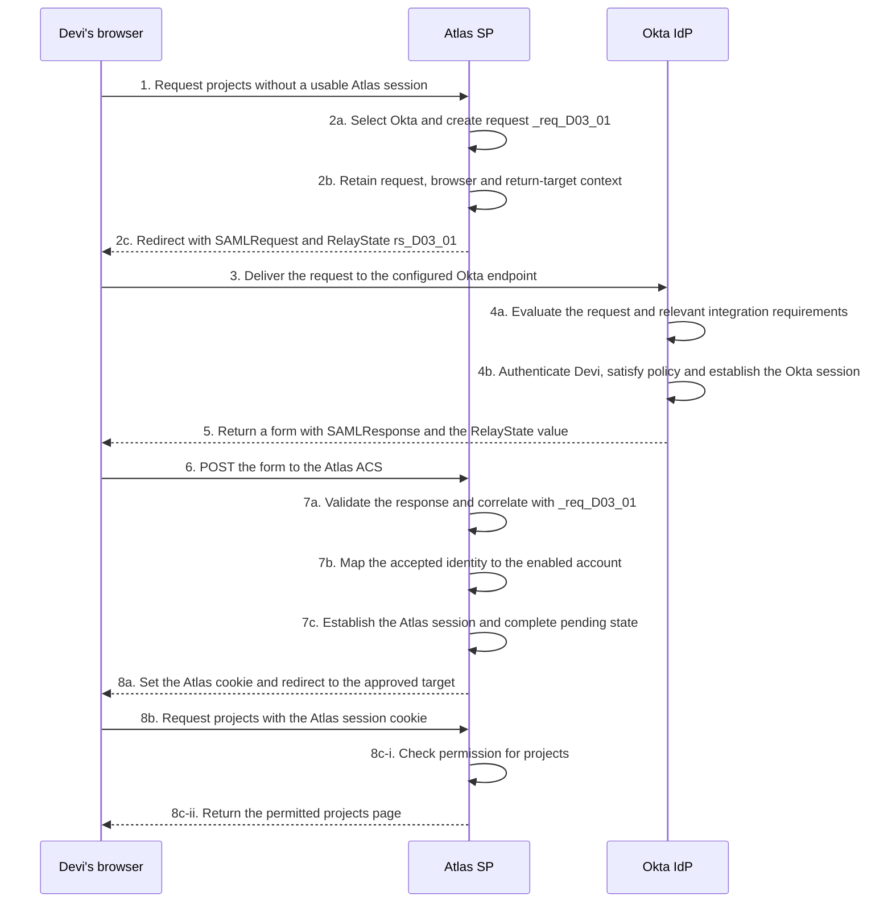

# Final engineering case: restore Atlas test access

Northstar's app owner asks you to assess Atlas test after an integration change. Several users report “Unable to sign in,” while one reader reports an administrative denial. Prepare a reasoned engineering recommendation using the evidence below. This is a fictional investigation with normalized records, not an export of actual Okta event names.

## Establish the required behavior

Atlas test's entity ID is `urn:northstar:atlas:test`, and its ACS is `https://atlas-test.northstar.example/saml/acs`. It expects the approved provider issuer `urn:northstar:okta:test`, its required signed assertion protection, request correlation, target/time checks and service-wide replay prevention. Actual tenant issuer values must come from approved integration information.

Devi should match employee ID `E1042`; Noor should match `E2087`. Both test accounts are unique, enabled readers. JIT provisioning is disabled. A required `department` claim must be released. Readers may open projects and must be denied administrative changes.

Approved K2 replaces uncompromised K1 under a planned overlap. Every active validator must adopt K2 before the sender switches. Recovery must preserve trust checks and intended account permissions. No supported cross-app logout mechanism is part of this change.

## Compare selected settings with requirements

| Item | Recorded value or state |
| --- | --- |
| Single sign-on URL | The agreed Atlas test ACS |
| Audience URI | `urn:northstar:atlas:test` |
| Name ID format | Unspecified, interpreted by the agreed employee-ID mapping |
| Devi's authoritative source / effective app username | `E1042` / `devi@northstar.example` |
| Noor's authoritative source / effective app username | `E2087` / `E2087` |
| Claim configuration and observed release | `department` is required; the displayed issued message contains `Research` |
| Sender signing key after the change | Approved K2 |
| Effective node trust | A trusts K1/K2; B trusts only K1 |

## Inspect the message evidence

This excerpt is a sanitized, incomplete copy of Devi's first attempt at node A. The signature and unrelated fields are omitted. Its displayed values do not prove cryptographic validity; the separate receiver record reports the validation result for the preserved original. Do not attempt to validate the modified excerpt as though it were that original.

```xml
<samlp:Response xmlns:samlp="urn:oasis:names:tc:SAML:2.0:protocol"
  xmlns:saml="urn:oasis:names:tc:SAML:2.0:assertion"
  ID="_resp_D03_01" InResponseTo="_req_D03_01"
  Destination="https://atlas-test.northstar.example/saml/acs">
  <saml:Issuer>urn:northstar:okta:test</saml:Issuer>
  <!-- Status is Success; signature and other required fields omitted. -->
  <saml:Assertion ID="_assert_D03_01">
    <saml:Issuer>urn:northstar:okta:test</saml:Issuer>
    <saml:Subject>
      <saml:NameID>devi@northstar.example</saml:NameID>
    </saml:Subject>
    <saml:Conditions NotBefore="2026-10-17T14:01:00Z"
      NotOnOrAfter="2026-10-17T14:06:00Z">
      <saml:AudienceRestriction>
        <saml:Audience>urn:northstar:atlas:test</saml:Audience>
      </saml:AudienceRestriction>
    </saml:Conditions>
    <saml:AttributeStatement>
      <saml:Attribute Name="department">
        <saml:AttributeValue>Research</saml:AttributeValue>
      </saml:Attribute>
    </saml:AttributeStatement>
  </saml:Assertion>
</samlp:Response>
```

Compare the reported audience, destination and subject with the contract. Record what each comparison establishes and what requires separate receiver evidence. For field-by-field interpretation, consult [annotated messages](annotated-saml-messages.md).

## Correlate several independent attempts

All timestamps are UTC. Every sign-in starts without a usable Atlas session and uses a fresh request, response and assertion. Required Okta assignment and authentication policy succeed for these recorded attempts. These facts do not imply every unrelated attempt succeeds.

| Attempt | Time and evidence | Observed result |
| --- | --- | --- |
| A1: Devi at A | 14:01:10, request `_req_D03_01`, response `_resp_D03_01`, assertion `_assert_D03_01`; preserved original uses K2; required receiver checks pass, including bearer confirmation, browser/request context and replay state | NameID is email; employee-ID lookup returns no match; no Atlas session |
| B1: Devi at B | 14:02:10, request `_req_EC_B1`, response `_resp_EC_B1`, assertion `_assert_EC_B1`; K2 response reaches correct ACS; node reports no approved verification key for that sender key | Verification fails; account mapping not reached; no Atlas session |
| A2: Noor at A | 14:03:10, request `_req_EC_A2`, response `_resp_EC_A2`, assertion `_assert_EC_A2`; required checks pass; NameID `E2087`, department `Research` | Intended enabled account selected; new session; projects succeeds |
| A2 resource request | 14:03:30, Noor's same new session requests an administrative action | Denied under reader role |

## Write your recommendation before opening the analysis

1. Explain the intended browser journey from requesting projects through session creation and the final resource check.
2. Identify the last success and first failure for A1 and B1. Explain why the A2 administrative denial differs.
3. Separate confirmed mismatches from unknown underlying causes.
4. Propose the smallest authorized corrections. Would a key rollback alone resolve all supplied failures?
5. Give positive and rejection tests that demonstrate recovery without weakening a boundary.

<details><summary>Reveal the engineering analysis</summary>

**A1 stops at account resolution.** Node A accepted the actual protected SAML message, but its consumed subject value disagrees with the employee-ID lookup contract. Trace Devi's username configuration, effective app-user value and update behavior to the approved source. Resolve that mismatch through the controlled identity change process. Do not substitute a permissive email lookup just to suppress the error.

**B1 stops at verification trust.** Its effective K2 trust is absent. Reconcile approved K2 adoption at B and verify all active validators. Do not trust an arbitrary embedded certificate or disable verification. Since K1 is stated uncompromised, a coordinated temporary rollback may be a supported recovery option, but it does not fix Devi's account mapping and requires its own criteria and verification.

**A2 establishes useful success and intended denial.** Noor reaches the intended account and projects. The reader's administrative denial is required behavior, not an SSO defect. Do not grant administrator rights as a repair.

The packet does not explain why B missed adoption or why Devi's app username became email. It also does not establish readiness of any unnamed node. Preserve those uncertainties in the handover.

Retest fresh Devi and Noor exchanges at each validator, recording new request and message IDs, actual signing key, time/target/correlation/replay outcomes, consumed NameID, unique account and resource result. Verify that a copied assertion, wrong audience and incorrect correlation are rejected through an approved test environment or supported test harness. A new successful sign-in must not make those rejection tests pass incorrectly. Keep the reader administrative denial.

</details>

## Trace the intended complete exchange

The diagram below shows a successful path after correction, starting without usable Atlas or Okta sessions. It reuses the same request identifier as A1 for orientation; a real retest must create a new request and assertion. The observed failures above stop before the intended session steps. Separate tests should also cover reuse of an acceptable Okta session.

**Figure RF-EC1: Intended complete sign-in after correction.** Browser delivery and local decisions are distinct.



At step 1, the browser asks Atlas for projects. Steps 2a through 3 create protected pending context and carry the request to Okta. Step 4 groups provider request processing, authentication and policy interactions. Steps 5 and 6 carry the response through the browser to the ACS. At 7a, the receiver evaluates trust and the applicable acceptance checks; at 7b it resolves the intended account. Compare each supplied attempt with these boundaries. Only successful processing reaches session creation at 7c and the browser's cookie-backed resource request and authorization outcome at step 8.

The cross-participant arrows show message movement; self-arrows show local processing. A trust configuration is a prerequisite to verification, not another browser message. The changed session state begins only after the receiver and account checks succeed.

## Check your own confidence

You are ready to defend the recommendation when you can explain the two distinct failure boundaries, preserve the expected denial, name missing evidence, and describe how a fresh test proves the intended repair. If one of those is unclear, use [troubleshooting comparisons](troubleshooting-comparisons.md) or the [Okta settings bridge](okta-settings-to-saml.md), then attempt the recommendation again.
