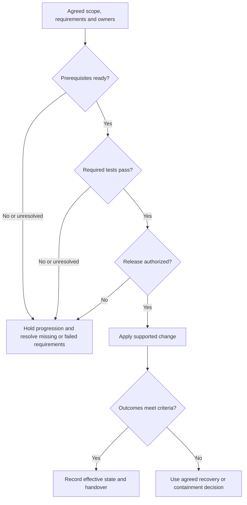

# SAML with Okta: integration planning, changes and handover

A useful integration agreement explains what should happen, who owns each decision and what evidence will establish the result. Daniel configures the Okta side; Priya coordinates Atlas's receiving and application requirements. Their work connects at the agreed identity, trust and access boundaries.

The examples use fictional Northstar Research environments, accounts and key labels. `.example` addresses are illustrative. Obtain real Okta issuer, endpoint and certificate information from the identified integration's approved setup information.

## Agree on the relationship before entering settings

| Agreement item | Record explicitly |
| --- | --- |
| Purpose and population | Application, users, intended resources and business outcome. |
| Product and scope | Okta org/engine, application instance/edition, environment and supported integration. |
| Protocol path | Initiation, binding on each leg, receiving services and any separately supported alternative. |
| Participant identity and targets | Expected issuer, SP entity ID, ACS, audience and other applicable receiving values. |
| Subject and account relationship | NameID format, authoritative source, scope, unique lookup and account continuity. |
| Required application data | Attribute names, usable values/cardinality, group filtering and app interpretation. |
| Protection and acceptance | Required signed/encrypted layers, approved keys, permitted processing and remaining acceptance controls. |
| Authentication and assignment | Intended assignments and applicable authentication requirements. |
| Account lifecycle | Creation/update/disablement mechanism, owner and downstream results. |
| Sessions and logout | Local limits, reauthentication boundaries, participants and per-service termination scope. |
| Operations | Test criteria, effective configuration evidence, support owners, monitoring and recovery. |

Check the selected OIN integration's capabilities and application guidance, or the supported custom integration requirements. A product name or a SAML checkbox does not establish support for every protocol path. Test and production need explicit review even when many settings look alike. [Okta existing integrations](https://help.okta.com/oie/en-us/content/topics/apps/apps-add-applications.htm), [custom SAML integrations](https://help.okta.com/oie/en-us/content/topics/apps/apps_app_integration_wizard_saml.htm)

For each important value, record its authoritative source, owner, environment and effective use. A metadata declaration, saved setting, emitted message and enforced receiver rule are different evidence. The [field comparison](field-comparison-and-message-anatomy.md) connects the protocol meanings to Okta labels.

### Keep ownership visible

| Owner | Decisions to maintain |
| --- | --- |
| Okta integration/policy owners | Integration selection, assignments, policy, emitted identity/claims and provider key use. |
| Atlas owners | Approved targets, runtime trust, acceptance, account lookup, local sessions and resource permissions. |
| Identity/lifecycle owners | Authoritative identifiers, account continuity and supported downstream lifecycle results. |
| Change and support owners | Release decision, monitoring, supported recovery, escalation and maintained records. |

One engineer may fill several roles, but the decisions remain separate. Assignment is not downstream readiness, and account creation is not resource permission. Provisioning needs its own supported configuration and result. [Okta provisioning workflow](https://help.okta.com/oie/en-us/content/topics/provisioning/lcm/lcm-deploy-cloud.htm)

## Review a concrete environment contract

Consider an independent Atlas test proposal. The agreed path is requested Redirect/POST. Devi's employee value remains `E1042`; its test account is a distinct fictional record, `atlas-test-4821`. Production's `atlas-4821` is not automatically the same account.

| Contract item | Agreed test requirement | Review implication |
| --- | --- | --- |
| SP entity ID | `https://atlas-test.northstar.example/saml` | Preserve the exact approved test identity. |
| ACS | `https://atlas-test.northstar.example/saml/acs` | A production ACS is not an equivalent target. |
| Provider information | Approved issuer, endpoint and verification material for this integration. | Obtain and adopt the actual values; do not manufacture an Okta URL pattern. |
| Identity | Scoped employee identifier selects `atlas-test-4821`. | Replacing it with email changes the account-selection contract. |
| Claims | Required `department` and only the agreed group values. | Verify names, sources, emitted values and Atlas's interpretation. |
| Protection | Atlas requires a signed assertion. | A different supported signed layer does not waive this requirement. |
| Access | Enabled test reader can open projects; administrative changes remain denied. | Test both intended permission and intended denial. |

Okta's ACS, audience, application username, Name ID format and protection settings serve different purposes. Compare each with the contract. For claims, current and legacy configurations need the applicable source/expression review; a correct profile value alone does not establish correct output. [Okta SAML field reference](https://help.okta.com/oie/en-us/content/topics/apps/aiw-saml-reference.htm), [custom claims](https://help.okta.com/oie/en-us/content/topics/apps/federated-claims-overview.htm)

## Define tests before interpreting results

The following is a proposed matrix for approved isolated test conditions, not completed test evidence. Controlled invalid-message cases need a supported test facility and the responsible owners. Each case must specify its own session state so an existing Atlas session cannot silently bypass the intended new exchange.

| Case | Starting condition or controlled difference | Expected outcome and evidence |
| --- | --- | --- |
| T1: permitted baseline | Devi assigned, policy satisfied, expected enabled test account and projects role; no app session | Correct test delivery, accepted identity, intended account, new session and permitted projects |
| T2: assignment boundary | Separate unassigned test user; no app session | Relevant Okta denial and no successful downstream session from this attempt |
| T3: authentication-policy boundary | Assigned test user cannot meet the applicable policy; no app session | Correct policy outcome; no successful assertion-to-session completion |
| T4: identity mapping | Authoritative employee identifier available | Actual NameID and unique test-account match agree with the contract |
| T5: missing required application claim | Supported fixture omits department; SAML otherwise accepted | Application rejects entry for the stated missing data, without creating a session |
| T6: permission boundary | Correct enabled reader account; attempt an agreed restricted operation | Session works for permitted resources; restricted operation denied by Atlas |
| T7: target mismatch | Supported fixture targets another SP/environment | Receiver rejects the unacceptable target; no new session |
| T8: correlation and replay | Separate supported mismatched-request and repeated-assertion cases | Each rejected at the appropriate boundary; no successful reuse |
| T9: time boundary | Controlled expired bearer presentation with known clocks/tolerance | Rejection consistent with the actual deadline and configured tolerance |
| T10: key transition | Approved K2 adopted by receiver before selected sender cutover, where supported | New signed output verifies under intended trust on all relevant receiving instances |
| T11: session and logout scope | Documented active sessions and selected supported logout path | Targeted services’ outcomes confirmed; unconfirmed participants recorded honestly |

Add separate missing-account and disabled-account cases where relevant. Each follows the agreed lookup/creation or rejection behavior. Include identifier changes when the source can change, preserving the intended existing account rather than treating a duplicate as success. Run T8’s correlation and replay cases separately, including reuse across relevant receiving instances.

Record **Pass**, **Fail** or **Unresolved** against the stated criterion and evidence. An intended denial can be a pass. A generic error without evidence of the required rejection can remain unresolved. An incorrect acceptance is a failure even if the permitted baseline works. The [acceptance](response-validation-and-acceptance.md) and [session/logout](sessions-reauthentication-and-logout.md) references explain those outcome boundaries.

Okta global and app sign-in policy requirements also need the correct starting context. Changing a provider rule does not prove that an existing local Atlas session consults it on the next page request. [Okta policies and rules](https://help.okta.com/oie/en-us/content/topics/identity-engine/policies/about-policies.htm)

## Sequence the change around dependencies

**Figure RF-P1: Readiness, release and post-change decisions.** Arrows show a change process, not SAML messages. Prerequisites include ownership, support, evidence access, monitoring and recovery readiness. Failed or unresolved required criteria hold progression.

<!-- mermaid:id=RF-P1 -->

Agree on the scope and expected behavior first. Establish supported prerequisites, then collect the required test evidence. Release authorization belongs to the responsible decision owner. After applying the supported change, compare observed outcomes with the criteria; use the agreed recovery or containment decision if they do not meet them. Record the effective state and any remaining limits for handover.

| Change | Dependency to resolve first | Evidence after the change |
| --- | --- | --- |
| Endpoint or entity identity | Correct environment, routing, approved receiving values and trust context. | Actual message delivery, intended target and receiver acceptance. |
| NameID or account mapping | Source authority, scope, existing links and account continuity. | Actual emitted value and intended unique account, without unintended duplicate creation. |
| Attribute/group output | Required names, cardinality, filtering and application interpretation. | Usable emitted data and intended allowed/denied permissions. |
| Signing key | Authoritative new material and every relevant receiver's supported adoption. | Observed sender key, required verification and per-instance acceptance. |
| Assignment or authentication policy | Intended access decision and test session state. | Correct new-attempt policy result; local-session behavior assessed separately. |
| Session or logout behavior | Supported participants, targeted session associations and expected scope. | Per-service processing and fresh protected-resource results. |

Avoid combining unrelated changes when it makes their outcomes hard to distinguish. A key change and an identifier change can fail independently. The [trust reference](trust-and-protection.md#separate-generation-activation-and-receiver-adoption) distinguishes available material, sender use and receiver adoption. Okta certificate activation does not update a partner's effective trust automatically. [Okta signing certificate management](https://help.okta.com/oie/en-us/content/topics/apps/manage-signing-certificates.htm)

### Judge a cutover from supplied evidence

In this independent fictional proposal, Okta still signs with K1. K2 is approved, and Atlas supports controlled multi-key trust. Receiver A trusts K1 and K2; receiver B trusts only K1. A fresh baseline succeeds at A under K1. No K2-based runtime result is supplied. K1 remains uncompromised and permitted for this proposed planned transition.

| Question | What this packet establishes |
| --- | --- |
| Does a permitted baseline currently work at A? | Yes, for the recorded K1 attempt and its stated outcome. |
| Is B prepared to verify K2? | No; its effective trust lacks K2. |
| Has runtime K2-based acceptance been demonstrated? | No. Trust inventory alone is not that result. |
| Is the proposed K2 sender switch ready on this packet? | No. Receiver preparation and required verification evidence remain incomplete. |

Prepare B through its supported approved process and obtain K2-based verification evidence in the agreed test arrangement before changing the readiness conclusion. A successful K1 attempt at A does not settle either gap. This packet does not establish why B is unprepared or that every later acceptance/account check would pass under K2.

## Define stopping and recovery criteria

State concrete reasons to stop progression: an unexpected sender key, an unprepared required receiver, a wrong account match, a required claim becoming unusable, or a rejection test creating a session. A working user elsewhere does not erase that failure.

Recovery needs a supported, permitted state on both sides. Define who decides, what configuration can be restored, what verification is required and how administrative access remains recoverable if federation fails. An approved recovery route should have an owner, allowed use and monitoring; it is not an undocumented policy bypass.

A rollback does not automatically reverse account creation, disclosed data, established sessions or partner caches. Restoring K1 is not a normal availability remedy if K1 is compromised or prohibited. An incident can require containment rather than restoration of the earlier state. [Lesson 9](../lessons/lesson-09-integration-design-and-change-planning.md#94-plan-tests-and-a-controlled-change) connects recovery scope to the change decision.

## Hand over the maintained state

Use this table as a handover template. [Lesson 9’s filled proposal](../lessons/lesson-09-integration-design-and-change-planning.md#write-the-decision-its-evidence-and-its-limits) shows how to record the decision, evidence and unresolved items without claiming completed tests.

| Handover item | Useful contents |
| --- | --- |
| Relationship and support | Org/integration, environment, supported app/version or edition, agreed path and owners. |
| Authoritative configuration | Entity IDs, endpoints, approved metadata/key sources, effective values and refresh/import behavior. |
| Identity and lifecycle | NameID source/format/scope, actual account lookup, required claims, creation/update/disablement owners. |
| Trust and key lifecycle | Required layers, approved algorithms/keys, sender use, receiver inventories and replacement ownership. |
| Policy and access | Assignment, authentication requirements, intended roles and allowed/denied resources. |
| Sessions and logout | Local limits, relevant supplied session bounds, reauthentication, participating services and known exclusions. |
| Test and release evidence | Starting states, message/attempt references, per-instance results, unresolved items and release decision. |
| Operations and recovery | Diagnostic sources, monitoring ownership, escalation, approved evidence locations and supported recovery criteria. |

Keep secrets and private keys out of ordinary handover material. Reference their approved custody arrangements where needed. Diagnostic records should preserve useful associations without unnecessarily distributing raw assertions or cookies; the [evidence reference](troubleshooting-evidence.md#write-a-handoff-that-another-engineer-can-use) gives a practical reporting structure.

For the cutover proposal above, a precise readiness note is:

> K2 is approved and Atlas supports multi-key trust. A currently trusts K1/K2, while B still trusts only K1. The supplied successful attempt used K1 at A; K2-based runtime acceptance has not been demonstrated. Hold the proposed sender switch while B is prepared and the agreed verification is completed. The packet does not establish the cause of B's missing adoption or readiness for the remaining release criteria.

After a verified change, update the record with what actually became effective, where it was observed and which permissions and rejection behaviors remained correct. Another engineer should be able to distinguish a completed result from a proposal or unresolved dependency without reconstructing the entire ticket history.
