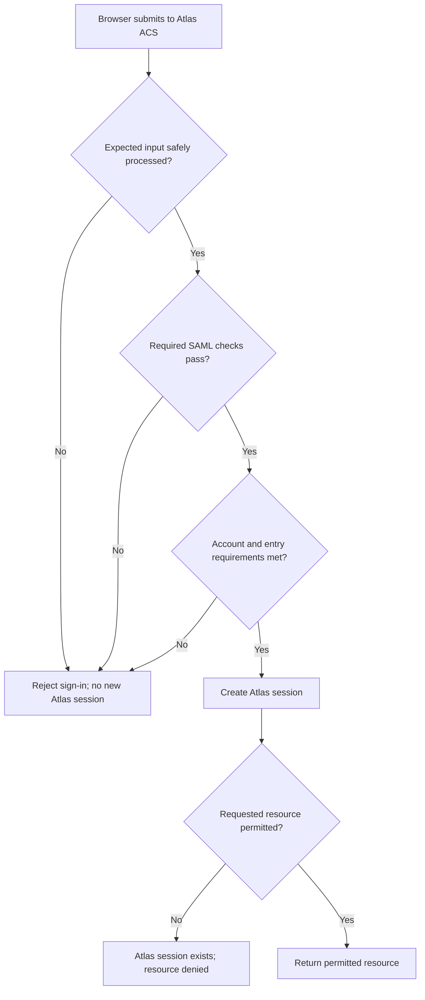
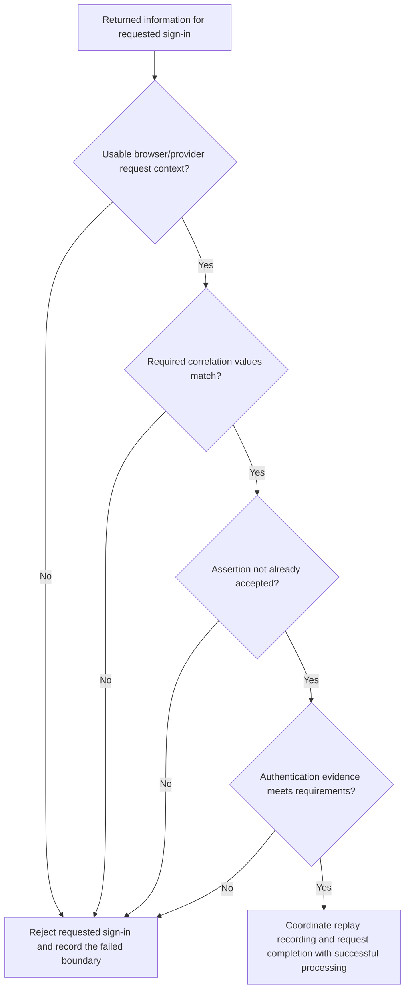

# SAML with Okta: response validation and acceptance

Okta can authenticate Devi successfully while Atlas rejects the information returned to it. Atlas can also accept that information but deny entry to a disabled application account. Even after Atlas creates a session, it can deny a particular resource. Each result belongs to a different decision.

For the fictional Northstar Research integration, Atlas expects a requested browser SSO response from its approved Okta provider, delivered by POST to `https://atlas.northstar.example/saml/acs`. Its entity ID is `https://atlas.northstar.example/saml`. Atlas requires a signed assertion and uses the accepted employee identifier `E1042` to match account `atlas-4821`. The `.example` addresses and records are fictional.

## Locate the acceptance boundary

**Figure RF-V1: From arrival to resource access.** Arrows show logical dependencies, not network messages or a universal parser/cryptographic execution order. The scenario starts without a usable Atlas session. Rejection does not create a new one; the resource-denied branch occurs after session creation.

<!-- mermaid:id=RF-V1 -->

Start at arrival. Atlas must safely obtain the expected message, establish that its SAML information is acceptable, then apply its account and entry requirements. A failure before session creation stops this sign-in. A failure at resource permission has a different outcome: the Atlas session exists, but the requested action is denied.

The full browser journey remains visible in [Lesson 7's complete exchange](../lessons/lesson-07-response-acceptance-and-access.md#75-complete-the-application-decisions-and-identify-the-stopping-boundary). RF-V1 expands the receiver's decisions rather than introducing another message path.

## Review input, trust and use requirements

The groups below belong together. A passing row does not establish that the remaining rows passed, and table order does not replace the receiving implementation's supported secure processing.

| Group | What Atlas needs to establish | Insufficient observation |
| --- | --- | --- |
| Input and structure | Expected binding, safely decoded input and supported message shape. | An HTTP request reached the ACS. |
| Reported protocol result | Appropriate handling of the response Status. | A Success status is present. |
| Issuer and trust | Approved provider/key relationship for this integration. | The issuer text or a supplied certificate looks familiar. |
| Required protection | Intended signed layer, permitted algorithms and complete verification. | An XML Signature element exists. |
| Object selection | The identity and restrictions used belong to the actual verified object. | A signature somewhere in the document passed. |
| Target and presentation | Applicable destination, audience and bearer-recipient requirements. | The browser reached the expected host. |
| Time | Applicable Conditions and confirmation limits, with approved tolerance. | One timestamp has not expired. |
| Attempt association | Applicable response/confirmation correlation and usable browser/provider context. | RelayState matches. |
| Replay | The bearer assertion cannot be accepted again contrary to the profile. | Its signature and time window still pass. |
| Authentication evidence | Reported authentication satisfies the applicable requirement. | The response was issued recently. |
| Application entry | Usable claims, intended unique account match and permitted account state. | Okta assigned the app to Devi. |
| Resource access | The resulting account is permitted to perform the requested action. | Atlas created a session. |

### Process input safely

Untrusted XML must not trigger arbitrary external entity resolution, file access, remote schema retrieval or unbounded processing. Where schema validation is performed, schemas come from controlled configuration. Schema validity establishes allowed structure and data types, not an approved sender or acceptable assertion. [OWASP SAML security guidance](https://cheatsheetseries.owasp.org/cheatsheets/SAML_Security_Cheat_Sheet.html)

An unsupported or ambiguous message does not become usable because an implementation can find a NameID inside it. An identifier alone is not the required authentication information for browser sign-in. A non-success Status needs appropriate failure handling, not a search for a convenient identity.

### Establish the protected content actually used

Atlas needs approved trust, complete required verification and secure content selection together. Verifying assertion A while reading the account identifier from B leaves the consumed identity unprotected by that result. [W3C XML Signature Best Practices, §3.1.5](https://www.w3.org/TR/xmldsig-bestpractices/)

Browser SSO processing verifies signatures present on the response and assertions. Another passing signature does not excuse an invalid additional signature. The amended profile's signing rules and Atlas's particular assertion-signing requirement both matter. [SAML Profiles, §4.1.4.3](https://docs.oasis-open.org/security/saml/v2.0/saml-profiles-2.0-os.pdf), [SAML Errata 05, E93](https://docs.oasis-open.org/security/saml/v2.0/errata05/os/saml-v2.0-errata05-os.pdf)

For encrypted content, required outer protection and recovery of an inner signature introduce construction-dependent dependencies. Decryption alone does not establish origin. The [trust and protection reference](trust-and-protection.md) explains key ownership, layers and the verified-versus-consumed relationship.

## Distinguish the target and time checks

| Value in the established response | Role | Example |
| --- | --- | --- |
| Response Destination | Intended receiving location for the reply. | Atlas ACS: `https://atlas.northstar.example/saml/acs` |
| Bearer Recipient | Permitted location for that presentation. | The same ACS in this arrangement. |
| Audience | Intended relying party. | Atlas entity ID: `https://atlas.northstar.example/saml` |

These values can look alike without being interchangeable. Apply approved values and the relevant comparison rules. Do not rewrite an entity ID into an ACS URL or normalize an unfamiliar value merely to make a comparison pass. The [field comparison](field-comparison-and-message-anatomy.md#targeting-correlation-and-navigation) locates each field.

An assertion's Conditions and the selected confirmation impose separate limits. Multiple AudienceRestriction elements combine as restrictions: a matching audience in one does not override another restriction that excludes Atlas. Unrecognized conditions cannot simply be ignored to obtain acceptance. Supported subject-confirmation alternatives are evaluated as complete alternatives, rather than combining the recipient from one with the deadline from another. [SAML Core, §§2.4.1 and 2.5.1](https://docs.oasis-open.org/security/saml/v2.0/saml-core-2.0-os.pdf)

### Read the established time example precisely

The following times are all UTC on 16 October 2026. Conditions permits use from 14:59:50 until before 15:05:00. The bearer deadline is before 15:02:00. These comparisons use zero clock tolerance and address only these illustrated limits.

| Arrival | Conditions interval | Bearer deadline | Time-group conclusion |
| --- | --- | --- | --- |
| 14:59:49 | Not yet open. | Not reached. | Too early for Conditions. |
| 15:00:21 | Open. | Not reached. | These limits pass; other requirements remain. |
| 15:02:00 | Open. | Reached exactly. | Presentation is too late. |
| 15:03:00 | Open. | Passed. | Conditions alone cannot authorize presentation. |
| 15:05:00 | End reached. | Passed. | Both end limits exclude this arrival. |

NotBefore is inclusive; NotOnOrAfter is exclusive. The selected browser bearer confirmation does not carry a NotBefore. Its deadline does not define Atlas's continuing session lifetime. [SAML Core, §§2.4.1.2 and 2.5.1.2](https://docs.oasis-open.org/security/saml/v2.0/saml-core-2.0-os.pdf), [SAML Profiles, §4.1.4.2](https://docs.oasis-open.org/security/saml/v2.0/saml-profiles-2.0-os.pdf)

Approved clock tolerance accounts for clock differences; it is not an automatic extension to every session. A late arrival can reflect real delivery delay even when clocks agree. Use clock and arrival evidence before diagnosing skew or changing tolerance. [SAML Errata 05, E92](https://docs.oasis-open.org/security/saml/v2.0/errata05/os/saml-v2.0-errata05-os.pdf)

## Associate the requested reply and prevent replay

**Figure RF-V2: Expand the requested-attempt requirements.** This focuses on one part of RF-V1's SAML group. It assumes supported processing of the intended protected content. Its passing branch does not create a session or establish all other SAML requirements.

<!-- mermaid:id=RF-V2 -->

For the established exchange, required response and bearer-confirmation InResponseTo values identify `_req_D03_01`. Atlas must also have usable context for that provider and browser attempt. An arbitrary old matching ID does not recreate completed or expired context. RelayState `rs_D03_01` helps resolve agreed context; it cannot repair a wrong request relationship.

An explicitly supported unsolicited path has different correlation expectations because no SP AuthnRequest initiated it. It is a separate configured path, not a fallback for an unmatched requested response. [SAML Profiles, §§4.1.4.3 and 4.1.5](https://docs.oasis-open.org/security/saml/v2.0/saml-profiles-2.0-os.pdf), [SAML Errata 05, E90](https://docs.oasis-open.org/security/saml/v2.0/errata05/os/saml-v2.0-errata05-os.pdf)

If Atlas accepts an assertion at 15:00:21 and the same assertion arrives again at 15:00:25, both arrivals precede the example deadline. That does not authorize repeated acceptance. POST browser SSO requires bearer replay protection across the applicable validity period. A receiving deployment with several nodes must preserve that protection across those nodes, including concurrent submissions. [SAML Profiles, §4.1.4.5](https://docs.oasis-open.org/security/saml/v2.0/saml-profiles-2.0-os.pdf)

Replay recording, request completion and successful sign-in processing need consistent coordination under the supported implementation. A retry may require a new sign-in attempt. Do not disable replay protection to make a repeated form submission succeed.

Recent IssueInstant means recent issuance; AuthnInstant reports authentication time. ForceAuthn is a requested behavior, and a context-class URI is not a portable MFA-factor count. Compare the actual returned evidence with the requirement. [SAML Core, §§2.7.2 and 3.4.1](https://docs.oasis-open.org/security/saml/v2.0/saml-core-2.0-os.pdf)

## Identify who owns the receiving decision

| Relationship | Receiver | Configuration and outcome to investigate |
| --- | --- | --- |
| Okta sends SAML to Atlas. | Atlas, as SP. | Outbound Okta app output together with Atlas's effective trust and acceptance result. |
| An external IdP sends SAML to Okta. | Okta, as SP on that leg. | Inbound IdP configuration and Okta's receiving/account-handling result. |

Okta's outbound Response and Assertion Signature settings select generated protection; they do not prove Atlas's verifier accepted an attempt. The inbound external-IdP configuration has separate issuer, certificate and response-signature verification settings. Keep the relationship and direction explicit before changing settings. [Okta SAML field reference](https://help.okta.com/oie/en-us/content/topics/apps/aiw-saml-reference.htm), [Okta external SAML IdP settings](https://help.okta.com/oie/en-us/content/topics/security/idp-add-saml.htm)

After SAML acceptance, Atlas still needs the intended scoped identity, usable required claims, an appropriate unique account match and permitted entry. Configured downstream JIT is an application capability; Okta assignment alone does not establish that an Atlas account exists or is enabled. Resource permissions remain Atlas's decisions.

## State the result without overstating it

Each report below is an independent fictional attempt starting without a usable Atlas session. A supplied failure establishes that boundary; it does not prove unreported checks passed.

| Recorded evidence | Accurate result | Next useful evidence |
| --- | --- | --- |
| Okta reports success; no Atlas receiving result is available. | Application acceptance is unresolved. | Associated browser delivery and Atlas processing record. |
| Approved signature passes; Atlas rejects a test-environment audience. | Protection passed, but a relying-party target check failed. | Actual audience and production integration expectation. |
| SAML accepted; intended Atlas account is disabled; no session created. | Application entry failed after SAML acceptance. | Intended lifecycle state and entry-policy decision. |
| SAML accepted; enabled account enters; session created; administrative resource denied. | Sign-in succeeded; that resource permission failed. | Intended roles and resource rule. |
| A configuration correction is proposed but has not been tested. | A possible repair is identified; recovery is unverified. | A fresh attempt and the intended account, session and resource outcomes. |

For example: "Atlas accepted the SAML information for Devi's intended account, then denied entry because that account was disabled. No new Atlas session was created." This identifies the known outcome without blaming a certificate or granting access as a routine repair.

The [troubleshooting lesson](../lessons/lesson-10-troubleshooting-and-engineering-casework.md) develops evidence association and diagnosis. Preserve enough authorized diagnostic detail to identify the failed boundary without distributing raw assertions, cookies or sensitive account data unnecessarily.
