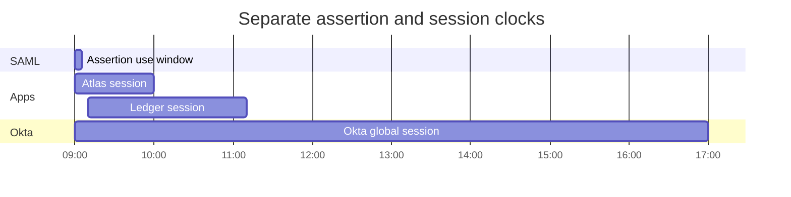
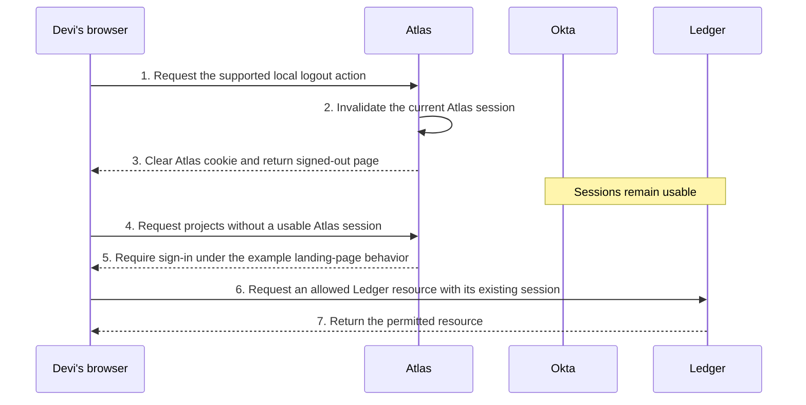
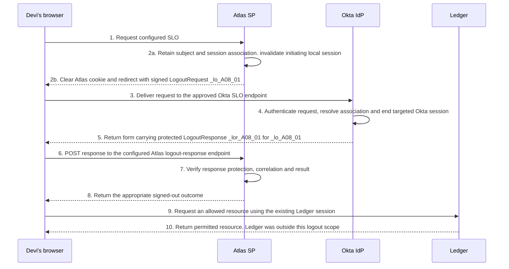

# SAML with Okta: sessions, reauthentication and logout

Devi signs out of Atlas, then opens Ledger successfully. That can be the correct result of Atlas's local logout. To evaluate it, identify which sessions existed, which action targeted them and what each service did afterward. SAML sign-in does not combine the provider and applications into one shared session.

The Northstar Research examples use Okta Identity Engine, Atlas and Ledger. Times and session lifetimes are fictional, not product defaults. Each example supplies its own starting state.

## Identify the state and its owner

| Item | Owner or role | What it is separate from |
| --- | --- | --- |
| Okta global session | Okta context for subsequent authentication and policy decisions. | Atlas and Ledger's local sessions. |
| Atlas session | Atlas's continuing signed-in state and local enforcement. | The assertion originally used to establish it. |
| Ledger session | Ledger's independent signed-in state. | Activity or logout at Atlas. |
| Browser cookie | Browser-held information used by a service's session mechanism. | Proof that the corresponding server-side session remains usable. |
| SAML SessionIndex | Authentication-session association within a federation relationship. | A browser cookie, assertion ID or LogoutRequest ID. |

Okta’s Identity Engine global session rules cover session establishment, lifetime, idle limits and cookie persistence. The application owns its local implementation; do not infer app session behavior from an Okta cookie or build custom behavior around an assumed cookie name. [Okta Identity Engine global session rules and cookies](https://help.okta.com/oie/en-us/content/topics/identity-engine/policies/add-okta-sign-on-policy-rule.htm)

Removing cookie bytes and invalidating a server session are different events. A server can refuse an old session even if the browser still holds its cookie. Removing one browser's cookie does not prove every related session elsewhere ended. [MDN: HTTP cookies](https://developer.mozilla.org/en-US/docs/Web/HTTP/Guides/Cookies)

## Read the independent clocks

| Time control | Meaning | Common wrong conclusion |
| --- | --- | --- |
| Conditions and bearer presentation limits | Restrict use of the SAML information and its presentation. | Every application session must end at assertion expiry. |
| AuthnInstant | Reported authentication time. | A newly issued response proves new authentication. |
| SessionNotOnOrAfter, when supplied | Upper bound for derived sessions under applicable processing. | It is another name for Conditions expiry. |
| Session maximum lifetime | Service-defined total-duration limit. | Activity can always extend it. |
| Idle timeout | Limit without qualifying activity under the service's rules. | Activity in any app keeps all sessions alive. |
| Browser cookie persistence | How long browser-held information is retained. | A retained cookie overrides server-side expiration. |

The optional SAML session bound and local policy must be understood together. Applicable processing does not turn all the clocks into one value. [SAML Errata 05, E79](https://docs.oasis-open.org/security/saml/v2.0/errata05/os/saml-v2.0-errata05-os.pdf)

### Compare a supplied schedule

**Figure RF-S1: Separate assertion and session intervals.** This is the established Lesson 8 example on 16 October 2026, in UTC. Bars show stated intervals, not messages. The assertion bar illustrates Conditions; bearer restrictions still apply separately.

<!-- mermaid:id=RF-S1 -->

Authentication occurs at 09:00. The assertion is issued at 09:00:05, with an illustrated Conditions window ending at 09:05:05. Atlas's session starts at 09:00:06 and ends at 10:00; Ledger's starts at 09:10 and ends at 11:10. The example Okta session ends at 17:00.

The example supplies no earlier session bound, idle expiry, logout or other invalidation, and no later sign-in replaces or extends these sessions.

| Observation time | Assertion's illustrated window | Atlas session | Ledger session | Okta session |
| --- | --- | --- | --- | --- |
| 09:30 | Ended. | Usable. | Usable. | Usable. |
| 10:30 | Ended. | Expired. | Usable. | Usable. |

At 09:30, Atlas uses its established session rather than accepting the old assertion again for each request. At 10:30, a new Atlas sign-in would be a new exchange under current requirements. It would not revive the expired assertion.

For a separate idle-time example, assume Atlas counts the last qualifying activity at 09:10 and has a 15-minute idle limit. Without more qualifying Atlas activity, that limit is reached at 09:25, even if the maximum lifetime would permit use until 10:00. Ledger activity alone does not change the supplied Atlas activity record.

## Locate the reauthentication decision

| Question | Decision owner |
| --- | --- |
| Is the existing Atlas session sufficient for this operation? | Atlas's session/action policy. |
| Is there usable Okta session context? | Okta global-session processing. |
| Are the requested integration's authentication requirements satisfied? | Applicable Okta app sign-in policy and request processing. |
| May the resulting Atlas account perform the operation? | Atlas authorization. |

Identity Engine global session policy and app sign-in policy have distinct roles. A usable Okta session does not establish that every app's current authentication requirements are satisfied. Conversely, an Atlas resource request served under a local session may not consult Okta at all. Changing an Okta rule does not prove Atlas reevaluates that rule on every page request. [Okta global session policies](https://help.okta.com/oie/en-us/content/topics/identity-engine/policies/about-okta-sign-on-policies.htm), [app sign-in policies](https://help.okta.com/oie/en-us/content/topics/identity-engine/policies/about-app-sign-on-policies.htm)

ForceAuthn requests fresh authentication. Okta's Honor Force Authentication setting and actual processing determine how the request is handled; the flag alone does not prove the returned authentication is fresh. IsPassive constrains visible interaction. If requirements cannot be met passively, an existing session does not justify bypassing them. These flags do not grant resource permission or terminate unrelated sessions. [Okta SAML field reference](https://help.okta.com/oie/en-us/content/topics/apps/aiw-saml-reference.htm)

A recent IssueInstant and an older AuthnInstant can coexist. Compare the returned evidence with the actual authentication requirement, then apply the [response acceptance requirements](response-validation-and-acceptance.md). Lesson 8's [reauthentication decision flow](../lessons/lesson-08-sessions-reauthentication-and-logout.md#83-explain-reauthentication-at-the-right-boundary) connects these owners.

## Distinguish local logout from coordinated logout

### Local Atlas logout

For this independent case, Devi has usable Okta, Atlas and Ledger sessions. Atlas's supported local-only action invalidates the current Atlas session and clears its cookie. No SAML logout messages are sent, and the other services are unaffected by that action.

**Figure RF-S2: Complete local logout and subsequent observations.** Browser arrows show requests and responses; the Atlas self-arrow changes local state. The Atlas landing behavior requires sign-in without immediately starting SSO.

<!-- mermaid:id=RF-S2 -->

Steps 1–3 perform local Atlas logout. Steps 4–5 establish that the old Atlas session no longer grants projects access. Steps 6–7 show Ledger's separate session still working. Those results agree with the supplied local-only scope.

If Atlas instead immediately starts SSO, a usable Okta session can help create a new Atlas session, subject to policy and acceptance. A rapid return to Atlas does not establish that its old session survived. Check whether the observed resource request used the old session or followed a new sign-in.

### Basic Atlas-initiated SAML SLO

Okta's basic SLO guidance describes an SP-initiated flow requiring supported app configuration and a signed request. Its documented SAML logout response return uses POST. The application's request-verification certificate at Okta is distinct from Okta's signing certificate supplied to the app. [Okta Single Logout configuration](https://help.okta.com/oie/en-us/content/topics/apps/apps_single_logout.htm)

For the following independent successful case, Atlas and Okta have approved endpoints, keys and session associations. Redirect is the selected supported request binding. Ledger is outside this basic logout arrangement and retains a usable session.

**Figure RF-S3: Complete basic SLO with its scope made explicit.** The browser carries both logout messages. Atlas retains the needed logout association while invalidating its initiating local session. That invalidation timing is this example's supported implementation choice.

<!-- mermaid:id=RF-S3 -->

Steps 1–3 deliver signed LogoutRequest `_lo_A08_01`. At step 4, Okta validates it and ends the targeted session. Steps 5–6 carry the protected reply `_lor_A08_01` in a form submitted to Atlas. At steps 7–8, Atlas verifies the response, correlation and result before reporting the outcome. Steps 9–10 show Ledger's explicitly separate scope.

If a later step fails, a local invalidation that already happened does not automatically reverse. Report the per-service result. A browser reaching a signed-out page is not proof of termination at every participant.

## Read participation, identifiers and results precisely

| Information | What to establish |
| --- | --- |
| LogoutRequest ID and issuer | Which request and sender belong to this relationship. |
| Subject, including agreed NameID format/scope | Which principal is being targeted. |
| SessionIndex, where applicable | Which session association is targeted. |
| Destination, expiry and protection | Whether the logout message is suitable for this receiver and use. |
| LogoutResponse InResponseTo and result | Which logout request the reply answers and what it reports. |

A request without SessionIndex can target all sessions for the identified principal at that participant under SAML's rules. This does not imply every device or service is selected by a particular product's logout action. [SAML Core, §§3.7.1–3.7.3](https://docs.oasis-open.org/security/saml/v2.0/saml-core-2.0-os.pdf)

Okta separately documents front-channel SLO for participating apps, currently marked Early Access in the cited guide. It uses browser-mediated notification, including an iframe path; receiving apps must invalidate their associated state. Basic SLO configuration alone does not establish that Ledger participates. Nor does the initiating reply prove every downstream callback completed. The [complete front-channel flow in Lesson 8](../lessons/lesson-08-sessions-reauthentication-and-logout.md#front-channel-notification-of-another-participating-app) shows those separate results. [Okta front-channel SLO guide](https://developer.okta.com/docs/guides/single-logout/saml2/main/)

SAML also defines server-to-server logout arrangements. The [generic SOAP example](../lessons/lesson-08-sessions-reauthentication-and-logout.md#a-direct-server-logout-alternative-in-the-saml-standard) is an awareness example, not a claim that the Okta integration supports SOAP logout. Okta's separately supported [Universal Logout capability](https://developer.okta.com/docs/guides/oin-universal-logout-overview/) is another mechanism; using SAML does not by itself enable it.

The authority's top-level logout status concerns its own termination result. A nested PartialLogout can report incomplete propagation alongside top-level Success. Do not convert that into "all participants confirmed." Establish how the selected product path exposes its per-participant results. [SAML Core, §3.7.3.2](https://docs.oasis-open.org/security/saml/v2.0/saml-core-2.0-os.pdf)

## Separate session termination from account lifecycle

| Action | Known intended boundary | Downstream result still needs evidence |
| --- | --- | --- |
| Atlas local logout | Current Atlas session under its implementation. | Okta and other application sessions. |
| End a targeted Okta session | Selected provider session. | Independently established application sessions and configured propagation. |
| Remove Atlas assignment | Okta integration access and applicable lifecycle effects. | Provisioning completion, Atlas account and existing-session handling. |
| Deactivate the Okta user | Okta account/session state and configured deprovisioning. | Completion and partner enforcement, including established app sessions. |
| Disable the Atlas account | Atlas account state. | Whether and how Atlas invalidates or refuses already-issued sessions. |

Okta deactivation stops active Okta sessions and removes assignments. It runs in the background, and downstream deprovisioning depends on enabled, applicable app behavior. An accepted administrative request therefore does not prove instantaneous completion everywhere. [Okta user deactivation](https://help.okta.com/oie/en-us/content/topics/users-groups-profiles/usgp-deactivate-user-account.htm)

In a brokered journey, the external IdP owns another session. Include that provider or another device in a logout claim only when the supported mechanism actually targets it and the evidence establishes its result.

## Explain an uncertain sign-out result

These independent fictional observations establish different limits.

| Observation | Supported conclusion | Next useful evidence |
| --- | --- | --- |
| Atlas's cookie disappears. | A browser-held value changed. | Atlas server-session invalidation and a fresh protected request. |
| Ledger's logout request was scheduled; no callback is recorded. | Participant completion is unconfirmed. | Delivery, Ledger processing, callback and protected-resource evidence. |
| A protected request succeeds after sign-out. | The service supplied access on that request. | Whether it used the old session or completed new authentication. |
| An old page remains visible without a network request. | Cached/displayed content remains visible. | A fresh protected operation and its server result. |

An absent callback does not prove Ledger stayed signed in: it may have invalidated its session before the response was lost. It also does not prove logout succeeded. A precise report can say: "Atlas and the targeted Okta session ended; Ledger's result is unconfirmed." Identify the user, browser/device, targeted sessions, participants and time behind that statement.
