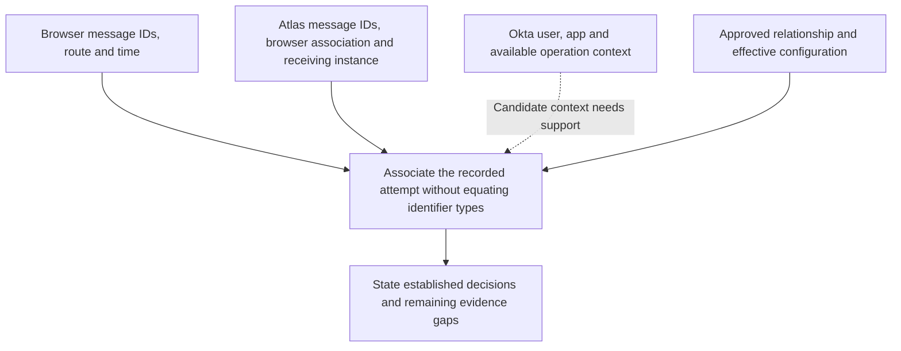

# SAML with Okta: troubleshooting evidence

A useful SSO investigation connects an observed symptom to a particular attempt and a particular decision. Daniel needs to explain what Okta recorded, what the browser delivered and what Atlas decided. Those observations complement one another; none speaks for every system.

The examples use the fictional Northstar Research integration, Devi and Atlas. Evidence tables are normalized teaching summaries, not actual Okta event names, an application log format or a promised vendor schema. Addresses ending in `.example`, message IDs and record labels are fictional.

## Establish the attempt before comparing records

| Context to record | Why it matters |
| --- | --- |
| Okta org, integration instance and application environment | Test and production can have similar names with different trust and targets. |
| User and intended application account | An Okta login name, emitted identifier and Atlas account ID can differ. |
| Requested resource and expected permission | A successful sign-in does not establish administrative access. |
| Time, time zone and useful precision | Nearby records may concern another retry or browser tab. |
| Browser/device context and starting sessions | Existing Atlas access may avoid a new federation exchange. |
| Launch and protocol path | Requested, deliberately unsolicited and generic artifact paths need different associations. |
| Scope of the symptom | One user, one receiving node or one launch path can narrow the investigation. |
| Relevant change and effective state | A proposed or saved setting may differ from what a runtime instance uses. |

Keep retries separate until the evidence connects them. A useful attempt label is a local investigation aid; it does not replace the protocol IDs or the systems' own records.

## Use each source within its scope

| Source | What it can help establish | What it does not establish alone |
| --- | --- | --- |
| Browser/network evidence | Requests, redirects, submitted forms, receiving routes and browser continuation. | Cryptographic validity or Atlas's internal acceptance decision. |
| Okta System Log | Logged org-side time, actor, target and processing observations. | Atlas's account match, session creation or resource permission. |
| Atlas receiving diagnostics | The message, selected integration/instance and recorded acceptance checks. | Unlogged downstream decisions or other nodes' effective state. |
| Atlas application/session records | Account lookup, entry result, session transition and resource decision. | Why an earlier provider-side action occurred. |
| Approved requirements and effective configuration | Expected behavior and the configuration actually used by each participant. | That a particular attempt exercised those settings successfully. |

Okta's System Log supports inspection and filtering of event details by context such as time, actor and target. Begin with the relevant org, app and time window, then inspect available operation context. A missing search result needs checks of filters, time zone, retention, access and event scope before it can support a conclusion about absence. [Okta System Log](https://help.okta.com/oie/en-us/content/topics/reports/reports_syslog.htm), [filters and search](https://help.okta.com/oie/en-us/content/topics/reports/syslog-filters.htm)

An assertion preview is generated-output inspection. It can help compare configured output with the identity contract, but is not a record of browser delivery or Atlas acceptance. [Okta assertion preview](https://help.okta.com/oie/en-us/content/topics/apps/apps_app_integration_wizard_saml.htm)

## Associate identifiers without making them equal

| Identifier | Meaning in the investigation |
| --- | --- |
| AuthnRequest ID | The SP's particular authentication request. |
| Response ID | The particular protocol reply. |
| Assertion ID | The assertion being evaluated, including applicable replay handling. |
| InResponseTo | A reply or presentation's relationship to the request it answers. |
| NameID and its agreed scope | The supplied subject relationship used for identity interpretation. |
| Application account ID | The local record actually selected. |
| Okta event `uuid` | Identity of an individual System Log event. |
| Okta `transaction.id` | Context linking events in an Okta operation. |
| Okta `authenticationContext.externalSessionId`, when present | Context for events within an Okta user session. |

Okta event, operation and session identifiers are different. They do not have a universal one-to-one relationship with each other or with SAML messages. The documented correlation examples include events with no granted user session. Do not equate an Okta event ID with AuthnRequest ID, or assume one Okta transaction spans the whole browser journey. [Okta System Log query: event correlation](https://developer.okta.com/docs/reference/system-log-query/)

Similarly, a Response's InResponseTo points to the initiating request rather than repeating its own Response ID. Use the [field comparison](field-comparison-and-message-anatomy.md#message-participant-subject-and-local-session-identifiers) to locate these values. For unsolicited or artifact journeys, use the [binding reference](binding-comparison.md) and the applicable path rather than inventing a missing request association.

**Figure RF-E1: Combining evidence for one attempt.** Arrows show contributions to an evidence association, not message movement, trust establishment or equal identifiers. The dotted provider connection needs its available contextual support; matching a user and approximate time alone is insufficient.

<!-- mermaid:id=RF-E1 -->

Browser and receiving records can connect the same message values to an endpoint, time and browser/request context. The provider's own event identifiers help investigate its operations. Approved configuration identifies the relationship being tested. Conclusions must remain limited when one of those associations is missing or ambiguous.

## Build a packet progressively

### Start with delivery and an unresolved application result

For this independent example, Devi starts a requested sign-in from Atlas production without a usable Atlas session. The intended resource is `/projects`. The following observations concern 16 October 2026; all displayed times are UTC. Atlas's retained context identifies the expected Okta provider and browser context `BROWSER-A`, which is a symbolic label rather than a cookie value.

| Record | Source and observation |
| --- | --- |
| R1 | Atlas request record at 14:20:00 retains `_req_EV_01` for the expected provider, BROWSER-A and approved projects target. |
| B1 | Browser evidence shows AuthnRequest `_req_EV_01`, then a POST to the production ACS at 14:20:13 with Response `_resp_EV_01`, readable Assertion `_assert_EV_01` and response/confirmation correlation to `_req_EV_01`. A generic sign-in error page follows. |
| O1 | An Okta observation at 14:20:12 reports satisfied authentication/policy processing for Devi and the intended app in that window. No direct message-level link is supplied in this summary. |

R1 and B1 establish a requested journey and the observed POST/error-page path. They do not identify Atlas's internal processing result or prove that the application verifier ran. Decoding the browser's XML does not independently verify its protection. O1 is a relevant candidate provider observation; app, user and nearby time alone do not prove which response it concerns.

At this stage, Atlas's acceptance, account, session and resource results remain unresolved. The next useful evidence is Atlas's receiving and application result for these message IDs and retained context. Replacing the certificate or granting a role is not justified by this packet.

### Add the receiving decision

The following additional record is now supplied:

| Record | Source and observation |
| --- | --- |
| A1 | Atlas production node A at 14:20:13 identifies `_resp_EV_01` and `_assert_EV_01` against the retained `_req_EV_01` and BROWSER-A. It records successful required SAML acceptance under approved trust. Accepted employee identifier `E1042` selects intended account `atlas-4821`, but entry is denied because that account is disabled. No Atlas session is created. |

A1 resolves the application's stopping point for the associated submission. It establishes accepted SAML followed by account-entry denial. Projects permission was not exercised, and enabling the account would require the intended access decision. The original reason for disablement remains outside the supplied evidence.

The compatible O1 observation still does not acquire an invented SAML-message-ID field. The receiving evidence is sufficient for the stated Atlas result without overstating the provider-event association. A report can preserve that limit while identifying the application owner who can assess intended account state.

The [complete requested flow in Lesson 10](../lessons/lesson-10-troubleshooting-and-engineering-casework.md#case-s-atlas-creates-the-request) shows where these decisions fit in browser movement. The [acceptance reference](response-validation-and-acceptance.md) explains why accepted SAML can coexist with no new application session.

## Choose evidence that distinguishes the remaining explanations

Each row is an independent observation, not a continuation of the packet above.

| Current observation | Smallest useful next comparison | Conclusion to avoid |
| --- | --- | --- |
| Generic signature verification failure. | Selected approved key, signed object/reference, permitted algorithm and reported failure stage. | The certificate is definitely expired. |
| Delivered response, no confirmed receiving result. | Actual receiving route/instance and its matching message record. | Atlas accepted it because the form arrived. |
| Correct source employee value, but no account match. | Actual emitted scoped identifier and Atlas's lookup result. | Correct source data guarantees correct output. |
| A repeated browser submission is rejected. | Original assertion acceptance, request completion and new attempt history. | Time validity authorizes reuse. |
| Atlas repeatedly starts SSO. | Receiving outcome, session creation, cookie use and the next resource request. | Every loop is a cookie problem. |
| One node succeeds after K2 cutover. | Observed key and effective trust/acceptance on each relevant receiver. | All receiving nodes adopted K2. |
| Logout callback is missing. | Participant delivery, processing and fresh protected-resource evidence. | The session definitely survived or definitely ended. |

A failed bearer deadline needs the actual Conditions interval, selected confirmation limit, receipt time, clock evidence and approved tolerance. Clock disagreement and real delivery delay are different explanations. The [acceptance time examples](response-validation-and-acceptance.md#read-the-established-time-example-precisely) show the boundaries without treating every late arrival as skew.

In brokered federation, keep the external-IdP-to-Okta result separate from Okta-to-Atlas acceptance. In generic artifact delivery, a browser reference arriving does not establish successful server retrieval. Identify the relationship that owns the missing decision before requesting more browser data.

## Preserve useful evidence without spreading sensitive material

Use approved capture, storage and sharing procedures. Assertions, cookies and sensitive references can contain identity data or bearer material. A decoded or Base64-encoded value is not automatically safe to distribute. Include the relevant decision, IDs and comparison results in a support summary rather than attaching an entire trace by default.

Where authorized evidence needs redaction, keep aliases consistent across records so necessary relationships remain understandable. Edited XML is not the original signed input and cannot demonstrate that the original signature verified. Preserve any required original evidence only in its approved restricted location, and record the limitation of a sanitized copy. [OWASP logging guidance: data to exclude and log protection](https://cheatsheetseries.owasp.org/cheatsheets/Logging_Cheat_Sheet.html)

## Write a handoff that another engineer can use

| Handoff item | Include |
| --- | --- |
| Scope and impact | User, org/integration, environment, resource, time and affected instances. |
| Starting state and path | Existing sessions, initiation and relevant federation legs. |
| Evidence association | Source references, meaningful IDs and any uncertain joins. |
| Established outcome | What passed, the known failure and resulting session/resource state. |
| Remaining uncertainty | Missing decision, competing explanations or untested later requirements. |
| Next action and owner | Observation or scoped proposal tied to the failed boundary. |
| Verification result | Fresh permitted/rejection outcomes actually observed; proposed tests remain identified as proposed. |

For the packet above, a useful note is:

> Atlas production node A accepted response `_resp_EV_01` and assertion `_assert_EV_01` for retained request `_req_EV_01` in the recorded browser context. The accepted employee identifier selected Devi's intended account `atlas-4821`. Entry was denied because that account was disabled, so no Atlas session was created and projects access was not exercised. The account owner needs to assess the intended lifecycle state and reason for disablement. Nearby Okta activity is consistent with this window, but a direct provider-event-to-message association has not been established. No repair has been applied or verified.

When a correction is authorized, a fresh attempt must establish the intended result. If it reaches another failure, update the report with that newly observed boundary. A plausible fix, an improved preview or one successful node does not by itself establish complete recovery.
