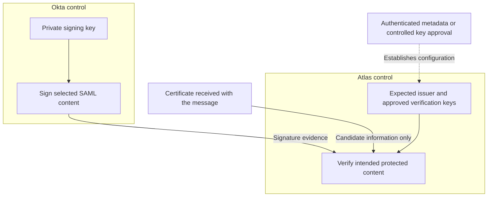
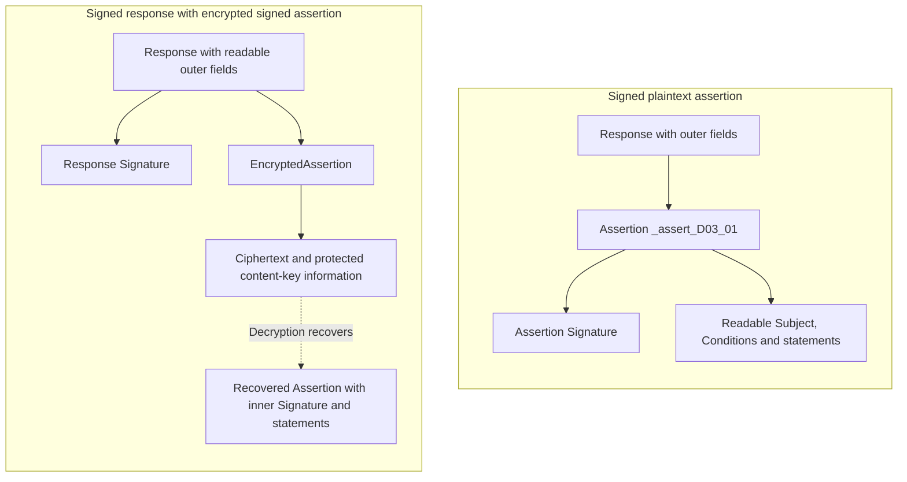
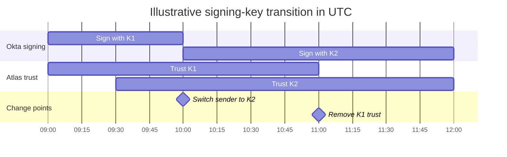

# SAML with Okta: trust and protection

When Atlas receives identity information for Devi, it needs more than readable XML. It needs an approved provider relationship, the required protection over the content it will use, and acceptable SAML and application results. A certificate appearing in the message does not establish all of these.

The examples use the fictional Northstar Research integration: Okta is the IdP and Atlas is the SP. Atlas requires a signed assertion. Key labels K1 and K2 are discussion labels, not values to paste into configuration.

## Match the mechanism to the question

| Mechanism | Question it helps answer | Limit to keep in mind |
| --- | --- | --- |
| Digital signature | Does the protected content verify under this signing key? | The key must also be approved for the expected issuer and relationship. A signature does not hide the content. |
| Encryption | Can the intended recipient recover the protected content? | Successful decryption alone does not identify the sender. |
| HTTPS/TLS | Is this connection protected under its negotiated security and peer-authentication rules? | Browser-mediated delivery involves separate connections. TLS does not replace required SAML message protection. |
| Base64 encoding | How are these bytes represented as text? | Encoding does not establish secrecy or origin. |
| Digest or hash | Does the processed input produce this digest? | A digest alone does not establish who supplied it. |

For the complete browser-mediated message path, see the [binding comparison](binding-comparison.md#follow-the-complete-atlas-exchange). Signing protects selected message content as it passes through the browser; encrypted assertions can additionally conceal their protected contents. These protections still leave session cookies and other connection traffic needing appropriate transport security. [OWASP SAML security guidance](https://cheatsheetseries.owasp.org/cheatsheets/SAML_Security_Cheat_Sheet.html)

## Identify the key owner before choosing a certificate

| Operation | Private capability stays with | Public information the other participant needs |
| --- | --- | --- |
| Okta signs an assertion or response for Atlas. | Okta, as signer. | Atlas needs approved Okta signature-verification information. |
| Atlas signs a request to Okta, where configured. | Atlas, as signer. | Okta needs approved Atlas signature-verification information. |
| Okta encrypts an assertion for Atlas. | Atlas retains the private decryption capability. | Okta needs Atlas's approved public encryption information. |

A public certificate can carry a public key. It does not give its holder the corresponding private signing or decryption capability. Partners exchange approved public information; private keys are not partner setup values.

### Establish trust independently of the received claim

**Figure RF-T1: Atlas's trust boundary.** Boxes group control and ownership. Solid arrows show cryptographic input or use; the dotted arrow shows approved configuration. These are not browser message deliveries. The candidate certificate cannot authorize itself.

<!-- mermaid:id=RF-T1 -->

Okta controls the private signing key. Atlas controls the expected issuer and permitted verification keys for its integration. Atlas can use received key information as a candidate, but the approval relationship must come from authenticated metadata or another controlled trust arrangement.

`KeyInfo` inside a signature supplies key-related information; its presence does not establish that the identified key is authorized for Northstar's Okta integration. Likewise, a matching issuer string is a claim until the required trust and message checks connect it to acceptable protected content. [W3C XML Signature, §§3.2 and 4.5](https://www.w3.org/TR/xmldsig-core1/)

A certificate fingerprint compares certificate bytes under the agreed fingerprint algorithm. A fingerprint copied from the same unverified message is not independent approval. A replacement certificate may contain the same public key, so a changed certificate and a changed key are separate facts to establish.

### Check which certificate rules the receiver actually applies

Federation trust can differ from browser website validation. The SAML Metadata Interoperability Profile defines trust based on accepted metadata and represented keys, rather than independently treating certificate fields as a Web PKI policy. Under that named model, a self-signed certificate is not inherently a failure. A public-CA certificate does not automatically authorize its key for a particular issuer either.

Establish Atlas's documented trust model, including certificate-date, chain and revocation handling. Do not assume every SP implements the named profile or automatically rejects a federation key when a certificate expires. [SAML Metadata Interoperability Profile, §§2.3–2.6](https://docs.oasis-open.org/security/saml/Post2.0/sstc-metadata-iop.pdf)

## Locate the protected layer

| Protection arrangement | Content to examine | Conclusion to avoid |
| --- | --- | --- |
| Signed assertion | The intended Assertion selected by the reference and transforms. | That its signature also covers outer Response fields or RelayState. |
| Signed response | The Response content selected by its reference and transforms. | That any nearby or separately selected XML object was therefore verified. |
| Encrypted assertion | EncryptedAssertion and the recovered assertion under the supported construction. | That successful decryption establishes an approved signer. |
| Signed response containing an encrypted, signed assertion | Outer protected response and recovered inner protected assertion. | That one generic verify/decrypt order is safe for every construction. |

**Figure RF-T2: Expand from signed content to encrypted layers.** Solid arrows mean containment. The dotted recovery arrow means decryption exposes an inner object for further processing. The encrypted branch is an illustrative supported construction, not an Okta default. Both branches retain Atlas's signed-assertion requirement.

<!-- mermaid:id=RF-T2 -->

In the plaintext branch, Assertion `_assert_D03_01` contains the signature and readable identity information. Its enclosing Response is a different object. In the encrypted branch, an outer response signature and encrypted assertion add layers; the inner assertion signature becomes available after recovery. Signed content can remain readable, while encrypted content still needs its required origin and integrity checks.

The amended browser SSO rules allow the response or enclosed assertions to supply the required POST signature protection. Atlas's narrower requirement still applies: a supported response-signing option does not waive its assertion-signing contract. Encryption processing depends on the actual construction. E93 addresses surrounding integrity protection for CBC encryption; do not generalize a diagram into an "always decrypt first" rule. [SAML Errata 05, E93](https://docs.oasis-open.org/security/saml/v2.0/errata05/os/saml-v2.0-errata05-os.pdf)

In a public-key XML Encryption arrangement, a content key encrypts the assertion and a key-transport mechanism protects that key for Atlas. Content encryption and key transport are separate algorithm roles. Possessing Atlas's public encryption information does not make a sender Okta. [W3C XML Encryption, §2.2](https://www.w3.org/TR/xmlenc-core1/)

## Connect the verified content to the identity used

Signature processing involves reference validation over the selected, transformed content and signature-value validation over canonicalized SignedInfo. Both are needed. Canonicalization provides a defined representation; it does not make arbitrary XML edits harmless. The signature algorithm, digest algorithm and certificate's own signature algorithm have different roles. [W3C XML Signature, §§3.2–4.4](https://www.w3.org/TR/xmldsig-core1/)

Suppose Atlas verifies assertion A but obtains the NameID used for account lookup from assertion B. The successful verification does not protect that chosen identity. This verified-versus-consumed mismatch is central to XML signature wrapping problems. Safe processing needs constrained content selection, unambiguous references and use of the actual verified object. A generic search for the first NameID cannot establish those properties. [W3C XML Signature Best Practices, §3.1.5](https://www.w3.org/TR/xmldsig-bestpractices/)

For an Atlas attempt, connect these facts in the evidence:

1. The expected provider and approved key apply to this integration.
2. The required signed layer and intended object are selected unambiguously.
3. Permitted algorithms and complete signature checks pass.
4. Atlas uses that verified object's identity and restrictions.
5. Applicable target, time, request association, replay, account and access requirements also pass.

This is a set of linked requirements, not a universal parser or cryptographic execution order. [Lesson 6](../lessons/lesson-06-trust-signatures-and-encryption.md#63-connect-the-signature-to-the-exact-content-used) explains the internal relationships; [Lesson 7](../lessons/lesson-07-response-acceptance-and-access.md) connects protection to acceptance.

## Read Okta's protection settings in the correct direction

| Outbound app-integration setting or information | Meaning for the relationship |
| --- | --- |
| Response and Assertion Signature | Separate choices of signed layer. |
| Signature Algorithm and Digest Algorithm | Separate roles in message-signature processing. |
| Assertion Encryption | Whether the assertion output is encrypted. |
| Encryption Algorithm and Key Transport Algorithm | Content protection and content-key protection respectively. |
| Encryption Certificate | Atlas's public recipient information used by Okta. |
| Signature Certificate | Application public information used by Okta to validate application-supplied sign-in and SLO requests. |
| Okta SAML signing certificate supplied to Atlas | Provider verification information Atlas needs for Okta-signed content. |

The **Signature Certificate** upload and the **Okta signing certificate** supplied to the SP have different directions. Naming the operation and key owner first prevents a misleading "replace the certificate" request. Effective support and required combinations must agree with the application. [Okta SAML field reference](https://help.okta.com/oie/en-us/content/topics/apps/aiw-saml-reference.htm)

Use currently approved algorithms supported by both participants. Do not copy obsolete algorithms from historical SAML examples or weaken required verification to make a test pass. [OWASP SAML security guidance](https://cheatsheetseries.owasp.org/cheatsheets/SAML_Security_Cheat_Sheet.html)

## Separate generation, activation and receiver adoption

Generating a new certificate makes material available. Activating selects sender use. Receiver adoption updates what Atlas accepts. None of these proves the other two happened. Okta documents available certificates, activation and app setup information; it recommends keeping the app-only certificate active. [Okta signing certificate management](https://help.okta.com/oie/en-us/content/topics/apps/manage-signing-certificates.htm)

**Figure RF-T3: Coordinated signing-key transition.** This is Lesson 6's fictional 20 October 2026 schedule, in UTC. Atlas supports controlled multi-key trust, and K1 remains uncompromised and permitted during overlap. Bars show signing and trust states, not assertion or session lifetimes.

<!-- mermaid:id=RF-T3 -->

At 09:30, Atlas adopts K2 while Okta still uses K1. At 10:00, Okta switches to K2. At 11:00, Atlas removes K1 after the agreed checks. The chart ends at noon for display; K2 does not expire at that point. The overlap is an example supported plan, not a standard waiting period or Okta guarantee.

Before cutover, Daniel needs the approved new public information, supported receiver update behavior, actual readiness across the receiving instances and an agreed recovery decision. A metadata URL does not prove automatic refresh. An import into one node does not prove fleet adoption. Before retiring K1, verify observed K2 use and acceptance, in-flight message handling and applicable cache/rollback needs.

If Atlas accepts only one key, this overlap plan does not apply. Use its supported coordinated replacement arrangement. If K1 may be compromised, keeping or restoring it preserves unwanted signing authority. Incident response also needs to assess sessions already created; removing a verification key does not automatically erase them.

Certificate validity dates, approved key usage, metadata validity/refresh, assertion expiry and application-session lifetime are separate controls. Define which deadlines each implementation enforces instead of treating "expired" as a complete diagnosis.

## Diagnose the failed boundary

These are independent fictional reports. The supplied facts support a limited conclusion.

| Report | Supported conclusion | What remains to establish |
| --- | --- | --- |
| A certificate is embedded in the response; no approved trust record is identified. | A candidate key was supplied. | Its authorization for the expected provider and integration. |
| Atlas decrypts an assertion, but required signature verification fails. | Recovery succeeded; required origin/integrity protection did not pass. | Specific key, reference, algorithm or content failure. |
| A signature over A passes, but Atlas selects identity from B. | The verification does not protect the identity consumed. | Correct secure object selection and all later acceptance results. |
| Okta signs with approved K2; Atlas runtime trusts only K1 and reports no matching verification key. | Sender use and receiver trust disagree. | Successful verification and later decisions after an authorized correction. |
| Atlas node A accepts K2; node B still trusts only K1. | One successful node does not establish rollout completion. | Effective trust and outcomes on every relevant receiver. |
| Atlas verifies the required signature, then rejects the audience. | Protection passed, but the assertion is unsuitable for that audience check. | Correct intended relying party and environment configuration. |

A generic "signature invalid" message supplies less evidence than a specific key-selection or reference failure. Record the observed processing result before proposing a certificate, algorithm or endpoint change. The [troubleshooting lesson](../lessons/lesson-10-troubleshooting-and-engineering-casework.md) develops that evidence-based approach.
